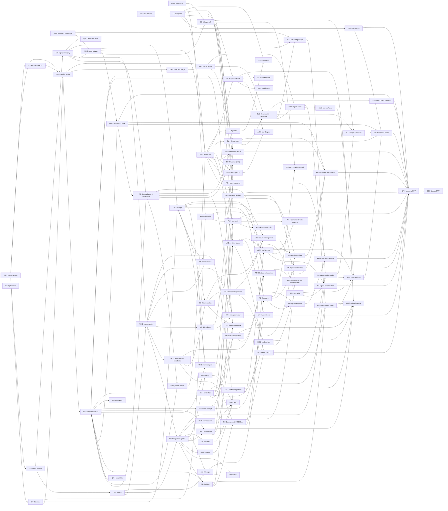

# Découpage du MVP

> **Décisions du fondateur du 2026-10-14 intégrées** (§ 7). Ce document reprend l'étude du 2026-10-13 sur le découpage du MVP pour un essaim d'agents, les ajustements de la synthèse (format dossier du [modèle de projet](../architecture/02-modele-projet.md), banc de charge QA-7), puis les quinze décisions du fondateur : les pistes audio et l'automation entrent dans le MVP, le moteur n'a plus de capacités fixes, le dossier réel devient le stockage par défaut. L'étude s'appuie sur le code de l'issue #2 (fusionnée dans `develop`, commit `03ee512`) ; le code reste la source de vérité. Le statut reste `draft` tant que le document n'a pas été vérifié contre le code.

## 0. Objectif du MVP

Objectif du fondateur : **arriver à la création d'un projet multi-pistes avec différents instruments, dans les différents modes.**

À la fin du MVP, un utilisateur (ou un agent MCP) peut :

1. créer un projet, plusieurs pistes MIDI et audio, chacune avec un instrument (ou un lecteur de clips audio) et une chaîne d'effets ;
2. jouer en direct sur la piste sélectionnée (MIDI, clavier de l'ordinateur), en mode Web comme en mode Boost ;
3. créer, éditer (piano roll) et enregistrer des clips MIDI ;
4. importer des fichiers audio (échantillons, boucles, stems) et les jouer comme clips, lus en flux depuis le disque ;
5. lancer des clips et des scènes dans une **grille de lancement**, avec quantification ;
6. placer des clips sur une **timeline d'arrangement** et la jouer en boucle ;
7. automatiser les paramètres des devices et du mixeur : dessiner et éditer des points, les entendre à l'échantillon près, et si c'est faisable enregistrer les mouvements de paramètres ;
8. piloter le transport (lecture, arrêt, boucle, tempo, métronome) ;
9. mixer (volume, panoramique, mute, solo, vu-mètres) ;
10. enregistrer le projet dans un dossier, le rouvrir, et obtenir le même rendu ;
11. faire tout cela par commandes typées, exposées en outils MCP.

Hors MVP (décision 5 du § 7) : l'**enregistrement audio** (il arrive juste après le MVP ; le format et le stockage lui réservent déjà sa place), le **recalage temporel** des clips audio (warping, audio élastique : hors MVP sauf s'il se révèle trivial, ce qui n'est pas attendu ; les clips audio sont non élastiques, voir [modèle de projet](../architecture/02-modele-projet.md) § 1.2), l'Atelier et la compilation Faust à la volée ([spec de l'Atelier](01-atelier-modules.md)), les sessions ACP (qui arrivent avec l'Atelier), les changements de tempo dans le temps, les envois et retours, les plugins tiers CLAP/VST3, WebMCP, les versions et variantes dans l'application.

## 1. Constat sur le code de l'issue #2

| Constat | Conséquence pour le MVP |
| --- | --- |
| `Command::apply(&self, synth: &mut Synth)` : les commandes agissent directement sur **un** synthé du moteur. | Il manque un **modèle de projet** distinct du moteur : les commandes modifient le projet, qui produit les messages moteur. |
| Un seul `enum Command` avec trois `match` (`name`, `apply`, `undo_kind`) dans `crates/commands/src/lib.rs`. | Point chaud de conflits dès que dix agents ajoutent des commandes. |
| Le mappage commande → moteur est écrit en TypeScript côté Web (`web/src/lib/engine/wasm-ops.ts`) et en Rust côté Boost (`helper/src/audio.rs::engine_event`). | Risque de divergence Web/Boost : il faut **un seul chemin**, en Rust, partagé par les deux cibles. |
| `Session.run` dans `web/src/lib/session.svelte.ts` est un `switch` par type de commande. | À remplacer par un dispatcher générique. |
| Un export C `fk_*` par opération dans `engine-wasm`. | À remplacer par une boîte de réception binaire unique (`fk_push`) et une boîte d'envoi (`fk_feedback`). |
| `web/src/lib/i18n.ts` : un seul fichier de chaînes ; `App.svelte` : un seul écran. | Points chauds de conflits pour l'interface. |
| Pas de temps musical, de piste, de clip, d'identifiant stable. | Tout le socle est à construire avant les fonctions visibles. |
| Mode Boost écrit mais non vérifié. | À vérifier avant d'empiler le multi-pistes dessus. |
| Pas d'isolation cross-origin : les commandes vont au worklet par `postMessage`. | À activer avant le canal partagé vers le moteur et avant les pistes audio (décision 4). |

## 2. Décisions d'architecture du socle

Les décisions 1 à 4 et 7 à 8 du § 7 fixent ce socle ; les tâches de contrat de la phase 0 le figent en code. Ce qui reste à trancher l'est dans la tâche de contrat nommée.

### 2.1 Qui possède l'état du projet (décidé)

- Nouvelle crate **`crates/project`** : le document (projet, pistes MIDI et audio, devices, scènes, emplacements de clips, clips MIDI et audio, notes, arrangement, couloirs d'automation, réglages du transport), pur Rust, `serde`, sans I/O ; son format sur disque est celui du [modèle de projet](../architecture/02-modele-projet.md). Elle modifie la table « Stack and layout » de `CLAUDE.md` (fait par CT-1, qui crée les crates).
- `crates/commands` applique les commandes **au projet**. L'étude propose `apply(&mut Project, Command) -> Result<Outcome, CommandError>`, où `Outcome` contient la sortie typée, l'inverse (annulation), les `ProjectEvent` (pour l'interface) et les `ControlMsg` (pour le moteur). Le [modèle de projet](../architecture/02-modele-projet.md) § 5.2 propose au contraire un modèle persistant (`apply(&Project, Command) -> Result<(Project, Outcome), CommandError>`, annulation par instantané). Les deux contrats s'excluent comme base de PR-2 : **CT-4 choisit** l'un d'eux (ou la variante hybride décrite dans le modèle de projet), et les deux documents seront alignés sur ce choix.
- **La page possède le projet, dans les deux modes** (décision 1) : le cœur projet + commandes est compilé en WASM (`crates/project-wasm`, `wasm-bindgen` permis car il tourne sur le thread principal, pas dans le worklet). En mode Boost, la page envoie au helper les `ControlMsg`, pas les commandes ; le helper reste un pont sans logique produit, son serveur MCP relaie les appels d'outils vers la page, et il lit et écrit le dossier du projet pour le compte de la page (AU-7).
- Conséquence : basculer Web ↔ Boost = rejouer un **instantané** du projet vers l'autre moteur ; ouvrir un projet = même mécanisme.

### 2.2 Temps musical

- Positions et durées en **ticks entiers**, 960 par noire (`i64`) ; positions dans un fichier audio en **frames** entières.
- Tempo constant par projet (`f64` BPM, 20–999), signature rythmique ; pas de changement de tempo dans le temps au MVP.
- Le moteur convertit ticks ↔ échantillons avec une position `f64` ; les événements (notes, points d'automation, départs de clips audio) sont placés **à l'échantillon près** (découpage du bloc aux offsets).
- **Quantification de lancement** (décision 8) : globale au projet, **1 mesure par défaut**, réglable parmi : aucune, 1/16, 1 temps, 1, 2, 4, 8 mesures. Un réglage par clip viendra plus tard : champ optionnel dans le fichier du clip, absent = réglage global. Boucle du transport : région `[début, fin)` en ticks.

### 2.3 Synchronisation projet → moteur sans verrou et sans plafond visible

Un seul code pour les deux cibles :

1. **`ControlMsg`** (encodage binaire compact) : ce que le projet envoie au moteur (créer une piste, insérer un device, régler un paramètre, téléverser les notes d'un clip, téléverser un couloir d'automation, déclarer une source audio, lancer un clip, jouer…).
2. `Engine::prepare(ControlMsg) -> RtMsg` : **hors chemin audio**, peut allouer (construire un device, un tampon de delay, une table de notes, une table de pistes plus grande).
3. `Engine::apply(RtMsg)` : **sur le chemin audio**, sans allocation, en début de bloc ou à l'offset indiqué ; ce qui est remplacé (y compris une ancienne table de pistes) part dans une file de « déchets » libérée hors chemin audio.
4. **`Feedback`** (moteur → page) : tête de lecture, état des clips, vu-mètres par piste, notes enregistrées, charge processeur, compteurs de sous-alimentation disque, à environ 30 Hz.

**Pas de plafond visible** (décision 7). Le moteur n'a pas de capacités fixes : quand une structure est pleine, `prepare` en construit une plus grande hors chemin audio et `apply` l'échange en un bloc, sans allocation en temps réel. Il n'existe qu'une **limite de sûreté très haute** (chiffrée par CT-3, par exemple 4 096 pistes, 16 777 216 notes, 1 024 événements par bloc) que le projet refuse par une erreur typée avant que la commande n'atteigne le moteur : le moteur n'échoue jamais en temps réel. Le banc de charge (QA-7) mesure le coût de ces échanges sur de très gros projets.

Par cible :

- **Natif (helper)** : `prepare` sur un thread de contrôle, `RtMsg` vers le callback audio par `rtrb`, déchets en retour par un second `rtrb`.
- **WASM** : le `onmessage` d'un `AudioWorklet` s'exécute **sur le thread de rendu**, comme `process` ; y appeler un `prepare` qui alloue violerait la règle « hors chemin audio ». L'isolation cross-origin étant acceptée (décision 4, tâche AU-0), la **cible est la mémoire partagée** : `prepare` tourne dans un Worker dédié qui partage la mémoire du moteur (`WebAssembly.Memory` partagée, build WASM avec atomics), et le worklet ne lit qu'un anneau lock-free, comme dans le helper. **CT-3 fige ce chemin** et vérifie sa faisabilité (mémoire partagée entre un Worker et un `AudioWorklet`, un seul module WASM instancié deux fois sur la même mémoire). Le repli, documenté seulement si la cible se révèle impossible : `onmessage` copie des octets bornés dans une boîte de réception préallouée du worklet, et toute croissance de structure passe alors par un message qui porte la structure déjà construite (le worklet n'alloue toujours pas). Dans les deux cas, le module réserve sa mémoire au démarrage et le coût du `MessageEvent` créé par le navigateur sur le thread de rendu est mesuré.
- Le mappage commande → messages vit en Rust (`crates/commands`), jamais en TypeScript.

### 2.4 Contrat de commande v2

- Nom `domaine.verbe` (`track.create`, `clip.notes.add`, `transport.play`).
- Entrée **et sortie** typées (`schemars`) ; la sortie donne les identifiants créés.
- **Identifiants stables** (`TrackId`, `ClipId`, `SceneId`, `DeviceId`, `LaneId`) générés par le projet, jamais des index ; le projet tient la correspondance identifiant → emplacement moteur. Le `NoteId` est à trancher : le [modèle de projet](../architecture/02-modele-projet.md) écrit les notes sans identifiant sur disque.
- Métadonnées de schéma : `x-undo` (`inverse`, `host`, `none`, et `snapshot` si l'annulation par instantané du modèle de projet est retenue), `x-destructive` (confirmation obligatoire), `x-kind` (`edit` entre dans l'historique, `live` éphémère comme une note jouée, la lecture ou le solo, `query` lecture seule).
- Historique : pile annuler/rétablir, **groupes** (un glisser de souris, un tour d'agent = une annulation), **auteur** sur chaque entrée (`user`, `agent:<nom>`).
- Disposition anti-conflits : un module par domaine (§ 5).
- Question ouverte, tranchée dans CT-4 (choix technique, pas une décision du fondateur) : l'état de vue (sélection, zoom, défilement, vue affichée) est-il une commande ? Proposition : non pour le zoom et le défilement ; oui pour la sélection de piste (`view.select_track`, `x-kind: live`), qui décide où va le MIDI live et qu'un agent doit pouvoir lire.

### 2.5 Contrat de device (instrument, effet, lecteur de clips)

- Trait `Device` dans `crates/engine` : `process(&mut self, ctx: &BlockCtx, events: &[Event], io: &mut AudioIo)`, `set_param(id, value)`, `reset()`. Sans allocation, sans panique. Les événements portent un offset dans le bloc ; ils incluent les notes **et les valeurs de paramètres** (`ParamValue { offset, id, value }`), pour que l'automation (AM-2) tombe à l'échantillon près.
- Descripteur statique par type : `kind` (`"faulk.osc_synth"`), rôle, paramètres (id stable, clé de nom, unité, min, max, défaut, échelle, pas, **temps de lissage**, valeurs énumérées). Exporté dans le schéma : l'interface **génère** les panneaux de réglage et les agents connaissent les paramètres.
- Un fichier par device (`crates/engine/src/devices/<kind>.rs`) et un registre d'une ligne par device. Le lecteur de clips audio (`faulk.clip_player`, AU-4) est un device de rôle instrument : une piste audio est une piste dont l'instrument lit des clips audio.
- Les futurs modules de l'Atelier implémenteront ce même contrat.

### 2.6 Interface

- `Session` est découpée en : **dispatcher** (`run(command)` générique vers `project-wasm`), **store projet** (miroir réactif alimenté par les `ProjectEvent`), **store moteur** (statut, mode, latence, tête de lecture, vu-mètres, alimenté par le `Feedback`).
- Les vues lisent les stores et n'appellent que `run`.
- Composants partagés à figer tôt : `TimeGrid` (règle, zoom, aimantation, conversion ticks ↔ pixels), `ParamControl` (bouton généré depuis un descripteur), `TrackHeader` (nom, couleur, mute, solo, armement), `Waveform` (aperçu de forme d'onde depuis le cache de crêtes).

## 3. Épopées et tâches

Chaque tâche tient en une pull request pour un agent et donne : **But**, **Critères**, **Touche** (dossiers), **Dépend de**, **Phase**, **Étiquettes**. Les critères s'ajoutent à la Definition of done de `CLAUDE.md` (fmt, clippy, tests, build WASM, parité, Playwright pour le web, schéma et undo testés pour les commandes).

Étiquettes :

- `hardware: oui` : la tâche exige le matériel audio ou MIDI du fondateur, ou une vérification manuelle sous Windows ; elle tourne en local (décision 15) et porte `ready-for-human`.
- `founder: oui` : la tâche attend une décision du fondateur ou livre des textes visibles par l'utilisateur (EN et FR) qu'il valide dans la pull request (règle de `CLAUDE.md`) ; elle ne porte jamais `ready-for-agent`.

Préfixes : `CT` contrats, `PR` projet et commandes, `MO` moteur, `TR` transport, `DV` devices, `CL` clips, `GR` grille de lancement, `AR` arrangement, `PN` piano roll, `RE` enregistrement MIDI, `MX` mixeur, `SV` sauvegarde, `AG` agents, `BO` mode Boost, `UI` interface, `AU` pistes audio, `AM` automation, `QA` qualité, `DOC` documentation. La numérotation de l'étude est conservée : il n'y a pas de DV-7 ; BO-4 est l'issue #10 déjà ouverte.

### Épopée 0 — Contrats et décisions (CT)

Chaque contrat est figé **en code** (types, traits, schémas) dans la pull request de sa tâche ; la décision et ses raisons sont écrites dans le plan de la tâche, la description de la pull request et une section de spec. Conformément à [domain docs](../agents/domain.md), l'ADR ne s'écrit qu'**après** le code qui la met en œuvre, jamais en préalable.

**CT-1 — Appliquer la décision 1 : crates `project` et `project-wasm`, la page possède le projet**
- But : appliquer § 2.1 (décidé le 2026-10-14) : créer les crates et mettre la documentation d'architecture en accord.
- Critères : `CLAUDE.md` (table Stack and layout) et l'[architecture](../architecture/01-architecture.md) mis à jour ; squelettes vides de `crates/project` et `crates/project-wasm` dans le workspace (compilent, aucun code métier, `project-wasm` construit en `wasm32-unknown-unknown`) ; la règle « le helper relaie, ne possède pas le projet » écrite dans le plan et la PR.
- Touche : `docs/architecture/`, `CLAUDE.md`, `Cargo.toml`, `crates/project*`.
- Dépend de : aucune.
- Phase : 0.
- Étiquettes : hardware: non, founder: non.

**CT-2 — Contrat : modèle de temps musical**
- But : figer § 2.2.
- Critères : types `Tick`, `Frame`, `Tempo`, `TimeSignature`, `Quantize` (aucune, 1/16, 1 temps, 1, 2, 4, 8 mesures ; défaut 1 mesure), `LoopRegion` avec conversions et tests (aller-retour ticks ↔ échantillons à 44,1/48/96 kHz, arrondis documentés ; prochaine frontière de quantification depuis une position quelconque, testée pour chaque valeur).
- Touche : module `time` (probablement dans `engine`, réexporté, puisque moteur et projet en ont besoin ; à décider dans le contrat).
- Dépend de : CT-1.
- Phase : 0.
- Étiquettes : hardware: non, founder: non.

**CT-3 — Contrat : synchronisation projet → moteur (prepare/apply, croissance sans plafond, feedback)**
- But : figer § 2.3.
- Critères : énumérations `ControlMsg`, `RtMsg`, `Feedback` déclarées (variantes du MVP listées, même vides, y compris automation et sources audio), format binaire décrit (en-tête, version, endianness) ; mécanisme de croissance des structures écrit (table pleine → `prepare` construit la suivante → `apply` échange → ancienne aux déchets) et limites de sûreté chiffrées ; chemin WASM à mémoire partagée vérifié par un prototype (un Worker et le worklet sur la même `WebAssembly.Memory`), le repli n'étant documenté que si ce prototype échoue ; attaque écrite : file pleine, message inconnu, limite de sûreté atteinte, croissance pendant la lecture, bascule de moteur en cours de message.
- Touche : `crates/engine/src/msg.rs` (types seulement), `web/src/lib/engine/` (prototype).
- Dépend de : CT-1.
- Phase : 0.
- Étiquettes : hardware: non, founder: non.

**CT-4 — Contrat : contrat de commande v2**
- But : figer § 2.4 ; choisir entre le modèle mutable à inverses et le modèle persistant à instantanés (§ 2.1) ; trancher l'état de vue, l'existence et la **largeur** du `NoteId` (l'ABI des modules de l'Atelier n'a que 24 bits pour l'identifiant de note, voir la [spec de l'Atelier](01-atelier-modules.md) § 1.3).
- Critères : signature `apply` figée en code ; domaines du MVP figés (`project`, `track`, `device`, `clip`, `note`, `scene`, `launch`, `arrangement`, `automation`, `transport`, `mixer`, `record`, `midi`, `live`, `history`, `view`) ; règle de test « chaque commande a description, schéma d'entrée et de sortie, undo testé ».
- Touche : `crates/commands` (squelettes des modules).
- Dépend de : CT-1.
- Phase : 0.
- Étiquettes : hardware: non, founder: non.

**CT-5 — Contrat : contrat de device**
- But : figer § 2.5, événements de paramètres datés et lissage déclaré compris.
- Critères : trait et descripteurs écrits dans `crates/engine/src/device.rs` ; `Event` porte notes et `ParamValue` avec offset ; le descripteur déclare pas et temps de lissage ; le schéma exporté contient les descripteurs (exemple avec le synthé actuel).
- Touche : `crates/engine`.
- Dépend de : CT-3.
- Phase : 0.
- Étiquettes : hardware: non, founder: non.

**CT-6 — Glossaire du domaine**
- But : créer `GLOSSARY.md` à la racine (projet, piste MIDI, piste audio, device, instrument, effet, lecteur de clips, scène, emplacement de clip, clip, note, arrangement, placement, lancement, quantification, armement, tête de lecture, prise, couloir d'automation, point, **version**, **variante** (décision 9), blob, session).
- Critères : chaque terme a sa définition et son identifiant de code ; aucun nom d'autre logiciel.
- Touche : `GLOSSARY.md`.
- Dépend de : aucune.
- Phase : 0.
- Étiquettes : hardware: non, founder: non.

**UI-0 — Anti-conflits côté web et fichiers générés**
- But : préparer le dépôt au travail parallèle (§ 5).
- Critères : i18n découpée par fonctionnalité (`web/src/lib/i18n/<feature>.ts`, assemblage typé, test de complétude EN/FR) ; registre de vues (`web/src/views/registry.ts`, une ligne par vue) ; fichiers générés (`web/src/lib/generated/*`) produits au `prebuild`/`pretest` et vérifiés en CI au lieu d'être fusionnés à la main (ou retirés de git : décision dans la PR) ; CI découpée en workflows par domaine.
- Touche : `web/src/lib/i18n*`, `web/src/views/`, `web/scripts/`, `.github/workflows/`, `.gitattributes`.
- Dépend de : aucune.
- Phase : 0.
- Étiquettes : hardware: non, founder: non.

**AU-0 — Isolation cross-origin et ressources auto-hébergées**
- But : appliquer la décision 4 : la page de l'application est isolée cross-origin (`Cross-Origin-Opener-Policy: same-origin` + `Cross-Origin-Embedder-Policy: require-corp` ou `credentialless`, ou `Document-Isolation-Policy` là où elle existe), pour que `SharedArrayBuffer` et la mémoire WASM partagée soient disponibles au canal moteur (CT-3, MO-2) et au streaming audio (AU-3).
- Critères : `crossOriginIsolated === true` vérifié par un test Playwright en dev (`pnpm dev`) et sur le build de production ; polices et bibliothèques auto-hébergées (aucune ressource tierce sans CORS ni `Cross-Origin-Resource-Policy`, test par énumération des requêtes réseau) ; la page d'accueil du site, si elle partage l'origine, n'est pas affectée (ou l'est sans casse, vérifié) ; conséquences notées dans les [contraintes](../constraints/01-contraintes.md) (fenêtres d'autres origines, Safari sans `credentialless`).
- Touche : `web/vite.config.ts`, configuration de l'hébergement, `web/public/`, `web/tests/e2e/`, `docs/constraints/`.
- Dépend de : aucune.
- Phase : 0.
- Étiquettes : hardware: non, founder: non.

**BO-0 — Vérifier le mode Boost existant**
- But : vérifier sur la machine du fondateur le code Boost de l'issue #2 avant d'empiler dessus.
- Critères : appairage, son, MIDI natif, bascule aller-retour vérifiés ; latence **mesurée** (méthode notée) ; défauts ouverts en issues `Bug`.
- Touche : `crates/helper` (corrections seulement), [S1](../spikes/S1-moteur-hybride.md).
- Dépend de : aucune (l'issue #2 est fusionnée).
- Phase : 0.
- Étiquettes : hardware: oui, founder: non.

### Épopée 1 — Projet et couche de commandes (PR)

**PR-1 — Modèle de projet**
- But : implémenter `crates/project` selon le [modèle de projet](../architecture/02-modele-projet.md) : projet, pistes (MIDI, audio), devices, scènes, emplacements de clips, clips MIDI et audio (référence de blob, plage en frames), notes, placements, couloirs d'automation, réglages du transport (quantification globale), identifiants stables, clés d'ordre fractionnaires, limites de sûreté.
- Critères : invariants vérifiés par `validate()` (identifiants uniques, références valides, notes dans la longueur du clip, au plus un point par tick, limites de sûreté) ; sérialisation aller-retour ; tests de propriétés sur la génération d'identifiants et de clés d'ordre.
- Touche : `crates/project`.
- Dépend de : CT-1, CT-2, CT-4.
- Phase : 1.
- Étiquettes : hardware: non, founder: non.

**PR-2 — Couche de commandes v2 sur le projet**
- But : refondre `crates/commands` en modules par domaine, `apply` selon le contrat CT-4 → `Outcome { output, undo, events, control }`, historique (annuler, rétablir, groupes, auteur) ; migrer les commandes existantes (`note.on` devient `live.note_on { track }`, `synth.set_param` devient `device.set_param`, `midi.*` inchangées).
- Critères : un test parcourt **toutes** les commandes (énumération générée, pas une liste écrite à la main) et vérifie description, schémas, `x-undo`, `x-kind` ; aller-retour apply → undo → état identique pour chaque commande `edit` ; `history.undo`, `history.redo`, `history.begin_group`, `history.end_group`.
- Touche : `crates/commands`, `crates/protocol` (export du schéma).
- Dépend de : PR-1.
- Phase : 1.
- Étiquettes : hardware: non, founder: non.

**PR-3 — Compilateur projet → moteur et instantané**
- But : chaque `Outcome` porte les `ControlMsg` du changement ; `snapshot(&Project) -> Vec<ControlMsg>` rejoue un projet entier sur un moteur vide (bascule de mode, ouverture).
- Critères : « appliquer N commandes en direct » et « instantané du projet final » produisent le **même rendu** hors ligne (harnais QA-1) ; table identifiant → emplacement moteur tenue par le projet, réutilisation des emplacements libérés et croissance de la table (§ 2.3) testées.
- Touche : `crates/commands`, `crates/project`.
- Dépend de : PR-2, MO-1, QA-1.
- Phase : 1.
- Étiquettes : hardware: non, founder: non.

**PR-4 — `project-wasm` : le cœur projet dans la page**
- But : compiler `project` + `commands` en WASM pour le thread principal ; API `run(json) -> json` (sortie, événements, octets moteur), `snapshot()`, `load(files)`, `save() -> fichiers sales`.
- Critères : test Vitest qui crée un projet, des pistes et des notes par commandes ; types TypeScript générés depuis le schéma ; taille du `.wasm` mesurée et notée.
- Touche : `crates/project-wasm`, `web/scripts/`, `web/src/lib/project/`.
- Dépend de : PR-2, PR-3.
- Phase : 1.
- Étiquettes : hardware: non, founder: non.

**PR-5 — Dispatcher web générique et stores**
- But : remplacer le `switch` de `Session.run` par `run(command)` → `project-wasm` → octets moteur vers le moteur actif ; stores projet et moteur ; supprimer `wasm-ops.ts`.
- Critères : aucune référence à un type de commande dans le dispatcher ; l'écran actuel (synthé, clavier, MIDI) fonctionne via les nouvelles commandes ; test Playwright : note jouée, son mesuré non nul, aucune erreur console.
- Touche : `web/src/lib/session*`, `web/src/lib/stores/`, `web/src/lib/engine/`.
- Dépend de : PR-4, MO-2, UI-1.
- Phase : 2.
- Étiquettes : hardware: non, founder: non.

**PR-6 — Commandes de requête pour les agents**
- But : `project.get`, `track.list`, `track.get`, `clip.get`, `clip.notes.list`, `scene.list`, `device.describe`, `automation.lane.list`, `transport.get` (`x-kind: query`).
- Critères : sorties typées et documentées ; aucune requête ne modifie le projet (égalité avant/après) ; pagination des listes de notes et de points.
- Touche : `crates/commands`.
- Dépend de : PR-2.
- Phase : 3.
- Étiquettes : hardware: non, founder: non.

**PR-7 — Annuler, rétablir et historique dans l'interface**
- But : boutons et raccourcis annuler/rétablir, panneau d'historique (libellé, auteur, heure).
- Critères : un glisser de note = une entrée ; l'historique affiche l'auteur ; test Playwright.
- Touche : `web/src/views/history/`, `web/src/lib/i18n/history.ts`.
- Dépend de : PR-5.
- Phase : 3.
- Étiquettes : hardware: non, founder: oui.

**PR-8 — Commandes de pistes**
- But : `track.create { kind: midi | audio, instrument?, name?, color? }`, `track.delete` (destructive), `track.rename`, `track.set_color`, `track.move`, `track.duplicate`, `view.select_track`.
- Critères : la limite de sûreté (§ 2.3) est refusée par une erreur typée, et en dessous la création ne connaît aucun plafond (test à 1 000 pistes sur le projet) ; `track.delete` puis undo restaure piste, devices et clips à l'identique.
- Touche : `crates/commands/src/track.rs`, `crates/project`.
- Dépend de : PR-2, DV-1.
- Phase : 2.
- Étiquettes : hardware: non, founder: non.

### Épopée 2 — Moteur : graphe et synchronisation (MO)

**MO-1 — Messages moteur et cycle prepare/apply**
- But : `ControlMsg` (encodage et décodage binaires), `Engine::prepare`, `Engine::apply`, file de déchets, croissance des structures hors chemin audio (§ 2.3).
- Critères : décodage de n'importe quels octets sans panique (fuzz ou proptest) ; `apply` sous détecteur d'allocation, y compris pendant l'échange d'une table pleine contre une plus grande ; même comportement en natif et en WASM.
- Touche : `crates/engine/src/msg.rs`, `crates/engine/src/engine.rs`.
- Dépend de : CT-3.
- Phase : 1.
- Étiquettes : hardware: non, founder: non.

**MO-2 — Un seul canal vers le moteur, dans les deux cibles**
- But : `engine-wasm` expose `fk_push(ptr, len)` et `fk_feedback()` ; le worklet devient générique (octets in, octets out) et lit l'anneau en mémoire partagée écrit par le Worker de `prepare` (chemin figé par CT-3) ; le helper consomme le même flux (thread de contrôle + `rtrb`).
- Critères : `worklet.ts` ne connaît aucun type de commande ; test de parité natif/WASM sur un flux de messages enregistré ; anciens exports `fk_note_on`… supprimés ; aucune allocation ni `postMessage` par message moteur sur le thread de rendu (mesuré).
- Touche : `crates/engine-wasm`, `web/src/lib/engine/`, `crates/helper/src/audio.rs`.
- Dépend de : MO-1, AU-0.
- Phase : 1.
- Étiquettes : hardware: non, founder: non.

**MO-3 — Graphe de pistes et chaînes de devices**
- But : pistes allouées hors chemin audio et échangées dans `apply`, chacune instrument + effets en série, somme vers le master, tampons préparés hors chemin audio.
- Critères : rendu de 8 pistes avec le synthé ; ajouter ou supprimer une piste pendant la lecture sans clic (fondu court) ni allocation dans `process`, y compris quand l'ajout fait grandir la table des pistes ; une piste vide ne coûte pas de calcul notable (mesuré).
- Touche : `crates/engine/src/graph.rs`.
- Dépend de : MO-1, CT-5.
- Phase : 1.
- Étiquettes : hardware: non, founder: non.

**MO-4 — Événements horodatés à l'échantillon près**
- But : les événements (notes live, notes de clips, valeurs de paramètres, départs de clips audio) portent un offset dans le bloc ; le moteur découpe le bloc et route vers le device de la piste cible.
- Critères : une note programmée à l'échantillon *k* démarre exactement à *k* (détection d'onset) pour des blocs de 64, 128, 512, 2048 ; file bornée, débordement compté et signalé dans le `Feedback`.
- Touche : `crates/engine/src/events.rs`, `crates/engine/src/graph.rs`.
- Dépend de : MO-3.
- Phase : 2.
- Étiquettes : hardware: non, founder: non.

**MO-5 — Retour visuel multi-pistes**
- But : vu-mètres crête et RMS par piste et master, tête de lecture, charge processeur, compteurs de débordement et de sous-alimentation, à environ 30 Hz.
- Critères : aucune allocation sur le chemin audio (côté worklet, un tampon partagé réutilisé, jamais un `postMessage` d'objet) ; décodage côté page testé.
- Touche : `crates/engine`, `crates/engine-wasm`, `web/src/lib/engine/`, `crates/helper`.
- Dépend de : MO-3.
- Phase : 2.
- Étiquettes : hardware: non, founder: non.

### Épopée 3 — Transport et temps musical (TR)

**TR-1 — Horloge musicale du moteur**
- But : lecture, arrêt, déplacement de la tête, tempo, signature, boucle, conversion ticks ↔ échantillons.
- Critères : dérive nulle sur 10 minutes à 120 BPM ; boucle sans trou ni doublon d'événement à la jointure ; changement de tempo en lecture sans saut.
- Touche : `crates/engine/src/transport.rs`.
- Dépend de : MO-1, CT-2.
- Phase : 1.
- Étiquettes : hardware: non, founder: non.

**TR-2 — Métronome**
- But : clic synthétisé (accent sur le premier temps), activation, volume, décompte optionnel avant enregistrement.
- Critères : clics à l'échantillon près (test d'onset) ; silence quand désactivé ; sortie sur le master hors vu-mètres des pistes.
- Touche : `crates/engine/src/metronome.rs`.
- Dépend de : TR-1, MO-3.
- Phase : 2.
- Étiquettes : hardware: non, founder: non.

**TR-3 — Commandes de transport**
- But : `transport.play`, `transport.stop`, `transport.seek`, `transport.set_tempo`, `transport.set_time_signature`, `transport.set_loop`, `transport.toggle_loop`, `metronome.set`.
- Critères : tempo, signature, boucle et métronome sont des `edit` (annulables, enregistrés) ; lecture et arrêt sont `live` ; bornes de tempo refusées proprement.
- Touche : `crates/commands/src/transport.rs`.
- Dépend de : PR-2, TR-1.
- Phase : 2.
- Étiquettes : hardware: non, founder: non.

**TR-4 — Barre de transport**
- But : lecture/arrêt, position en mesures:temps:ticks et minutes:secondes, tempo éditable, boucle, métronome, quantification de lancement globale (décision 8), enregistrement (désactivé jusqu'à RE-5), état du moteur (mode, latence, charge) toujours visible.
- Critères : chaque contrôle passe par une commande ; glyphes d'état du DS-0.1 ; test Playwright lecture/arrêt et changement de tempo.
- Touche : `web/src/views/transport/`, `web/src/lib/i18n/transport.ts`.
- Dépend de : PR-5, TR-3, UI-1.
- Phase : 2.
- Étiquettes : hardware: non, founder: oui.

### Épopée 4 — Instruments et effets (DV)

**DV-1 — Registre de devices et synthé porté**
- But : registre des devices ; le synthé oscillateur actuel devient le device `faulk.osc_synth` avec son descripteur ; descripteurs exportés dans le schéma.
- Critères : rendu identique à l'ancien synthé (rendu de référence) ; aucun identifiant de paramètre écrit en dur côté web.
- Touche : `crates/engine/src/devices/`, `crates/protocol`.
- Dépend de : CT-5, MO-3.
- Phase : 1.
- Étiquettes : hardware: non, founder: non.

**DV-2 — Filtre multimode**
- But : passe-bas, passe-haut, passe-bande, résonance ; lissage des paramètres par le mécanisme commun (AM-3).
- Critères : atténuation mesurée à une octave de la coupure ; stable à résonance maximale ; ni NaN ni dénormaux.
- Touche : `crates/engine/src/devices/filter.rs`.
- Dépend de : DV-1, AM-3.
- Phase : 2.
- Étiquettes : hardware: non, founder: non.

**DV-3 — Delay synchronisable au tempo**
- But : temps libre ou en division, retour, mélange.
- Critères : écho mesuré au bon nombre d'échantillons ; tampon alloué dans `prepare` ; changement de tempo sans craquement.
- Touche : `crates/engine/src/devices/delay.rs`.
- Dépend de : DV-1, TR-1.
- Phase : 4.
- Étiquettes : hardware: non, founder: non.

**DV-4 — Réverbération**
- But : réverbération algorithmique (taille, amortissement, mélange).
- Critères : queue qui décroît vers le silence ; coût processeur mesuré.
- Touche : `crates/engine/src/devices/reverb.rs`.
- Dépend de : DV-1.
- Phase : 4.
- Étiquettes : hardware: non, founder: non.

**DV-5 — Compresseur**
- But : seuil, ratio, attaque, relâchement, gain de compensation.
- Critères : courbe statique mesurée conforme au ratio ; aucun dépassement non borné.
- Touche : `crates/engine/src/devices/compressor.rs`.
- Dépend de : DV-1.
- Phase : 4.
- Étiquettes : hardware: non, founder: non.

**DV-6 — Batterie synthétisée**
- But : un deuxième instrument de nature différente : grosse caisse, caisse claire, charleston, clap, mappés sur des notes.
- Critères : chaque son déclenché par sa note, non silencieux et sans NaN ; paramètres par son dans le descripteur.
- Touche : `crates/engine/src/devices/drums.rs`.
- Dépend de : DV-1.
- Phase : 2.
- Étiquettes : hardware: non, founder: non.

**DV-8 — Commandes de devices**
- But : `device.insert { track, kind, index }`, `device.remove` (destructive), `device.move`, `device.set_param`, `device.set_bypass`, `track.set_instrument`. L'index de la commande est traduit en clé d'ordre fractionnaire.
- Critères : `device.set_param` valide l'identifiant contre le descripteur et arrondit au pas déclaré ; l'undo de `device.remove` restaure les réglages.
- Touche : `crates/commands/src/device.rs`.
- Dépend de : PR-2, DV-1.
- Phase : 2.
- Étiquettes : hardware: non, founder: non.

**DV-9 — Panneau de chaîne de devices**
- But : panneau du bas avec l'instrument et les effets de la piste sélectionnée, réglages générés (`ParamControl`), ajout depuis un navigateur d'instruments et d'effets, suppression, réordonnancement, contournement.
- Critères : aucun panneau écrit à la main par device ; un nouveau device apparaît sans changer l'interface ; test Playwright.
- Touche : `web/src/views/devices/`, `web/src/lib/components/ParamControl.svelte`, `web/src/lib/i18n/devices.ts`.
- Dépend de : PR-5, DV-8, UI-1.
- Phase : 2.
- Étiquettes : hardware: non, founder: oui.

### Épopée 5 — Clips (CL)

**CL-1 — Modèle et commandes de clips MIDI**
- But : `clip.create { slot | arrangement }`, `clip.delete`, `clip.duplicate`, `clip.rename`, `clip.set_length`, `clip.set_loop`, `clip.notes.add` (lot), `clip.notes.remove`, `clip.notes.update` (position, durée, hauteur, vélocité, en lot).
- Critères : un lot = une entrée d'historique ; notes hors longueur refusées ou tronquées selon le contrat ; aucun plafond de notes en dessous de la limite de sûreté (test à 100 000 notes).
- Touche : `crates/commands/src/clip.rs`, `crates/project`.
- Dépend de : PR-2.
- Phase : 3.
- Étiquettes : hardware: non, founder: non.

**CL-2 — Lecteur de clips dans le moteur**
- But : tables de notes construites dans `prepare` et échangées dans `apply`, téléversement par fragments, lecture d'un clip en boucle synchronisée au transport.
- Critères : aucune note coincée à l'arrêt, au bouclage, à la suppression d'un clip en lecture ; note qui chevauche la fin de boucle coupée proprement ; parité natif/WASM.
- Touche : `crates/engine/src/clip_player.rs`.
- Dépend de : MO-4, TR-1.
- Phase : 3.
- Étiquettes : hardware: non, founder: non.

**CL-3 — Édition d'un clip pendant sa lecture**
- But : remplacer atomiquement la version d'un clip en lecture (nouvelle table préparée, échange dans `apply`, ancienne table aux déchets).
- Critères : 1 000 éditions pendant la lecture : aucune allocation sur le chemin audio, aucune note coincée, pas de trou audible.
- Touche : `crates/engine`, `crates/commands`.
- Dépend de : CL-1, CL-2, PR-3.
- Phase : 3.
- Étiquettes : hardware: non, founder: non.

### Épopée 6 — Grille de lancement (GR)

**GR-1 — Lancement quantifié dans le moteur**
- But : lancer ou arrêter un clip (MIDI ou audio) ou une scène à la prochaine frontière de la quantification globale ; un clip à la fois par piste ; états (armé, en attente, en lecture, arrêt en attente) dans le `Feedback`.
- Critères : départ à l'échantillon de la frontière pour chaque valeur de quantification (aucune, 1/16, 1 temps, 1, 2, 4, 8 mesures) ; lancer un autre clip sur la même piste remplace le premier à la frontière sans note coincée.
- Touche : `crates/engine/src/launcher.rs`.
- Dépend de : CL-2.
- Phase : 3.
- Étiquettes : hardware: non, founder: non.

**GR-2 — Commandes de scènes et de lancement**
- But : `scene.create`, `scene.delete`, `scene.rename`, `scene.move`, `launch.clip`, `launch.scene`, `launch.stop_track`, `launch.stop_all`, `transport.set_launch_quantization` (valeurs de la décision 8, défaut 1 mesure, enregistrée dans `project.json`).
- Critères : `launch.*` sont `live` ; les scènes et la quantification sont `edit` ; supprimer une scène qui contient des clips est destructive et confirmée.
- Touche : `crates/commands/src/scene.rs`, `crates/commands/src/launch.rs`.
- Dépend de : CL-1, GR-1.
- Phase : 3.
- Étiquettes : hardware: non, founder: non.

**GR-3 — Vue grille de lancement**
- But : pistes en colonnes, scènes en lignes ; lancement par clic, état visible ; clip vide par double-clic ; ouverture du piano roll.
- Critères : fluide avec 32 pistes × 64 scènes (cible de mesure, pas un plafond) ; chaque état a un glyphe en plus de sa couleur ; test Playwright de lancement de scène.
- Touche : `web/src/views/grid/`, `web/src/lib/i18n/grid.ts`.
- Dépend de : GR-2, UI-2.
- Phase : 3.
- Étiquettes : hardware: non, founder: oui.

### Épopée 7 — Timeline d'arrangement (AR)

**AR-1 — Modèle et commandes d'arrangement**
- But : placements par piste (début, durée, décalage dans la source, boucle), écrits dans l'`arrangement.tsv` de chaque piste ; `arrangement.place`, `arrangement.move`, `arrangement.resize`, `arrangement.split`, `arrangement.delete`, `arrangement.duplicate { linked: bool }` (copie indépendante par défaut, clip lié sur option : décision 11).
- Critères : chevauchements résolus selon une règle écrite dans le contrat (le dernier posé gagne, l'autre est rogné) et testés ; dupliquer sans option crée un nouveau clip, avec `linked` un second placement du même clip.
- Touche : `crates/commands/src/arrangement.rs`, `crates/project`.
- Dépend de : CL-1.
- Phase : 4.
- Étiquettes : hardware: non, founder: non.

**AR-2 — Lecture de l'arrangement et priorité grille / arrangement**
- But : le moteur joue la timeline ; par piste, un clip lancé depuis la grille prend la main jusqu'à `launch.back_to_arrangement`.
- Critères : seek au milieu d'une note longue sans démarrage en retard ni en double (règle écrite) ; boucle de région ; parité natif/WASM.
- Touche : `crates/engine/src/arrangement.rs`, `crates/commands/src/launch.rs`.
- Dépend de : CL-2, TR-1, GR-1.
- Phase : 4.
- Étiquettes : hardware: non, founder: non.

**AR-3 — Composant `TimeGrid` partagé**
- But : règle (mesures, temps), zoom, défilement, aimantation, conversion ticks ↔ pixels, rendu canvas ; utilisé par la timeline, le piano roll et les couloirs d'automation.
- Critères : tests unitaires des conversions et de l'aimantation ; 60 images/s au défilement sur 200 mesures (mesuré dans Playwright).
- Touche : `web/src/lib/components/timegrid/`.
- Dépend de : UI-1, CT-2.
- Phase : 3.
- Étiquettes : hardware: non, founder: non.

**AR-4 — Vue timeline d'arrangement**
- But : pistes, clips placés, glisser, redimensionner, couper, dupliquer (indépendant par défaut, lié par un modificateur), tête de lecture, région de boucle.
- Critères : chaque geste = une commande, un glisser = un groupe d'annulation ; test Playwright.
- Touche : `web/src/views/arrangement/`, `web/src/lib/i18n/arrangement.ts`.
- Dépend de : AR-1, AR-3, UI-2.
- Phase : 4.
- Étiquettes : hardware: non, founder: oui.

**AR-5 — De la grille vers l'arrangement**
- But : glisser un clip de la grille vers la timeline ; commande `arrangement.place_from_slot { linked: bool }` (copie indépendante par défaut, décision 11).
- Critères : la copie est indépendante de l'original (éditer l'un ne change pas l'autre) ; avec `linked`, le placement référence le clip de la grille ; tests des deux cas.
- Touche : `crates/commands`, `web/src/views/arrangement/`.
- Dépend de : GR-3, AR-4.
- Phase : 4.
- Étiquettes : hardware: non, founder: non.

### Épopée 8 — Piano roll (PN)

**PN-1 — Éditeur piano roll**
- But : clavier vertical, grille `TimeGrid`, dessin, sélection (clic, rectangle), déplacement, redimensionnement, suppression, ligne de vélocité, écoute de la note éditée, longueur et boucle du clip.
- Critères : chaque geste = une commande, un glisser = un groupe ; fluide avec 2 000 notes (mesuré) ; test Playwright dessin + annulation.
- Touche : `web/src/views/piano-roll/`, `web/src/lib/i18n/piano-roll.ts`.
- Dépend de : CL-1, AR-3, PR-5.
- Phase : 3.
- Étiquettes : hardware: non, founder: oui.

**PN-2 — Édition avancée**
- But : quantification (avec force), transposition, duplication de sélection, copier/coller, raccourcis.
- Critères : `clip.notes.quantize` testée sur des cas limites (note à cheval sur la fin du clip).
- Touche : `crates/commands/src/clip.rs`, `web/src/views/piano-roll/`.
- Dépend de : PN-1.
- Phase : 3.
- Étiquettes : hardware: non, founder: oui.

**PN-3 — Piano roll ouvert depuis la timeline**
- But : ouvrir le clip d'un placement, avec la tête de lecture dans le contexte de la timeline.
- Critères : la tête de lecture du piano roll suit la position dans le clip pour les deux origines (grille, timeline).
- Touche : `web/src/views/piano-roll/`, `web/src/views/arrangement/`.
- Dépend de : PN-1, AR-4.
- Phase : 4.
- Étiquettes : hardware: non, founder: non.

### Épopée 9 — Enregistrement MIDI (RE)

**RE-1 — Armement, monitoring et MIDI live vers les pistes**
- But : `track.arm`, `track.set_monitor` ; le MIDI live (Web MIDI, MIDI natif, clavier de l'ordinateur) va à la piste sélectionnée et aux pistes armées ; les messages de contrôle (CC) sont décodés et disponibles pour l'automation (AM-5).
- Critères : changer de piste pendant une note tenue ne coince pas la note ; fonctionne en Web et en Boost (MIDI simulé dans les tests).
- Touche : `crates/commands/src/record.rs`, `crates/engine`, `web/src/lib/midi/`, `crates/helper/src/midi.rs`.
- Dépend de : MO-4, PR-8.
- Phase : 2.
- Étiquettes : hardware: non, founder: non.

**RE-2 — Capture dans le moteur**
- But : horodater les entrées au tick, tampon d'enregistrement préparé hors chemin audio, notes capturées renvoyées dans le `Feedback` ; compensation de la latence de sortie.
- Critères : une note jouée sur un temps (MIDI simulé à horodatage connu) est enregistrée sur ce temps à ± 1 ms en Web, méthode notée ; tampon plein signalé, jamais d'allocation.
- Touche : `crates/engine/src/recorder.rs`, `web/src/lib/midi/`.
- Dépend de : RE-1, TR-1.
- Phase : 3.
- Étiquettes : hardware: non, founder: non.

**RE-3 — Enregistrer dans un emplacement de la grille**
- But : enregistrer une prise dans un emplacement vide ; longueur arrondie à la quantification ; la prise devient un clip par **une** commande annulable (`record.commit_take`).
- Critères : annuler retire toute la prise ; enregistrement en boucle (overdub) sur un clip existant.
- Touche : `crates/commands/src/record.rs`, `crates/engine`.
- Dépend de : RE-2, GR-1.
- Phase : 3.
- Étiquettes : hardware: non, founder: non.

**RE-4 — Enregistrer dans l'arrangement**
- But : enregistrer sur la timeline à la tête de lecture, avec décompte, et en boucle de région (prises superposées fusionnées).
- Critères : la prise est placée là où elle a été jouée ; une entrée d'historique par prise.
- Touche : `crates/commands/src/record.rs`, `crates/engine`.
- Dépend de : RE-2, AR-2.
- Phase : 4.
- Étiquettes : hardware: non, founder: non.

**RE-5 — Interface d'enregistrement**
- But : bouton d'enregistrement global, armement par piste, décompte, notes en cours d'enregistrement visibles.
- Critères : test Playwright avec Web MIDI simulé : enregistrer 4 notes, les voir dans le piano roll, annuler.
- Touche : `web/src/views/transport/`, `web/src/views/grid/`, `web/src/lib/components/TrackHeader.svelte`.
- Dépend de : RE-3, TR-4.
- Phase : 3.
- Étiquettes : hardware: non, founder: oui.

### Épopée 10 — Mixeur (MX)

**MX-1 — Mixage dans le moteur**
- But : volume et panoramique par piste et master (lissés), mute, solo (exclusif ou cumulatif selon le contrat), loi de panoramique documentée ; volume, panoramique et mute du master et des pistes sont des paramètres adressables par l'automation (AM-2) avec le même mécanisme que ceux des devices.
- Critères : −6 dB demandé = −6 dB mesuré ; mute et solo sans clic ; vu-mètres après fader ; une rampe de volume reçue par événements datés est suivie à l'échantillon près.
- Touche : `crates/engine/src/mixer.rs`.
- Dépend de : MO-3, MO-5.
- Phase : 2.
- Étiquettes : hardware: non, founder: non.

**MX-2 — Commandes de mixage**
- But : `mixer.set_volume`, `mixer.set_pan`, `mixer.set_mute`, `mixer.set_master_volume` (`edit`, versionnées) et `mixer.set_solo` (décision 10 : état de session, `x-kind: live`, écrit dans `.faulk/session.json` et restauré à la réouverture, jamais versionné).
- Critères : un geste de fader = un groupe d'annulation ; valeurs hors bornes refusées ou bornées selon le contrat ; le solo n'apparaît ni dans l'historique ni dans les fichiers versionnés, et survit à une réouverture (test) ; le mute est versionné.
- Touche : `crates/commands/src/mixer.rs`, `crates/project` (état de session).
- Dépend de : PR-2.
- Phase : 2.
- Étiquettes : hardware: non, founder: non.

**MX-3 — Vue mixeur**
- But : tranches de pistes (fader, pan, mute, solo, armement, vu-mètre, nom, couleur), tranche master.
- Critères : vu-mètres à 30 Hz sans fuite mémoire (mesuré sur 10 minutes) ; test Playwright.
- Touche : `web/src/views/mixer/`, `web/src/lib/i18n/mixer.ts`.
- Dépend de : MX-1, MX-2, UI-2.
- Phase : 4.
- Étiquettes : hardware: non, founder: oui.

### Épopée 11 — Sauvegarde et chargement (SV)

**SV-1 — Format de projet sur disque**
- But : implémenter le format dossier du [modèle de projet](../architecture/02-modele-projet.md) (décision 2) : écrivain et lecteur canoniques (JSON à clés triées, TSV pour notes, points d'automation et placements), `blobs/<sha256>` (décision 12), version de format et migrations, validation à l'ouverture, refus explicite d'un projet invalide ou plus récent, suivi des fichiers sales, instantané de cache dans `.faulk/cache/`, état de session dans `.faulk/session.json`, `.gitattributes` et `.gitignore`, export et import `.faulkpack` (archive zip du dossier).
- Critères : projets de référence relus et réécrits octet pour octet ; écrire → relire → réécrire identique sur des projets générés ; éditer une note ne réécrit qu'un fichier ; fichier corrompu → erreur typée, jamais de panique (fuzz) ; seuils issus de QA-7 appliqués (densité d'automation qui bascule en blob).
- Touche : `crates/project/src/file/`.
- Dépend de : PR-1, QA-7.
- Phase : 3.
- Étiquettes : hardware: non, founder: non.

**SV-4 — Chargement d'un projet dans le moteur**
- But : `project.open` remplace le projet : arrêt, réinitialisation du moteur, instantané rejoué, état de session restauré.
- Critères : rendu d'un projet enregistré puis rouvert identique au rendu d'origine ; aucune note coincée de l'ancien projet.
- Touche : `crates/commands/src/project.rs`, `web/src/lib/session*`.
- Dépend de : PR-3, SV-1, PR-5.
- Phase : 3.
- Étiquettes : hardware: non, founder: non.

**SV-2 — Magasin de projet et enregistrement automatique dans un dossier réel**
- But : appliquer la décision 3 : interface `ProjectStore` dans un Worker (lister, lire une plage, écrire atomiquement, observer), avec l'implémentation **dossier réel** (File System Access, Chrome et Edge) : `project.new`, `project.save`, `project.save_as`, choix du dossier (`showDirectoryPicker`), poignée rangée en IndexedDB, liste des projets récents, `queryPermission` / `requestPermission` avec bandeau, enregistrement automatique des fichiers sales après un court délai, écriture atomique (`.faulk/tmp/` puis `move()`, ou `createWritable` seul si `move()` ne convient pas, vérifié), relecture après modification externe (`FileSystemObserver`, repli au retour du focus) ; voir [stockage local](../architecture/03-stockage-local.md).
- Critères : test Playwright avec un `showDirectoryPicker` simulé qui rend un dossier OPFS (même interface `FileSystemDirectoryHandle`) : modifier, recharger la page, retrouver le projet ; onglet fermé pendant une écriture → ancien fichier intact ; permission perdue → bandeau, geste, reprise ; `project.new` sur un projet modifié non enregistré demande confirmation (destructive) ; dossier refusé par le navigateur géré.
- Touche : `crates/commands/src/project.rs`, `web/src/lib/storage/`, `web/src/views/projects/`.
- Dépend de : SV-1, SV-4.
- Phase : 3.
- Étiquettes : hardware: non, founder: oui.

**SV-3 — Repli OPFS et export `.faulkpack`**
- But : appliquer la décision 3 hors Chrome et Edge (Firefox, Safari, ou dossier refusé) : implémentation OPFS de `ProjectStore`, `navigator.storage.persist()`, avertissement « vos projets sont dans le navigateur ; exportez-les », export et import `.faulkpack` (archive zip du dossier, lisible par l'implémentation dossier réel), quota dépassé géré.
- Critères : test Playwright du repli (navigateur sans `showDirectoryPicker`) : modifier, recharger, retrouver, exporter, importer dans un dossier réel simulé et obtenir le même projet octet pour octet ; quota plein signalé sans corruption.
- Touche : `web/src/lib/storage/`, `web/src/views/projects/`.
- Dépend de : SV-2.
- Phase : 6.
- Étiquettes : hardware: non, founder: oui.

### Épopée 12 — Agents (AG)

**AG-1 — Serveur MCP dans le helper, outils générés**
- But : serveur MCP local (`rmcp`, HTTP sur `127.0.0.1` avec jeton, et stdio) ; un outil par commande, généré depuis le schéma ; le helper relaie l'appel à la page et renvoie la sortie.
- Critères : protocole v2 avec requêtes et réponses corrélées (`id`) ; jeton, `Origin` et `Host` vérifiés (tests d'attaque) ; page absente → erreur typée claire.
- Touche : `crates/helper/src/mcp.rs`, `crates/protocol`, `web/src/lib/agents/`.
- Dépend de : PR-2, PR-5, BO-1.
- Phase : 3.
- Étiquettes : hardware: non, founder: non.

**AG-2 — Test de parité commandes ↔ outils MCP**
- But : test CI qui compare l'énumération des commandes aux outils exposés (nom, schéma, description).
- Critères : une commande sans outil fait échouer le test (vérifié par un test qui l'enlève).
- Touche : `crates/helper/tests/`.
- Dépend de : AG-1.
- Phase : 3.
- Étiquettes : hardware: non, founder: non.

**AG-3 — Auteur et tour d'agent**
- But : chaque appel MCP porte l'auteur ; un tour d'agent = un groupe d'annulation ; l'historique l'affiche.
- Critères : annuler une fois défait tout un tour ; un geste de l'utilisateur pendant le tour n'est pas avalé dans le groupe (règle écrite et testée).
- Touche : `crates/commands`, `web/src/views/history/`.
- Dépend de : PR-7, AG-1.
- Phase : 6.
- Étiquettes : hardware: non, founder: non.

**AG-4 — Confirmation des commandes destructrices**
- But : toute commande `x-destructive` demande une confirmation dans la page, quel que soit l'appelant ; refus → erreur typée renvoyée à l'agent.
- Critères : avec un client MCP de test, `track.delete` attend la confirmation ; refus → aucun changement.
- Touche : `web/src/lib/agents/`, `web/src/views/confirm/`.
- Dépend de : AG-1.
- Phase : 6.
- Étiquettes : hardware: non, founder: oui.

**AG-5 — Scénario agent de bout en bout**
- But : un client MCP scripté crée un projet : 3 pistes (synthé, batterie, synthé avec delay) et une piste audio avec un clip importé, 2 scènes, des clips, un couloir d'automation sur le filtre, lance une scène, place des clips sur la timeline.
- Critères : le scénario passe en CI (helper sans interface + page Playwright) ; rendu non silencieux et sans NaN ; vérification manuelle avec Claude Code notée.
- Touche : `tests/e2e/agents/`.
- Dépend de : AG-1, GR-2, DV-8, AR-1, AU-5, AM-1.
- Phase : 6.
- Étiquettes : hardware: non, founder: non.

### Épopée 13 — Parité du mode Boost (BO)

**BO-1 — Le helper parle le protocole v2**
- But : le helper reçoit les octets `ControlMsg`, renvoie le `Feedback` multi-pistes ; `Hello` annonce ce que le helper sait faire (version du protocole, MIDI, accès au disque).
- Critères : même flux de messages → même rendu natif et WASM ; un message invalide ne coupe pas la session.
- Touche : `crates/helper`, `crates/protocol`.
- Dépend de : MO-2, BO-0.
- Phase : 1.
- Étiquettes : hardware: non, founder: non.

**BO-2 — Bascule à chaud avec un projet**
- But : passer Web ↔ Boost en cours de session : arrêt des notes, instantané rejoué, position et état de lecture conservés.
- Critères : projet de 8 pistes, bascule pendant la lecture, rendus équivalents après la bascule ; perte du helper → retour Web sans perte du projet ; vérifié sur la machine du fondateur.
- Touche : `web/src/lib/session*`, `crates/helper`.
- Dépend de : BO-1, PR-3, PR-5.
- Phase : 2.
- Étiquettes : hardware: oui, founder: non.

**BO-3 — MIDI natif horodaté pour l'enregistrement**
- But : horodatage `midir` converti en position d'échantillon du callback.
- Critères : même test d'exactitude que RE-2, en Boost, avec un contrôleur réel.
- Touche : `crates/helper/src/midi.rs`, `crates/helper/src/audio.rs`.
- Dépend de : RE-2, BO-1.
- Phase : 4.
- Étiquettes : hardware: oui, founder: non.

**BO-4 — Mesure de latence dans les deux modes** (issue #10, déjà ouverte)
- But : mesure aller-retour documentée (méthode, matériel, valeurs) ; l'interface distingue une latence mesurée d'une latence estimée.
- Critères : ceux de l'issue #10 ; valeurs mesurées notées dans `docs/` ; aucune latence annoncée sans mesure.
- Touche : `docs/spikes/`, `crates/helper`, `web/`.
- Dépend de : BO-1, MO-5.
- Phase : 6.
- Étiquettes : hardware: oui, founder: non.

### Épopée 14 — Interface (UI)

**UI-1 — Coquille d'application**
- But : mise en page (barre du haut avec transport et état moteur, zone principale avec vues grille, timeline, mixeur, panneau du bas pour devices et piano roll, liste des pistes) ; navigation par le registre ; `Session` découpée en stores (§ 2.6).
- Critères : l'écran actuel reste accessible ; thème DS-0.1 ; sans débordement à 1 280 et 1 920 px ; test Playwright de navigation.
- Touche : `web/src/App.svelte`, `web/src/views/shell/`, `web/src/lib/stores/`.
- Dépend de : UI-0.
- Phase : 1.
- Étiquettes : hardware: non, founder: oui.

**UI-2 — En-têtes et liste de pistes**
- But : composant `TrackHeader` (nom, couleur, type de piste, instrument, mute, solo, armement, sélection) partagé par la grille, la timeline et le mixeur ; créer une piste MIDI (en choisissant son instrument) ou audio.
- Critères : chaque action = une commande ; renommage au clavier ; test Playwright.
- Touche : `web/src/lib/components/TrackHeader.svelte`, `web/src/views/tracks/`.
- Dépend de : UI-1, PR-5, PR-8, MX-2.
- Phase : 2.
- Étiquettes : hardware: non, founder: oui.

**UI-3 — Clavier de l'ordinateur et MIDI vers la piste sélectionnée**
- But : adapter le clavier musical et le MIDI existants à la piste sélectionnée.
- Critères : aucun raccourci ne se déclenche pendant le jeu au clavier (règle écrite) ; test Playwright.
- Touche : `web/src/lib/keyboard.ts`, `web/src/lib/midi/`.
- Dépend de : UI-2, RE-1.
- Phase : 2.
- Étiquettes : hardware: non, founder: non.

**UI-4 — Palette de commandes**
- But : palette générée depuis le schéma (nom, description, paramètres), recherche, exécution.
- Critères : toute commande `edit` ou `live` est trouvable (test par énumération du schéma).
- Touche : `web/src/views/palette/`.
- Dépend de : PR-5.
- Phase : 6.
- Étiquettes : hardware: non, founder: oui.

**UI-5 — Registre de raccourcis**
- But : raccourcis centralisés (lecture, enregistrement, annuler, dupliquer, vues), sans conflit avec le clavier musical, affichés dans la palette.
- Critères : un test détecte deux raccourcis identiques.
- Touche : `web/src/lib/shortcuts/`.
- Dépend de : UI-1, UI-4.
- Phase : 6.
- Étiquettes : hardware: non, founder: oui.

### Épopée 16 — Pistes audio (AU)

Décision 5 : import et lecture de fichiers audio (échantillons, boucles, stems), lus en flux depuis le disque selon le [stockage local](../architecture/03-stockage-local.md) ; **pas d'enregistrement audio dans le MVP** (il suit immédiatement) ; **pas de recalage temporel** (warping), sauf s'il se révèle trivial, ce qui n'est pas attendu. Une piste audio est une piste dont l'instrument est le lecteur de clips (`faulk.clip_player`) ; elle a sa chaîne d'effets, son mixage et son automation comme une piste MIDI. AU-0 est en phase 0 (§ Épopée 0).

**AU-1 — Import d'un fichier audio : empreinte, blob, PCM**
- But : pipeline d'import dans un Worker : lecture du fichier, SHA-256 en flux, rangement des octets d'origine dans `blobs/<sha256>` par le `ProjectStore` (décision 12), lecture des métadonnées (fréquence, canaux, frames, nom d'origine) écrites dans le JSON du clip, décodage en PCM float32 rangé dans `.faulk/cache/` (régénérable). WAV et AIFF décodés directement ; formats compressés (FLAC, MP3, Opus, AAC) par WebCodecs `AudioDecoder` ou un décodeur Rust (`symphonia`) partagé avec le helper : le choix, et celui du rééchantillonnage (à l'import vers la fréquence du projet, ou à la lecture), sont tranchés dans le plan de la tâche et notés dans le stockage local.
- Critères : importer deux fois le même fichier ne crée qu'un blob ; l'empreinte est celle de `sha256sum` sur le fichier d'origine ; décodage de fichiers de référence comparé à un décodage de référence (tolérance notée) ; fichier corrompu ou format inconnu → erreur typée, jamais de plantage ; progression visible pour un fichier d'une heure ; le cache absent se régénère à l'ouverture.
- Touche : `web/src/lib/audio/import/`, `crates/project` (blobs), `web/src/lib/storage/`.
- Dépend de : SV-1, SV-2.
- Phase : 5.
- Étiquettes : hardware: non, founder: non.

**AU-2 — Cache d'aperçus de forme d'onde**
- But : à l'import, calcul des crêtes (min/max par bloc de 256 échantillons, niveaux réduits ×4, ×16, ×64) dans le Worker, rangées dans `.faulk/cache/` ; composant `Waveform` qui dessine depuis ce cache au niveau adapté au zoom.
- Critères : environ 45 Ko par minute au niveau le plus fin (mesuré) ; cache absent → régénéré sans bloquer l'interface ; rendu d'une heure d'audio à 60 images/s au défilement (mesuré dans Playwright) ; test de conformité des crêtes sur un signal connu.
- Touche : `web/src/lib/audio/peaks/`, `web/src/lib/components/Waveform.svelte`.
- Dépend de : AU-1.
- Phase : 5.
- Étiquettes : hardware: non, founder: non.

**AU-3 — Worker disque et anneau partagé vers le worklet**
- But : le Worker disque lit les blobs par plages (`File.slice`, `SyncAccessHandle.read`), tient la lecture anticipée par voix (2 à 4 s), le pré-chargement des débuts de clips (1 à 2 s) et le budget global de PCM décodé avec éviction LRU ([stockage local](../architecture/03-stockage-local.md) § 5.4), et pousse des blocs PCM dans des anneaux lock-free en `SharedArrayBuffer` lus par le moteur dans le worklet ; sauts et boucles vident et remplissent les anneaux sans jamais bloquer le thread audio.
- Critères : aucune allocation ni attente sur le chemin audio (détecteur) ; sous-alimentation comptée dans le `Feedback` et traduite en silence sur la voix, jamais en blocage ; test de saut et de boucle courte sans trou (rendu comparé) ; budget respecté sous un test qui demande plus que le budget ; débit de lecture par plages mesuré en OPFS et en dossier réel (méthode et chiffres notés).
- Touche : `web/src/lib/audio/stream/`, `crates/engine/src/audio_source.rs`, `crates/engine-wasm`.
- Dépend de : AU-0, MO-2, SV-2.
- Phase : 5.
- Étiquettes : hardware: non, founder: non.

**AU-4 — Lecteur de clips audio dans le moteur**
- But : device `faulk.clip_player` (rôle instrument) : lit une source audio (PCM en mémoire pour les clips courts, anneau de streaming pour les longs) à partir d'une position en frames, départ et arrêt à l'échantillon près (MO-4), gain du clip, fondus courts aux bords et au lancement, boucle d'un clip, rééchantillonnage à la lecture si AU-1 l'a retenu ; le helper alimente le même device depuis le disque natif.
- Critères : rendu d'un clip de référence identique à la source au gain près (tolérance notée) ; départ à l'échantillon *k* (onset) ; aucun clic au lancement, à l'arrêt, au bouclage (mesuré) ; parité natif/WASM ; aucune allocation dans `process`.
- Touche : `crates/engine/src/devices/clip_player.rs`, `crates/engine/src/audio_source.rs`, `crates/helper/src/disk.rs`.
- Dépend de : MO-4, AU-3, DV-1.
- Phase : 5.
- Étiquettes : hardware: non, founder: non.

**AU-5 — Modèle et commandes de pistes et de clips audio**
- But : `track.create { kind: audio }` crée une piste dont l'instrument est le lecteur de clips ; `clip.import_audio { track, file, slot | arrangement }` (passe par le pipeline AU-1), `clip.audio.set_range { start, frames }`, `clip.audio.set_gain`, `clip.audio.set_loop` ; `ClipContent::Audio` et `Span::Frames` du [modèle de projet](../architecture/02-modele-projet.md) écrits et relus ; un clip dont le blob manque reste ouvrable et marqué « média absent ».
- Critères : un clip audio dans un placement ou un emplacement de grille se sérialise, se relit et se rejoue à l'identique ; blob absent → projet valide, clip silencieux, état visible dans le `Feedback` ; undo de l'import retire le clip mais pas le blob (nettoyage sur demande seulement).
- Touche : `crates/commands/src/clip.rs`, `crates/commands/src/track.rs`, `crates/project`.
- Dépend de : CL-1, AU-1, PR-8.
- Phase : 5.
- Étiquettes : hardware: non, founder: non.

**AU-6 — Clips audio dans la grille et la timeline**
- But : glisser un fichier audio sur une piste (grille ou timeline) pour l'importer et le placer ; forme d'onde (`Waveform`) dans la case et dans le placement ; lancement quantifié d'un clip audio depuis la grille ; redimensionner et déplacer un placement audio (plage source en frames) ; gain du clip éditable.
- Critères : chaque geste = une commande ; test Playwright : importer un fichier de référence, le lancer, mesurer un niveau non nul, le placer sur la timeline, recharger, le retrouver.
- Touche : `web/src/views/grid/`, `web/src/views/arrangement/`, `web/src/lib/i18n/audio.ts`.
- Dépend de : AU-4, AU-5, AU-2, GR-3, AR-4.
- Phase : 5.
- Étiquettes : hardware: non, founder: oui.

**AU-7 — Le helper et le dossier du projet en mode Boost**
- But : en Boost, la page reste propriétaire du projet (décision 1) et le helper est la seule autorité qui écrit le dossier : implémentation `ProjectStore` « helper » (fichiers lus et écrits par le WebSocket, jamais de son), rapprochement du dossier par l'identifiant du projet ou choix par un sélecteur natif (tranché dans le plan de la tâche), résolution des blobs par chemin natif pour le streaming du helper, projet OPFS transféré vers un dossier réel avant la bascule.
- Critères : ouvrir un projet dans la page puis basculer en Boost : le helper joue les clips audio depuis le disque sans que l'audio traverse le lien (test : le WebSocket ne porte aucune trame PCM) ; une modification faite en Boost est écrite dans le dossier et relue en Web ; deux dossiers de même identifiant → le helper demande, jamais de choix silencieux.
- Touche : `crates/helper/src/disk.rs`, `crates/helper/src/server.rs`, `crates/protocol`, `web/src/lib/storage/`.
- Dépend de : BO-1, SV-2, AU-4.
- Phase : 5.
- Étiquettes : hardware: non, founder: non.

**AU-8 — Scénario audio de bout en bout et parité**
- But : le parcours complet : importer trois fichiers (court, long d'une heure, compressé), les placer dans la grille et la timeline, lancer, boucler, sauter, enregistrer le projet, le rouvrir, obtenir le même rendu ; en Web (CI) et en Boost (machine du fondateur) ; projets de référence avec audio ajoutés au harnais QA-1.
- Critères : rendu Web et Boost comparés à tolérance fixée ; sous-alimentation nulle sur le fichier d'une heure en lecture continue (compteur) ; mémoire audio sous le budget pendant tout le parcours (mesurée) ; écoute du rendu par le fondateur notée.
- Touche : `web/tests/e2e/audio/`, `crates/engine/tests/fixtures/`.
- Dépend de : AU-6, AU-7, SV-4, QA-1, QA-3.
- Phase : 5.
- Étiquettes : hardware: oui, founder: non.

### Épopée 17 — Automation (AM)

Décision 5 : couloirs d'automation sur les paramètres des devices et du mixeur, dessin et édition de points, lecture à l'échantillon près, et si c'est faisable l'enregistrement des mouvements de paramètres depuis l'interface ou le MIDI CC. Automation d'arrangement seulement (par piste) ; les enveloppes propres aux clips viennent plus tard ([modèle de projet](../architecture/02-modele-projet.md) § 1.2).

**AM-1 — Modèle, format et commandes des couloirs d'automation**
- But : `AutomationLane { target, points }` du [modèle de projet](../architecture/02-modele-projet.md) (cible : paramètre d'un device ou du mixeur ; au plus un point par tick ; courbe `linear` ou `step` par point), fichier `automation/<lane>.tsv` et bascule en blob au-delà du seuil de densité de QA-7 ; commandes `automation.lane.create { track, target }`, `automation.lane.delete`, `automation.points.add` (lot), `automation.points.remove`, `automation.points.update`, `automation.lane.clear`.
- Critères : la cible est validée contre le descripteur du device ou la liste des paramètres du mixeur ; un lot = une entrée d'historique ; valeurs arrondies au pas déclaré ; couloir dense écrit en blob et relu comme table ; supprimer le device supprime ses couloirs (undo les restaure).
- Touche : `crates/commands/src/automation.rs`, `crates/project`.
- Dépend de : PR-2, DV-8, MX-2.
- Phase : 5.
- Étiquettes : hardware: non, founder: non.

**AM-2 — Lecture de l'automation à l'échantillon près**
- But : le moteur reçoit les couloirs par `prepare` (tables échangées dans `apply`, comme les notes), évalue chaque couloir par bloc, interpole entre les points et émet des `ParamValue` datés vers le device ou le mixeur ; à l'arrêt, le dernier geste manuel reprend la main ; un paramètre automatisé ignore les réglages manuels pendant la lecture (règle écrite) ; parité.
- Critères : automation de volume de −∞ à 0 dB sur une mesure → rampe mesurée à l'échantillon près (rendu hors ligne) ; seek au milieu d'une rampe → valeur correcte au premier bloc ; 100 couloirs sur 1 000 points sans allocation dans `process` ; parité natif/WASM.
- Touche : `crates/engine/src/automation.rs`, `crates/commands` (compilateur).
- Dépend de : AM-1, AM-3, MO-4, TR-1, PR-3.
- Phase : 5.
- Étiquettes : hardware: non, founder: non.

**AM-3 — Lissage des paramètres**
- But : mécanisme commun de lissage dans la couche device : chaque paramètre déclare un temps de lissage (CT-5) ; un `ParamValue` daté fixe une cible, la valeur suit une rampe par échantillon (ou par bloc pour les paramètres sans audibilité) sans clic ; utilisé par le synthé, les effets et le mixeur.
- Critères : saut de gain de −60 à 0 dB → aucun clic (spectre mesuré) ; la rampe atteint la cible dans le temps déclaré ± un bloc ; aucune allocation ; un paramètre à lissage nul est appliqué à l'offset exact.
- Touche : `crates/engine/src/param.rs`, `crates/engine/src/devices/`.
- Dépend de : DV-1, CT-5.
- Phase : 2.
- Étiquettes : hardware: non, founder: non.

**AM-4 — Édition des points d'automation dans la timeline**
- But : couloirs dépliables sous chaque piste de la timeline (choix du paramètre parmi les descripteurs), dessin de points (clic), déplacement, suppression, sélection multiple, courbe par point, ligne de valeur affichée en unité naturelle ; `TimeGrid` partagée.
- Critères : chaque geste = une commande, un glisser = un groupe ; fluide avec 10 000 points affichés (mesuré) ; test Playwright : dessiner trois points, lire, voir le paramètre bouger dans le panneau de devices, annuler.
- Touche : `web/src/views/arrangement/automation/`, `web/src/lib/i18n/automation.ts`.
- Dépend de : AM-1, AR-4, DV-9.
- Phase : 5.
- Étiquettes : hardware: non, founder: oui.

**AM-5 — Enregistrement des mouvements de paramètres**
- But : si c'est faisable dans le temps du MVP : en enregistrement, un bouton tourné dans le panneau de devices ou un MIDI CC assigné à un paramètre écrit des points dans le couloir (mode « touche » : le couloir reprend la main quand le geste s'arrête) ; les points sont quantifiés au pas et simplifiés (points colinéaires supprimés) ; apprentissage CC → paramètre (`midi.map_cc`).
- Critères : un geste simulé (suite de valeurs horodatées) produit un couloir dont la relecture reproduit le geste à ± un pas ; une prise = une entrée d'historique ; faisabilité tranchée dans le plan : si elle est reportée, la raison est écrite et l'issue renvoyée au fondateur.
- Touche : `crates/commands/src/automation.rs`, `crates/engine/src/recorder.rs`, `web/src/views/devices/`, `web/src/lib/midi/`.
- Dépend de : AM-2, DV-9, RE-1.
- Phase : 6.
- Étiquettes : hardware: non, founder: oui.

**AM-6 — Scénario d'automation de bout en bout**
- But : un projet de référence avec des couloirs sur un device et sur le mixeur, dense (blob) et clairsemé (TSV) : lu, enregistré, rouvert, rendu ; comparé en natif et en WASM ; ajouté au harnais QA-1.
- Critères : rendu identique après réouverture ; parité natif/WASM ; le niveau mesuré suit le couloir de volume ; test Playwright du parcours complet dans l'interface.
- Touche : `web/tests/e2e/automation/`, `crates/engine/tests/fixtures/`.
- Dépend de : AM-2, AM-4, QA-1, SV-4.
- Phase : 5.
- Étiquettes : hardware: non, founder: non.

### Épopée 15 — Qualité et outillage de test (QA)

**QA-1 — Harnais de rendu hors ligne de projet**
- But : construire un projet par commandes, le rendre N secondes en natif et en WASM ; assertions (niveau, silence, spectre, onset, NaN, dénormaux) ; comparaison natif/WASM à tolérance fixée.
- Critères : utilisé par au moins un test de chaque crate moteur ; projets de référence dans `tests/fixtures/`.
- Touche : `crates/engine/tests/`, `crates/engine-wasm/tests/`, `crates/test-support` si besoin.
- Dépend de : MO-2, PR-2.
- Phase : 1.
- Étiquettes : hardware: non, founder: non.

**QA-2 — Détecteur d'allocation généralisé**
- But : `assert_no_alloc` sur `apply` + `process` pour tout le moteur et chaque device, en debug.
- Critères : un test qui alloue volontairement sur le chemin audio échoue (test du garde-fou lui-même).
- Touche : `crates/engine`, `crates/test-support`.
- Dépend de : MO-1.
- Phase : 1.
- Étiquettes : hardware: non, founder: non.

**QA-3 — Harnais Playwright**
- But : démarrage de l'audio, Web MIDI simulé, capture des erreurs console, lecture du niveau de sortie, chargement de projets de référence, `showDirectoryPicker` simulé sur l'OPFS.
- Critères : un test d'exemple pour chaque point ; tourne en CI.
- Touche : `web/tests/e2e/`, `.github/workflows/`.
- Dépend de : UI-1.
- Phase : 1.
- Étiquettes : hardware: non, founder: non.

**QA-4 — Tests de propriétés des commandes**
- But : séquences aléatoires de commandes : jamais de panique, `validate()` toujours vrai, tout annuler ramène au projet vide, limites de sûreté respectées.
- Critères : tourne en CI avec la graine affichée en cas d'échec.
- Touche : `crates/commands/tests/`.
- Dépend de : PR-2.
- Phase : 1.
- Étiquettes : hardware: non, founder: non.

**QA-5 — Banc de performance audio**
- But : coût processeur par bloc avec 16 pistes × (instrument + 3 effets), en natif et en WASM ; budget fixé ; suivi en CI (non bloquant au début). Instruments : synthé (DV-1) et batterie (DV-6) en alternance ; les trois effets mesurés sont le delay (DV-3), la réverbération (DV-4) et le compresseur (DV-5).
- Critères : résultats publiés dans la sortie CI ; budget noté dans `docs/constraints/`.
- Touche : `crates/engine/benches/`, `.github/workflows/`.
- Dépend de : MO-3, DV-6, DV-3, DV-4, DV-5.
- Phase : 4.
- Étiquettes : hardware: non, founder: non.

**QA-6 — Scénario MVP de bout en bout**
- But : le parcours complet dans l'interface : créer un projet, 4 pistes de 2 instruments et une piste audio, effets, clips dans la grille, enregistrement MIDI, scène lancée, arrangement, un couloir d'automation, mixage, enregistrement dans un dossier, réouverture, même rendu ; dans les deux modes quand le helper est disponible.
- Critères : test Playwright en CI (mode Web) ; parcours Boost vérifié et noté.
- Touche : `web/tests/e2e/mvp/`.
- Dépend de : RE-4, RE-5, AR-5, MX-3, SV-3, BO-2, DV-9, UI-3, PN-1, AU-8, AM-6, QA-1, QA-3. Ce sont les fonctions qu'exerce le scénario et ses harnais (le graphe en déduit le reste par transitivité) ; le scénario ne requiert pas les autres tâches des phases 1 à 5, qui ont leurs propres tests.
- Phase : 6.
- Étiquettes : hardware: oui, founder: non.

**QA-7 — Banc de charge du format de projet** (ajout de la synthèse)
- But : générer un projet synthétique très lourd (100 pistes, 200 000 notes, 6 millions de points d'automation, quelques Go d'audio) au format dossier, et mesurer l'ouverture, l'enregistrement (une note modifiée, le projet entier), la mémoire, le coût des échanges de structures du moteur (§ 2.3) et les opérations git (status, commit, diff, fusion), dans le navigateur (OPFS et dossier réel) et en natif.
- Critères : générateur déterministe (graine notée) ; chiffres publiés avec la méthode et la machine ; seuils du format proposés à partir des mesures (densité d'automation qui bascule en blob, instantané de cache, éventuelle subdivision de `blobs/`) et reportés dans le [modèle de projet](../architecture/02-modele-projet.md) ; limites de sûreté de CT-3 confrontées aux mesures ; aucun chiffre annoncé sans mesure.
- Touche : `crates/project/benches/`, `web/tests/bench/`, `docs/architecture/02-modele-projet.md`.
- Dépend de : PR-1. L'écrivain du format utilisé ici est un prototype que SV-1 reprend ou remplace.
- Phase : 1.
- Étiquettes : hardware: non, founder: non.

**DOC-1 — Documentation du MVP**
- But : mettre à jour `docs/architecture/`, `docs/product/` (statut des décisions) et `docs/specs/` pour les fonctions livrées.
- Critères : chaque document vérifié contre le code change de `status` ; liens valides ; `docs/log.md` à jour.
- Touche : `docs/`.
- Dépend de : QA-6.
- Phase : 6.
- Étiquettes : hardware: non, founder: non.

## 4. Chemin critique et colonne vertébrale

### 4.1 La colonne vertébrale (en série, d'abord)

Deux branches se rejoignent en QA-1, puis le socle est en série jusqu'à PR-5 :

- branche projet : **CT-1 → CT-2 et CT-4 (les deux, en parallèle) → PR-1 → PR-2** ;
- branche moteur : **CT-1 → CT-3 → MO-1 → MO-2** (MO-2 attend aussi AU-0, sans prérequis, qui tourne en parallèle de la phase 0) ;
- puis **QA-1 → PR-3 → PR-4 → PR-5**.

Après PR-5 (« la page envoie n'importe quelle commande, le projet produit les messages, les deux moteurs jouent N pistes »), les domaines deviennent des feuilles parallèles. Les autres tâches du socle (CT-5, MO-3, DV-1, TR-1, MO-4…) ont de la marge.

### 4.2 Chemin critique jusqu'au MVP

Méthode : un script lit les lignes `Dépend de` de chaque tâche du § 3 (une arête par prérequis), vérifie que le graphe est sans cycle et qu'aucune tâche ne dépend d'une tâche d'une phase postérieure, puis calcule pour chaque tâche sa **profondeur** (plus long chemin depuis une tâche sans prérequis, en nombre de tâches) et sa **hauteur** (plus long chemin jusqu'à une tâche terminale). La longueur du chemin critique est la profondeur maximale ; une tâche est critique (marge nulle) si profondeur + hauteur − 1 égale cette longueur. Le même script engendre le graphe Mermaid du § 4.3 depuis ces arêtes, ce qui garantit l'égalité des deux ; au dernier calcul (2026-10-14) : 96 tâches, 204 arêtes. (BO-4 est l'issue #10 ; ses prérequis BO-1 et MO-5 sont dans le graphe.)

<!-- critical-path:start -->
**Longueur : 16 tâches en série.** Plusieurs chemins ont cette longueur ; les tâches sans marge, par profondeur :

```
1  CT-1
2  CT-2 | CT-3 | CT-4
3  PR-1 | MO-1
4  PR-2 | MO-2
5  QA-1
6  PR-3
7  PR-4
8  PR-5
9  SV-4
10 SV-2
11 AU-1 | AU-3
12 AU-2 | AU-4 | AU-5
13 AU-6 | AU-7
14 AU-8
15 QA-6
16 DOC-1
```
<!-- critical-path:end -->

Les chemins critiques passent donc par le socle, puis par la sauvegarde et les pistes audio : CT-1 → (CT-3 → MO-1 → MO-2, ou CT-2/CT-4 → PR-1 → PR-2) → QA-1 → PR-3 → PR-4 → PR-5 → SV-4 → SV-2 → (AU-1 → AU-2 ou AU-5 → AU-6, ou AU-3 → AU-4 → AU-6 ou AU-7) → AU-8 → QA-6 → DOC-1. L'étude du 2026-10-13 comptait 13 tâches en série : les pistes audio en ajoutent trois, parce qu'elles attendent le dossier réel (SV-2) et que leur scénario (AU-8) précède celui du MVP. Toute autre tâche a au moins une tâche de marge : l'automation (AM-1 à AM-6), l'enregistrement MIDI, la grille et la timeline tournent en parallèle sans allonger le MVP, tant qu'elles ne prennent pas de retard. Ce chiffre est à recalculer à chaque changement de dépendance.

### 4.3 Graphe des dépendances

<!-- graph:start -->

<!-- graph:end -->

## 5. Contrats à figer tôt et points chauds de conflits

### 5.1 Contrats à figer avant d'ouvrir le parallélisme

| Contrat | Où | Figé par | Qui en dépend |
| --- | --- | --- | --- |
| Propriété de l'état (la page possède le projet) | Décision 1, CT-1 | Phase 0 | Tout |
| Types de temps (`Tick`, `Frame`, `Tempo`, `Quantize`, `LoopRegion`) | `engine::time` | CT-2 | Transport, clips, grille, timeline, piano roll, enregistrement, automation, audio |
| `ControlMsg` / `RtMsg` / `Feedback`, croissance sans plafond, encodage binaire, mémoire partagée | `engine::msg` | CT-3, MO-1 | Moteur, helper, worklet, compilateur projet, streaming audio |
| Isolation cross-origin | Hébergement, `web/` | AU-0 | Canal moteur (MO-2), streaming (AU-3) |
| Signature `apply`, `Outcome`, `x-undo` / `x-destructive` / `x-kind`, domaines | `commands` | CT-4, PR-2 | Toutes les commandes, MCP, palette |
| Identifiants stables et clés d'ordre | `project` | PR-1 | Commandes, MCP, interface, format |
| Trait `Device`, descripteur de paramètres, événements `ParamValue` datés, lissage | `engine::device` | CT-5, DV-1, AM-3 | Devices, panneau généré, agents, automation, futurs modules de l'Atelier |
| `ProjectEvent` (miroir de l'interface) | `commands` | PR-2 | Stores web, vues |
| Format de projet v1 (arborescence par piste, règle texte / blobs, seuils, état de session) | `project::file` | QA-7, SV-1 | Enregistrement, tests de référence, pilote de fusion git, import audio |
| `ProjectStore` (dossier réel, OPFS, helper) | `web/src/lib/storage/` | SV-2 | Sauvegarde, import audio, streaming, Boost |
| Protocole page ↔ helper v2 (octets moteur, requêtes MCP corrélées, fichiers du projet) | `protocol` | BO-1, AG-1, AU-7 | Helper, page |
| Stores web (`project`, `engine`) et `run()` | `web/src/lib/stores/` | PR-5 | Toutes les vues |
| Composants `TimeGrid`, `ParamControl`, `TrackHeader`, `Waveform` | `web/src/lib/components/` | AR-3, DV-9, UI-2, AU-2 | Timeline, piano roll, grille, mixeur, automation, clips audio |

Règle pour l'essaim : **une tâche feuille ne modifie jamais un contrat figé.** Si elle en a besoin, elle s'arrête, et une tâche « amendement de contrat » est ouverte et livrée seule, par le lead.

### 5.2 Fichiers à risque de conflit et parades

| Fichier | Pourquoi | Parade |
| --- | --- | --- |
| `crates/commands/src/lib.rs` (`enum Command` + trois `match`) | Chaque commande y ajoute 3 à 4 lignes | Un module par domaine avec son enum et son `apply` ; l'enum racine ne compte qu'**une ligne par domaine**, figée en PR-2 ; `name()` et `undo_kind()` dérivés par macro ou par le schéma. |
| `web/src/lib/session.svelte.ts` (`switch` sur les commandes) | Chaque commande y passerait | Dispatcher générique (PR-5). |
| `web/src/lib/engine/wasm-ops.ts`, `crates/helper/src/audio.rs::engine_event` | Deux mappages commande → moteur | Supprimés par MO-2 : le mappage vit en Rust. |
| `web/src/lib/i18n.ts` | Toutes les chaînes dans un fichier | Un fichier par fonctionnalité (UI-0), test de complétude EN/FR. |
| `web/src/App.svelte` | Un seul écran | Coquille + registre de vues (UI-0, UI-1) : une vue = un dossier + une ligne au registre. |
| `web/src/lib/generated/protocol.ts`, `schema.json` | Régénérés par chaque PR qui touche une commande | Générés au build et vérifiés en CI ; en cas de conflit, régénérer, jamais fusionner à la main (ou les retirer de git : décision en UI-0). |
| `crates/protocol/src/lib.rs` (`ServerMessage`) | Chaque retour moteur y ajoutait une variante | Le `Feedback` passe en octets opaques ; `ServerMessage` ne bouge plus qu'au changement de version. |
| `crates/engine/src/lib.rs`, registre des devices | Réexports, une ligne par device | Une ligne par device, triée ; un fichier par device. |
| `crates/engine/src/msg.rs` (`ControlMsg`) | Chaque fonction moteur ajoute des messages | Toutes les variantes du MVP déclarées d'avance en CT-3 / MO-1, regroupées par domaine. |
| `Cargo.toml`, `Cargo.lock`, `web/pnpm-lock.yaml` | Ajouts de crates et de dépendances | Crates du MVP créées en phase 0 ou 1 ; une tâche feuille annonce toute dépendance dans son plan ; en cas de conflit, rebaser et régénérer le verrou. |
| `.github/workflows/ci.yml` | Chaque domaine ajoute des étapes | Un workflow par domaine (UI-0). |
| `docs/log.md`, `docs/*/index.md` | Ajouts en fin de fichier par chaque PR | Une ligne par PR, ajoutée en dernier au rebase ; conflits résolus en gardant les deux entrées. |
| `CLAUDE.md` | Stack et règles | Modifié seulement par les tâches de contrat (CT-1) et DOC-1. |

Le format de projet suit la même logique pour les musiciens : un fichier par device, un arrangement par piste, une note par ligne ([modèle de projet](../architecture/02-modele-projet.md) § 4).

### 5.3 Règles de travail de l'essaim

- Un agent = une tâche = une branche (`feat/<issue>-<slug>`) dans son propre worktree, rebasée sur `develop` avant la PR.
- Chaque tâche liste dans son plan les fichiers qu'elle possède ; deux tâches qui possèdent le même fichier ne tournent pas en même temps (lien de blocage GitHub).
- Les tâches moteur livrent toujours le test de parité natif/WASM et le détecteur d'allocation : la parité Boost est une condition de chaque PR, pas une phase.
- Les textes visibles par l'utilisateur (EN et FR) sont proposés dans la PR et validés par le fondateur (règle de `CLAUDE.md`) ; ces tâches portent `founder: oui`.
- **Fusion des PR** (décision 14) : le lead fusionne lui-même une PR prête (CI verte, Judge Dredd et Copilot réglés), qu'elle soit feuille, contrat ou colonne vertébrale ; seule une PR qui attend une décision du fondateur ou la validation d'un texte attend le fondateur (`CLAUDE.md`, [issue tracker](../agents/issue-tracker.md)).
- **Où tournent les agents** (décision 15) : dans le cloud pour l'essaim ; en local, sur la machine du fondateur, pour les tâches `hardware: oui` (audio ou MIDI réels, vérifications manuelles sous Windows).

## 6. Phases (jalons)

| Phase | But | Tâches | Nombre |
| --- | --- | --- | --- |
| **Phase 0 — Contrats** | Les décisions qui permettent le parallélisme sont écrites en code ; l'isolation cross-origin est en place ; le Boost existant est vérifié ; le dépôt est prêt pour le travail parallèle. | CT-1, CT-2, CT-3, CT-4, CT-5, CT-6, UI-0, AU-0, BO-0 | 9 |
| **Phase 1 — Socle** | Un projet de N pistes construit par commandes rend le même signal en natif et en WASM ; la coquille d'interface et les harnais de test existent ; le format de projet est mesuré sous forte charge. | PR-1, PR-2, PR-3, PR-4, MO-1, MO-2, MO-3, DV-1, TR-1, BO-1, QA-1, QA-2, QA-3, QA-4, QA-7, UI-1 | 16 |
| **Phase 2 — Premier projet multi-pistes jouable** | Pistes avec des instruments différents, jeu en direct sur la piste sélectionnée, transport et métronome, effets avec lissage des paramètres, volume/mute/solo, dans les deux modes avec bascule à chaud. | PR-5, PR-8, MO-4, MO-5, TR-2, TR-3, TR-4, DV-2, DV-6, DV-8, DV-9, AM-3, MX-1, MX-2, UI-2, UI-3, RE-1, BO-2 | 18 |
| **Phase 3 — Clips, grille de lancement, piano roll, sauvegarde** | Créer, éditer et enregistrer des clips, les lancer par scènes avec quantification ; le projet vit dans un dossier réel et survit à un rechargement ; un agent MCP pilote Faulk. | CL-1, CL-2, CL-3, GR-1, GR-2, GR-3, AR-3, PN-1, PN-2, RE-2, RE-3, RE-5, PR-6, PR-7, SV-1, SV-4, SV-2, AG-1, AG-2 | 19 |
| **Phase 4 — Arrangement, mixeur, effets** | Un morceau sur la timeline, enregistrement dedans, vue mixeur, delay, réverbération et compresseur ; budget de performance connu. | AR-1, AR-2, AR-4, AR-5, PN-3, RE-4, MX-3, DV-3, DV-4, DV-5, QA-5, BO-3 | 12 |
| **Phase 5 — Pistes audio et automation** | Importer des fichiers audio et les jouer en flux depuis le disque dans la grille et la timeline, en Web et en Boost ; automatiser les paramètres des devices et du mixeur à l'échantillon près. | AU-1, AU-2, AU-3, AU-4, AU-5, AU-6, AU-7, AU-8, AM-1, AM-2, AM-4, AM-6 | 12 |
| **Phase 6 — Fichiers, agents, finition** | Repli OPFS et export, garde-fous des agents, palette et raccourcis, enregistrement des mouvements de paramètres, latence mesurée, scénario MVP complet, documentation vérifiée. | SV-3, AG-3, AG-4, AG-5, BO-4 (#10), UI-4, UI-5, AM-5, QA-6, DOC-1 | 10 |
| **Total** | | | **96** |

<!-- phases:start -->
Parallélisme attendu (largeur maximale du front de tâches d'une même phase à une même profondeur, calculée par le script du § 4.2) : phase 0 ≈ 5 ; phase 1 ≈ 6 ; phase 2 ≈ 5 ; phase 3 ≈ 5 ; phase 4 ≈ 4 ; phase 5 ≈ 4 ; phase 6 ≈ 4.
<!-- phases:end -->

Après le MVP : l'enregistrement audio (le chemin inverse du streaming, [stockage local](../architecture/03-stockage-local.md) § 3.3 et § 5.5), l'Atelier (modules Faust compilés à la volée, contrat `Device` réutilisé), les sessions ACP dans l'Atelier, le recalage temporel des clips audio, les enveloppes de clip, les envois et retours, les plugins CLAP puis VST3 en Boost avec gel des pistes, WebMCP, les versions et variantes dans l'application, la quantification de lancement par clip.

## 7. Décisions du fondateur (2026-10-14)

Les quinze décisions, et ce qu'elles changent dans ce plan :

| # | Décision | Effet |
| --- | --- | --- |
| 1 | Créer `crates/project` et `crates/project-wasm` ; la page possède le projet dans les deux modes ; le helper relaie. | § 2.1 ; CT-1 applique ; AU-7 pour le dossier en Boost. |
| 2 | Format de projet : dossier regroupé par piste, texte pour la structure, blobs adressés par contenu pour les données massives. | SV-1 ; [modèle de projet](../architecture/02-modele-projet.md). |
| 3 | Stockage par défaut : dossier réel (Chrome, Edge) ; OPFS + export zip ailleurs. | SV-2 (dossier réel, phase 3), SV-3 (repli, phase 6) ; [stockage local](../architecture/03-stockage-local.md) § 5.1. |
| 4 | Isolation cross-origin (COOP/COEP ou Document-Isolation-Policy, polices et bibliothèques auto-hébergées). | AU-0 (phase 0) ; chemin à mémoire partagée de CT-3 et MO-2 ; AU-3. |
| 5 | Périmètre du MVP : pistes MIDI, **pistes audio** (import et lecture, streaming disque, pas d'enregistrement audio), **automation** ; tempo constant ; pas d'envois et retours ; ACP avec l'Atelier plus tard. | § 0 ; épopées 16 et 17 ; phase 5. |
| 6 | Instruments et effets : synthé oscillateur, batterie synthétisée, filtre, delay, réverbération, compresseur, plus le lecteur de clips des pistes audio. | DV-1 à DV-6, AU-4. |
| 7 | Pas de plafond visible : structures préparées hors chemin audio et échangées sans allocation temps réel ; seule une limite de sûreté très haute existe. | § 2.3 ; CT-3, MO-1, MO-3, PR-1, PR-8, CL-1, CL-2, GR-3, QA-4, QA-7 adaptés. |
| 8 | Quantification de lancement globale, 1 mesure par défaut, réglable (aucune, 1/16, 1 temps, 1, 2, 4, 8 mesures) ; réglage par clip plus tard (champ optionnel du fichier de clip, absent = global). | § 2.2 ; CT-2, GR-1, GR-2, TR-4. |
| 9 | Vocabulaire de l'interface : « Version » (commit) et « Variante » (branche). | CT-6 ; [modèle de projet](../architecture/02-modele-projet.md) § 4.6. |
| 10 | Solo : état de session dans `.faulk/` (ignoré par git, restauré à la réouverture), jamais versionné ; le mute reste versionné. | MX-2, SV-1, SV-4. |
| 11 | Copie d'un clip dans la timeline : copie indépendante par défaut, lien en option. | AR-1, AR-4, AR-5. |
| 12 | Stockage audio versionné : fichiers nommés par SHA-256, compatibles Git LFS ; LFS ou magasin séparé décidé quand le besoin viendra. | SV-1, AU-1. |
| 13 | faustwasm (LGPL-3.0) : acceptable si Faulk est open source ; à revoir sinon. | [Spec de l'Atelier](01-atelier-modules.md), hors MVP. |
| 14 | Fusion des PR de l'essaim : le lead fusionne les PR prêtes (CI, Judge Dredd, Copilot), feuilles comme contrats et colonne vertébrale. | § 5.3. |
| 15 | Où tournent les agents : dans le cloud pour l'essaim ; en local pour les tâches qui touchent l'audio ou le MIDI réels. | § 3 (étiquette `hardware`), § 5.3. |

Restent à trancher, dans les tâches de contrat (choix techniques, pas des décisions du fondateur) : l'état de vue comme commande et la largeur du `NoteId` (CT-4) ; le modèle mutable ou persistant (CT-4) ; les chiffres des limites de sûreté (CT-3) ; le décodeur des formats compressés et le rééchantillonnage (AU-1) ; le choix du dossier en Boost, sélecteur natif ou rapprochement par identifiant (AU-7). Le format des prises audio (FLAC ou WAV) sera décidé avec l'enregistrement audio, après le MVP.
