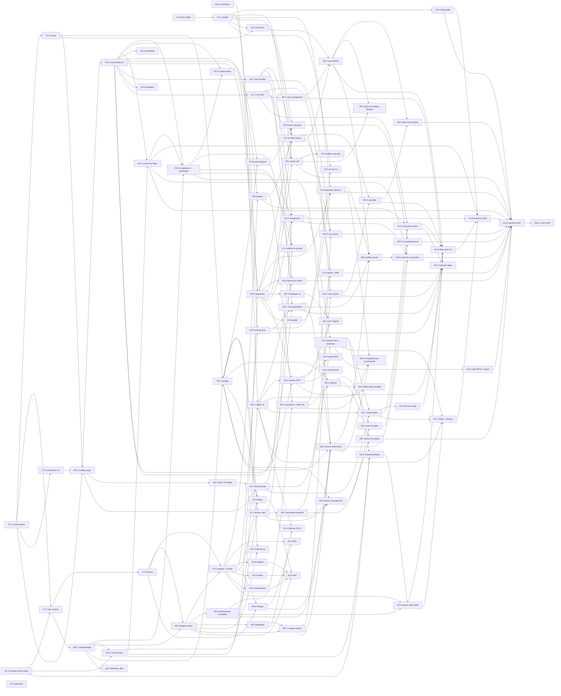

# Découpage du MVP

> **Décisions du fondateur du 2026-10-14 intégrées** (§ 7). Ce document reprend l'étude du 2026-10-13 sur le découpage du MVP pour un essaim d'agents, les ajustements de la synthèse (format dossier du [modèle de projet](../architecture/02-modele-projet.md), banc de charge QA-7), puis les quinze décisions du fondateur : les pistes audio et l'automation entrent dans le MVP, le moteur n'a plus de capacités fixes, le dossier réel devient le stockage par défaut. L'étude s'appuie sur le code de l'issue #2 (fusionnée dans `develop`, commit `03ee512`) ; le code reste la source de vérité. Le statut reste `draft` tant que le document n'a pas été vérifié contre le code.

## 0. Objectif du MVP

Objectif du fondateur : **arriver à la création d'un projet multi-pistes avec différents instruments, dans les différents modes.**

À la fin du MVP, un utilisateur (ou un agent MCP) peut :

1. créer un projet, plusieurs pistes MIDI et audio, chacune avec un instrument (ou un lecteur de clips audio) et une chaîne d'effets ;
2. jouer en direct sur la piste sélectionnée (MIDI, clavier de l'ordinateur), en mode Web comme en mode Boost ;
3. créer, éditer (piano roll) et enregistrer des clips MIDI ;
4. importer des fichiers audio (échantillons, boucles, stems) et les jouer comme clips, lus en flux depuis le disque ;
5. lancer des clips et des scènes dans une **grille de lancement**, avec quantification ;
6. placer des clips sur une **timeline d'arrangement** et la jouer en boucle ;
7. automatiser les paramètres des devices et du mixeur : dessiner et éditer des points, les entendre à l'échantillon près, et si c'est faisable enregistrer les mouvements de paramètres ;
8. piloter le transport (lecture, arrêt, boucle, tempo, métronome) ;
9. mixer (volume, panoramique, mute, solo, vu-mètres) ;
10. enregistrer le projet dans un dossier, le rouvrir, et obtenir le même rendu ;
11. faire tout cela par commandes typées, exposées en outils MCP.

Hors MVP (décision 5 du § 7) : l'**enregistrement audio** (il arrive juste après le MVP ; le format et le stockage lui réservent déjà sa place), le **recalage temporel** des clips audio (warping, audio élastique : hors MVP sauf s'il se révèle trivial, ce qui n'est pas attendu ; les clips audio sont non élastiques, voir [modèle de projet](../architecture/02-modele-projet.md) § 1.2), l'Atelier et la compilation Faust à la volée ([spec de l'Atelier](01-atelier-modules.md)), les sessions ACP (qui arrivent avec l'Atelier), les changements de tempo dans le temps, les envois et retours, les plugins tiers CLAP/VST3, WebMCP, les versions et variantes dans l'application, et avec elles la **fusion à trois points et le binaire `faulk` pilote de git** (`merge`, `diff`, `git setup`) que le [modèle de projet](../architecture/02-modele-projet.md) § 4 et § 8 proposait dans son MVP : aucune tâche de ce découpage ne les construit, le format v1 reste seulement *prêt pour git* ; le fondateur a confirmé ce périmètre le 2026-10-14.

## 1. Constat sur le code de l'issue #2

| Constat | Conséquence pour le MVP |
| --- | --- |
| `Command::apply(&self, synth: &mut Synth)` : les commandes agissent directement sur **un** synthé du moteur. | Il manque un **modèle de projet** distinct du moteur : les commandes modifient le projet, qui produit les messages moteur. |
| Un seul `enum Command` avec trois `match` (`name`, `apply`, `undo_kind`) dans `crates/commands/src/lib.rs`. | Point chaud de conflits dès que dix agents ajoutent des commandes. |
| Le mappage commande → moteur est écrit en TypeScript côté Web (`web/src/lib/engine/wasm-ops.ts`) et en Rust côté Boost (`helper/src/audio.rs::engine_event`). | Risque de divergence Web/Boost : il faut **un seul chemin**, en Rust, partagé par les deux cibles. |
| `Session.run` dans `web/src/lib/session.svelte.ts` est un `switch` par type de commande (depuis UI-1 : `Dispatcher.run`, `web/src/lib/stores/dispatcher.ts`). | À remplacer par un dispatcher générique. |
| Un export C `fk_*` par opération dans `engine-wasm`. | À remplacer par une boîte de réception binaire unique (`fk_push`) et une boîte d'envoi (`fk_feedback`). |
| `web/src/lib/i18n.ts` : un seul fichier de chaînes ; `App.svelte` : un seul écran. | Points chauds de conflits pour l'interface. |
| Pas de temps musical, de piste, de clip, d'identifiant stable. | Tout le socle est à construire avant les fonctions visibles. |
| Mode Boost écrit mais non vérifié. | À vérifier avant d'empiler le multi-pistes dessus. |
| Isolation cross-origin en place sur tout le site (AU-0, en-têtes dans `web/vercel.json`) ; contrat de synchronisation figé et voie WASM choisie par mesure (CT-3, `crates/engine/src/msg.rs`) ; un seul canal vers le moteur dans les deux cibles (MO-1, MO-2 : octets `ControlMsg` en mémoire partagée côté Web, même flux dans le helper). | Les pistes audio (AU-3) restent à construire. |

## 2. Décisions d'architecture du socle

Les décisions 1 à 4 et 7 à 8 du § 7 fixent ce socle ; les tâches de contrat de la phase 0 le figent en code. Ce qui reste à trancher l'est dans la tâche de contrat nommée.

### 2.1 Qui possède l'état du projet (décidé)

- Nouvelle crate **`crates/project`** : le document (projet, pistes MIDI et audio, devices, scènes, emplacements de clips, clips MIDI et audio, notes, arrangement, couloirs d'automation, réglages du transport), pur Rust, `serde`, sans I/O ; son format sur disque est celui du [modèle de projet](../architecture/02-modele-projet.md). Elle modifie la table « Stack and layout » de `CLAUDE.md` (fait par CT-1, qui crée les crates).
- `crates/commands` applique les commandes **au projet**. **Décidé par CT-4 (#40)** : modèle mutable à inverses explicites, `Command::apply(&self, state: &mut State, ctx: &mut Context) -> Result<Outcome, CommandError>`, où `State { project, session, history }` (l'état de session de la décision 10 est une cible de commande comme le projet ; PR-2 y ajoute l'historique d'annulation, que seuls `commands::run` et les commandes `history.*` modifient), `Context { author, group, ids }` porte l'auteur, le groupe d'historique et le générateur d'identifiants (ULID, semé par la page avec son horloge et son aléa : le projet reste pur), et `Outcome { output, undo, events, control }` contient la sortie typée, l'inverse (une commande ordinaire, appliquée par le même chemin, donc avec ses propres `ProjectEvent` et `ControlMsg`), les `ProjectEvent` (pour l'interface) et les `ControlMsg` (pour le moteur). Le modèle persistant du [modèle de projet](../architecture/02-modele-projet.md) § 5.2 n'est pas retenu : annuler un instantané exigerait un diff projet → moteur ou un rejeu complet ; les deux documents sont alignés sur ce choix.
- **La page possède le projet, dans les deux modes** (décision 1) : le cœur projet + commandes est compilé en WASM (`crates/project-wasm`, `wasm-bindgen` permis car il tourne sur le thread principal, pas dans le worklet). En mode Boost, la page envoie au helper les `ControlMsg`, pas les commandes ; le helper reste un pont sans logique produit, son serveur MCP relaie les appels d'outils vers la page, et il lit et écrit le dossier du projet pour le compte de la page (AU-7).
- Conséquence : basculer Web ↔ Boost = rejouer un **instantané** du projet vers l'autre moteur ; ouvrir un projet = même mécanisme.

### 2.2 Temps musical

- Positions et durées en **ticks entiers**, 960 par noire (`i64`) ; positions dans un fichier audio en **frames** entières.
- Tempo constant par projet (`f64` BPM, 20–999), signature rythmique ; pas de changement de tempo dans le temps au MVP.
- Le moteur convertit ticks ↔ échantillons avec une position `f64` ; les événements (notes, points d'automation, départs de clips audio) sont placés **à l'échantillon près** (découpage du bloc aux offsets).
- **Quantification de lancement** (décision 8) : globale au projet, **1 mesure par défaut**, réglable parmi : aucune, 1/16, 1 temps, 1, 2, 4, 8 mesures. Un réglage par clip viendra plus tard : champ optionnel dans le fichier du clip, absent = réglage global. Boucle du transport : région `[début, fin)` en ticks.

Figé par CT-2 (#38) dans `engine::time`, réexporté par `crates/project` :

- `Tick(i64)` et `Frame(u64)` sont des newtypes (un tick et une frame ne se mélangent pas), `PPQ = 960` ; `Tempo(f64)` fini dans `[20, 999]` ; `TimeSignature` (numérateur `1..=32`, dénominateur puissance de deux `1..=32`) ; `Quantize` est une énumération fermée (`None, Sixteenth, Beat, Bar, Bars2, Bars4, Bars8`, sur disque `none, sixteenth, beat, bar, bars_2, bars_4, bars_8`) ; `LoopRegion` refuse une région vide ou plus longue que `i64::MAX` ticks.
- Le **temps** est la valeur du dénominateur de la signature (en 6/8, une croche, 480 ticks) ; c'est ce que « 1 temps » et l'affichage mesure:temps:tick comptent. Choix à confirmer par le fondateur (l'alternative en mesure composée est la noire pointée).
- Grille ancrée au tick 0 (division euclidienne : les positions négatives du décompte sont sur la même grille). `next_boundary_at_or_after` rend le premier point de grille à partir de la position (un lancement demandé sur une frontière part tout de suite) ; `next_boundary_after` le premier strictement après. Les deux rendent `None` quand il n'y a pas de point (au-delà de `i64::MAX`) ; sans quantification, la première rend la position elle-même et la seconde `None`.
- Conversions sur `Tempo`, fonctions pures de la position absolue (jamais accumulées, donc sans dérive) : tick → secondes et tick → échantillon en `f64` (`tick × 60 × fréquence / (BPM × 960)`, à quelques ulp près ; le moteur garde cette position fractionnaire pour découper le bloc) ; secondes, échantillons et frames → tick **au plus proche, demi vers l'extérieur** (`f64::round`, identique sur toutes les cibles) ; entrée non finie → tick 0, entrée finie hors plage → saturation par signe. L'aller-retour tick → échantillon → tick est l'identité pour `|tick| ≤ 2^40` à 44,1, 48 et 96 kHz ; l'inverse ne l'est pas (à 120 BPM et 48 kHz un tick dure 25 échantillons).
- Fin en ticks d'un clip audio : `début + frames_to_ticks(frames)`, la durée arrondie au tick le plus proche puis ajoutée au début (à tempo constant ; une carte de tempo viendra après le MVP).

### 2.3 Synchronisation projet → moteur sans verrou et sans plafond visible

Un seul code pour les deux cibles :

1. **`ControlMsg`** (encodage binaire compact) : ce que le projet envoie au moteur (créer une piste, insérer un device, régler un paramètre, téléverser les notes d'un clip, téléverser un couloir d'automation, déclarer une source audio, lancer un clip, jouer…).
2. `Engine::prepare(ControlMsg) -> RtMsg` : **hors chemin audio**, peut allouer (construire un device, un tampon de delay, une table de notes, une table de pistes plus grande).
3. `Engine::apply(RtMsg)` : **sur le chemin audio**, sans allocation, en début de bloc ou à l'offset indiqué ; ce qui est remplacé (y compris une ancienne table de pistes) part dans une file de « déchets » libérée hors chemin audio.
4. **`Feedback`** (moteur → page) : tête de lecture, état des clips, vu-mètres par piste, notes enregistrées, charge processeur, compteurs de sous-alimentation disque, à environ 30 Hz.

**Pas de plafond visible** (décision 7). Le moteur n'a pas de capacités fixes : quand une structure est pleine, `prepare` en construit une plus grande hors chemin audio et `apply` l'échange en un bloc, sans allocation en temps réel. Il n'existe qu'une **limite de sûreté très haute** (chiffrée par CT-3, par exemple 4 096 pistes et 16 777 216 notes) que le projet refuse par une erreur typée avant que la commande n'atteigne le moteur : le moteur n'échoue jamais en temps réel. Les événements des clips et de l'automation ne passent par aucune file bornée : le moteur les lit dans leurs tables (construites par `prepare`) au moment de rendre le bloc ; seule l'entrée jouée en direct (MIDI, clavier) passe par une file bornée, dont la taille est hors d'atteinte d'un humain et dont le débordement est compté. Le banc de charge (QA-7) mesure le coût de ces échanges sur de très gros projets.

Par cible :

- **Natif (helper)** : `prepare` sur un thread de contrôle, `RtMsg` vers le callback audio par `rtrb`, déchets en retour par un second `rtrb`.
- **WASM** : le `onmessage` d'un `AudioWorklet` s'exécute **sur le thread de rendu**, comme `process` ; y appeler un `prepare` qui alloue violerait la règle « hors chemin audio ». L'isolation cross-origin étant acceptée (décision 4, tâche AU-0), **CT-3 tranche par prototype et mesure entre deux voies** :
  - (b) **mémoire partagée** : `prepare` tourne dans un Worker dédié qui partage la mémoire du moteur (`WebAssembly.Memory` partagée) et le worklet ne lit qu'un anneau lock-free, comme dans le helper. Ce que cette voie implique, et que le prototype doit régler : un build WASM avec atomics (aujourd'hui la bibliothèque standard précompilée de la cible `wasm32-unknown-unknown` sur la chaîne `stable` épinglée par `rust-toolchain.toml` n'en a pas ; passer par `build-std` sur `nightly` est un choix pour tout le dépôt, présenté au fondateur dans la PR de CT-3), deux instances du même module sur une mémoire (pile et stockage local de thread distincts, segments de données initialisés une seule fois, sans `wasm-bindgen`), et un allocateur partagé qu'aucune libération ne doit verrouiller sur le thread de rendu ;
  - (a) **sans mémoire partagée** : `onmessage` copie des octets bornés dans une boîte de réception préallouée du worklet, et une structure qui grandit est construite dans le worklet **entre deux quanta de rendu, hors de `process`**, par un message dédié ; le coût sur le thread de rendu (objets `MessageEvent` du navigateur, allocation entre deux quanta) est mesuré et doit tenir sous un budget que CT-3 fixe.
  Dans les deux cas, `process` n'alloue jamais et le critère de MO-2 s'énonce par rapport à la voie retenue. **Mémoire linéaire** : le module réserve une mémoire initiale au démarrage et **grandit hors chemin audio** (`memory.grow` appelé par `prepare`, dans le Worker ou entre deux quanta, jamais dans `process`) ; après une croissance, les vues typées du worklet sur la mémoire sont réobtenues en début de bloc (comparaison de `memory.buffer`, coût constant) ; un `memory.grow` refusé (plafond de 4 Gio de wasm32, mémoire de la machine) est une erreur typée renvoyée au projet et affichée, jamais un plantage ni un silence. Les limites de sûreté de CT-3 tiennent sous ce plafond, budget PCM (AU-3) compris.
- Le mappage commande → messages vit en Rust (`crates/commands`), jamais en TypeScript.

**Décision CT-3 (#39, 2026-10-14) : contrat figé dans `crates/engine/src/msg.rs`, voie (b) retenue.** Les types (`ControlMsg`, `RtMsg`, `Feedback`, `Table`, limites, en-tête) sont le contrat ; MO-1 écrit les codecs des charges utiles, `prepare` et `apply`, MO-2 le canal de chaque cible. Ce que le code fige :

- **Format binaire de `ControlMsg`** : petit-boutiste partout ; en-tête de 16 octets `version u8` (= 1), `flags u8` (0), `tag u16` (une valeur par variante, stable), `epoch u16`, `réservé u16`, `len u32` (≤ 16 Mio, au-delà l'envoi est découpé en morceaux `first`/`total`), `seq u32` ; le message suivant commence au multiple de 4 suivant. Un `tag` inconnu est sauté grâce à `len` et compté (`Feedback.rejected`), le flux continue ; version, bits réservés ou `len` hors limite : flux corrompu, erreur typée. Les structures sont nommées par des **emplacements** (`TrackSlot`, `ClipSlot`…, des `u32` attribués par le projet, qui garde la correspondance avec ses identifiants stables). Le PCM des pistes audio ne passe jamais par un message (AU-3 le diffuse dans des tampons que `AudioSourceDeclare` déclare).
- **Époque** : seule `Reset { epoch }` porte une nouvelle époque, que le moteur adopte si elle est plus récente (comparaison avec enroulement sur 16 bits : un `Reset` d'une époque passée, dupliqué ou rejoué, est jeté et ne ramène jamais le moteur en arrière) en jetant tout (y compris les morceaux d'envoi en cours) ; tout autre message d'une autre époque est jeté et compté (égalité stricte). À chaque bascule de moteur (web ↔ helper, ou retour sur un moteur suspendu), la page incrémente l'époque et renvoie tout le projet après un `Reset` : un envoi découpé coupé par la bascule ne se termine jamais dans l'ancienne époque.
- **`RtMsg`** : une valeur Rust, jamais sérialisée, déplacée dans un anneau à un producteur et un consommateur ; ≤ 64 octets (testé) ; **un `ControlMsg` donne au plus un `RtMsg`**, et un `RtMsg` au plus un déchet (`Garbage`). Seul le côté `prepare` écrit dans l'anneau ; l'entrée live a sa propre file. Anneau plein : le côté `prepare` garde le message dans sa file ordonnée (hors chemin audio, il peut allouer) et le pousse dès qu'une place se libère ; rien n'est perdu ni réordonné. Cette file est bornée elle aussi (4 096) : au-delà, le moteur ne consomme pas (contexte audio suspendu, périphérique perdu) et le projet reçoit `EngineBusy`, arrête d'envoyer et se resynchronise par un `Reset` quand le moteur repart ; en mode web la page sait son `AudioContext` suspendu et s'arrête avant.
- **Croissance** : deux sortes de tables. Les **tables de contenu** (notes d'un clip, points d'un couloir, placements d'une piste) sont des instantanés immuables construits entièrement par `prepare` à partir des données du projet et échangés par pointeur : leur taille ne coûte rien au thread de rendu (déplacer un million de notes dans `apply` coûterait 3,5 ms en natif, mesuré). Les **tables d'exécution** (pistes, sources audio : l'état que le thread audio modifie) sont des tableaux d'emplacements : chaque emplacement existe (`None` s'il est vide) et un message l'adresse directement ; quand un message nomme un emplacement au-delà de la capacité, `prepare` construit d'abord la suivante, vide, deux fois plus grande, `apply` y déplace les entrées (un pointeur chacune, borné par la limite de la table : 3,4–5 µs pour 4 096 pistes en natif, moins de 350 µs dans la pompe du worklet pour 4 096 puis 8 192 emplacements déplacés) et l'ancienne part aux déchets ; un emplacement hors table dans `apply` est sauté et compté, jamais une panique. Toute allocation de `prepare` est **faillible** (`Table::try_with_capacity`, `try_box`, jamais `Box::new`) : un `memory.grow` refusé est `MsgError::OutOfMemory`, jamais un piège. L'anneau des déchets a une place de plus que l'anneau `RtMsg` et `prepare` le vide avant chaque envoi : après une vidange, au plus 4 096 messages sont en vol et le côté audio peut en appliquer un (un déchet) avant que l'envoi qui suit la vidange n'arrive, d'où au plus 4 097 déchets ; `apply` a toujours une place et ne libère jamais rien.
- **Limites de sûreté** (`msg::limits`) : 4 096 pistes, 1 024 devices par piste, 1 048 576 clips, 1 048 576 placements (131 072 par piste), 16 777 216 notes (1 048 576 par clip), 65 536 couloirs, 16 777 216 points (par couloir aussi), 4 096 sources audio, 4 096 scènes (alignées avec `crates/project/src/limits.rs`, qui prend les siennes dans `engine::msg::limits` et vérifie à la compilation qu'aucune ne dépasse celles du moteur) ; file live 4 096 ; anneaux 4 096 ; 128 messages appliqués par bloc au plus ; mémoire initiale 16 Mio ; budget PCM 1 Gio (AU-3) ; budget moteur 3 Gio − 64 Mio pour les tables et les devices, dont la taille déclarée par le descripteur (CT-5) est additionnée par le projet qui refuse un insert au-delà. Le pire cas des tables (toutes à leur limite, doublées pendant une croissance, plus la plus grande une fois pour la fragmentation d'une mémoire linéaire qui ne rétrécit pas, plus les anneaux et le `Feedback`) tient sous le budget moteur (test `limits_fit_under_the_wasm32_cap`).
- **Entrée live** : seule file bornée ; en débordement l'événement est jeté et un compteur atomique (`LiveOverflow`) incrémenté ; le côté audio vide d'abord la file live et applique ses événements, puis lit le compteur en début de chaque bloc et, s'il a bougé, relâche toutes les notes live (l'ordre du helper aujourd'hui : un note-on en file avant le note-off perdu est appliqué avant la relâche, jamais après) : aucune note bloquée même si plus rien n'est envoyé.
- **`Feedback`** : en-tête fixe de 56 octets (version, transport, époque, `seq` en verrou de séquence, impair pendant l'écriture, pour une lecture sans arrêt du moteur, tête de lecture en ticks et en frames, charge, compteurs : débordements live, rejets, sous-alimentations disque), puis les vu-mètres par piste, les clips actifs seulement (au plus deux par piste : un joué, un en attente) et les notes enregistrées depuis le dernier rapport (au plus 1 024 par rapport, le reste au suivant). La plus grande session tient sous 256 Kio par rapport.

**Mesures** (prototype `web/src/lib/engine/proto/`, suite `web/tests/e2e/engine-channel.spec.ts` ; la vraie synthèse joue une note pendant toute la mesure ; horloge : un Worker qui incrémente un compteur partagé, calibré sur `performance.now()`, car un `AudioWorkletGlobalScope` n'a pas de `performance` ; variation de l'étalonnage ≤ 10 % ; une lecture nulle signifie que le Worker-horloge a été préempté pendant la mesure et elle est écartée ; le compteur est un entier 32 bits lu comme un nombre, sans `BigInt`, pour que le worklet n'alloue rien). Chromium sans tête, Windows 11, 48 kHz ; les mêmes ordres de grandeur dans Chrome avec le périphérique audio réel :

| Mesure | (a) sans mémoire partagée | (b) mémoire partagée | Natif (helper, `rtrb`) |
| --- | --- | --- | --- |
| Par message sur le thread de rendu | corps du gestionnaire 0,8–1,9 µs ; 3,3–20 µs par message en rafale, `MessageEvent` compris | 0,2–1,0 µs par message pompé (lectures d'horloge comprises), 1,4–1,7 µs par pompe, vide ou non | push 2–3 ns, pop + apply 2–3 ns |
| Par croissance (1 M notes + tableau de pistes doublé, 4 096 puis 8 192 emplacements déplacés) | **5–18,6 ms sur le thread de rendu** (`prepare` entre deux quanta), au-delà d'un quantum (2,67 ms) et d'un rappel de périphérique de 10 ms ; préparer 4 096 pistes y coûte 1,2–1,8 ms de plus | `prepare` dans le Worker 4,4–18 ms, hors thread de rendu ; `apply` dans la pompe : pompe la plus longue 36–340 µs, déplacement des 4 096 puis 8 192 emplacements et préemption compris | `apply` 0,2 µs (64 entrées), 1,0–1,2 µs (1 024), 3,4–5,0 µs (4 096) ; libération hors thread ≤ 1,7 µs |
| Allocations sur le thread de rendu (mise en place exclue) | 4 103 allocations et 6 libérations (`prepare` y tourne : 4 096 pistes, les tables) | **0 et 0** (compteur par instance) ; côté `prepare` 4 113 et 6 | 0 (détecteur d'allocation sur `apply`) |
| `memory.grow` pendant que le worklet tient des vues | l'ancien tampon est détaché (longueur 0) : vues reprises au bloc suivant, aucun bloc silencieux | l'ancien tampon reste lisible, vues reprises (`memory.buffer` comparé), aucun bloc silencieux | sans objet |
| `memory.grow` refusé (mémoire à `maximum` 20 Mio, doublure du plafond de 4 Gio) | code typé, l'instance reste vivante | code typé, l'instance reste vivante | `try_reserve` → `OutOfMemory` (test) |

Le compteur de blocs en retard du worklet ne distingue pas les deux voies : Chrome rend quatre quanta par rappel de 10 ms, au repos comme en charge (écart moyen 2,5–2,7 ms, maximum 11 ms dans les deux cas) ; c'est la durée du travail sur le thread de rendu qui tranche, et une croissance de (a) dépasse le rappel.

**Voie retenue : (b)**, sur la cible **`wasm32-wasip1-threads`** de la chaîne `stable` épinglée (bibliothèque standard précompilée avec atomics et mémoire partagée importée ; `--max-memory` porté à 4 Gio ; Chrome accepte un `maximum` de 65 536 pages). **Pas de passage à `nightly`** : l'option `build-std` sur `wasm32-unknown-unknown` donnerait le même module sans imports WASI, au prix d'une chaîne instable pour tout le dépôt ; elle est présentée au fondateur dans la PR de CT-3 avec ces chiffres. Ce que (b) impose, réglé par le prototype : deux instances du même module sur une mémoire (la seconde reçoit sa propre pile, 1 Mio du tas partagé, par le global `__stack_pointer` exporté ; les segments de données ne sont initialisés qu'une fois) ; cinq imports WASI remplacés par des bouchons (`environ_get`, `environ_sizes_get`, `fd_write`, `proc_exit`, `sched_yield`) ; un stockage local de thread distinct par instance (vérifié par un `thread_local!` qui garde une valeur différente dans chaque instance ; le module du prototype n'a pas de segment TLS à initialiser, MO-2 revérifie les exports du vrai module et initialise un bloc TLS par instance si `__wasm_init_tls` apparaît) ; un allocateur partagé (celui de la libc WASI, verrouillé) que le thread de rendu ne touche jamais, prouvé par le compteur d'allocations par instance. Effet sur la chaîne : la cible ajoutée à `rust-toolchain.toml` et à la CI ; MO-2 fait basculer `engine-wasm`.

**Budget que MO-2 doit tenir** (thread de rendu, mesuré par la suite e2e) : ≤ 2 µs par `RtMsg` pompé, ≤ 500 µs pour la pompe qui échange une table d'exécution à sa limite (4 096 puis 8 192 emplacements déplacés, mesuré 36–340 µs dans Chromium, 3,4–5 µs en natif), la suite e2e ne tenant en CI qu'un plafond dix fois plus haut (20 µs par message, 5 000 µs pour la pompe), car un coureur partagé dépasse parfois 500 µs sans régression (#220 : lectures de 512 à 1 201 µs sur le prototype, jamais plus de 169 µs sur le worklet livré), et ces bornes elles-mêmes sur la médiane de cinq mesures avec `FAULK_E2E_STRICT_TIMING=1`, sur une machine de référence (`docs/agents/verification.md`), ≤ 128 messages par bloc (`MAX_APPLY_PER_BLOCK`), soit moins de 10 % d'un quantum de 128 frames à 48 kHz pour une vidange complète ; aucune allocation ni libération sur l'instance du worklet (compteur à zéro) ; `prepare` sans borne, dans le Worker.

**Mise en œuvre MO-1 (#54, 2026-10-14) : `crates/engine/src/engine.rs` et `crates/engine/src/msg/codec.rs`.** Ce que le code ajoute au contrat de CT-3, et où il s'en écarte :

- **Codecs** : chaque variante de `ControlMsg` a sa charge utile (champs dans l'ordre de déclaration, largeurs naturelles, petit-boutiste ; disposition dans la documentation du module `codec`). Le décodage lit exactement `len` octets, refuse une valeur hors domaine (booléen autre que 0 ou 1, flottant non fini, hauteur MIDI au-delà de 127, tempo, signature ou boucle invalides) par `MsgError::BadPayload`, message sauté et compté, et vérifie le nombre d'éléments d'une liste avant toute allocation. L'état initial d'un device (`DeviceInsert::state`, laissé à MO-1 par CT-5) est une suite de paires `(identifiant de paramètre u32, valeur f32)`.
- **Un `ControlMsg` donne au plus un `RtMsg`, croissance comprise** : le tableau de CT-3 envoyait `Swap(Tracks)` puis `Swap(Track)` pour une piste qui fait grandir la table, en contradiction avec sa propre règle. La table agrandie voyage désormais dans le même message que l'élément (`Put`) ; `apply` déplace les entrées, échange, place l'élément, et renvoie un seul déchet. Les types opaques de CT-3 (`Swap`, `Prepared`, `TableKind`, `Opaque`) deviennent des types concrets (`State`, `Track`, `Clip`, `Lane`, `Source`, `DeviceEntry`) ; MO-3 les étend. Le prototype de CT-3 (`web/src/lib/engine/proto/crate`) garde une copie des anciens types pour rester la référence de ses mesures.
- **Tables paginées** : les clips (1 048 576) et les couloirs (65 536) seraient 256 et 16 fois au-delà du cas mesuré par CT-3 (4 096 emplacements) s'ils grandissaient emplacement par emplacement. Ils sont rangés en pages de 1 024 emplacements derrière un répertoire : une croissance déplace au plus 1 024 pointeurs. Les pistes, les sources, et par piste les devices et les scènes restent des tableaux d'emplacements (au plus 4 096).
- **`prepare` est atomique** : toutes ses allocations précèdent tout changement de son état (l'ombre des capacités, les envois en cours, l'époque d'un `Reset`) ; un `OutOfMemory` ou un `EngineBusy` laisse le côté `prepare` tel quel, et le flux peut être renvoyé à partir de ce message (`Preparer::stopped_at` en donne la position). Un retrait d'emplacement que le moteur n'a jamais reçu n'envoie rien. Un message qui nomme une piste ou un device absents est refusé par `prepare` (`NoSuchTarget`), compté.
- **Effet en début de bloc** : `RtMsg::ParamSet` n'a plus d'`offset` ; un réglage par la main ou par un agent prend effet au début du bloc qui l'applique (`Device::set_param`, CT-5). Les événements à l'échantillon près sont ceux de MO-4.
- **Coût mesuré** (natif, release, `msg_cost`) : préparer et pousser un `ParamSet` 25 ns, le dépiler et l'appliquer 21 ns ; croissance de la table des pistes à sa limite (2 048 pistes déplacées) 3,1 µs, du répertoire des clips à sa limite (512 pages) 1,0 µs, d'une rangée de 512 devices 0,7 µs.
- **WASM** : le test de MO-1 tourne sur `wasm32-unknown-unknown` dans un interpréteur, une instance qui porte les deux côtés : la croissance de la mémoire linéaire par `prepare` pendant la lecture (9 Mio) ne laisse aucun bloc silencieux, et le rendu est identique au natif ; un `memory.grow` refusé rend `OutOfMemory` et l'instance continue. Le canal à deux instances sur mémoire partagée (`wasm32-wasip1-threads`) est celui de MO-2, qui reprend ce test sur sa cible.
- **Changement de fréquence d'échantillonnage** (#236, 2026-11-03) : les devices sont construits pour le `DeviceSetup` du canal. À un changement de fréquence, l'hôte garde le canal et appelle `Preparer::set_sample_rate` (`host::Prepare::set_sample_rate`) hors du thread audio : le côté `prepare` garde de chaque device son type, les valeurs de paramètres reçues (insertion puis `ParamSet`, les seuls identifiants que déclare son descripteur) et son état activé, reconstruit chaque device des pistes et du master pour la nouvelle fréquence, puis envoie `RtMsg::SetSampleRate` (horloge avec sa tête de lecture, métronome, limiteur, fondus) suivi d'un `DevicePut` par device à son emplacement (sur une chaîne qu'on entend, l'ancien device s'efface pendant que le nouveau monte, par les fondus de #233). Atomique : tout est construit avant de rien changer ; sans place dans la file pour `1 +` les devices, `EngineBusy` et rien ne change. Une note qui sonne sur un instrument est relâchée (le nouvel instrument n'a pas sa voix) et chaque effet repart propre (queues d'écho et de réverbération, enveloppes, états des filtres) ; les couloirs d'automation rendent leur valeur au device reconstruit (un couloir déjà supprimé non : le device reprend la valeur du projet, comme après une resynchronisation). Un appel à la fréquence en cours ne fait rien ; une fréquence hors de 8 à 192 kHz est refusée (`LimitExceeded`). Les hôtes (#577) : en Boost, quand une sortie tombe et qu'une autre s'ouvre dans les 2 s, le helper garde le moteur et l'appelle si la fréquence change (voir `architecture/04-distribution-helper.md` > Sans sortie audio). Sur le web, sans objet : la fréquence d'un `AudioContext` est fixée à sa création, et le navigateur rééchantillonne vers celle du périphérique (spécification Web Audio, constructeur d'`AudioContext`). Un nouveau périphérique ou une reprise ne change donc pas la fréquence que rend le worklet. Suivre celle du périphérique demanderait de reconstruire le contexte et le worklet, ce que le lead a écarté (décision du 2026-11-03 : la règle d'un seul message du worklet, et peu de gain). Pas de `ControlMsg` ni d'export WASM. Tests : `crates/engine/tests/it/sample_rate.rs`.

**Mise en œuvre MO-3 (#56, 2026-10-14) : `crates/engine/src/graph.rs`.** `Engine::render` (et `Engine::process`, qui le fait précéder de `begin_block`) rend le graphe :

- **Pistes et chaînes** : chaque piste, dans l'ordre de ses emplacements, fait tourner sa chaîne dans l'ordre de ses emplacements (le projet garde l'ordre de CT-5) : un effet MIDI transforme le flux de notes en sa propre sortie, réduite aux notes ; le premier instrument activé reçoit ce flux et écrit le son ; un effet audio le transforme sur place ; un device désactivé est contourné. Les notes jouées en direct arrivent à l'offset 0 (le routage à l'échantillon près est celui de MO-4). Une seule paire de tampons stéréo, allouée par `channel` hors chemin audio, sert à toutes les pistes, rendues l'une après l'autre.
- **Mixage** : par canal, `audible × gain × balance(pan)` ; `audible` est faux pour une piste muette, ou non soliste quand une autre l'est (solo cumulatif) ; balance à gain unité au centre (`gauche = min(1, 1 − pan)`, `droite = min(1, 1 + pan)`), loi remplacée par celle de MX-1 (voir « Mise en œuvre MX-1 »). Chaque niveau, master compris, suit une rampe linéaire de 5 ms (la règle de lissage de CT-5).
- **Fondus** : une piste nouvelle part de 0 et monte en 5 ms. Une piste qui quitte son emplacement (`TrackRemove`, un `TrackPut` sur un emplacement occupé, toutes les pistes à un `Reset`) n'est plus un déchet d'`apply` : elle rejoint une liste chaînée par ses propres pointeurs (aucune allocation, aucune borne), descend à 0 en 5 ms, puis passe dans un **anneau de retraite** (4 096 places) que `Preparer::collect` vide. Anneau plein : la piste reste dans la liste, muette et non rendue, et repasse au bloc suivant. Cet anneau est distinct de celui des déchets, dont la borne (un déchet par message) ne couvre pas ce qu'un rendu produit.
- **Effet MIDI ou instrument changé** : insérer, retirer, activer ou désactiver un effet MIDI ou un instrument relâche toutes les notes de sa piste au prochain bloc rendu (avant les notes jouées de ce bloc), car l'instrument ne recevrait jamais les note-off des voix nommées par l'ancien flux, ni ceux arrivés pendant qu'il était contourné. Un échantillon non fini (NaN, infini) ou dénormal ne sort jamais du graphe : il vaut 0. La renumérotation des voix entre effets MIDI et le dimensionnement des sorties MIDI enchaînées restent à MO-4.
- **Fondus des devices (#233, 2026-11-03)** : activer, désactiver, retirer, remplacer ou insérer un instrument ou un effet audio pendant qu'on entend sa chaîne passe par un fondu linéaire de 5 ms, comme les pistes. Chaque device porte un niveau `fade` entre 0 et 1, qui va vers 1 s'il est activé et vers 0 sinon ; l'emplacement où il bouge rend `sec + fade × (traité − sec)`, `sec` étant le signal qui entre dans l'emplacement (copié dans deux tampons alloués par `channel`). Un device stable ne coûte rien de plus. Un device qui s'éteint ne reçoit plus d'événement (ses voix et sa queue s'éteignent sous le fondu), puis il est remis à zéro (`reset`) à 0 : rien ne revient quand on le rallume ; rallumé avant 0, il remonte d'où il est, queue comprise. Un device retiré ou remplacé rejoint la liste **sortante** de sa chaîne (un tableau fixe de la chaîne, 32 au plus, au-delà un départ net comme avant : assez pour une insertion en tête d'une chaîne de 32 devices, qui les reconstruit tous, et dans la marge du pire cas mémoire des tables) et joue encore à son emplacement, sans événement, sur le même signal d'entrée, en descendant à 0 : un remplacement est un fondu enchaîné. À 0 il passe par l'anneau de retraite (anneau plein : il attend, muet, le bloc suivant). Un effet MIDI n'a pas de son : son changement relâche les notes de l'instrument, qui les termine avec son propre relâchement. Une chaîne qu'on n'entend pas (bande à 0 : piste pas encore montée, piste muette) change d'un coup. Le master fait de même ; un `Reset` termine sa liste sortante, échangée avec l'ancienne chaîne. Coût (release, `graph_cost`, machine chargée) : une chaîne de 32 filtres tous remplacés coûte 105,6 µs par bloc pendant les deux blocs du fondu contre 35,6 µs au repos ; une piste vide passe de 24 à 27 ns par bloc (la piste porte le tableau sortant), mesuré dos à dos sur la même machine. Tests : `crates/engine/tests/it/device_fade.rs` (chaque changement, sous le détecteur d'allocation, et un effet MIDI) et `crates/test-support/tests/it/device_fade.rs` (par les commandes, parité natif / WASM).
- **Coût mesuré** (natif, release, `graph_cost`, bloc de 128 frames à 48 kHz, budget 2 667 µs) : une piste vide (sans device activé) coûte 14 à 17 ns par bloc, 4 095 pistes vides 2,2 à 2,7 % du budget ; une piste qui joue un son de test, 1,5 à 2 µs.

**Mise en œuvre MO-4 (#57, 2026-10-15) : `crates/engine/src/events.rs`, `crates/engine/src/graph.rs`.** Ce que le code ajoute, et ce qu'il laisse aux tâches qui lisent les tables :

- **Un bloc d'horloge par bloc du graphe** : `Engine::render` découpe un rendu en blocs d'au plus `max_block_frames` ; chacun est un bloc de l'horloge de TR-1, dont les segments (coupés à chaque bouclage) sont relevés une fois dans une table préallouée (`max_frames + 2` places, la borne de TR-1) que lisent le graphe et le métronome (`Clicker::render` reçoit les segments au lieu de l'horloge).
- **Sous-blocs** : chaque piste fait tourner sa chaîne une fois par segment, et coupe encore le segment quand ses événements remplissent sa réserve. Un sous-bloc ne traverse donc jamais un bouclage ni un déplacement, et chaque device reçoit dans `BlockCtx` la longueur du sous-bloc, l'état de l'horloge (`playing`) et la position en ticks fractionnaires de sa première frame (TR-2 la laissait à 0) ; à l'arrêt, un seul sous-bloc à la position figée.
- **Routage** : les événements d'un sous-bloc sont rangés en deux suites, les notes (relâche d'une chaîne changée, notes live à l'offset 0 du bloc, relâche après un débordement live, puis les notes de la table) et les valeurs de paramètres avec le device qu'elles visent. Chaque device reçoit la fusion par offset de ses propres valeurs (en premier à offset égal) et, s'il est instrument ou effet MIDI, du flux de notes ; un effet audio ne reçoit que ses valeurs. Les notes live restent à l'offset 0 : un `LiveEvent` ne porte pas d'heure.
- **Table d'événements datés** (`Schedule`) : une table de contenu triée par tick, construite hors chemin audio par allocations faillibles (`Schedule::try_new` : une note donne un note-on à son début et un note-off à `début + max(durée, 1)` ; à tick égal, les valeurs, puis les note-off, puis les note-on ; identifiants de voix `premier + index`, à partir de 129 pour ne jamais croiser les voix live 1 à 128 ; accord fin porté jusqu'au device). Le thread audio la lit avec un curseur, **sans file bornée** : les événements sont pris par groupes de même offset ; quand un groupe ne tient pas dans la réserve du sous-bloc (1 024 notes au-delà du bloc live, 1 024 valeurs), le sous-bloc s'arrête avant lui et la lecture reprend au même index. Un groupe plus grand que toute la réserve, sur un seul échantillon, est livré en partie, le reste à la première frame du sous-bloc suivant, même après un bouclage ou un déplacement : aucun événement n'est perdu (test : 10 000 notes et 2 000 valeurs dans un bloc ; 10 000 note-on sur un échantillon ; 6 000 sur la dernière frame d'un bloc suivi d'un déplacement).
- **Sauts et arrêt** : un segment qui ne commence pas là où la lecture s'était arrêtée (lecture, déplacement, bouclage) relâche les notes que la table tient, **chacune par son propre note-off** (les notes live de la piste ne sont pas touchées), puis repositionne le curseur par recherche dichotomique ; le note-off d'une note dont le note-on n'a pas été livré est ignoré. Un bloc à l'arrêt relâche de même et oublie le curseur.
- **Ce qui ne remplit pas encore la table** : aucun message ne la porte ; le lecteur de clips (CL-2) lit ses clips par le même curseur dans une table à lui (mise en œuvre CL-2 plus bas), l'arrangement (AR-2) lit les clips de ses placements de la même façon (mise en œuvre AR-2 plus bas), l'automation (AM-2) lit ses couloirs directement (voir « Réalisé » d'AM-2), et les tests la posent hors chemin audio (`TrackGraph::set_schedule`). Le rattrapage d'une valeur d'automation après un déplacement (fait par AM-2), les cibles du mixeur (adressables depuis MX-1 par le pseudo-emplacement `MIXER_SLOT`, voir « Mise en œuvre MX-1 ») et le départ d'un clip audio (AU-4, qui choisira comment le lecteur de clips reçoit son départ) n'y sont pas.
- **Effets MIDI** : un effet MIDI est dimensionné à partir de la réserve d'un sous-bloc, ou de la sortie du plus grand effet MIDI placé avant lui (l'ombre de `prepare` garde la capacité de sortie de chaque emplacement) ; un effet inséré plus tard devant un autre ne redimensionne pas celui-ci, le filet de sécurité de CT-5 (un `AllNotesOff` dans la place réservée) couvre ce cas. Un device qui reçoit des valeurs de paramètres derrière une sortie MIDI plus grande que le tampon de fusion les reçoit par `set_param` à la première frame du sous-bloc : aucune note n'est perdue. Les identifiants de voix ne sont pas renumérotés : le graphe ne fusionne jamais deux flux de notes (la sortie d'un effet MIDI remplace le flux), donc aucun identifiant ne peut en croiser un autre ; le contrat de `device.rs` le dit désormais (la renumérotation annoncée par CT-5 est sans objet).
- **Débordement live** : déjà compté (`LiveOverflow`) et écrit dans le `Feedback` (mot 28, MO-2), inchangé.
- **Coût mesuré** (natif, release, `events_cost`) : 10 000 notes (20 000 événements) dans un bloc de 2 048 frames à 48 kHz, médiane 0,78 ms pour un budget de 42,7 ms.
- **Parité** : `engine::events::testing::scenario` (instrument et effet de test, notes avec accord fin et valeurs pour les deux devices, boucle, déplacement, arrêt, blocs de tailles impaires) rendu en natif et par le module `.wasm` (`crates/engine-wasm/tests/events_parity.rs`), écart ≤ 1e-5 et silences aux mêmes échantillons.

**Mise en œuvre MO-2 (#55, 2026-10-14).** Ce que le code ajoute, et ce qui reste provisoire :

- **Un seul module, deux instances** : `engine-wasm` est livré pour `wasm32-wasip1-threads` (arguments d'édition de liens dans `.cargo/config.toml`). Le Worker de `prepare` (`web/src/lib/engine/prepare-worker.ts`) crée le canal (`fk_channel_new`) et alloue, pour l'instance du worklet, sa pile (1 Mio) et son bloc de stockage local de thread : le module réel a un segment TLS (192 octets) et une seconde instance non initialisée l'aurait placé à l'adresse 0 ; le worklet appelle `__wasm_init_tls` avant tout. Exports : `fk_inbox` puis `fk_push(canal, ptr, len)` (le pointeur de canal s'ajoute à la signature `fk_push(ptr, len)` du ticket, une page pouvant tenir plusieurs canaux), `fk_flush` (toutes les 5 ms), `fk_render` (= `fk_pump` puis `fk_render_block`), `fk_left`, `fk_right`, `fk_feedback`. Les anciens exports `fk_new`, `fk_note_on`… sont supprimés ; le prototype de CT-3 en garde une copie figée.
- **Mappage en Rust seulement** : `commands::engine_msgs` traduit les commandes en `ControlMsg` pour le seul synthé (piste 0, device 0) en attendant la table identifiant → emplacement de PR-3 ; la page encode par `crates/project-wasm` (ABI C provisoire, que PR-4 remplace), le helper encode les commandes qu'il reçoit et soumet les mêmes octets à son côté `prepare` (thread de contrôle toutes les 5 ms). Les commandes, et non les octets, traversent encore la WebSocket : c'est BO-1 (fait depuis, #102 : ce sont les octets que la page encode). `wasm-ops.ts` et `engine_event` sont supprimés.
- **Rendu et synthé** (`crates/engine/src/host.rs`) : l'hôte rend le graphe de MO-3 (`Engine::render`) ; il construit les devices par le registre des devices intégrés (`engine::devices`) ; l'adaptateur provisoire `SynthDevice` de MO-2 a été retiré par DV-1, le synthé étant lui-même un `Device`.
- **Rapport** (MO-5, version 2 de la disposition ; version 3 depuis #293, voir « Feedback » plus bas) : le thread de rendu écrit le `Feedback` environ 30 fois par seconde dans une zone fixe de la mémoire partagée (taille maximale, 160 Kio), sous verrou de séquence ; la page la lit sans message. Écrits : version, époque, état du transport et tête de lecture (`Engine::report_transport`), débordements live, rejets, un vu-mètre crête et RMS par emplacement de piste jusqu'à la dernière piste (après le fader de la piste ; zéros pour un emplacement vide) puis celui de la sortie (après le master et le métronome), le plus grand nombre de voix des devices des pistes sur la période (`Device::voices`, mot 52), la charge processeur. La charge est mesurée par l'appelant (`Host::add_render_time`, #486, exception à la règle « aucun appel au système sur le fil audio » limitée à la lecture d'une horloge monotone) : le helper chronomètre chaque tranche de rendu avec `Instant`, le worklet chaque quantum avec l'horloge de sa portée (`Date.now()` au pas de 1 ms dans Chromium, qui n'y expose pas `performance`). Le rapport (version 6 de la disposition) porte la charge de la période (temps de rendu sur la durée des blocs chronométrés) et, au mot 72, sa crête : la plus forte charge d'une fenêtre d'au moins 100 pas d'horloge, soit un bloc avec l'horloge fine du helper et environ 100 ms avec celle du worklet. Tant que l'hôte n'a chronométré aucun bloc, les deux mots valent −1 (« non mesuré ») ; ensuite une période sans bloc chronométré vaut 0. La page lisse la charge (moyenne exponentielle, 1 s) et garde la crête des 3 dernières secondes (`web/src/lib/engine/load.ts`). Clips actifs, notes enregistrées et sous-alimentations disque restent à zéro (LA, RE, AU-3). En mode Boost, le helper envoie les mêmes octets en trames binaires WebSocket (protocole 3, puis 4 avec la version 3 de la disposition, #293 ; une trame au plus en attente par session) : la page les décode avec le même décodeur (`web/src/lib/engine/feedback.ts`). L'association emplacement → `TrackId` dans la page est de la vue mixeur (MX-3) ; en Boost, depuis BO-1 (#102), les emplacements sont ceux du projet de la page, dont le helper reçoit les octets.

- **Erreurs** : un flux arrêté (`OutOfMemory`, `EngineBusy`) est renvoyé à la page avec son code et sa position, et journalisé ; son affichage et la resynchronisation (renvoi après `Reset`) sont de PR-3 / PR-5. Les époques des deux cibles commencent à 1 (un `Reset` d'époque 0 serait refusé).
- **Mesures** (Chromium sans tête, Windows 11, 48 kHz, `web/tests/e2e/engine-mo2.spec.ts`, charge enregistrée en Rust) : trois passages : 1 000 `ParamSet` à 0,10–0,16 µs par message pompé, pompe la plus longue 12,5–47,6 µs ; 4 095 pistes (dernière croissance du tableau : 2 048 entrées déplacées) à 0,03–0,07 µs par message, pompe la plus longue 12,3–19,8 µs ; pompe à vide 1,1–1,5 µs ; aucune allocation ni libération sur l'instance du worklet, aucun bloc silencieux. Budget tenu (≤ 2 µs par message, ≤ 500 µs par pompe). Croissance de la mémoire partagée par un autre thread pendant le rendu, `memory.grow` refusé (`-8`, le canal continue) et parité avec le rendu natif : `web/src/lib/engine/channel.test.ts` (Node, module livré) et `crates/engine-wasm/tests/parity.rs` (flux enregistré `tests/fixtures/session.stream`).

### 2.4 Contrat de commande v2

Figé en code par CT-4 (#40) ; PR-2 (#47) l'a promu à la racine de `crates/commands` (le contrat v1 n'existe plus) et y a migré les commandes v1 : `live.note_on`, `live.note_off`, `live.all_notes_off`, `device.set_param`, `midi.list_inputs`, `midi.select_input`.

- Nom `domaine.verbe` (`track.create`, `clip.notes.add`, `transport.play`). Seize domaines au MVP, un fichier chacun : `project`, `track`, `device`, `clip`, `note`, `scene`, `launch`, `arrangement`, `automation`, `transport`, `mixer`, `record`, `midi`, `live`, `history`, `view` (un dix-septième, `preset`, après `device`, depuis #191) ; l'enum racine compte une ligne par domaine et le désérialiseur aiguille sur le préfixe (un domaine inconnu ou un verbe inconnu est nommé dans l'erreur). Les réglages du métronome sont des réglages du transport : `transport.set_metronome`, pas de domaine `metronome`.
- Entrée **et sortie** typées (`schemars`) : chaque commande a une variante `Output` du même nom ; la sortie donne les identifiants créés. Le schéma exporté (clé `command` du bundle : `input`, `output`, `catalog`) porte l'entrée, la sortie et le **catalogue** des outils MCP, dérivé du schéma et comparé un pour un aux commandes déclarées par un test ; le serveur MCP (AG-1) expose ce catalogue, jamais une liste écrite à la main.
- **Identifiants stables** (`TrackId`, `ClipId`, `SceneId`, `DeviceId`, `LaneId`, `PlacementId`, dans `project::ids`) : ULID de 26 caractères Crockford base32, générés par le projet via le `IdGenerator` du `Context`, jamais des index ; le projet tient la correspondance identifiant → emplacement moteur. **Pas de `NoteId`** : une note est une valeur (`Note { start, pitch, length, velocity }`), les commandes l'adressent par sa valeur entière (`clip.notes.remove { clip, notes: [Note] }`, une modification = retrait et ajout dans une seule commande), et un inverse est construit depuis ce qui a réellement changé, jamais depuis les seuls arguments (ajouter une note déjà présente ne change rien, son inverse ne retire rien). Le `note_id` de 24 bits de l'ABI de l'Atelier est un identifiant de voix alloué par le moteur parmi les notes tenues ([spec de l'Atelier](01-atelier-modules.md) § 1.3, voie (a)), jamais écrit dans le projet ni porté par une commande.
- Métadonnées de schéma : `x-kind` (`edit` entre dans l'historique ; `setting` (#473) change un réglage enregistré avec le projet, la bascule de boucle ou le métronome, sans entrer dans l'historique d'annulation : le journal d'activité de l'historique le liste ; `live` éphémère comme une note jouée, la lecture, l'armement ou la sélection : touche la session ou le moteur, jamais le projet ; `query` lecture seule), `x-undo` (`inverse` : l'inverse est dans l'`Outcome` ; `none`), `x-destructive` (irréversible, confirmation obligatoire). Le solo, état de session, est un `edit` annulable depuis #473, comme la sourdine. `host` et `snapshot` ne sont pas retenus : la page possède le projet et l'état de session, rien ne s'annule hors du modèle. Règles de cohérence testées sur chaque commande : `setting`, `live` et `query` ⇒ `none` et non destructive ; `edit` ⇒ `inverse`, ou `none` seulement si destructive ; un `edit` change l'état et émet au moins un `ProjectEvent` ; chaque cas de refus d'une commande est testé par `check_refusal`, qui vérifie que l'état reste intact.
- Historique : pile annuler/rétablir, **groupes** (`GroupId` : un glisser de souris, un tour d'agent = une annulation), **auteur** sur chaque entrée (`Author`, sérialisé `user` ou `agent:<nom>`). La pile elle-même et `history.undo` / `history.redo` sont de PR-2 : l'hôte passe chaque commande par `commands::run`, qui applique puis enregistre l'inverse d'une édition (une édition irréversible vide les deux piles) ; `history.undo` a pour inverse `history.redo` et réciproquement ; `history.begin_group` / `history.end_group` ouvrent et ferment un groupe qui appartient à son auteur (seules ses éditions le rejoignent, lui seul le ferme, annuler est refusé tant qu'il est ouvert ; l'hôte ferme celui d'un auteur parti sans le fermer, `History::abandon_group`) ; le `Context::group` d'un tour d'agent l'emporte sur le groupe ouvert. L'historique reste dans l'ordre d'application : une édition d'un autre auteur au milieu d'un groupe le coupe en plusieurs entrées. L'inverse d'une suppression est une commande de restauration publique qui porte l'entité avec ses identifiants, refusée s'ils entrent en collision.
- Disposition anti-conflits : un module par domaine (§ 5) ; une commande est un bloc `domain!` dans le fichier de son domaine, d'où dérivent nom, métadonnées, schéma et outil MCP.
- Règle de test, en code (`commands::testing`) : chaque commande a une description, un schéma d'entrée et de sortie, et son undo est testé par le harnais (`apply`, puis `apply(inverse)` restaure l'état à l'identique, puis le rétablir le ramène) ; une commande déclarée sans exemple fait échouer les tests, donc une commande n'est déclarée que lorsqu'elle est implémentée.
- État de vue, tranché : le zoom, le défilement et la vue affichée ne sont pas des commandes. Depuis #473, la page garde la disposition de chaque projet (vue affichée, zoom et défilement de chaque vue, couloirs d'automation ouverts, hauteurs de piste) dans le `localStorage` du navigateur, sous l'identité du projet (`web/src/lib/stores/layout.ts`), et la rend à la réouverture ; la sélection de piste est une commande, `view.select_track { track }`, `x-kind: live`, parce qu'elle décide où va le MIDI live et qu'un agent doit pouvoir la lire et la poser.

### 2.5 Contrat de device (instrument, effet, lecteur de clips)

- Trait `Device` dans `crates/engine` : `process(&mut self, ctx: &BlockCtx, events: &[Event], io: &mut AudioIo)`, `set_param(id, value)`, `reset()`. Sans allocation, sans panique. Les événements portent un offset dans le bloc ; ils incluent les notes **et les valeurs de paramètres** (`ParamValue { offset, id, value }`), pour que l'automation (AM-2) tombe à l'échantillon près.
- Descripteur statique par type : `kind` (`"faulk.osc_synth"`), nom affiché, rôle, paramètres (id stable, clé de nom, unité, min, max, défaut, échelle, pas, **temps de lissage**, valeurs énumérées). Exporté dans le schéma : l'interface **génère** les panneaux de réglage et les agents connaissent les paramètres.
- Le nom affiché d'un device est un seul nom anglais, jamais traduit, le même dans les deux langues de l'interface (décision du fondateur du 2026-10-14) ; les libellés et descriptions de ses paramètres sont traduits (EN, FR). Le nom vient du descripteur ; les fichiers de traduction (par exemple `web/src/lib/i18n/devices.ts` de DV-9) ne portent que les libellés et descriptions, et toute clé de nom de device qui y entre est listée avec les autres (`DEVICE_NAME_KEYS`, `LANDING_DEVICE_NAME_KEYS`), dont un test vérifie qu'elles sont identiques en EN et en FR.
- Un fichier par device (`crates/engine/src/devices/<kind>.rs`) et un registre d'une ligne par device. Le lecteur de clips audio (`faulk.clip_player`, AU-4) est un device de rôle instrument : une piste audio est une piste dont l'instrument lit des clips audio.
- Les futurs modules de l'Atelier implémenteront ce même contrat.

**Décision CT-5 (#41, 2026-10-14) : contrat figé dans `crates/engine/src/device.rs`, rôle « effet MIDI » compris (#170).** Ce que le code fige :

- **Rôles** (`DeviceRole`) : instrument (notes en entrée, stéréo en sortie, au plus un par piste), effet audio (stéréo transformée sur place), **effet MIDI** (notes en entrée, notes en sortie, `EventBuffer`). Ordre de la chaîne : effets MIDI, instrument, effets audio ; effets MIDI sur les pistes MIDI seulement. Le modèle de projet ne connaît pas encore ce rôle et exige l'instrument en tête de chaîne (`InstrumentNotFirst`) : son amendement est une tâche à part.
- **Événements** (`Event`, 24 octets au plus, testé), chacun avec son offset dans le bloc : `NoteOn { voice, key, velocity 0–1, tune_cents }`, `NoteOff { voice, key }`, `AllNotesOff`, `ParamValue { id, value }`. La hauteur d'une note est `key + tune_cents / 100` demi-tons (accord fin, ±1 200 cents, pour #167). Une note est désignée par son `VoiceId` (24 bits, l'identifiant de voix de l'Atelier § 1.3) : un `NoteOff` termine la note de même `VoiceId`, `key` n'est qu'informatif. Les identifiants qu'écrit un effet MIDI sont son propre espace ; l'hôte les remplace par des identifiants neufs avant le device suivant.
- **Garanties de l'hôte** (MO-4) : événements triés par offset, offset < `frames` ; à un même offset, les valeurs de paramètres, puis tous les événements de notes dans l'ordre où ils ont été émis (`Event::rank`, fusion stable) : une note démarre avec les valeurs posées à son offset, un note-off puis un note-on est un redéclenchement, un note-on puis un note-off de la même voix (une frappe plus courte qu'un bloc) donne une note qui s'arrête aussitôt et jamais une note bloquée, un note-on émis avant une relâche est relâché (débordement live de CT-3), un note-on émis après un arrêt joue ; la sortie d'un effet MIDI, triée par offset dans l'ordre où il l'écrit, n'a pas à être retriée ; un device ne reçoit que ses paramètres, et des notes s'il est instrument ou effet MIDI ; un bloc ne traverse jamais un bouclage ni un déplacement. Un device ne panique jamais si une garantie manque : offset ramené à la dernière frame ou au « maintenant », identifiant inconnu ignoré, NaN ignoré, valeur bornée et arrondie au pas.
- **Lissage** : un paramètre à lissage nul s'applique à l'offset exact ; sinon, avec `n = round(lissage × fréquence)`, la valeur à la frame `k + i` est `départ + (cible − départ) · min(i, n) / n` ; une nouvelle valeur pendant une rampe repart de la valeur courante ; un paramètre à pas ou énuméré n'est jamais lissé ; exception décrite par le descripteur (#342) : un paramètre dont la réponse est propre au device (le temps de l'Echo, glissement exponentiel, fondu enchaîné ou saut selon son réglage `time_change`) déclare un lissage nul, et sa description renvoie au réglage qui dit la réponse. `set_param` vaut un `ParamValue` à l'offset 0 du bloc suivant ; `reset` vide l'état DSP et amène les rampes à leur cible.
- **Trait** : `Device { descriptor, process(ctx, events, io), set_param, reset }`, sans allocation, verrou ni panique ; construit dans `prepare` par une `Factory` à allocation faillible (`MsgError::OutOfMemory`) ; l'état initial d'un device intégré est la liste de ses valeurs, appliquée par `set_param` puis `reset` avant le thread audio (l'encodage est de MO-1). `BlockCtx` porte la fréquence, la taille du bloc et le transport (lecture, tempo, signature, position en ticks fractionnaires) : l'horloge qu'un effet MIDI demande.
- **Sortie d'un effet MIDI** : l'hôte dimensionne l'`EventBuffer` dans `prepare` à partir des bornes que le descripteur déclare (`MidiOutput { per_input, per_block }`) et du nombre d'événements qu'il peut lui donner dans un bloc, et le reconstruit plus grand quand ses tables grandissent (décision 7) : il ne se remplit pas. Le débordement reste un filet de sécurité : une place réservée reçoit un `AllNotesOff` après le dernier événement, pour qu'aucune note ne reste bloquée.
- **Descripteur** (`DeviceDescriptor`, statique) : `kind` (`faulk.osc_synth`), `kind_id` (le numéro de `ControlMsg::DeviceInsert`, jamais réattribué), `version`, nom anglais jamais traduit, rôle, mémoire maximale (à 192 kHz, additionnée par le projet sous le budget moteur de CT-3), bornes de sortie MIDI, touches nommées (`named_keys` : pour une batterie, la touche et le nom anglais de chaque son, que le piano roll écrit sur sa ligne), paramètres : `id` numérique stable, `key` texte stable (clé de la carte des paramètres du projet et clé de traduction), `description` (anglais, une ou deux phrases, 240 octets au plus : ce que fait le paramètre ; pour les agents, par le bundle de schémas, et pour l'infobulle de l'interface, dont le texte anglais est celui-ci et le texte français une traduction, DV-9), unité, min, max, défaut, échelle, pas, temps de lissage, valeurs énumérées. `validate` vérifie chaque règle (clés au format du projet, au plus 10 000 paramètres…). Un module de l'Atelier, dont les paramètres ne sont connus qu'à la compilation, obtient son descripteur statique par une fuite bornée par le nombre de compilations.
- **Export** : le bundle de schémas (`crates/protocol`) porte `devices` (les descripteurs intégrés, aujourd'hui `faulk.osc_synth`, « Oscillator », six paramètres, et `faulk.drums`, « Drums », seize paramètres) et `device_descriptor` (leur schéma). Le synthé implémente le trait et suit le lissage linéaire déclaré depuis DV-1 (paragraphe suivant) ; le lisseur commun est celui d'AM-3 (`crates/engine/src/param.rs`, voir « Réalisé AM-3 » dans l'épopée 17).
- **DV-1 (#63, 2026-10-14)** : le synthé est le device `faulk.osc_synth` (`crates/engine/src/devices/osc_synth.rs`), au registre `engine::devices::REGISTRY` (une ligne par device, résolu par `engine::builtin_factory` et exporté par `builtin_descriptors`). Ses notes sont désignées par leur `VoiceId`, ses événements tombent à l'échantillon près. Décision sur le lissage : le gain et le sustain suivent les rampes linéaires déclarées (10 ms et 5 ms) au lieu du filtre à un pôle et de la pente fixe. À gain et sustain constants, le rendu est identique à l'échantillon près à celui de l'ancien synthé (rendu de référence, `crates/engine/tests/it/osc_synth.rs`) ; quand ils bougent, l'écart reste sous l'amplitude du geste pendant la rampe, puis sous 1e-5 (l'ancien filtre s'arrêtait à quelques millionièmes de sa cible). Un sustain changé pendant le déclin laisse un écart de moins de 2e-3 jusqu'à ce que la voix atteigne le sustain. Le panneau de l'interface vient du descripteur (`DEVICES` du protocole généré) : nom, paramètres, bornes, échelle, unité.
- **DV-6 (#68, 2026-10-18)** : la batterie est le device `faulk.drums` (`kind_id` 2, `crates/engine/src/devices/drums.rs`), une ligne de plus au registre. Quatre sons synthétisés, sans échantillon, sur les notes d'une table de batterie : grosse caisse 36, caisse claire 38, clap 39, charleston fermé 42 et ouvert 46 (un seul son : une frappe fermée coupe une ouverte). Les autres notes sont ignorées ; un `NoteOff` aussi (frappe sans durée, le son s'éteint seul) ; `AllNotesOff` éteint tout en 3 ms ; une frappe sur un son qui sonne encore le fait descendre en 3 ms avant de repartir. Seize paramètres, par son (`kick_tune`, `snare_decay`, `clap_tone`, `hat_open_decay`…) et un `gain` général : réglage, déclin (durée de chute de 60 dB), timbre, niveau. Réglage, déclin et timbre sont lus à la frappe (jamais lissés) ; les niveaux et le gain suivent la rampe de 10 ms déclarée. Le bruit vient d'un générateur entier qui repart du même état au `reset` : un rendu est identique à chaque fois, en natif comme en WASM (écart mesuré 9e-8). Le choix des sons et de leurs valeurs par défaut est une décision sonore du fondateur, à valider à l'écoute (`.qa/renders/drums-*.wav`).
- **Vérification** : trois devices de test (fonctionnalité `testing` du moteur : un instrument, un effet, un effet MIDI) et une passe de conformité (`device::testing::conformance`) que DV-1 et les tâches suivantes font passer à chaque device du registre ; rendus hors ligne à l'échantillon près pour des blocs de 1 à 2 048 frames, sans allocation, et parité native / WASM du même scénario.

### 2.6 Interface

- `Session` est découpée en : **dispatcher** (`run(command)` générique vers `project-wasm`), **store projet** (miroir réactif alimenté par les `ProjectEvent`), **store moteur** (statut, mode, latence, tête de lecture, vu-mètres, alimenté par le `Feedback`).
- Les vues lisent les stores et n'appellent que `run`.
- Composants partagés à figer tôt : `TimeGrid` (règle, zoom, aimantation, conversion ticks ↔ pixels), `ParamControl` (bouton généré depuis un descripteur), `TrackHeader` (nom, couleur, mute, solo, armement), `Waveform` (aperçu de forme d'onde depuis le cache de crêtes).

## 3. Épopées et tâches

Chaque tâche tient en une pull request pour un agent et donne : **But**, **Critères**, **Touche** (dossiers), **Dépend de**, **Phase**, **Étiquettes**. Les critères s'ajoutent à la Definition of done de `CLAUDE.md` (fmt, clippy, tests, build WASM, parité, Playwright pour le web, schéma et undo testés pour les commandes).

Étiquettes :

- `hardware: oui` : la tâche exige le matériel audio ou MIDI du fondateur, ou une vérification manuelle sous Windows ; elle tourne en local (décision 15) et porte `ready-for-human`.
- `founder: oui` : la tâche attend une décision du fondateur (comportement produit à valider dans la PR) ou livre des textes visibles par l'utilisateur (EN et FR) qu'il valide dans la pull request (règle de `CLAUDE.md`) ; une tâche qui attend une décision ne porte pas `ready-for-agent`. Une tâche dont seuls les textes attendent sa validation reçoit `ready-for-agent` une fois débloquée (décision du fondateur du 2026-10-14) : le travail ne l'attend pas, seule la fusion de sa PR l'attend.

Préfixes : `CT` contrats, `PR` projet et commandes, `MO` moteur, `TR` transport, `DV` devices, `CL` clips, `GR` grille de lancement, `AR` arrangement, `PN` piano roll, `RE` enregistrement MIDI, `MX` mixeur, `SV` sauvegarde, `AG` agents, `BO` mode Boost, `UI` interface, `AU` pistes audio, `AM` automation, `QA` qualité, `DOC` documentation. La numérotation de l'étude est conservée : il n'y a pas de DV-7 ; BO-4 est l'issue #10 déjà ouverte.

### Épopée 0 — Contrats et décisions (CT)

Chaque contrat est figé **en code** (types, traits, schémas) dans la pull request de sa tâche ; la décision et ses raisons sont écrites dans le plan de la tâche, la description de la pull request et une section de spec. Conformément à [domain docs](../agents/domain.md), l'ADR ne s'écrit qu'**après** le code qui la met en œuvre, jamais en préalable.

**CT-1 — Appliquer la décision 1 : crates `project` et `project-wasm`, la page possède le projet**
- But : appliquer § 2.1 (décidé le 2026-10-14) : créer les crates et mettre la documentation d'architecture en accord.
- Critères : `CLAUDE.md` (table Stack and layout) et l'[architecture](../architecture/01-architecture.md) mis à jour ; squelettes vides de `crates/project` et `crates/project-wasm` dans le workspace (compilent, aucun code métier, `project-wasm` construit en `wasm32-unknown-unknown`) ; la règle « le helper relaie, ne possède pas le projet » écrite dans le plan et la PR.
- Touche : `docs/architecture/`, `CLAUDE.md`, `Cargo.toml`, `crates/project*`.
- Dépend de : aucune.
- Phase : 0.
- Étiquettes : hardware: non, founder: non.

**CT-2 — Contrat : modèle de temps musical**
- But : figer § 2.2.
- Critères : types `Tick`, `Frame`, `Tempo`, `TimeSignature`, `Quantize` (aucune, 1/16, 1 temps, 1, 2, 4, 8 mesures ; défaut 1 mesure), `LoopRegion` avec conversions et tests (aller-retour ticks ↔ échantillons à 44,1/48/96 kHz, arrondis documentés ; prochaine frontière de quantification depuis une position quelconque, testée pour chaque valeur).
- Touche : module `time` (probablement dans `engine`, réexporté, puisque moteur et projet en ont besoin ; à décider dans le contrat).
- Dépend de : CT-1.
- Phase : 0.
- Étiquettes : hardware: non, founder: non.

**CT-3 — Contrat : synchronisation projet → moteur (prepare/apply, croissance sans plafond, feedback)**
- But : figer § 2.3.
- Critères : énumérations `ControlMsg`, `RtMsg`, `Feedback` déclarées (variantes du MVP listées, même vides, y compris automation et sources audio), format binaire décrit (en-tête, version, endianness) ; mécanisme de croissance des structures écrit (table pleine → `prepare` construit la suivante → `apply` échange → ancienne aux déchets) et limites de sûreté chiffrées ; voie WASM choisie par un prototype mesuré des deux voies du § 2.3 (pour (b) : chaîne d'outils avec atomics, deux instances sur une mémoire, allocateur partagé ; pour (a) : coût par message et par croissance sur le thread de rendu), avec le budget que MO-2 devra tenir ; si la voie retenue impose de quitter la chaîne `stable`, ce choix est présenté au fondateur dans la PR ; attaque écrite : file d'entrée live pleine, message inconnu, limite de sûreté atteinte, croissance pendant la lecture, `memory.grow` pendant que le worklet tient des vues, `memory.grow` refusé, plafond de 4 Gio atteint, bascule de moteur en cours de message, libération sur le thread de rendu.
- Touche : `crates/engine/src/msg.rs` (types seulement), `web/src/lib/engine/` (prototype).
- Dépend de : CT-1, AU-0.
- Phase : 0.
- Étiquettes : hardware: non, founder: oui (chaîne d'outils : si la voie retenue impose de quitter `stable`, le fondateur valide ce choix dans la PR).

**CT-4 — Contrat : contrat de commande v2**
- But : figer § 2.4 ; choisir entre le modèle mutable à inverses et le modèle persistant à instantanés (§ 2.1) ; trancher l'état de vue, l'existence et la **largeur** du `NoteId` (l'ABI des modules de l'Atelier n'a que 24 bits pour l'identifiant de note, voir la [spec de l'Atelier](01-atelier-modules.md) § 1.3).
- Critères : signature `apply` figée en code ; domaines du MVP figés (`project`, `track`, `device`, `clip`, `note`, `scene`, `launch`, `arrangement`, `automation`, `transport`, `mixer`, `record`, `midi`, `live`, `history`, `view`) ; règle de test « chaque commande a description, schéma d'entrée et de sortie, undo testé ».
- Touche : `crates/commands` (squelettes des modules).
- Dépend de : CT-1.
- Phase : 0.
- Étiquettes : hardware: non, founder: non.

**CT-5 — Contrat : contrat de device**
- But : figer § 2.5, événements de paramètres datés et lissage déclaré compris.
- Critères : trait et descripteurs écrits dans `crates/engine/src/device.rs` ; `Event` porte notes et `ParamValue` avec offset ; le descripteur déclare pas et temps de lissage ; le schéma exporté contient les descripteurs (exemple avec le synthé actuel).
- Touche : `crates/engine`.
- Dépend de : CT-3.
- Phase : 0.
- Étiquettes : hardware: non, founder: non.

**CT-6 — Glossaire du domaine**
- But : créer `GLOSSARY.md` à la racine (projet, piste MIDI, piste audio, device, instrument, effet, lecteur de clips, scène, emplacement de clip, clip, note, arrangement, placement, lancement, quantification, armement, tête de lecture, prise, couloir d'automation, point, **version**, **variante** (décision 9), blob, session).
- Critères : chaque terme a sa définition et son identifiant de code ; aucun nom d'autre logiciel.
- Touche : `GLOSSARY.md`.
- Dépend de : aucune.
- Phase : 0.
- Étiquettes : hardware: non, founder: non.

**UI-0 — Anti-conflits côté web et fichiers générés**
- But : préparer le dépôt au travail parallèle (§ 5).
- Critères : i18n découpée par fonctionnalité (`web/src/lib/i18n/<feature>.ts`, assemblage typé, test de complétude EN/FR) ; registre de vues (`web/src/views/registry.ts`, une ligne par vue) ; fichiers générés (`web/src/lib/generated/*`) produits au `prebuild`/`pretest` et vérifiés en CI au lieu d'être fusionnés à la main (ou retirés de git : décision dans la PR) ; CI découpée en workflows par domaine.
- Touche : `web/src/lib/i18n*`, `web/src/views/`, `web/scripts/`, `.github/workflows/`, `.gitattributes`.
- Dépend de : aucune.
- Phase : 0.
- Étiquettes : hardware: non, founder: non.

**AU-0 — Isolation cross-origin et ressources auto-hébergées**
- But : appliquer la décision 4 : la page de l'application est isolée cross-origin (`Cross-Origin-Opener-Policy: same-origin` + `Cross-Origin-Embedder-Policy: require-corp` ou `credentialless`, ou `Document-Isolation-Policy` là où elle existe), pour que `SharedArrayBuffer` et la mémoire WASM partagée soient disponibles au canal moteur (CT-3, MO-2) et au streaming audio (AU-3).
- Critères : `crossOriginIsolated === true` vérifié par un test Playwright en dev (`pnpm dev`) et sur le build de production ; polices et bibliothèques auto-hébergées (aucune ressource tierce sans CORS ni `Cross-Origin-Resource-Policy`, test par énumération des requêtes réseau) ; les WebSockets vers le helper (`web/src/lib/engine/helper-client.ts`, `native-engine.ts`) et le Web MIDI simulé fonctionnent toujours sous isolation (tests Playwright) ; la page d'accueil du site, si elle partage l'origine, n'est pas affectée (ou l'est sans casse, vérifié) ; conséquences notées dans les [contraintes](../constraints/01-contraintes.md) (fenêtres d'autres origines, Safari sans `credentialless`).
- Touche : `web/vite.config.ts`, configuration de l'hébergement, `web/public/`, `web/tests/e2e/`, `docs/constraints/`.
- Dépend de : aucune.
- Phase : 0.
- Étiquettes : hardware: non, founder: non.

**BO-0 — Vérifier le mode Boost existant**
- But : vérifier sur la machine du fondateur le code Boost de l'issue #2 avant d'empiler dessus.
- Critères : appairage, son, MIDI natif, bascule aller-retour vérifiés ; latence **mesurée** (méthode notée) ; défauts ouverts en issues `Bug`.
- Touche : `crates/helper` (corrections seulement), [S1](../spikes/S1-moteur-hybride.md).
- Dépend de : aucune (l'issue #2 est fusionnée).
- Phase : 0.
- Étiquettes : hardware: oui, founder: non.

### Épopée 1 — Projet et couche de commandes (PR)

**PR-1 — Modèle de projet**
- But : implémenter `crates/project` selon le [modèle de projet](../architecture/02-modele-projet.md) : projet, pistes (MIDI, audio), devices, scènes, emplacements de clips, clips MIDI et audio (référence de blob, plage en frames, boucle), notes, placements, couloirs d'automation, réglages du transport (quantification globale), identifiants stables, clés d'ordre fractionnaires, limites de sûreté ; plus l'**état de session** (`SessionState` : solo par piste, entrée MIDI choisie), distinct du document et jamais sérialisé avec lui (décision 10).
- Critères : invariants vérifiés par `validate()` (identifiants uniques, références valides, notes dans la longueur du clip, au plus un point par tick, limites de sûreté) ; sérialisation aller-retour ; tests de propriétés sur la génération d'identifiants et de clés d'ordre.
- Touche : `crates/project`.
- Dépend de : CT-1, CT-2, CT-4.
- Phase : 1.
- Étiquettes : hardware: non, founder: non.

**PR-2 — Couche de commandes v2 sur le projet**
- But : refondre `crates/commands` en modules par domaine, `apply` selon le contrat CT-4 → `Outcome { output, undo, events, control }`, historique (annuler, rétablir, groupes, auteur) ; migrer les commandes existantes (`note.on` devient `live.note_on { track }`, `synth.set_param` devient `device.set_param`, `midi.*` inchangées).
- Critères : un test parcourt **toutes** les commandes (énumération générée, pas une liste écrite à la main) et vérifie description, schémas, `x-undo`, `x-kind` ; aller-retour apply → undo → état identique pour chaque commande `edit` ; `history.undo`, `history.redo`, `history.begin_group`, `history.end_group`.
- Touche : `crates/commands`, `crates/protocol` (export du schéma).
- Dépend de : PR-1.
- Phase : 1.
- Étiquettes : hardware: non, founder: non.

**PR-3 — Compilateur projet → moteur et instantané**
- But : chaque `Outcome` porte les `ControlMsg` du changement ; `snapshot(&Project) -> Vec<ControlMsg>` rejoue un projet entier sur un moteur vide (bascule de mode, ouverture).
- Critères : « appliquer N commandes en direct » et « instantané du projet final » produisent le **même rendu** hors ligne (harnais QA-1) ; table identifiant → emplacement moteur tenue par le projet, réutilisation des emplacements libérés et croissance de la table (§ 2.3) testées.
- Touche : `crates/commands`, `crates/project`.
- Dépend de : PR-2, MO-1, QA-1.
- Phase : 1.
- Étiquettes : hardware: non, founder: non.

**Mise en œuvre PR-3 (#48, 2026-10-15) : `crates/commands/src/engine_msgs.rs`, `crates/project/src/slots.rs`.** Ce que le code ajoute, et ce qu'il laisse :

- **Compilation** : `contract::ControlMsg` est le type du moteur. `Command::apply` (la racine) appelle `engine_msgs::compile` après la commande : les notes jouées, la lecture, l'arrêt et le déplacement sont traduits d'après la commande, tout le reste d'après ses `ProjectEvent` lus sur l'état d'après (piste créée : la piste entière ; piste supprimée : la piste, ses clips et ses couloirs retirés ; clip créé, supprimé ou changé ; paramètre ; mixeur ; solo ; sélection ; tempo, signature, boucle, métronome). `history.*` ne compile rien lui-même : annuler et rétablir appliquent leurs commandes par `Command::apply`, une seule fois chacune.
- **Instantané** : `snapshot(&Project, &SessionState)` (la session donne le solo et la sélection, que le moteur rend) renvoie les messages et la table qu'ils attribuent ; `resync` y ajoute le `Reset` et adopte la table. Les envois de notes, de placements et de points sont découpés en morceaux de 65 536.
- **Table des emplacements** (`EngineSlots`) : dans `Context`, comme le générateur d'identifiants, car elle dépend de l'ordre des créations et suppressions et appartient à une connexion moteur ; un hôte garde un seul `Context` par moteur et change l'auteur et le groupe par appel. Plus petit emplacement libre, croissance sans plafond, emplacement d'un device = sa place dans la chaîne. Un groupe annulé qui échoue rend aussi la table. Une entité sans emplacement (un moteur jamais synchronisé) ne reçoit aucun message.
- **Limites** : le projet avait des limites par piste seulement pour les clips, les placements et les couloirs ; les emplacements du moteur sont globaux. `project::limits` ajoute `MAX_CLIPS`, `MAX_PLACEMENTS`, `MAX_LANES` (ceux du moteur), vérifiés par `validate()` et refusés par `clip.create`, `clip.duplicate`, `clip.restore` et `track.duplicate` (`limit`).
- **Hôtes** : `Synced` (état, contexte, flux) remplace le mappage sans état de MO-2 dans `project-wasm` (nouveau code `ERR_REFUSED = -101`), le helper et le harnais QA-1 ; la page et le helper tenaient chacun une copie du projet à un synthé jusqu'à PR-4, PR-5 et BO-1 (depuis #102, seule la page tient le projet). Les commandes `transport.play`, `stop` et `seek` produisent leurs messages : `play` part de la tête de lecture (le repère donné par `seek`, ou la position d'une pause), et n'envoie rien pendant la lecture (le `Play` du moteur positionne toujours, et la tête de lecture n'est pas encore remontée)  ; le repère, `stop` et `pause` sont décrits en TR-3 (#360).
- **Flux refusé** : la page le range dans `EngineStore.streamError`, arrête le moteur Web, affiche le message (PR-5) ; « Démarrer l'audio » relance un moteur neuf qui repart d'un instantané (`Synced::resync`).
- **Pas encore envoyé** : les clips audio et leurs placements (AU-3), les devices qui ne sont pas des devices intégrés du registre (lecteur de clips, modules). Depuis CL-2, l'envoi d'un clip porte sa région de boucle et chaque note son accord fin, sa chance et sa répétition (#225).
- **Envoi rythmé d'un gros instantané (#245, 2026-11-03)** : au-delà d'environ 8 192 messages préparés (anneau et file d'attente), `prepare` s'arrête sur `EngineBusy`. L'hôte garde le reste du flux à partir de `Preparer::stopped_at` et le renvoie à chaque vidange, avant tout ce qui suit, au rythme où le moteur consomme (128 messages par bloc) : la file du Worker de `prepare` (`web/src/lib/engine/push-queue.ts`) côté page, `engine::host::StreamQueue` côté natif (le helper, le harnais `render_native` ; l'export l'avait déjà). Les deux files bornent à 64 Mio ce qui attend derrière le flux en cours, jamais le flux en cours lui-même (un instantané valide peut être plus gros) ; au-delà, ou sur un autre arrêt, le moteur est en retard sur le projet : la page l'arrête et le relance par un instantané, le helper vidait sa file et se resynchronisait (`Reset` et instantané dans une nouvelle époque) ; depuis BO-1 (#102), il répond `stream_refused` et la page lui renvoie l'instantané. Une note jouée tant qu'un flux attend dans la file de l'hôte passe derrière lui, dans l'ordre ; une fois cette file vide, la file d'attente de `prepare` peut encore tenir la fin de l'instantané (jusqu'à 4 096 messages, environ 85 ms d'audio), et une note jouée alors va droit à la file live (`Preparer::handle`, comportement d'avant #245, le même sur le web) : elle peut arriver avant la création de sa piste et ne pas sonner. Le helper espaçait ses resynchronisations d'au moins 200 vidanges (environ 1 s) ; depuis BO-1, la page en envoie au plus trois en dix secondes, puis joue elle-même. Mesuré sur un projet de 48 pistes et 6 144 clips (9 413 messages, 687 Ko) : 74 blocs, soit 197 ms d'audio à 48 kHz, pour l'appliquer ; les chiffres complets sont dans la pull request de #245.

**PR-4 — `project-wasm` : le cœur projet dans la page**
- But : compiler `project` + `commands` en WASM pour le thread principal ; API `run(json) -> json` (sortie, événements, octets moteur), `snapshot()`, `load(files)`, `save() -> fichiers sales`.
- Critères : test Vitest qui crée un projet, des pistes et des notes par commandes ; types TypeScript générés depuis le schéma ; taille du `.wasm` mesurée et notée.
- Touche : `crates/project-wasm`, `web/scripts/`, `web/src/lib/project/`.
- Dépend de : PR-2, PR-3.
- Phase : 1.
- Étiquettes : hardware: non, founder: non.

**Mise en œuvre PR-4 (#49, 2026-10-18) : `crates/project-wasm`, `crates/commands/src/host.rs`, `web/src/lib/project/core.ts`.** Ce que le code ajoute, et ce qu'il laisse :

- **ABI** : exports C simples (`pw_*`), sans `wasm-bindgen` (son outil en ligne de commande serait une dépendance de plus à épingler pour une dizaine d'appels). La page écrit du JSON dans la boîte de réception, appelle un export, lit le JSON rendu et, à part, les octets moteur ; chaque appel remplace ces octets (vides quand il n'en produit pas), jamais ceux d'un appel précédent.
- **Un cœur** (`Core`) : le projet, sa session et son historique, le contexte des commandes et le flux du moteur (`Synced`), plus ce qui a été écrit en dernier. Création vide ou à un synthé ; les identifiants sont semés par l'horloge et 80 bits d'aléa de la page (`pageSeed`).
- **Appels** : `run(commande)` → `RunReport` (`applied` avec sortie, événements et `stream_error`, `refused` avec l'erreur typée, `invalid`) et octets moteur ; `setup()` (époque courante) et `snapshot()` (époque suivante) → `SnapshotReport` et octets ; `project()` → `ProjectView` (projet et session, ce que la page relit après `track_created` ou `clip_created`) ; `stage(nom, entrées)` met un dossier de projet en place et la commande `project.open` l'ouvre (historique vidé, session restaurée, octets moteur : un `Reset` dans l'époque suivante et l'instantané, SV-4) ; `save(mode)` → le cadre binaire des écritures à faire dans le dossier (SV-2, ci-dessous) ; `saved(oui/non)` dit si l'hôte les a faites ; `dirty()` dit si le projet a des changements que le dossier n'a pas. Types générés dans `web/src/lib/generated/protocol.ts`.
- **Enregistrement en deux temps** (remplacé par SV-2, ci-dessous) : `save(mode)` calcule les écritures avec `project::file::save` et les rend en un cadre binaire ; seul `saved(true)` fixe la référence. Une écriture qui échoue (`saved(false)`) laisse tout sale, une modification faite entre `save()` et `saved()` aussi.
- **Fichiers provisoires d'enregistrement** : supprimés par SV-2 (`.faulk/interim-project.json`, `ProjectChanges`, `SaveReport`). Un fichier de session illisible n'empêche pas d'ouvrir le projet : la session par défaut le remplace (`session_reset`) et le fichier reste tel quel tant que la session ne change pas.
- **Taille** (build release, 2026-10-18) : `project.wasm` pèse 1 748 910 octets, dont 322 159 de section `name`, et 442 877 octets compressé (`gzip -9`).
- **Pas encore** : la copie du projet dans le helper reste jusqu'à BO-1 (le cœur unique de la page, le store projet et la bascule par instantané sont de PR-5, ci-dessous). Retirée par BO-1 (#102).

**PR-5 — Dispatcher web générique et stores**
- But : remplacer le `switch` de `Dispatcher.run` (`web/src/lib/stores/dispatcher.ts`) par `run(command)` → `project-wasm` → octets moteur vers le moteur actif ; stores projet et moteur (`wasm-ops.ts` est déjà supprimé par MO-2, qui a posé un premier encodeur `project-wasm` provisoire).
- Critères : aucune référence à un type de commande dans le dispatcher ; l'écran actuel (synthé, clavier, MIDI) fonctionne via les nouvelles commandes ; test Playwright : note jouée, son mesuré non nul, aucune erreur console.
- Touche : `web/src/lib/stores/`, `web/src/lib/engine/`.
- Dépend de : PR-4, MO-2, UI-1.
- Phase : 2.
- Étiquettes : hardware: non, founder: non.

**Mise en œuvre PR-5 (#50, 2026-10-18) : `web/src/lib/stores/dispatcher.ts`.** Ce que le code fait :

- **Un seul cœur, celui du dispatcher** : `ProjectCore` créé au premier `start()` (projet à un synthé, époque 1) et gardé tant que la page vit ; `WebEngine` n'a plus de cœur. `run(commande)` : le cœur applique, le moteur actif reçoit ce que la commande lui veut (`Engine.send(commande, octets)` : le moteur Web prend les octets encodés, le helper prenait la commande, sa copie provisoire ignorant les octets ; depuis BO-1, #102, il prend les mêmes octets), le store projet reçoit les événements. Une commande refusée par le projet ne part nulle part. Sans moteur (audio pas démarré, ou arrêté sur un flux refusé), `run` ne fait rien.
- **Store projet** : miroir (`view`, drapeaux annuler/rétablir) nourri par les `ProjectEvent` ; `device_param_changed` met à jour le miroir en place, tout autre événement relit le projet du cœur.
- **Effets propres à la page** (`effects.ts`) : le dispatcher ne nomme aucune commande ; l'entrée MIDI Web et les notes « qui sonnent » du clavier, qui ne sont ni dans le projet ni dans un événement, sont une table commande → effet. Les commandes que la page émet d'elle-même (relâcher les notes, demander les entrées MIDI du helper) sont dans `housekeeping.ts`. La mise à niveau de la copie du helper à l'entrée en Boost était dans `engine/helper-copy.ts`, supprimé par BO-1 (#102) : le helper part de l'instantané de la page.
- **Bascule** : retour au mode Web = instantané du cœur (`Reset` à l'époque suivante) poussé au moteur Web ; entrée en Boost = les octets du cœur ne vont plus nulle part, le helper reçoit les commandes (depuis BO-1, #102 : le helper reçoit un instantané plus récent que l'époque de son `hello`, puis les octets du cœur).
- **Flux refusé** : le moteur Web est arrêté, `streamError` posé et le message affiché (EN « The audio engine stopped taking changes. Click "Start audio" to continue. », FR « Le moteur audio n'accepte plus les changements. Clique sur « Démarrer l'audio » pour continuer. », texte validé par le fondateur le 2026-10-18) ; le bouton « Démarrer l'audio » relance un moteur neuf depuis un instantané, le projet est conservé. Un événement tardif d'un moteur arrêté est ignoré (génération du moteur Web).
- **Pas encore** : un contexte audio suspendu par le navigateur en mode Web ne suspend pas l'envoi (voir « file d'attente » ci-dessus) ; la bascule Boost → Web n'est vérifiée dans un vrai navigateur que contre un helper de substitution.

**PR-6 — Commandes de requête pour les agents**
- But : `project.get`, `track.list`, `track.get`, `clip.get`, `clip.notes.list`, `scene.list`, `device.describe`, `automation.lane.list`, `transport.get` (`x-kind: query`).
- Critères : sorties typées et documentées ; aucune requête ne modifie le projet (égalité avant/après) ; pagination des listes de notes et de points.
- Touche : `crates/commands`.
- Dépend de : PR-2.
- Phase : 3.
- Étiquettes : hardware: non, founder: non.

**Mise en œuvre PR-6 (#51, 2026-10-31) : `crates/commands/src/query.rs`.** Ce que le code fait :

- **Dix requêtes**, déclarées dans le domaine de leur sujet (`x-kind: query`, `x-undo: none`) : `project.get` (résumé, chaîne d'effets du master, indicateurs annuler/rétablir), `track.list`, `track.get` (chaîne de devices, page de clips), `clip.get` (contenu sans les notes, page de placements), `clip.notes.list`, `scene.list` (avec les clips des emplacements), `device.describe` (par `device` ou par `kind` : un seul des deux), `automation.lane.list` (couloirs sans points), `automation.lane.points` (**ajoutée à la liste du ticket** : c'est la seule façon de paginer les points d'un couloir) et `transport.get` (réglages enregistrés ; l'état de lecture et la tête appartiennent au moteur, pas au projet).
- **Une règle de pagination** : `offset` (0 par défaut) et `limit` (100 par défaut, de 1 à 1 000 ; toute autre valeur est refusée en `invalid`, jamais ramenée dans les bornes) ; la réponse porte `page { total, offset, next_offset }`, `next_offset` vaut `null` après la dernière page, un `offset` au-delà de la fin donne une page vide. Chaque liste a un ordre fixe (ordre d'affichage des pistes et des scènes, ordre des notes, ordre des ticks).
- **Une requête ne change rien** : les lecteurs reçoivent `&State`, la réponse n'a ni inverse, ni événement, ni message moteur ; l'historique ignore `Kind::Query` et la page ne marque le projet à enregistrer que pour un `edit` qui rapporte un événement. Testé : état, contexte et historique égaux avant et après pour chaque exemple (`tests/query.rs`), et le cœur de la page reste propre après des requêtes (`project-wasm`).
- **Pas encore** : aucun chemin générique de l'interface ne rend la sortie d'une requête (le dispatcher ne traite que `project.list_stored`) ; ces sorties servent les agents (AG-1).

**PR-7 — Annuler, rétablir et historique dans l'interface**
- But : boutons et raccourcis annuler/rétablir, panneau d'historique (libellé, auteur, heure).
- Critères : un glisser de note = une entrée ; l'historique affiche l'auteur ; test Playwright.
- Touche : `web/src/views/history/`, `web/src/lib/i18n/history.ts`.
- Dépend de : PR-5.
- Phase : 3.
- **Réalisé (#52, 2026-10-31)** :
  - **Déjà là** : `history.undo` / `history.redo`, les raccourcis Ctrl/Cmd+Z, Ctrl/Cmd+Maj+Z et Ctrl+Y (`historyShortcut`), les boutons de la liste des pistes, et un glisser de note envoyé comme **une** commande (`clip.notes.update`) donc une entrée.
  - **Contrat** : chaque `Entry` de l'historique porte un `id` (stable d'une pile à l'autre) et `at` (millisecondes, `Context::now_ms`). L'horloge est celle de la page, donnée avant chaque commande (`pw_set_clock`, `ProjectCore.run`) ; le cœur reste sans horloge. `pw_history` rend `HistoryView` (entrées des deux piles, de la plus ancienne à la plus récente : id, nom de la première commande, auteur, groupe, heure), lu par le panneau quand l'historique change (`ProjectStore.historyRev`), jamais avec chaque événement. L'historique n'est pas enregistré dans le projet. **Coût (#432)** : sans plafond d'historique (décision de produit : pas de plafond visible). Mesuré sur 10 000 entrées, onglet ouvert, un groupe de 100 pas : la lecture `pw_history` coûte une médiane de 3,5 ms, mais dessiner 10 000 lignes coûtait une médiane de 217 ms par image (p95 273 ms, 17 ms onglet fermé). Le panneau dessine donc 200 lignes (les plus récentes, les annulées d'abord) et en ajoute 200 par clic sur « entrées plus anciennes » : 16,8 ms (p95 17,6 ms). Tests : `web/tests/e2e/history-cost.spec.ts`, et `core.test.ts` pour la lecture.
  - **Auteur** : `Author` (`user` ou `agent:<nom>`) existait. La page passe l'auteur d'une commande par `Dispatcher.run(commande, { author })` → `pw_set_author`, fixé avant chaque exécution (rien n'est reporté d'une exécution à la suivante). Le relais des agents (AG-1) s'en servira ; en attendant, seul le crochet de développement `__faulkRun(commande, auteur)` l'emploie (test Playwright).
  - **Interface** : onglet « Historique » du panneau du bas (`web/src/views/history/`), entrées de la plus récente à la plus ancienne, les entrées annulées au-dessus en grisé, libellé traduit par commande (`history.cmd.<nom>`, repli : le nom de la commande), auteur (« Vous » / nom de l'agent), heure. Boutons Annuler / Rétablir en tête. Pas de saut à une entrée.
  - **Versions** : `PROTOCOL_VERSION` reste 10 (non publié ; aucun message page ↔ helper ne change : seul le paquet de schémas `project_core` gagne `HistoryView`). Test de bout en bout : `web/tests/e2e/history.spec.ts`.
- Étiquettes : hardware: non, founder: oui.

**PR-8 — Commandes de pistes**
- But : `track.create { kind: midi | audio, instrument?, name?, color? }`, `track.delete` (destructive), `track.rename`, `track.set_color`, `track.move`, `track.duplicate`, `view.select_track`.
- Critères : la limite de sûreté (§ 2.3) est refusée par une erreur typée, et en dessous la création ne connaît aucun plafond (test à 1 000 pistes sur le projet) ; `track.delete` puis undo restaure piste, devices et clips à l'identique.
- Touche : `crates/commands/src/track.rs`, `crates/project`.
- Dépend de : PR-2, DV-1.
- Phase : 2.
- Étiquettes : hardware: non, founder: non.

### Épopée 2 — Moteur : graphe et synchronisation (MO)

**MO-1 — Messages moteur et cycle prepare/apply**
- But : `ControlMsg` (encodage et décodage binaires), `Engine::prepare`, `Engine::apply`, file de déchets, croissance des structures hors chemin audio (§ 2.3).
- Critères : décodage de n'importe quels octets sans panique (fuzz ou proptest) ; `apply` sous détecteur d'allocation, y compris pendant l'échange d'une table pleine contre une plus grande ; en WASM, une croissance de la mémoire linéaire déclenchée par `prepare` pendant la lecture ne produit ni trou ni plantage (test), et un `memory.grow` refusé remonte en erreur typée ; même comportement en natif et en WASM.
- Touche : `crates/engine/src/msg.rs`, `crates/engine/src/engine.rs`.
- Dépend de : CT-3.
- Phase : 1.
- Étiquettes : hardware: non, founder: non.

**MO-2 — Un seul canal vers le moteur, dans les deux cibles**
- But : `engine-wasm` expose `fk_push(ptr, len)` et `fk_feedback()` ; le worklet devient générique (octets in, octets out) par la voie que CT-3 a retenue (anneau en mémoire partagée écrit par le Worker de `prepare`, ou boîte de réception préallouée alimentée entre deux quanta) ; le helper consomme le même flux (thread de contrôle + `rtrb`).
- Critères : `worklet.ts` ne connaît aucun type de commande ; test de parité natif/WASM sur un flux de messages enregistré ; anciens exports `fk_note_on`… supprimés ; aucune allocation dans `process` ; le coût par message sur le thread de rendu est mesuré et tient dans le budget fixé par CT-3 ; le test de croissance de MO-1 (`crates/engine-wasm/tests/cycle_parity.rs`) repris sur la cible retenue : une croissance de la mémoire partagée déclenchée par le Worker de `prepare` pendant que le worklet rend ne produit ni bloc silencieux ni plantage (vues reprises), et un `memory.grow` refusé remonte en erreur typée.
- Touche : `crates/engine-wasm`, `web/src/lib/engine/`, `crates/helper/src/audio.rs`.
- Dépend de : MO-1, AU-0.
- Phase : 1.
- Étiquettes : hardware: non, founder: non.

**MO-3 — Graphe de pistes et chaînes de devices**
- But : pistes allouées hors chemin audio et échangées dans `apply`, chacune instrument + effets en série, somme vers le master, tampons préparés hors chemin audio.
- Critères : rendu de 8 pistes avec le synthé ; ajouter ou supprimer une piste pendant la lecture sans clic (fondu court) ni allocation dans `process`, y compris quand l'ajout fait grandir la table des pistes ; une piste vide ne coûte pas de calcul notable (mesuré).
- Touche : `crates/engine/src/graph.rs`.
- Dépend de : MO-1, CT-5.
- Phase : 1.
- Étiquettes : hardware: non, founder: non.

**MO-4 — Événements horodatés à l'échantillon près**
- But : les événements (notes live, notes de clips, valeurs de paramètres, départs de clips audio) portent un offset dans le bloc ; le moteur découpe le bloc et route vers le device de la piste cible.
- Critères : une note programmée à l'échantillon *k* démarre exactement à *k* (détection d'onset) pour des blocs de 64, 128, 512, 2048 ; les événements des clips et de l'automation sont lus dans leurs tables sans file bornée (test : 10 000 événements dans un bloc, aucun perdu) ; seule l'entrée live passe par une file bornée, débordement compté et signalé dans le `Feedback`.
- Touche : `crates/engine/src/events.rs`, `crates/engine/src/graph.rs`.
- Dépend de : MO-3.
- Phase : 2.
- Étiquettes : hardware: non, founder: non.

**MO-5 — Retour visuel multi-pistes**
- But : vu-mètres crête et RMS par piste et master, tête de lecture, charge processeur, compteurs de débordement et de sous-alimentation, à environ 30 Hz.
- Critères : aucune allocation sur le chemin audio (côté worklet, un tampon partagé réutilisé, jamais un `postMessage` d'objet) ; décodage côté page testé.
- Touche : `crates/engine`, `crates/engine-wasm`, `web/src/lib/engine/`, `crates/helper`.
- Dépend de : MO-3.
- Phase : 2.
- Étiquettes : hardware: non, founder: non.

### Épopée 3 — Transport et temps musical (TR)

**TR-1 — Horloge musicale du moteur**
- But : lecture, arrêt, déplacement de la tête, tempo, signature, boucle, conversion ticks ↔ échantillons.
- Critères : dérive nulle sur 10 minutes à 120 BPM ; boucle sans trou ni doublon d'événement à la jointure ; changement de tempo en lecture sans saut.
- Touche : `crates/engine/src/transport.rs`.
- Dépend de : MO-1, CT-2.
- Phase : 1.
- Étiquettes : hardware: non, founder: non.

**TR-2 — Métronome**
- But : clic synthétisé (accent sur le premier temps), activation, volume, décompte optionnel avant enregistrement.
- Critères : clics à l'échantillon près (test d'onset) ; silence quand désactivé ; sortie sur le master hors vu-mètres des pistes.
- Touche : `crates/engine/src/metronome.rs`.
- Dépend de : TR-1, MO-3.
- Phase : 2.
- Étiquettes : hardware: non, founder: non.

**TR-3 — Commandes de transport**
- But : `transport.play`, `transport.stop`, `transport.pause`, `transport.seek`, `transport.set_tempo`, `transport.set_time_signature`, `transport.set_loop`, `transport.toggle_loop`, `transport.set_metronome` (le domaine `metronome` n'existe pas : CT-4).
- Critères : tempo, signature, boucle et métronome sont des `edit` (annulables, enregistrés) ; lecture et arrêt sont `live` ; bornes de tempo refusées proprement.
- Décision du fondateur (2026-10-26, #360) : `play` part de la tête de lecture, qui est toujours la position affichée. `stop` ramène la tête au repère ; un second `stop`, la tête déjà sur le repère, la ramène à 0 ; Espace reste la pause (#332), qui ne déplace pas le repère. La description de `transport.stop` le dit aux agents.
- Mise en œuvre (#360) : le repère est la dernière position posée par `transport.seek` (clic sur la règle, utilisateur ou agent), 0 au début ; Espace envoie `transport.pause` (arrêt à la position lue, repère inchangé), donc pause puis reprise puis Stop, ou pause puis Stop, reviennent au repère. Un double-clic sur Stop compte pour deux arrêts et se termine sur 1.1.000.
- Touche : `crates/commands/src/transport.rs`.
- Dépend de : PR-2, TR-1.
- Phase : 2.
- Étiquettes : hardware: non, founder: non.

**TR-4 — Barre de transport**
- But : lecture/arrêt, position en mesures:temps:ticks et minutes:secondes, tempo éditable, boucle, métronome, quantification de lancement globale (décision 8), enregistrement (désactivé jusqu'à RE-5), état du moteur (mode, latence, charge) toujours visible.
- Critères : chaque contrôle passe par une commande ; glyphes d'état du DS-0.1 ; test Playwright lecture/arrêt et changement de tempo.
- Touche : `web/src/views/transport/`, `web/src/lib/i18n/transport.ts`.
- Dépend de : PR-5, TR-3, UI-1.
- Phase : 2.
- Étiquettes : hardware: non, founder: oui.

### Épopée 4 — Instruments et effets (DV)

**DV-1 — Registre de devices et synthé porté**
- Nom affiché : Oscillator. Le panneau prend ce nom dans le descripteur ; la clé `synth.title` du catalogue web (et son entrée dans `DEVICE_NAME_KEYS`) disparaît alors, pour garder une seule source.
- But : registre des devices ; le synthé oscillateur actuel devient le device `faulk.osc_synth` avec son descripteur ; descripteurs exportés dans le schéma.
- Critères : rendu identique à l'ancien synthé (rendu de référence) ; aucun identifiant de paramètre écrit en dur côté web.
- Touche : `crates/engine/src/devices/`, `crates/protocol`.
- Dépend de : CT-5, MO-3.
- Phase : 1.
- Étiquettes : hardware: non, founder: non.

**DV-2 — Filtre multimode**
- Nom affiché : Filter.
- But : passe-bas, passe-haut, passe-bande, résonance ; lissage des paramètres par le mécanisme commun (AM-3).
- Critères : atténuation mesurée à une octave de la coupure ; stable à résonance maximale ; ni NaN ni dénormaux.
- Touche : `crates/engine/src/devices/filter.rs`.
- Dépend de : DV-1, AM-3.
- Phase : 2.
- Étiquettes : hardware: non, founder: non.
- **Réalisé (#64)** : le device `faulk.filter`, affiché « Filter » (identifiant de type 6, effet) :
  - **Signal** : filtre à variables d'état sans retard dans la boucle (topologie TPT), deux intégrateurs par canal, 12 dB par octave en passe-bas et en passe-haut ; la passe-bande est normalisée à un gain de 1 à la coupure et tombe de 6 dB par octave de chaque côté. La coupure est bornée à 45 % de la fréquence d'échantillonnage (sous Nyquist à toute fréquence d'échantillonnage). L'entrée est assainie comme celle de l'écho (non fini à 0, bornée à 1e6, aplatie sous 1e-20) et les états sont aplatis à chaque échantillon : aucun dénormal.
  - **Réglages** (identifiants stables) : 0 `mode` (choix `lowpass`, `highpass`, `bandpass`, défaut `lowpass`), 1 `cutoff` (20 Hz à 20 kHz, échelle log, défaut 1 kHz, lissé 20 ms), 2 `resonance` (0 à 1, défaut 0,2, lissé 20 ms), 3 `mix` (0 à 1, défaut 1, lissé 20 ms). Le lissage suit la rampe linéaire du contrat (la coupure en hertz) ; un changement de `mode` fond les trois sorties en 10 ms (un choix ne déclare aucun lissage dans le descripteur : le fondu est interne et la description du réglage le dit ; le passe-bas et le passe-haut sont en opposition de phase à la coupure, un passage de l'un à l'autre crée donc un creux autour de la coupure pendant le fondu).
  - **Stabilité** : l'amortissement va de √2 (résonance 0 : réponse plate, −3 dB à la coupure) à 0,04 (résonance 1 : pic de +28 dB), jamais 0 : pas d'auto-oscillation, la réponse impulsionnelle décroît toujours et un sinus établi ressort au plus 25 fois plus fort, et toute entrée bornée au plus d'environ 32 fois (norme L1 de la réponse impulsionnelle ; un carré pleine échelle à la coupure atteint environ 32). Le filtre lui-même ne borne pas sa sortie ; depuis #402 la protection de sortie du moteur (`engine::limiter`, −0,3 dBFS) tient le niveau final, donc un signal pleine échelle à résonance maximale ne part plus à +30 dBFS vers la carte son.
  - **Choix du chef** (sonores, à valider à l'écoute dans `.qa/renders/filter-sweep.wav`) : loi exponentielle de la résonance, plafond de +28 dB du filtre (la protection de sortie du moteur, #402, tient le niveau final à −0,3 dBFS), mélange à 1 par défaut, passe-bande à gain unité à la coupure, fondu de 10 ms du changement de mode. La pull request attend l'avis du fondateur. Aucune délégation du fondateur n'est enregistrée pour ces choix.
  - **Mesures** : `crates/engine/tests/it/filter.rs` (atténuation à une et deux octaves de la coupure, par mode, contre la réponse analytique, à 0,6 dB près ; pic à résonance maximale ; stabilité au bruit pleine échelle (coupures de 20 Hz à 20 kHz) et à l'impulsion (coupures de 20 Hz, 60 Hz, 1 kHz, 15 kHz et 20 kHz), pour chaque mode, borne de 36 fois l'entrée, et stabilité à 8, 11,025, 22,05, 44,1, 48, 96 et 192 kHz avec la coupure à 20 kHz ; ni NaN ni dénormal ; lissage sans saut ; indépendance au découpage en blocs ; détecteur d'allocation), `crates/engine-wasm/tests/filter_parity.rs` (parité natif / WASM), `crates/test-support/tests/it/filter.rs` (par les commandes, balayage de la coupure par une piste d'automation).

**DV-3 — Delay synchronisable au tempo**
- Nom affiché : Echo (le même device que l'extension Echo du catalogue, #161).
- But : temps libre ou en division, retour, mélange.
- Critères : écho mesuré au bon nombre d'échantillons ; tampon alloué dans `prepare` ; changement de tempo sans craquement.
- Touche : `crates/engine/src/devices/echo.rs` (le fichier porte le nom du type du device sans `faulk.`, comme les autres).
- **Réalisé (#65, 2026-10-22)** : le device `faulk.echo`, affiché « Echo » (identifiant de type 3, effet) :
  - **Signal** : deux lignes à retard indépendantes (gauche et droite), lecture interpolée linéairement, sortie `sec × (1 − mélange) + écho × mélange`, la ligne reçoit `sec + écho × retour`. Le retour est borné à 0,95 dans le descripteur : le gain de boucle reste sous 1, la queue ne s'emballe jamais. L'entrée est assainie (non fini → 0, bornée à ±1e6, valeurs sous 1e-20 remises à 0) : aucun dénormal ne circule dans la boucle.
  - **Réglages** (identifiants stables) : 0 `mode` (`free` ou `synced`, défaut `synced`), 1 `time` (1 ms à 4 s, échelle log, défaut 300 ms, mode libre), 2 `division` (dix valeurs de note de 1/32 à la ronde, triolets et pointée de croche et de noire comprises, défaut croche pointée, mode au tempo), 3 `feedback` (0 à 0,95, défaut 0,4, lissé 20 ms), 4 `mix` (0 à 1, défaut 0,3, lissé 20 ms).
  - **Temps** : en mode au tempo, `valeur × 60 / tempo` secondes au tempo du bloc (`BlockCtx.transport.tempo`, transport à l'arrêt compris) ; le retard est borné à [1 image, 4 s] (une ronde sous 60 BPM est ramenée à 4 s). Le retard en cours glisse vers sa cible (constante de temps 50 ms, pas par image entre 0,002 et 0,25) : un changement de tempo, de temps, de valeur ou de mode ne fait aucun saut, au prix d'un glissement de hauteur des répétitions (25 % au plus) pendant qu'il glisse ; un grand changement glisse donc plusieurs secondes (environ 8 s de 120 à 20 BPM sur une ronde, jusqu'à 16 s de 4 s à 1 ms). Choix du chef (délégué par le fondateur) : un glissement façon bande plutôt qu'un fondu enchaîné, validable à l'écoute. Le premier bloc après la construction ou un `reset` part de la cible.
  - **Limites connues** : le contournement (`device.set_bypass`) fond la sortie vers le signal sec en 5 ms depuis #233, et le réactiver après ce fondu repart d'une ligne vide, le sec passant à `sec × (1 − mélange)` par le même fondu ; l'écho joue dans le worklet web et, depuis BO-1 (#102), dans l'assistant natif, qui joue les octets de la page, chaîne de devices comprise.
  - **Mémoire** : les deux lignes (4 s au taux de l'instance, au plus 192 kHz) sont allouées dans la fabrique (`prepare`), `process` n'alloue rien ; `memory_bytes` est déclaré à 192 kHz.
  - **Moteur** : `Device::reset` est appelé quand un effet audio est activé depuis le silence et quand le fondu d'un effet désactivé atteint 0 (#233), pour qu'une queue d'avant le contournement ne revienne pas ; réactivé pendant son fondu, l'effet garde la queue qu'on entend encore. `reset` de l'écho est en temps constant (il ne vide pas les lignes : un compteur masque ce qu'elles contiennent).
  - **Mesures** : `crates/engine/tests/it/echo.rs` (écho au bon nombre d'images, libre et au tempo, fractions de temps, répétitions, borne du retour, pas entre échantillons voisins sous un balayage de tempo, NaN, dénormaux, indépendance du découpage en blocs), `crates/engine/tests/it/graph.rs` (activation) et `crates/engine-wasm/tests/echo_parity.rs` (parité natif / WASM).

**DV-4 — Réverbération**
- Nom affiché : Reverb.
- But : réverbération algorithmique (taille, amortissement, mélange).
- Critères : queue qui décroît vers le silence ; coût processeur mesuré.
- Touche : `crates/engine/src/devices/reverb.rs`.
- **Réalisé (#66, 2026-10-24)** : le device `faulk.reverb`, affiché « Reverb » (identifiant de type 4, effet) :
  - **Signal** : réseau classique en stéréo : l'entrée est sommée en mono, passe par un filtre coupe-continu (coupure à 8 Hz, à tout taux d'échantillonnage), le pré-délai, puis deux bancs de 8 filtres en peigne à contre-réaction (le banc droit a des lignes plus longues de 23 images à 44,1 kHz, ce qui décorrèle les deux sorties) dont la boucle contient un passe-bas à un pôle (l'amortissement), puis 4 filtres passe-tout en série. Sortie `sec × (1 − mélange) + réverbération × mélange`.
  - **Réglages** (identifiants stables) : 0 `size` (0 à 1, défaut 0,5), 1 `damping` (0 à 1, défaut 0,5), 2 `predelay` (0 à 0,2 s, défaut 10 ms), 3 `mix` (0 à 1, défaut 0,25), 4 `time_change` (Glissé, Fondu, Saut ; défaut Glissé, ajouté par #353) ; lissage linéaire de 50 ms pour `size` et `damping`, 20 ms pour `mix`. Ce que fait un nouveau pré-délai pendant que la réverbération sonne est le réglage `time_change`, le même que celui de l'Echo (mêmes clé, valeurs et libellés, code partagé dans `devices/time_change.rs`) : Glissé (défaut, identique au bit près à avant) fait glisser le pré-délai en cours vers sa cible d'au plus 0,25 image par image (la hauteur de la réverbération fléchit de 25 % au plus pendant un changement, façon bande) ; Fondu lit la ligne aux deux durées et les enchaîne en 50 ms (hauteur conservée, un changement pendant le fondu attend sa fin) ; Saut applique la cible à l'image exacte du changement (peut claquer). Un rampage de durée fixe aurait lu la ligne jusqu'à cinq fois plus vite que le temps réel. Les pôles du coupe-continu et de l'amortissement sont mis à l'échelle du taux d'échantillonnage (coupures indépendantes du taux ; mesuré en bande pleine, le temps de réverbération amorti diminue un peu aux taux élevés, de 1,83 s à 44,1 kHz à 1,35 s à 192 kHz pour `damping` = 1, car la bande contient des aigus de plus). La largeur stéréo n'est pas un réglage (décision du chef : la réverbération est toujours large).
  - **Taille et durée** : la taille règle le temps de réverbération `RT60 = 0,3 s × 25^taille` (0,3 s, 1,5 s par défaut, 7,5 s), par le gain de contre-réaction de chaque peigne (`10^(−3 × retard / RT60)`, toujours sous 1) ; les longueurs des lignes sont fixes. L'entrée de chaque peigne est multipliée par `√(1 − g²)` : l'énergie de la réponse impulsionnelle est la même à toute taille et un bruit blanc ressort au niveau où il est entré.
  - **Limite levée par BO-1 (#102)** : le helper natif ne faisait tourner que le synthé unique ; il joue depuis les octets de la page, chaîne de devices comprise, et la réverbération avec. La parité natif / WASM est prouvée sur le moteur (`Cycle`) et, pour des projets à plusieurs pistes, à travers une session du helper (`crates/helper/tests/parity.rs`).
  - **Coût** (release, Intel Core Ultra 7 268V, Windows, meilleur de 5, blocs de 256 images, par image stéréo) : environ 50 ns aux réglages par défaut et aux réglages extrêmes, 58 ns quand `size` bouge à chaque bloc, soit moins de 0,3 % d'un cœur à 48 kHz (`cargo test -p engine --release --test reverb_cost -- --ignored --nocapture`).
  - **Mémoire** : toutes les lignes sont allouées dans la fabrique, `process` n'alloue rien ; `memory_bytes` est déclaré à 192 kHz. `reset` est en temps constant (un compteur d'âge masque le contenu des lignes ; seuls les 16 états des passe-bas sont remis à zéro).
  - **Mesures** : `crates/engine/tests/it/reverb.rs` (RT60 mesuré par intégration de Schroeder pour cinq tailles, queue sous −100 dB après deux RT60, amortissement, début de la queue avec et sans pré-délai, énergie constante, sortie bornée aux 16 coins des réglages pour une entrée pleine échelle, balayage en jouant, entrées hostiles, indépendance du découpage en blocs, `reset`), `crates/engine/tests/reverb_cost.rs` (coût, en release), `crates/engine-wasm/tests/reverb_parity.rs` (parité natif / WASM), `crates/test-support/tests/it/reverb.rs` (par les commandes ; écrit `.qa/renders/reverb.wav`).
- Dépend de : DV-1.
- Phase : 4.
- Étiquettes : hardware: non, founder: non.

**DV-5 — Compresseur**
- Nom affiché : Compressor (le même device que son extension du catalogue, #157).
- But : seuil, ratio, attaque, relâchement, gain de compensation.
- Critères : courbe statique mesurée conforme au ratio ; aucun dépassement non borné.
- Touche : `crates/engine/src/devices/compressor.rs`.
- Dépend de : DV-1.
- Phase : 4.
- Étiquettes : hardware: non, founder: non.
- **Réalisé (#67)** : le device `faulk.compressor`, affiché « Compressor » (identifiant de type 5, effet) :
  - **Signal** : compresseur à action directe, détecteur de crête sur le plus fort des deux canaux (un seul gain pour les deux : l'image stéréo ne bouge pas), courbe statique à genou doux fixe de 6 dB centré sur le seuil, réduction lissée en décibels par deux étages (relâchement par maintien de crête, attaque par filtre à un pôle). L'attaque et le relâchement sont des constantes de temps (63 % du chemin), chacune exacte quelle que soit l'autre. Le gain appliqué est `compensation − réduction` avec une réduction toujours positive ou nulle : **la sortie ne dépasse jamais l'entrée multipliée par la compensation**, quels que soient le signal et les réglages. Pas d'anticipation : les premières millisecondes d'un son brusque passent avant que l'attaque ait fermé le gain (borné par la même règle). L'entrée est assainie comme celle de l'écho.
  - **Réglages** (identifiants stables) : 0 `threshold` (−60 à 0 dB, défaut −18, lissé 20 ms), 1 `ratio` (1 à 20, échelle log, défaut 4, lissé 20 ms), 2 `attack` (0,1 ms à 200 ms, log, défaut 10 ms), 3 `release` (10 ms à 2 s, log, défaut 150 ms), 4 `makeup` (0 à 24 dB, défaut 0, lissé 20 ms). L'attaque et le relâchement ne sont pas lissés : leur coefficient est recalculé à la pose, sans saut du gain. L'extension du catalogue (#157) ajoutera ses réglages (genou, anticipation, mélange…) avec des valeurs par défaut qui redonnent ce comportement (genou à 6 dB).
  - **Choix du chef** (sonores, à valider à l'écoute dans `.qa/renders/compressor.wav`) : détecteur de crête plutôt que RMS, genou de 6 dB, défauts −18 dB / 4:1 / 10 ms / 150 ms, pas de compensation automatique. Aucune délégation du fondateur n'est enregistrée pour ce choix : la pull request attend son écoute.
  - **Limites connues** : un relâchement très court sur une note grave fait respirer le gain avec l'onde (le maintien de crête retombe entre deux crêtes) : mesuré sur un sinus de 50 Hz, le gain varie de 3,1 dB sur la partie forte du cycle à 10 ms de relâchement, de 0,26 dB à 150 ms (le défaut) et de 0,04 dB à 1 s ; le compresseur joue dans le worklet web et, depuis BO-1 (#102), dans l'assistant natif.
  - **Mesures** : `crates/engine/tests/it/compressor.rs` (courbe statique contre le ratio : 270 cas, écart maximal 0,005 dB ; constantes d'attaque et de relâchement ; borne de la sortie ; balayage des bornes ; `reset`), `crates/engine-wasm/tests/compressor_parity.rs` (parité natif / WASM), `crates/test-support/tests/it/compressor.rs` (par les commandes, rendu d'une boucle de batterie).

**DV-6 — Batterie synthétisée**
- Nom affiché : Drums.
- But : un deuxième instrument de nature différente : grosse caisse, caisse claire, charleston, clap, mappés sur des notes.
- Critères : chaque son déclenché par sa note, non silencieux et sans NaN ; paramètres par son dans le descripteur.
- Touche : `crates/engine/src/devices/drums.rs`.
- Dépend de : DV-1.
- Phase : 2.
- Étiquettes : hardware: non, founder: non.

**DV-8 — Commandes de devices**
- But : `device.insert { track, kind, index }`, `device.remove` (destructive, voir « Réalisé » ci-dessous), `device.move`, `device.set_param`, `device.set_bypass`, `track.set_instrument`. L'index de la commande est traduit en clé d'ordre fractionnaire.
- Critères : `device.set_param` valide l'identifiant contre le descripteur et arrondit au pas déclaré ; l'undo de `device.remove` restaure les réglages.
- Touche : `crates/commands/src/device.rs`.
- Dépend de : PR-2, DV-1.
- Phase : 2.
- Étiquettes : hardware: non, founder: non.
- **Réalisé (#69, 2026-10-21)** : les commandes sont dans `crates/commands/src/device.rs` (`device.insert`, `device.remove`, `device.move`, `device.set_bypass`, `device.set_param`, et les inverses `device.restore` et `device.restore_order`) et, pour `track.set_instrument` et son inverse `track.restore_instrument`, dans `track.rs` (le domaine est celui du nom). Ce que le code fait :
  - **Index** : l'index d'`insert` et de `move` compte les effets de la piste, de 0 (juste après l'instrument) ; au-delà de la fin, le dernier. L'instrument reste premier : il ne se retire, ne se déplace et ne s'insère pas par ces commandes (`track.set_instrument` le remplace). Un index devient une clé d'ordre fractionnaire ; l'annulation d'un déplacement remet la clé exacte.
  - **`device.remove` n'est pas marquée destructive** : le contrat réserve ce drapeau aux éditions sans inverse, et celle-ci s'annule (`device.restore` rend l'identifiant, la clé d'ordre, les réglages et le contournement), comme `track.delete`. Retirer un effet supprime les couloirs d'automation qui le visent et `device.restore` les rend avec lui (`lanes`, AM-1, #118) ; changer d'instrument (`track.set_instrument`) emporte de même les couloirs de l'ancien instrument et `track.restore_instrument` (`lanes`) les rend, dans la même entrée d'historique (décision du chef de projet sur #380, faite par AM-4, #121).
  - **`device.set_param`** valide l'identifiant contre le descripteur du device, borne la valeur à la plage et l'arrondit au pas (`ParamDescriptor::sanitize_f64`) ; la valeur stockée, l'événement et la sortie portent le résultat. Un device sans descripteur (un module) garde l'ancien contrôle.
  - **Moteur** : la place d'un device dans le moteur est son index dans la chaîne ; un changement de chaîne (`DeviceChainChanged`) reconstruit les devices dont l'index change (leur queue et leurs voix repartent de leurs réglages du projet), vide les places libérées et laisse intacts ceux qui gardent leur place ; ajouter en fin de chaîne ne touche rien. Les courbes d'automatisation d'un device reconstruit sont renvoyées à sa nouvelle place.
  - **Tests** : le registre n'avait pas encore d'effet (DV-3, l'écho, en est le premier, DV-4 et DV-5 suivent) ; avec la fonctionnalité `testing` de `commands`, que ses propres tests activent, les commandes construisent aussi l'effet de test du moteur (`faulk.test_gain`).

**DV-9 — Panneau de chaîne de devices**
- But : panneau du bas avec l'instrument et les effets de la piste sélectionnée, réglages générés (`ParamControl`), ajout depuis un navigateur d'instruments et d'effets, suppression, réordonnancement, contournement.
- Critères : aucun panneau écrit à la main par device ; un nouveau device apparaît sans changer l'interface ; test Playwright.
- Touche : `web/src/views/devices/`, `web/src/lib/components/ParamControl.svelte`, `web/src/lib/i18n/devices.ts`.
- Dépend de : PR-5, DV-8, UI-1.
- Phase : 2.
- Étiquettes : hardware: non, founder: oui.
- **Réalisé (#70, 2026-10-21)** : le panneau du bas (`web/src/views/devices/`) montre la chaîne de la piste sélectionnée, instrument en tête, une carte par device (`DeviceCard`) dont les réglages sont des `ParamControl` générés du descripteur (`DEVICES`), et à gauche le navigateur (`DeviceBrowser`) : un instrument remplace celui de la piste (`track.set_instrument`, absent sur une piste audio), un effet s'ajoute en fin de chaîne (`device.insert`) ; un effet se contourne, se déplace d'une place (`device.move`, dont l'index compte les effets seuls) et se retire sans confirmation (`device.remove`, annulable), l'instrument seulement se contourne. Un geste sur un bouton rotatif est un seul groupe d'historique. Le descripteur de paramètre porte une `description` anglaise (champ ajouté, vérifié par `validate`) ; l'infobulle vient du catalogue (`<device>.<paramètre>.hint`, EN et FR, le texte anglais égal à la description : un test le vérifie). Un device sans textes dans le catalogue a quand même son panneau (la clé et la description tiennent lieu de libellé et d'infobulle) ; un test exige les textes de chaque paramètre du registre. Le registre n'a encore aucun effet : la section des effets montre un état vide, et le flux des effets est éprouvé par des tests sur les commandes envoyées. Le panneau de l'Oscillator de la vue Instrument est remplacé par ce panneau, la batterie a le sien. En mode Boost, tant que BO-1 n'est pas faite, le helper joue sa copie à un synthé : le panneau agit sur le projet de la page, pas sur ce que le helper fait entendre.

### Épopée 5 — Clips (CL)

**CL-1 — Modèle et commandes de clips MIDI**
- But : `clip.create { slot | arrangement }`, `clip.delete`, `clip.duplicate`, `clip.rename`, `clip.set_length`, `clip.set_loop`, `clip.notes.add` (lot), `clip.notes.remove`, `clip.notes.update` (position, durée, hauteur, vélocité, en lot).
- Critères : un lot = une entrée d'historique ; notes hors longueur refusées ou tronquées selon le contrat ; aucun plafond de notes en dessous de la limite de sûreté (test à 100 000 notes).
- Touche : `crates/commands/src/clip.rs`, `crates/project`.
- Dépend de : PR-2.
- Phase : 3.
- Étiquettes : hardware: non, founder: non.

**CL-2 — Lecteur de clips dans le moteur**
- But : tables de notes construites dans `prepare` et échangées dans `apply`, téléversement par fragments, lecture d'un clip en boucle synchronisée au transport.
- Critères : aucune note coincée à l'arrêt, au bouclage, à la suppression d'un clip en lecture ; note qui chevauche la fin de boucle coupée proprement ; parité natif/WASM.
- Touche : `crates/engine/src/clip_player.rs`.
- Dépend de : MO-4, TR-1.
- Phase : 3.
- Étiquettes : hardware: non, founder: non.

**Mise en œuvre CL-2 (#72, 2026-10-18) : `crates/engine/src/clip_player.rs`.** Ce que le code ajoute, et ce qu'il laisse :

- **Contrat** : `ClipNotesUpload` porte `looping: Option<LoopRegion>` (la boucle `[début, fin)` du clip, dans `[0, longueur]`, refusée sinon) au lieu de `looped` ; `msg::Note` porte `cents` (±50), `chance` (0–100) et `repeat` (1–16), refusés hors plage (21 octets par note). Le compilateur (PR-3) et `EngineView` les envoient tous : deux notes qui ne diffèrent que par un champ optionnel restent deux notes (#225).
- **Table de notes** : construite dans `prepare` au dernier morceau (`ClipNotes`, allouée avant toute modification de l'état, triée en place), échangée dans `apply` avec le clip. Une seule allocation de mots de 32 bits par clip : chaque note tient en 16 octets (longueur saturée à `u32::MAX` ticks, environ 25 jours à 120 BPM), ses deux entrées dans l'ordre de livraison de MO-4 en 8, plus un bit « tenue » : les limites de sûreté tiennent toujours sous le budget mémoire du moteur (pire cas 2 983 Mio pour 3 008).
- **Lecture** : le curseur de MO-4 est généralisé (`events::Cursor` sur le trait `Events`) et lit indifféremment la table d'un `Schedule` ou celle d'un clip : groupes de même offset, sous-bloc coupé quand la réserve est pleine, saut qui relâche les notes tenues par leurs propres note-off. Voix `129 + index`, jamais celles du jeu en direct. L'accord fin arrive au device ; la chance et la répétition sont transportées mais pas jouées (#192).
- **Lancement** : chaque piste a un `ClipPlayer` qui prend l'ordre de lancement (`LaunchClip`, `StopTrack`) et l'exécute à la **frontière** de la quantification globale (1 mesure par défaut), calculée à la première lecture qui suit l'ordre ; si la tête de lecture saute avant de l'atteindre (bouclage du transport, déplacement), l'ordre s'exécute au saut, même dans une boucle qui ne contient aucune frontière. Transport arrêté : l'ordre attend, la frontière part de la position de lecture. À la frontière, les notes de l'ancien clip sont relâchées à l'échantillon de la frontière avant tout note-on du nouveau. Un emplacement vide, un clip audio, ou un clip joué par une autre piste (un clip ne joue que sur une piste à la fois) laissent la piste muette.
- **Position** : avec `e = t − départ`, un clip joué une fois lit `e` de 0 à sa longueur (un note-off en fin de clip est livré, une note qui dépasse est relâchée à la fin), puis s'arrête ; un clip en boucle `[ls, le)` lit `e` jusqu'à `le` (une intro quand `ls > 0`), puis `ls + (e − le) mod (le − ls)`, aussi avant le départ (une boucle du transport qui revient avant le départ garde le clip en phase). Chaque segment de l'horloge est coupé aux bouclages du clip ; chaque morceau est lu dans le temps du clip par un segment décalé (`Segment::shifted`, même correspondance tick → échantillon : un événement tombe sur le plancher de son échantillon fractionnaire). Une note qui chevauche la fin de boucle est coupée à l'échantillon du bouclage.
- **Aucune note coincée** : arrêt du transport (notes relâchées, le clip s'arrête ; un ordre en attente reste), bouclage du clip et du transport, déplacement, `StopTrack`, clip remplacé pendant sa lecture (le lecteur continue dans la nouvelle table au même endroit ; les note-off de l'ancienne étant perdus avec elle, la piste reçoit un `AllNotesOff`, qui coupe aussi les notes jouées en direct sur cette piste, et une note longue n'est pas relancée), clip supprimé (`AllNotesOff`, le clip s'arrête), piste qui quitte son emplacement (elle rend son clip, qu'une autre piste peut relancer).
- **Piste prise** : tant qu'un clip joue ou qu'un lancement attend, la table de la piste (`TrackGraph::schedule`, que rien ne remplit encore en production) se tait ; l'arrangement face à la grille est réglé par AR-2 (mise en œuvre AR-2 plus bas : l'arrangement joue jusqu'à la frontière du lancement, puis la grille garde la piste).
- **Pas ici** (GR-1, GR-2) : `LaunchScene`, `StopAll`, `BackToArrangement`, l'état des clips dans le `Feedback`, les commandes `launch.*`. Les tests lancent les clips par des messages moteur bruts après avoir construit le projet par commandes.
- **Choix à valider par le fondateur** : un clip en boucle avec une région part de sa position 0 (intro) puis boucle ; l'arrêt du transport arrête les clips ; lancer pendant l'arrêt ne démarre pas le transport ; lancer un emplacement vide arrête la piste ; un clip joué une fois est muet avant son départ (déplacement en arrière) ; un ordre en attente quand la tête de lecture saute s'exécute au saut.
- **Vérification** : `crates/engine/tests/it/clip_player.rs` (détecteur d'allocation sur chaque bloc, sonde qui relève chaque événement à son échantillon : placement exact sur plusieurs passages à 44,1 et 48 kHz, blocs de 1 à 2 048 frames, région de boucle avec intro, chaque valeur de quantification, lancement à l'arrêt, boucle sans frontière, remplacement à la frontière, arrêt, déplacement, suppression et remplacement en lecture, piste remplacée, 3 089 notes sur un échantillon au dernier frame d'un bloc) ; `crates/engine/tests/it/clip_render.rs` (harnais QA-1, projet à deux pistes construit par commandes, assertions sur le signal) ; parité native/WASM `crates/engine-wasm/tests/clip_parity.rs`.

**CL-3 — Édition d'un clip pendant sa lecture**
- But : remplacer atomiquement la version d'un clip en lecture (nouvelle table préparée, échange dans `apply`, ancienne table aux déchets).
- Critères : 1 000 éditions pendant la lecture : aucune allocation sur le chemin audio, aucune note coincée, pas de trou audible.
- Réalisé (#73) : l'échange de table existait (CL-2, MO-2). Ajouts : une note qui sonne et que l'édition ne change pas (même indice, donc même identifiant de voix, même début, même longueur, même hauteur) continue sans être coupée ni relancée ; sinon la piste relâche tout (`AllNotesOff`). Limite levée par #434 : une note ajoutée ou retirée avant une note qui sonne ne la coupe plus (la note garde son identifiant de voix, la correspondance se fait par contenu à l'échange) ; une note qui sonne et que l'édition change, déplace ou supprime est terminée par un note-off de la piste, sans toucher aux notes jouées en direct (repli sur `AllNotesOff`, notes en direct comprises : au-delà de 64 notes à terminer, cette place étant partagée par les éditions d'un même lot de messages ; au-delà de 4 096 notes tenues ; au plus 48 notes déplacées dans la table sont reportées, les autres sont terminées). Suite #443 : quand la grille et l'arrangement tiennent tous deux des notes du clip (état que le lecteur ne produit pas de lui-même, l'arrangement étant relâché avant que la grille démarre le clip, donc construit par un crochet de test), chaque note tenue est terminée sous la voix de chaque curseur, sans toucher aux notes en direct ; `reset_devices` (fin de la coupure `AllSoundOff`) et les changements de chaîne coupent les notes en direct par construction ; la fenêtre de parité `pad_edit` commence deux relâchements du synthé après l'édition et un témoin (`pad_cut`) prouve qu'elle distingue une note coupée d'une note qui continue. Épreuves : `crates/engine/tests/it/clip_edit.rs` (1 000 éditions, détecteur d'allocation) et `crates/test-support/tests/it/clip_edit_playback.rs` (1 000 commandes, synthé réel, parité natif/WASM).
- Touche : `crates/engine`, `crates/commands`.
- Dépend de : CL-1, CL-2, PR-3.
- Phase : 3.
- Étiquettes : hardware: non, founder: non.

### Épopée 6 — Grille de lancement (GR)

**GR-1 — Lancement quantifié dans le moteur**
- But : lancer ou arrêter un clip (MIDI ou audio) ou une scène à la prochaine frontière de la quantification globale ; un clip à la fois par piste ; états (armé, en attente, en lecture, arrêt en attente) dans le `Feedback`.
- Critères : départ à l'échantillon de la frontière pour chaque valeur de quantification (aucune, 1/16, 1 temps, 1, 2, 4, 8 mesures) ; lancer un autre clip sur la même piste remplace le premier à la frontière sans note coincée.
- Touche : `crates/engine/src/launcher.rs`.
- Dépend de : CL-2.
- Phase : 3.
- Étiquettes : hardware: non, founder: non.

**Mise en œuvre GR-1 (#74, 2026-10-22) : `crates/engine/src/launcher.rs`.** Le lancement d'un clip (frontière, remplacement sans note coincée) est celui de CL-2 ; GR-1 ajoute ce qui est propre à la grille :

- **Scène** : `LaunchScene` donne à chaque piste dont la ligne contient un clip dans cette scène le lancement de ce clip. Toutes les pistes lisent le même premier segment du bloc : elles partent sur le même échantillon. Une piste dont l'emplacement est vide **s'arrête à la même frontière** si elle joue ou attend un lancement (décision du lead : une scène est une section de morceau, après son lancement exactement ses clips jouent, et le modèle n'a pas de marque « ne pas arrêter » par emplacement) ; une piste inactive n'est pas touchée.
- **`StopAll`** : toute piste qui joue, attend un lancement ou en a un non pris reçoit un arrêt, à la frontière ; il remplace un lancement en attente. Les pistes inactives ne sont pas touchées.
- **`BackToArrangement`** : toute piste engagée est libérée **tout de suite**, sans attendre une frontière : ses notes sont relâchées au premier échantillon du bloc (la suite au sous-bloc suivant si la réserve se remplit), son lancement en attente est abandonné, même à l'arrêt, et sa propre table (l'arrangement, AR-2) reprend à la position de la tête de lecture (règle d'un départ au milieu d'une note, mise en œuvre AR-2). Un lancement donné après elle dans le même bloc est pris ; un lancement donné avant est abandonné.
- **Frontière jamais dans le passé** : un ordre pris dans le bloc qui suit une coupure (réserve pleine à la fin du bloc précédent) calcule sa frontière depuis le début du segment de ce bloc, jamais depuis la reprise de la coupure : sinon une piste qui reprend une coupure partait une frontière avant les autres de la scène.
- **Piste sans device** : son lecteur tourne quand même quand un clip joue ou qu'un lancement attend (elle ne rend rien), pour que son état soit vrai.
- **`Feedback`** : les clips actifs suivent les vu-mètres (la section réservée par CT-3). Version 3 de la disposition (#293, protocole 4) : chaque cellule fait 16 octets au lieu de 8 et porte l'`anchor`, le tick du transport où la position 0 du clip a été lancée (la frontière de lancement), pour que la page place la tête de lecture dans un clip lancé depuis la grille ; pour un lancement en attente, sa frontière si le moteur la connaît, sinon 0. Un lecteur d'une autre version refuse le rapport (le protocole a changé de version avec lui). Au plus deux par piste : le clip qui joue (`Playing`, ou `Stopping` quand l'ordre en attente le laisse muet : arrêt, emplacement vide, clip audio, clip joué par une autre piste) et celui qu'un lancement attend (`Queued` quand le transport tourne, `Armed` quand il est arrêté et que l'ordre attend la lecture). Le clip qui joue est rapporté dans l'emplacement où il se trouve maintenant (`SceneSetSlot` le suit) ; un clip retiré de son emplacement joue sans être rapporté. La page décode les clips (`web/src/lib/engine/feedback.ts`) ; la grille (GR-3) les affichera.
- **Pas ici** : les clips audio (leur départ est AU-4 : le lecteur ne les joue pas, un lancement d'un clip audio arrête la piste et se rapporte comme un arrêt), les commandes `launch.*` (GR-2 ; `launch.back_to_arrangement` est celle d'AR-2), l'arrangement (AR-2).
- **Vérification** : `crates/engine/tests/it/launcher.rs` (détecteur d'allocation sur chaque bloc, sonde qui relève chaque événement à son échantillon : scène lancée en milieu de mesure pour chacune des 7 quantifications, en 4/4 et 7/8, à 44,1 et 48 kHz, blocs de 1 à 2 048 ; remplacement sans note coincée ; dernier ordre gagnant ; emplacement vide ; `StopAll` ; `BackToArrangement` à l'arrêt, avec 6 000 notes, dans les deux ordres ; coupure d'un bloc à l'autre balayée sur 40 positions ; états du rapport de bout en bout), `crates/engine/tests/it/host.rs` (le rapport écrit, copié, décodé, refusé), `crates/engine/tests/it/grid_render.rs` (harnais QA-1, projet à deux scènes construit par commandes), parité native/WASM `crates/engine-wasm/tests/grid_parity.rs`.

**GR-2 — Commandes de scènes et de lancement**
- But : `scene.create`, `scene.delete`, `scene.rename`, `scene.move`, `launch.clip`, `launch.scene`, `launch.stop_track`, `launch.stop_all`, `transport.set_launch_quantize` (valeurs de la décision 8, défaut 1 mesure, enregistrée dans `project.json`).
- Critères : `launch.*` sont `live` ; les scènes et la quantification sont `edit` ; supprimer une scène qui contient des clips est destructive et confirmée.
- Touche : `crates/commands/src/scene.rs`, `crates/commands/src/launch.rs`.
- Dépend de : CL-1, GR-1.
- Phase : 3.
- Étiquettes : hardware: non, founder: non.

**Mise en œuvre GR-2 (#75, 2026-10-22) : `crates/commands/src/scene.rs`, `launch.rs`.** Ce que la tâche a décidé :

- **Scènes** (`edit`, annulables, aucune destructive) : `scene.create` (en fin de grille, nom facultatif), `scene.delete`, `scene.restore` (l'inverse d'une suppression), `scene.rename`, `scene.move` et `scene.restore_order` (l'inverse d'un déplacement, comme `track.move`). La quantification est `transport.set_launch_quantize` (#242), pas dupliquée.
- **Supprimer une scène qui contient des clips** reste annulable et **non destructive**, sans confirmation (décision du lead : le contrat refuse une commande à la fois annulable et destructive, comme `track.delete`, et `destructive` est statique par commande). Elle emporte les clips des emplacements de la scène (MIDI ou audio) et leurs placements dans l'arrangement ; `scene.restore` rend la scène et chaque clip avec leurs identifiants, un seul `history.undo` suffit. Ordre des événements : `ClipDeleted` puis `SceneDeleted` (à l'annulation : `SceneCreated` puis `ClipCreated`), pour que le compilateur moteur voie toujours la scène d'un clip.
- **Lancement** (`live`, sans annulation, sans événement) : `launch.clip { clip }` (un clip MIDI qui occupe un emplacement de la grille ; un clip audio ou un clip de l'arrangement seul est refusé), `launch.scene { scene }` (une scène vide est valide : elle arrête les pistes qui jouent), `launch.stop_track { track }`, `launch.stop_all`. `BackToArrangement` est `launch.back_to_arrangement`, dans AR-2.
- **Un lancement à l'arrêt démarre le transport** (décision du 2026-10-21, #252) : le compilateur moteur (`engine_msgs::compile`) émet le lancement **puis** `Play` depuis le repère. Le lancement vient en premier : le moteur l'arme à l'arrêt et prend sa frontière sur le premier segment joué, quel que soit le bloc où arrivent les deux messages ; `Play` d'abord laisserait la tête de lecture quitter le repère avant l'arrivée du lancement, et un clip lancé depuis une barre partirait une mesure trop tard (mesuré : début à 2,0 s au lieu de 0, `crates/engine/tests/it/grid_render.rs`). Pendant la lecture, ni `Play` ni retour au repère. `launch.stop_track` et `launch.stop_all` ne démarrent jamais le transport. Une scène vide lancée à l'arrêt démarre aussi le transport : c'est un lancement.
- **Moteur** : une scène prend un emplacement moteur à sa création (`SceneCreated`) et le rend à sa suppression ; renommer et déplacer n'envoient rien (le moteur n'a ni nom ni ordre de scène). Un lancement en attente d'une scène supprimée se résout, à la frontière, sur la ligne que l'emplacement moteur contient alors : des emplacements vides (il arrête les pistes) tant qu'aucune scène n'a repris l'emplacement libéré, sinon la ligne de la nouvelle scène (limite connue, réduite à la fenêtre de quantification : supprimer la scène, en créer une et la remplir avant la frontière).
- **Vérification** : `crates/commands/tests/it/scene.rs` (métadonnées, refus qui laissent l'état intact, suppression avec clips, placement et clip audio puis annulation par l'historique), `engine_sync.rs` (ordre des messages, jamais deux `Play`, emplacements de scène), `crates/test-support/tests/it/scenes.rs` (le moteur après des commandes de scène égale celui d'un instantané), `crates/engine/tests/it/grid_render.rs` et `crates/engine-wasm/tests/grid_parity.rs` (rendu d'un clip lancé depuis l'arrêt par la commande, parité natif/WASM).

**GR-3 — Vue grille de lancement**
- But : pistes en colonnes, scènes en lignes ; lancement par clic, état visible ; clip vide par double-clic ; ouverture du piano roll.
- Critères : fluide avec 32 pistes × 64 scènes (cible de mesure, pas un plafond) ; chaque état a un glyphe en plus de sa couleur ; test Playwright de lancement de scène.
- Touche : `web/src/views/grid/`, `web/src/lib/i18n/grid.ts`.
- Dépend de : GR-2, UI-2.
- Phase : 3.
- Étiquettes : hardware: non, founder: oui.

**Mise en œuvre GR-3 (#76, 2026-10-22) : `web/src/views/grid/`, `web/src/lib/i18n/grid.ts`, `web/src/lib/scene-commands.ts`.** Ce que la tâche a décidé :

- **Le moteur rapporte une cellule par emplacements, pas par identifiants.** La page ne connaissait pas la table des emplacements (elle vit dans le noyau de projet, `Context.engine`). `ProjectView` porte maintenant `slots { epoch, tracks, scenes }` (id → emplacement, et l'époque du flux moteur qui les a donnés), lu par `Core::view()` dans `crates/project-wasm`. Additif, côté page seulement : rien ne change sur le lien avec l'assistant natif. La grille lit le rapport par ces emplacements et **ignore un rapport d'une autre époque** (un moteur en retard sur un instantané nomme d'autres emplacements) ; le répartiteur relit la vue après chaque instantané (`syncWeb`), car un instantané redonne les emplacements.
- **Une cellule rapportée deux fois** (un clip qui joue et qu'on relance : `Playing` puis `Queued` pour la même cellule) garde l'état qui joue et se marque « repart à la prochaine frontière » : son propre glyphe (barre et triangle plein), son propre texte.
- **Six glyphes distincts par la forme, en plus de la couleur et du texte** (`aria-label` et `title`) : clip au repos (triangle creux), en attente (triangle dans un anneau pointillé), en lecture (triangle plein), qui repart (barre et triangle plein), arrêt en attente (carré dans un anneau pointillé), armé, c'est-à-dire prêt à partir avec la lecture (horloge). Le clignotement des états en attente respecte `prefers-reduced-motion`. La position de lecture du clip n'est pas dans le rapport (l'état seulement) : non affichée.
- **Gestes.** Un clic sur un clip le lance (`launch.clip`) et sélectionne sa piste (le clavier la joue) ; le piano roll suit le clip (`UiStore.editedClip`, état de vue). Le double-clic sur un clip, ou son bouton d'édition, l'ouvre dans le piano roll (le premier clic du double-clic lance le clip, comme tout clic ; le second ne lance rien de plus). Le double-clic sur une cellule vide d'une piste MIDI, ou Entrée au clavier, y crée un clip et l'ouvre. Le bouton d'une ligne lance la scène, celui d'une colonne arrête la piste, « Tout arrêter » arrête tout. Cliquer une cellule vide ne coupe pas la piste (coupure silencieuse par un clic de travers).
- **Un clip créé par la grille boucle sur toute sa longueur**, dans la même entrée d'historique que sa création : un clip lancé qui joue une fois puis se tait ressemble à un lancement raté (le moteur joue un clip sans boucle une seule fois). Le piano roll garde une boucle qui couvre tout le clip couvrant tout le clip quand on l'allonge (une seule entrée d'historique), sinon la boucle resterait à l'ancienne longueur.
- **Supprimer une scène** : une scène vide part tout de suite ; une scène qui contient des clips demande une confirmation en ligne (le nombre de clips, « tu peux annuler »). La commande reste annulable et non destructive (décision de GR-2) : la confirmation est de l'interface, un seul `history.undo` rend la scène et ses clips. Renommer (double-clic, F2 ; Entrée valide, Échap annule), monter, descendre, ajouter : des commandes `scene.*`, une entrée d'historique chacune.
- **Fluide à 32 pistes × 64 scènes** : la grille ne dessine que les cellules que la page montre (et trois lignes, deux colonnes autour : 160 cellules sur 2 048), les pièces non dessinées gardent leur place par des espaceurs ; les états sont dérivés d'une signature des cellules actives, pas du rapport (30 par seconde). Une cellule est un seul bouton ; les gestes sont écoutés par la grille, pas par chaque cellule. Les flèches passent d'une cellule à l'autre (une seule cellule dans l'ordre de tabulation, qui suit la fenêtre), en défilant jusqu'à la cellule voulue. Aucun nouveau raccourci nu : F2, Entrée, Échap et les flèches sont déjà dans `BARE_SHORTCUT_CODES`, et Espace sur un bouton reste au bouton.
- **Limite levée par BO-1 (#102)** : en mode Boost, l'assistant natif gardait son propre projet à un synthé et la grille n'y lançait rien ; il joue désormais les octets de la page, lancements compris.
- **Vérification** : `web/src/views/grid/grid.test.ts` (cellules, lecture du rapport par emplacements, époque, doublon, signature, fenêtre, glyphes, texte EN/FR), `crates/project-wasm/src/tests.rs` (emplacements de la vue), `web/tests/e2e/grid.spec.ts` (lancement d'une scène entendu, états du rapport, annulation des opérations de scène, confirmation, clavier, mesure 32 × 64 avec 2 048 clips : montage de la vue et intervalle d'image au défilement et pendant la lecture).

### Épopée 7 — Timeline d'arrangement (AR)

**AR-1 — Modèle et commandes d'arrangement**
- But : placements par piste (début, durée, décalage dans la source, boucle), écrits dans l'`arrangement.tsv` de chaque piste ; `arrangement.place`, `arrangement.move`, `arrangement.resize`, `arrangement.split`, `arrangement.delete`, `arrangement.duplicate { linked: bool }` (copie indépendante par défaut, clip lié sur option : décision 11).
- Critères : chevauchements résolus selon une règle écrite dans le contrat (le dernier posé gagne, l'autre est rogné) et testés ; dupliquer sans option crée un nouveau clip, avec `linked` un second placement du même clip.
- Touche : `crates/commands/src/arrangement.rs`, `crates/project`.
- Dépend de : CL-1.
- Phase : 4.
- Étiquettes : hardware: non, founder: non.

**Mise en œuvre AR-1 (#77, 2026-10-23) : `crates/commands/src/arrangement.rs`.** Le modèle (`Placement { clip, début, étendue { décalage, longueur } }`, dans `Track.placements`, écrit dans l'`arrangement.tsv` de chaque piste) existait depuis CL-1 : la tâche ajoute les commandes qui le modifient et la règle de chevauchement. Aucun changement de `crates/project`.

- **Commandes** (`edit`, annulables, aucune destructive) : `arrangement.place { clip, start, length?, offset? }` (nouveau placement d'un clip déjà dans l'arrangement : un clip lié), `arrangement.move { placements, by }` (une sélection entière, de plusieurs pistes, de `by` ticks : un glisser d'AR-4 est une commande, une entrée d'historique), `arrangement.resize { placement, edge: start|end, to }`, `arrangement.split { placement, at }`, `arrangement.delete { placements }`, `arrangement.duplicate { placements, linked, by? }`, `arrangement.move_to_track { moves: [{ placement, track }], by? }` (#491) et `arrangement.restore { edits }`, l'inverse de toutes les autres. Pas de marqueurs ni de régions (la tâche ne les demande pas : la boucle de région est celle du transport).
- **Règle de chevauchement : le dernier posé gagne, les autres sont rognés.** Le placement que `place`, `move`, `resize` ou `duplicate` pose garde son étendue ; ce qu'il recouvre est rogné : un placement entièrement dessous disparaît ; celui qui commence avant finit là où le nouveau commence ; celui qui commence dessous et finit après commence là où le nouveau finit, son décalage avancé de ce qui a été coupé en suivant la boucle du clip (un clip sans boucle se répète en entier depuis #473 : son décalage fait le tour du clip) ; celui qui contient le nouveau est coupé en deux (la partie gauche garde l'identifiant, la droite est un nouveau placement). Après ces commandes une piste n'a plus de chevauchement ; `clip.create` dans l'arrangement le refuse toujours et `clip.set_length` arrête un placement qui grandit au suivant (une édition de notes ne rogne ni ne refuse jamais). Le moteur coupe toujours une table au début du suivant (AR-2) : un projet venu d'ailleurs qui chevauche joue « le dernier commencé gagne ».
- **Annulation exacte** : l'inverse est `arrangement.restore`, calculé par différence entre la piste avant et après (placements et clips créés ou retirés) : il rend aussi les voisins rognés, avec leurs identifiants, et la réexécution (redo) retrouve les mêmes identifiants. Il écrit l'état tel quel, sans la règle de chevauchement. Un groupe sur plusieurs pistes est un seul `restore` (`edits` : une entrée par piste).
- **Copie** : indépendante par défaut (un nouveau clip par clip source distinct, sans case de grille : des placements liés dans la sélection restent liés entre leurs copies), liée avec `linked: true` (nouveaux placements des mêmes clips) ; sans `by`, les copies commencent juste après la sélection.
- **Événements** : `ArrangementChanged { track }` pour tout changement de placements ; `ClipCreated` et `ClipDeleted` d'abord quand la commande crée ou retire des clips. Le compilateur moteur envoie la table de la piste une seule fois par résultat, même quand la commande crée ou retire N clips (les clips d'abord, la table, puis la libération des emplacements des clips retirés).
- **Décisions prises** (tranchées par le chef de projet, chacune peut être renversée sans toucher au contrat) :
  - **Rogner, ni refuser ni autoriser** : refuser forcerait l'utilisateur à supprimer avant de poser par-dessus (un glisser échouerait), autoriser laisserait la timeline montrer deux placements dont le moteur n'en joue qu'un, rogner le nouveau ferait perdre silencieusement ce que l'utilisateur vient de poser ; le critère de la tâche et la règle du moteur (AR-2) disent « le dernier posé gagne ». Le cas « contient » coupe en deux plutôt que de perdre la fin du placement recouvert (le moteur seul la tairait) ;
  - **un clip qui perd son dernier placement reste dans sa piste** (#473, remplace la règle d'AR-1 qui le supprimait) : c'est la réserve de clips de la piste, que le panneau Clips montre ; il y est replacé (`arrangement.place`), mis dans la grille (`clip.move`) ou supprimé (`clip.delete`). Le champ `clips_removed` des sorties a disparu ;
  - **`arrangement.place` refuse un clip de la grille** : copier ou lier un clip de la grille vers la timeline est `arrangement.place_from_slot { linked }` (AR-5, décision 11), pas ici. Depuis le panneau Clips (#473), un clip déjà utilisé est copié par défaut et Alt pose le clip lui-même (lié), selon la même décision ;
  - **pas de boucle de placement** dans le modèle : AR-2 laissait la question à AR-1, le chef de projet a tranché que non (la boucle du clip se répète dans le placement, un placement plus long qu'un clip en boucle le répète ; une boucle propre au placement changerait le format de l'`arrangement.tsv` et le moteur, et la tâche ne la demande que dans la liste du modèle). À reprendre si le fondateur veut boucler une partie d'un placement ;
  - **`resize` du début** : le contenu ne glisse pas (le décalage suit, à travers la boucle du clip) ; agrandir vers la gauche au-delà du début du clip (décalage 0) est refusé ; un clip sans boucle se répétant en entier (#473), `split` et `resize` ramènent le décalage dans le clip en faisant le tour ;
  - **`move` et `duplicate` hors de la timeline** (début avant 0, fin après 2^40) sont refusés, jamais ramenés de force ; une liste vide ou qui nomme deux fois un placement est refusée ; un déplacement de 0 ne change rien et n'écrit pas dans l'historique ;
  - **un groupe est levé d'abord puis posé dans l'ordre de la liste** : un placement peut venir sur l'ancienne place d'un autre du groupe.
- **Vérification** : `crates/commands/tests/it/arrangement.rs` (chaque cas de la règle avec les décalages à travers la boucle, groupe, copie indépendante et liée, clip sans placement, refus un par un, limite de placements par piste, 400 éditions aléatoires qui gardent le projet valide, sans chevauchement et exactement annulable, aller-retour par le format de dossier), exemples de chaque commande dans le catalogue du contrat (`tests/arrangement_examples/`), `engine_sync.rs` (messages moteur de chaque commande et de leur annulation), `crates/test-support/tests/it/arrangement_commands.rs` (après chaque commande, annulation et réexécution, l'état du moteur par le flux est celui de l'instantané ; rendu d'un morceau construit par les commandes seules ; parité native/WASM).

**AR-2 — Lecture de l'arrangement et priorité grille / arrangement**
- But : le moteur joue la timeline ; par piste, un clip lancé depuis la grille prend la main jusqu'à `launch.back_to_arrangement`.
- Critères : seek au milieu d'une note longue sans démarrage en retard ni en double (règle écrite) ; boucle de région ; parité natif/WASM.
- Touche : `crates/engine/src/arrangement.rs`, `crates/commands/src/launch.rs`.
- Dépend de : CL-2, TR-1, GR-1.
- Phase : 4.
- Étiquettes : hardware: non, founder: non.

**Mise en œuvre AR-2 (#78, 2026-10-22) : `crates/engine/src/arrangement.rs`.** Le moteur joue la timeline de chaque piste ; la grille la prend en main jusqu'à `launch.back_to_arrangement`.

- **Lecture** : chaque piste a un `ArrangementPlayer` (dans son `ClipPlayer`) qui lit les placements de la piste (`TrackPlacementsUpload`, table de contenu triée) avec le même curseur MO-4 que le lecteur de clips, dans la table de notes **du clip** : un placement ne copie aucune note, deux placements du même clip (clips liés) coûtent une table. Le placement `{ clip, début, étendue { décalage, longueur } }` joue le clip à partir de son tick `décalage`, pendant `longueur` ticks, depuis le tick `début` du transport : la position dans le clip au tick `t` est `décalage + (t − début)`, suivie à travers la boucle propre du clip s'il en a une, sinon à travers le clip entier (#473 : un placement plus long que son clip le répète, sa boucle ou le clip entier ; la grille garde sa règle, un clip sans boucle y joue une fois). Une note est livrée quand son début est dans `[décalage, décalage + longueur)` ; les notes tenues à la fin du placement sont relâchées **à l'échantillon du tick de fin**, chacune par son note-off. `prepare` trie les placements par (début, emplacement), écarte ceux sans longueur en ticks (ou en frames : AU-4) et ramène un décalage négatif à 0 ; la fin effective d'un placement est la plus petite de sa fin et du début du suivant (le dernier commencé gagne, le précédent est rogné, quel que soit le contenu de la table : AR-1 refusera ou rognera déjà ces cas côté commandes). Recherche dichotomique, arithmétique saturée, aucun panic quelle que soit la table.
- **Règle d'un départ au milieu d'une note** (critère de l'issue) : **une note n'est démarrée qu'à son propre tick.** Une lecture qui commence à l'intérieur d'une note (lecture depuis cette position, déplacement, bouclage de la région du transport, entrée dans un placement dont le décalage tombe dans la note, retour de la grille par `BackToArrangement`) ne la démarre pas : elle reste muette jusqu'à sa fin et son note-off est ignoré. Une note qui commence exactement au premier tick de la lecture démarre au premier échantillon. Jamais en retard (après son tick), jamais en double (une lecture qui prolonge la précédente ne la redémarre pas), jamais coincée : les notes que la lecture précédente tenait sont relâchées par leurs propres note-off au premier échantillon du saut. Une note qui traverse la fin de la boucle de région est coupée à l'échantillon du bouclage et ne redémarre qu'à son tick, au passage suivant ; une note qui commence avant le début de la région n'est pas redémarrée par le bouclage.
- **Priorité grille / arrangement** : l'arrangement joue tant que la grille ne tient pas la piste. Un lancement (ou un arrêt) donné depuis la grille attend sa frontière comme avant, et **l'arrangement joue jusqu'à elle** (CL-2 le taisait dès l'ordre) : à la frontière, les notes de l'arrangement sont relâchées à l'échantillon de la frontière, puis l'ordre s'exécute et la grille **tient** la piste (`ClipPlayer::taken`) : le clip joue, ou la piste est muette (arrêt, emplacement vide, clip fini). La prise dure au-delà d'un arrêt du transport, jusqu'à `BackToArrangement` : le clip est relâché tout de suite (GR-1) et l'arrangement reprend à la position de la tête de lecture, par la règle ci-dessus. Le relâchement de l'ancien contenu est toujours complet avant que le nouveau clip démarre : une réserve pleine entre les deux coupe la lecture, reprise à la frontière (le même clip dans un emplacement et dans un placement de la piste partage une table de notes et ses bits « tenue »).
- **`launch.back_to_arrangement`** (`crates/commands/src/launch.rs`) : commande `live`, sans annulation ni sauvegarde, traduite en `ControlMsg::BackToArrangement`. Aucune autre tâche ne la porte (GR-2 ne la liste pas) : elle est ici.
- **Retour à l'arrangement depuis la page (#314)** : l'arrêt du transport ne rend pas les pistes. Le bouton « Revenir à l'arrangement » de la barre de transport envoie `launch.back_to_arrangement`, allumé tant qu'au moins une piste ne suit plus sa timeline ; la vue arrangement signale chaque piste tenue par la grille et la rend seule par `launch.back_track_to_arrangement { track }` (`ControlMsg::BackTrackToArrangement`, étiquette 76, même libération que la commande globale). Ces commandes sont `live` : aucune entrée d'historique. L'état « tenue » vient du rapport du moteur : `ClipState::Held` (valeur 5, `scene` = `HELD_SCENE`, aucune cellule) pour une piste prise par la grille sans clip qui joue ; une piste qui joue un clip est tenue et le dit par ce clip. `PROTOCOL_VERSION` passe à 5 (valeur d'état et commande nouvelles). Test de bout en bout : `web/tests/e2e/back-to-arrangement.spec.ts`.
- **Modifications pendant la lecture** : la table de placements échangée en lecture n'a pas de message à part (le placement lu est retrouvé à chaque lecture depuis le tick ; un placement déplacé, raccourci, remplacé par un autre clip ou supprimé termine la lecture en cours comme un saut, notes relâchées par leurs note-off) ; un clip remplacé ou supprimé pendant qu'un placement le lit est traité comme pour la grille (`ClipPlayer::clip_changed`, `AllNotesOff` de la piste si des notes étaient tenues, une note longue n'est pas redémarrée). L'arrangement tient le clip comme le lecteur de clips (`Clip::on_track`) : un clip qu'une autre piste tient reste muet.
- **Mémoire** : aucune note n'est dupliquée ; le seul ajout est l'état du lecteur par piste (`size_of::<Track>()`). Pire cas des tables de `limits_fit_under_the_wasm32_cap` : 2 984 Mio (2 983 Mio avant AR-2) pour un budget de 3 008 Mio.
- **Pas ici** : les clips audio et leurs placements (AU-4), l'automation d'arrangement (AM-2), les commandes d'arrangement (AR-1 ; `clip.set_length` fait déjà suivre sa nouvelle longueur aux placements qui jouent le clip entier, voir la décision de #280 ci-dessous), la vue timeline (AR-4), un bit « piste tenue par la grille » dans le `Feedback` pour le bouton de retour de la grille (fait par #314 : `ClipState::Held`).
- **Limite levée par BO-1 (#102)** : en mode Boost, le helper jouait son propre projet à un synthé, et les vu-mètres des pistes étaient ceux de ses emplacements ; il joue désormais le projet de la page, dont l'instantané lui donne les mêmes emplacements que la vue.
- **Décisions prises** (tranchées par le chef de projet, chacune peut être renversée sans toucher au contrat) :
  - une note n'est démarrée qu'à son tick (pas de rattrapage des notes en cours après un saut) : c'est ce que le critère demande (« sans démarrage en retard ni en double »), c'est la règle du curseur MO-4 et de CL-2, et reprendre une note déjà commencée serait un démarrage en retard ;
  - la grille garde la piste après un arrêt du transport et après la fin du clip, jusqu'à `launch.back_to_arrangement` : c'est ce que dit la tâche (« jusqu'à `launch.back_to_arrangement` ») ; sinon un lancement serait oublié au premier arrêt ;
  - un arrêt donné depuis la grille (`StopTrack`) prend la piste comme un lancement : la piste est muette jusqu'au retour, comme l'est un clip arrêté ;
  - `LaunchScene` (case vide) et `StopAll` ne touchent pas une piste qui suit son arrangement (rien à arrêter : une piste « engagée » est une piste que la grille tient ou attend) : l'arrangement d'un morceau ne se tait pas parce qu'une scène est lancée sur d'autres pistes ; cela limite la règle de GR-1 (« exactement ses clips jouent ») aux pistes de la grille ;
  - le placement n'a pas d'indicateur de boucle dans le modèle : il joue le clip depuis son décalage, la boucle propre du clip se répète dans le placement, un clip sans boucle se répète en entier (#473) ; une boucle de placement relèverait du modèle (AR-1) ;
  - en cas de chevauchement dans la table, le dernier commencé gagne : c'est la règle d'AR-1 (« le dernier posé gagne, l'autre est rogné ») appliquée par le moteur pour ne jamais lire deux placements d'une piste à la fois ;
  - un lancement est exécuté à sa frontière, l'arrangement jouant jusqu'à elle : un lancement quantifié sur 4 mesures ne laisse pas la piste muette pendant 4 mesures.
  - (#280) `clip.set_length` (et `clip.set_content`) donne la nouvelle longueur à chaque placement du clip qui le joue entier (décalage 0, longueur égale à l'ancienne longueur du clip), dans la même commande donc la même entrée d'historique : sans cela les notes dessinées au-delà de la première mesure du piano roll étaient muettes. Un placement qui n'en montre qu'une partie (décalage non nul, plus court) ou qui le répète (plus long) n'est pas touché. Si l'allongement chevauchait le placement suivant de la piste, le placement s'arrête au début du suivant (rognage) plutôt que de chevaucher (le modèle n'en crée jamais par une édition de notes ; la règle de chevauchement reste celle d'AR-1) ou de refuser (une édition de notes ne doit pas échouer pour une raison d'arrangement). Conséquences assumées : de deux copies du clip posées bout à bout, seule la dernière s'allonge, et un placement rogné ne suit plus le clip ensuite (sa longueur n'est plus l'ancienne longueur du clip) ; un placement que le suivant chevauche déjà ne raccourcit pas quand le clip s'allonge. L'annulation rétablit les longueurs exactes, y compris celles d'un placement rogné : l'inverse porte le champ `placements` (longueurs exactes, qui remplacent la règle de suivi).
- **Coût** (`crates/engine/tests/arrangement_cost.rs`, release, poste Windows de développement, bloc de 2 048 images à 48 kHz, qui dure 42,7 ms) : une piste dont chaque tick commence un placement d'un tick avec une note (une quatre-vingtaine de changements de placement par bloc) coûte 42 µs par bloc ; 1 000 pistes qui ont chacune un placement long d'un clip sans note coûtent environ 1,1 ms de plus par bloc que les mêmes pistes sans placement, soit environ 1 µs par piste.
- **Vérification** : `crates/engine/tests/it/arrangement.rs` (détecteur d'allocation sur chaque bloc, sonde qui relève chaque événement à son échantillon, positions attendues par arithmétique rationnelle exacte à 44,1 et 48 kHz, blocs de 1 à 2 048 : placement, décalage, longueur, boucle du clip, placements consécutifs, chevauchement, table en désordre et valeurs extrêmes, clip tenu par une autre piste ; seek au milieu d'une note longue, lecture depuis le milieu, seek sur un début de note et un tick avant, seek hors d'un placement et retour, arrêt ; boucle de région sur plusieurs passages à 44,1 et 48 kHz, note qui traverse la fin de la boucle, note qui traverse son début ; table échangée en lecture (autre clip, vidée, déplacée, raccourcie, allongée), clip remplacé et supprimé ; 6 000 notes qui commencent et finissent ensemble pour 3 tailles de bloc ; prise de la piste à chaque quantification, arrêt, `BackToArrangement` au milieu d'une note, lancement donné après le retour dans le même bloc, prise conservée après un arrêt du transport, scène et `StopAll` sans effet sur une piste d'arrangement, le même clip de 6 000 notes dans la grille et dans un placement ; 12 sessions aléatoires de 100 étapes (éditions, déplacements, boucle, lancements, retours) sans panic, sans allocation et sans note coincée), `crates/engine/tests/it/arrangement_render.rs` (harnais QA-1, morceau construit par commandes : son à la lecture, silence après la fin et à l'arrêt, seek dans une note, boucle de région, prise puis retour), parité native/WASM `crates/engine-wasm/tests/arrangement_parity.rs` (un rendu qui boucle, saute dans une note, se fait prendre une piste par la grille puis la rend), `web/tests/e2e/arrangement.spec.ts` (navigateur réel : un clip dessiné dans le piano roll sonne à Lecture, se tait à Stop, `launch.back_to_arrangement` sans erreur ; #280 : un clip allongé dans le piano roll, une note en mesure 2 qui sonne quand la tête de lecture y arrive) ; #280 : `crates/commands/tests/it/clip_length.rs` (suivi, rognage, placements partiels ou répétés intacts, annulation exacte même avec des chevauchements existants, une seule entrée d'historique) et le rendu `a_note_in_the_second_bar_of_a_lengthened_clip_sounds_on_play` de `crates/engine/tests/it/arrangement_render.rs`.

**AR-3 — Composant `TimeGrid` partagé**
- But : règle (mesures, temps), zoom, défilement, aimantation, conversion ticks ↔ pixels, rendu canvas ; utilisé par la timeline, le piano roll et les couloirs d'automation.
- Critères : tests unitaires des conversions et de l'aimantation ; 60 images/s au défilement sur 200 mesures (mesuré dans Playwright).
- Touche : `web/src/lib/components/timegrid/`.
- Dépend de : UI-1, CT-2.
- Phase : 3.
- Étiquettes : hardware: non, founder: non.

**AR-4 — Vue timeline d'arrangement**
- But : pistes, clips placés, glisser, redimensionner, couper, dupliquer (indépendant par défaut, lié par un modificateur), tête de lecture, région de boucle.
- Critères : chaque geste = une commande, un glisser = un groupe d'annulation ; test Playwright.
- Touche : `web/src/views/arrangement/`, `web/src/lib/i18n/arrangement.ts`.
- Dépend de : AR-1, AR-3, UI-2.
- Phase : 4.
- Étiquettes : hardware: non, founder: oui.
- Réalisé (#80) : une piste par couloir sur la grille de temps partagée ; un geste = une commande envoyée à la fin du geste (déplacer : `arrangement.move`, bords : `arrangement.resize`, couper à la position de lecture : Ctrl+E, `arrangement.split`, dupliquer indépendant : Ctrl+D, lié : Ctrl+Maj+D, Alt+glisser copie là où on dépose, `arrangement.duplicate`, Suppr : `arrangement.delete`) ; magnétisme sur la grille (Ctrl ou Cmd l'ignore) ; glisser sur la règle = région de boucle (`transport.set_loop` puis `transport.toggle_loop`, un seul pas d'annulation), clic sur la règle = `transport.seek` ; double-clic sur un couloir vide = clip d'une mesure (`clip.create`), sur un clip = piano roll. `arrangement.move` garde la piste ; changer de piste est `arrangement.move_to_track` (#491, ci-dessous).
- Outils Dessiner / Sélectionner (#615) : un sélecteur dans la barre de l'arrangement, comme celui du piano roll (Sélectionner au départ ; le choix est de la vue, pas du projet). En Dessiner, glisser sur le vide d'une piste MIDI trace un clip de la longueur parcourue, vers la droite ou vers la gauche, calé sur l'aimantation (Ctrl ou Cmd la libère) et arrêté aux clips voisins ; un aperçu et l'étiquette du geste (#612) suivent la souris, et le relâchement envoie un seul `clip.create` (une annulation). En Sélectionner, le même glisser trace un rectangle qui sélectionne les clips touchés (Maj les ajoute). Le double-clic crée un clip d'une mesure et saisir un clip le déplace ou l'étire, dans les deux modes. Aucun raccourci : le piano roll n'en a pas pour son outil. Test : `web/tests/e2e/arrangement-draw.spec.ts`.

**AR-5 — De la grille vers l'arrangement**
- But : glisser un clip de la grille vers la timeline ; commande `arrangement.place_from_slot { linked: bool }` (copie indépendante par défaut, décision 11).
- Critères : la copie est indépendante de l'original (éditer l'un ne change pas l'autre) ; avec `linked`, le placement référence le clip de la grille ; tests des deux cas.
- Réalisé (#81) : `arrangement.place_from_slot { clip, start, linked }` (le clip de la grille est posé en entier, sur sa piste, au tick `start` ; copie indépendante sans case de grille par défaut, ou placement du clip de la grille lui-même avec `linked`) et `arrangement.place_scene { scene, start, linked }` (tous les clips MIDI d'une scène, chacun sur sa piste, en une commande donc un pas d'historique ; les cases vides ne posent rien, une scène sans clip MIDI est refusée). Les deux suivent la règle de AR-1 (le dernier posé gagne) ; leur annulation est `arrangement.restore`. Dans la grille, le menu `⋯` d'un clip propose « Envoyer dans l'arrangement » et la même entrée « (lié) », celui d'une scène « Envoyer la scène dans l'arrangement » (et « (liée) ») : le placement est posé sur la mesure de la position de lecture. Pas de glisser-déposer (la grille et l'arrangement sont deux vues), pas de raccourci clavier (aucun n'est libre sans ambiguïté).
- Touche : `crates/commands`, `web/src/views/arrangement/`.
- Dépend de : GR-3, AR-4.
- Phase : 4.
- Étiquettes : hardware: non, founder: non.

**AR-6 — Insérer ou supprimer du temps sur toutes les pistes** (#396)
- But : changer la longueur d'une section en une opération : `arrangement.insert_time { at, length }` et `arrangement.delete_time { from, to }` décalent ensemble les placements de toutes les pistes, les points de tous les couloirs d'automation (pistes et master) et la région de boucle, en une seule entrée d'historique.
- Critères : un placement à cheval sur le point d'insertion est coupé comme `arrangement.split` ; la suppression coupe aux deux bords et retire ce qui est entre eux ; les points d'automation suivent, la région de boucle suit ; l'annulation rend tout exactement ; sélection de temps sur la règle et actions dans la barre d'outils de la vue Arrangement, EN et FR, test Playwright ; parité MCP.
- Touche : `crates/commands/src/arrangement.rs`, `web/src/views/arrangement/`, `web/src/lib/i18n/arrangement.ts`.
- Dépend de : AR-1, AR-4, AM-1.
- Phase : 4.
- Étiquettes : hardware: non, founder: oui.
- Automation : c'est la seule exception à « les couloirs ne suivent pas les clips » (#390) : ces deux commandes déplacent le temps entier du projet, clips et couloirs ensemble.
- Réalisé (#396) : trois commandes, `arrangement.insert_time`, `arrangement.delete_time` et leur inverse `arrangement.restore_time` (placements comme `arrangement.restore`, points de couloirs remplacés tels quels, boucle). Décisions du chef de projet (délégation du fondateur) :
  - **Tout le projet** : toutes les pistes et le master, sans variante par piste.
  - **Insertion** : un placement qui commence au point d'insertion ou après avance ; un placement qui le traverse est coupé là (la partie gauche garde l'identifiant, la droite est un nouveau placement du même clip, donc lié, qui reprend le clip à travers sa boucle, ou à travers le clip entier quand il n'en a pas) ; un placement qui finit au point d'insertion ou avant ne bouge pas.
  - **Suppression** : la règle de rognage d'AR-1 sur `[from, to)` (retiré, raccourci, rogné au début, coupé en deux), puis tout ce qui commence à `to` ou après recule de `to − from`. Un clip qui perd son dernier placement reste dans la réserve de sa piste (#473), comme avec `arrangement.delete`.
  - **Automation** : à l'insertion, les points à partir de `at` avancent (une rampe qui traverse le point s'étire sur le temps inséré, aucun point n'est inventé) ; à la suppression, les points de `[from, to)` disparaissent et les suivants reculent, donc le dernier point avant la coupure rejoint directement le premier après (une rampe reste continue ; un point `step` garde sa valeur jusqu'à la coupure, puis la suivante s'applique).
  - **Boucle** : une borne à partir du point d'insertion avance (une fin exactement au point reste) ; à la suppression, une borne dans l'intervalle tombe sur `from` ; une boucle vide est effacée et désactivée.
  - **Tempo et mesure** : le format du projet impose un seul point au tick 0 (`validate`), il n'y a rien à décaler ; pas de marqueurs dans le modèle (#194 les ajoutera et devra les suivre). La tête de lecture et la grille de lancement ne sont pas sur la timeline et ne bougent pas.
  - **Refus** : un placement, un point ou une borne de boucle qui dépasserait 2^40 refuse toute la commande ; une piste qui porte un placement audio la refuse aussi (l'arrangement audio vient avec l'import, comme pour toutes les commandes d'arrangement). Sans effet (rien à partir du point), pas d'entrée d'historique.
  - **Interface** : Maj + glisser sur la règle choisit une plage de temps (le glisser simple reste la région de boucle) ; le menu « Plus » (⋯) de la barre d'outils offre « Insérer des mesures… » (le nombre est demandé dans un champ) (au début de la plage choisie, sinon à la mesure de la position de lecture) et « Supprimer les mesures sélectionnées » (#575). « Dupliquer la section » reste à décider (la plage de temps en serait la base).
- Vérification : `crates/commands/tests/it/arrangement_time.rs` (chaque cas ci-dessus, annulation et rétablissement exacts, une entrée d'historique, refus, balayage aléatoire), les exemples du contrat (`arrangement_examples`), `web/tests/e2e/arrangement-time.spec.ts` (navigateur réel).

### Épopée 8 — Piano roll (PN)

**PN-1 — Éditeur piano roll**
- But : clavier vertical, grille `TimeGrid`, dessin, sélection (clic, rectangle), déplacement, redimensionnement, suppression, ligne de vélocité, écoute de la note éditée, longueur et boucle du clip.
- Critères : chaque geste = une commande, un glisser = un groupe ; fluide avec 2 000 notes (mesuré) ; test Playwright dessin + annulation.
- Touche : `web/src/views/piano-roll/`, `web/src/lib/i18n/piano-roll.ts`.
- Dépend de : CL-1, AR-3, PR-5.
- Phase : 3.
- Étiquettes : hardware: non, founder: oui.

**PN-2 — Édition avancée**
- But : quantification (avec force), transposition, duplication de sélection, copier/coller, raccourcis.
- Critères : `clip.notes.quantize` testée sur des cas limites (note à cheval sur la fin du clip).
- Réalisé (#83) : trois commandes, `clip.notes.quantize { clip, notes?, grid, strength }` (le début des notes vers la ligne de grille la plus proche, de `strength` pour cent de la distance ; sans `notes`, tout le clip ; une note que le déplacement ferait déborder du clip s'arrête où elle tient encore, sa longueur ne change jamais ; les notes qui deviennent égales fusionnent), `clip.notes.transpose { clip, notes, semitones }` (tout le lot est refusé si une note sort de 0 à 127) et `clip.notes.duplicate { clip, notes, offset? }` (par défaut la copie suit la sélection ; refusée si elle sort du clip). Copier, couper, coller passent par `clip.notes.add` et `clip.notes.remove` (le presse-papiers est un état de la page). Dans le piano roll : boutons Quantifier (grille et force), Dupliquer, ±1 demi-ton ; Ctrl ou Cmd + C, X, V, D, flèches haut et bas (Maj : octave) quand la grille a le focus ; pas de raccourci de quantification (aucune touche libre sans ambiguïté). Un collage ou une duplication qui ne tient pas allonge le clip à la mesure entière suivante, dans la même entrée d'historique. Protocole version 7.
- Touche : `crates/commands/src/clip.rs`, `web/src/views/piano-roll/`.
- Dépend de : PN-1.
- Phase : 3.
- Étiquettes : hardware: non, founder: oui.

**PN-3 — Piano roll ouvert depuis la timeline**
- But : ouvrir le clip d'un placement, avec la tête de lecture dans le contexte de la timeline.
- Critères : la tête de lecture du piano roll suit la position dans le clip pour les deux origines (grille, timeline).
- Touche : `web/src/views/piano-roll/`, `web/src/views/arrangement/`.
- Dépend de : PN-1, AR-4.
- Phase : 4.
- Étiquettes : hardware: non, founder: non.

### Épopée 9 — Enregistrement MIDI (RE)

**RE-1 — Armement, monitoring et MIDI live vers les pistes**
- But : `track.arm`, `track.set_monitor` ; le MIDI live (Web MIDI, MIDI natif, clavier de l'ordinateur) va à la piste sélectionnée et aux pistes armées ; l'entrée MIDI choisie est écrite dans le `SessionState` (PR-1), que SV-1 enregistre ; les messages de contrôle (CC) sont décodés et disponibles pour l'automation (AM-5).
- Critères : changer de piste pendant une note tenue ne coince pas la note ; fonctionne en Web et en Boost (MIDI simulé dans les tests).
- Touche : `crates/commands/src/record.rs`, `crates/engine`, `web/src/lib/midi/`, `crates/helper/src/midi.rs`.
- Dépend de : MO-4, PR-8.
- Phase : 2.
- Étiquettes : hardware: non, founder: non.

**RE-2 — Capture dans le moteur**
- But : horodater les entrées au tick, tampon d'enregistrement préparé hors chemin audio, notes capturées renvoyées dans le `Feedback` ; compensation de la latence de sortie.
- Critères : une note jouée sur un temps (MIDI simulé à horodatage connu) est enregistrée sur ce temps à ± 1 ms en Web, méthode notée ; tampon plein signalé, jamais d'allocation.
- Touche : `crates/engine/src/recorder.rs`, `web/src/lib/midi/`.
- Dépend de : RE-1, TR-1.
- Phase : 3.
- Étiquettes : hardware: non, founder: non.

**RE-3 — Enregistrer dans un emplacement de la grille**
- But : enregistrer une prise dans un emplacement vide ; longueur arrondie à la quantification ; la prise devient un clip par **une** commande annulable (`record.commit_take`).
- Critères : annuler retire toute la prise ; enregistrement en boucle (overdub) sur un clip existant.
- Touche : `crates/commands/src/record.rs`, `crates/engine`.
- Dépend de : RE-2, GR-1.
- Phase : 3.
- Étiquettes : hardware: non, founder: non.

**RE-4 — Enregistrer dans l'arrangement**
- But : enregistrer sur la timeline à la tête de lecture, avec décompte, et en boucle de région (prises superposées fusionnées).
- Critères : la prise est placée là où elle a été jouée ; une entrée d'historique par prise.
- Touche : `crates/commands/src/record.rs`, `crates/engine`.
- Dépend de : RE-2, AR-2.
- Phase : 4.
- Étiquettes : hardware: non, founder: non.

**RE-5 — Interface d'enregistrement**
- But : bouton d'enregistrement global, armement par piste, décompte, notes en cours d'enregistrement visibles.
- Critères : test Playwright avec Web MIDI simulé : enregistrer 4 notes, les voir dans le piano roll, annuler.
- Touche : `web/src/views/transport/`, `web/src/views/grid/`, `web/src/lib/components/TrackHeader.svelte`.
- Dépend de : RE-3, TR-4.
- Phase : 3.
- Étiquettes : hardware: non, founder: oui.

### Épopée 10 — Mixeur (MX)

**MX-1 — Mixage dans le moteur**
- But : volume et panoramique par piste et master (lissés), mute, solo (exclusif ou cumulatif selon le contrat), loi de panoramique documentée ; volume et panoramique du master et des pistes sont des paramètres adressables par l'automation (AM-2) avec le même mécanisme que ceux des devices. Le mute ne l'est pas (décision du fondateur du 2026-11-03, #406) : un couloir de volume descendu à −∞ couvre cet usage.
- Critères : −6 dB demandé = −6 dB mesuré ; mute et solo sans clic ; vu-mètres après fader ; une rampe de volume reçue par événements datés est suivie à l'échantillon près.
- Touche : `crates/engine/src/mixer.rs`.
- Dépend de : MO-3, MO-5.
- Phase : 2.
- Étiquettes : hardware: non, founder: non.

**Mise en œuvre MX-1 (#90, 2026-10-22) : `crates/engine/src/mixer.rs`.** Le moteur faisait déjà le gros du mixage (MO-3, MO-5) : volume, panoramique, mute et solo cumulatif par piste, volume et mute du master, rampes de 5 ms, vu-mètres après le fader, fondus des pistes. MX-1 ajoute ce qui manquait :

- **La tranche (`Mixer`)** : volume, panoramique, mute et « audible » (le solo) d'une piste ou du master, sortis de `graph.rs`. Le niveau d'un canal est `porte × niveau` : la **porte** (0 ou 1) porte le mute, le solo, l'entrée en fondu d'une piste neuve et la sortie d'une piste qui part (rampe linéaire de 5 ms) ; le **niveau** porte le volume et le panoramique (rampe de 5 ms pour un message, valeur exacte pour une valeur datée). Les deux sont séparés pour qu'un couloir soit suivi à l'échantillon même pendant un fondu de mute ou de solo, et que l'entrée en fondu d'une piste ne lisse pas un couloir.
- **Loi de panoramique** : l'équilibre garde l'unité au centre et ne baisse que le canal **opposé**, selon un quart de cosinus : `gauche = cos(pan · π/2)` pour `pan > 0`, `droite = cos(−pan · π/2)` pour `pan < 0`, l'autre canal reste à 1, et le canal opposé vaut exactement 0 au panoramique extrême. Mesures : −3,01 dB du canal opposé à mi-course (la loi linéaire de MO-3 donnait −6 dB), −∞ à fond, pente nulle au centre. La puissance totale passe de 2 au centre à 1 à fond (−3 dB).
- **Paramètres datés, même mécanisme que ceux des devices** : un `ParamValue` daté dans la table d'événements (`Schedule`) de la piste, adressé au pseudo-emplacement `MIXER_SLOT` (`DeviceSlot(u16::MAX)` ; les emplacements réels sont sous 1 024) avec l'identifiant `GAIN` (gain linéaire), `PAN` (−1 à 1) ou `MUTE` (≥ 0,5 coupe). Le master a sa propre table (`State::set_master_schedule`, dans l'état : un `Reset` l'emporte avec l'ancien état ; aucun message ne la remplit : AM-2). Une valeur de volume ou de panoramique prend effet **à son échantillon** (le plancher de l'échantillon fractionnaire du tick, règle de TR-1), sans retard ni deuxième rampe ; un mute daté et tout changement par message passent par la rampe de 5 ms. Un id inconnu est ignoré ; un gain négatif, infini ou NaN est le silence, un panoramique non fini est le centre.
- **Messages et couloirs** : un message ne reprend un champ (volume, panoramique, mute) que si **ce champ** a changé depuis le dernier message ; un geste sur le mute n'écrase pas le volume que le couloir a posé. Quand le couloir disparaît (table remplacée) ou après un `Reset`, la tranche reprend les valeurs des faders (`Mixer::forget`). La règle entre un geste manuel et un couloir est celle d'AM-2.
- **Panoramique du master** : `SetMaster` porte désormais `pan` (le projet le stockait déjà, et `engine_msgs` l'envoie) ; `ControlMsg::SetMaster { gain, pan, mute }`, octets de la charge : gain, pan, mute. Depuis #412, `mixer.set_master_pan` le change (MX-2 n'en avait pas) : il vaut celui du projet, 0 par défaut.
- **Ce que AM-2 devait faire** (fait par #119, voir « Réalisé » d'AM-2 : les couloirs sont lus directement, sans passer par la table, et jouent aussi sur une piste qui a un arrangement) : traduire `AutomationTarget::MixerGain` et `MixerPan` en entrées `GAIN` et `PAN` de `MIXER_SLOT` (le gain du modèle est en dB : la conversion en gain linéaire est celle d'AM-2, `MixerParam` n'a pas encore `Mute` ni de couloir du master), et décider du sort de la table d'une piste que le lecteur de clips tient (la table est arrêtée tant que le lecteur est engagé : un couloir de mixage sur une piste qui a un arrangement ne joue pas avant qu'AM-2 ne remplace cette règle). Une valeur datée ne lisse rien : au bouclage ou après un déplacement, la valeur du couloir saute (le rattrapage d'une valeur après un déplacement est d'AM-2, comme dit plus haut). Une valeur par tick est au plus à une fréquence de 1 tick (25 échantillons à 120 BPM) ; « suivi à l'échantillon près » veut dire que chaque valeur tombe sur son échantillon.
- **Décisions prises** (tranchées par le chef de projet, chacune peut être renversée sans toucher au contrat) :
  - **loi de panoramique** : équilibre à l'unité au centre, quart de cosinus. Une loi à puissance constante (−3 dB au centre) ferait mentir « −6 dB demandé = −6 dB mesuré » sur une piste centrée ; une loi linéaire (−6 dB à mi-course) fait chuter le canal opposé trop vite. La loi change le son des pistes panoramiquées des projets existants (aucun fichier de référence ne dépend de la loi : les tests de rendu de référence passent) ;
  - **lissage** : 5 ms linéaires pour tout geste (règle de CT-5, inchangée) ; **aucun lissage d'une valeur datée de volume ou de panoramique** : le couloir est le lissage, et un second lissage retarderait la rampe (critère « suivi à l'échantillon près »). Un point `Step` de volume est donc un saut de niveau, ce que le couloir dit ; le mute daté est lissé (la porte) ;
  - **à faire écouter au fondateur** : la loi de panoramique et l'absence de lissage d'une valeur datée sont des choix de son (`.qa/renders/mx1-gestures.wav`) ; ils se changent dans `mixer.rs` seul ;
  - **solo cumulatif** (décision déjà prise) : chaque piste soliste joue ;
  - **adressage** par un pseudo-emplacement plutôt que par de nouvelles variantes d'`AutomationTarget` : aucun changement de fil nécessaire pour le mute ni le master, et AM-2 garde la main sur la traduction ;
  - **panoramique du master sur le fil** : le projet le stocke et la tâche le demande (« volume et panoramique par piste et master ») ; le laisser hors du message l'aurait fait ignorer par les deux moteurs.
- **Vérification** : `crates/engine/tests/it/mixer.rs` (détecteur d'allocation sur chaque bloc, aucun NaN ni dénormal) : le niveau demandé est le niveau mesuré (−96 à +6 dB, piste et master, à 0,01 dB près) ; la loi ; mute, solo et master sans saut ; un mute daté ; une rampe de volume de 481 valeurs datées suivie à l'échantillon près (écart < 1e-6 contre le même signal non mixé) pour des blocs de 33, 97, 128 et 1 024 images, avec le même résultat ; un couloir qui commence pendant l'entrée en fondu et un solo ; un geste sur un champ n'écrase pas un autre champ du couloir ; retour aux faders ; valeurs hostiles ; vu-mètres après le fader et le master. Parité natif/WASM : `crates/engine-wasm/tests/parity.rs` (pistes panoramiquées des deux côtés, master avec panoramique, par messages) et `crates/engine-wasm/tests/events_parity.rs` (le scénario d'`events::testing` porte des valeurs datées de volume, de panoramique et de mute sur la piste et sur le master, boucle, déplacement et arrêt compris). Le solo cumulatif est prouvé par `crates/engine/tests/it/graph.rs` (`solo_is_cumulative_and_unsolo_restores_every_track`).
- **Écoute** : `.qa/renders/mx1-gestures.wav` (`cargo test -p engine --test it mixer:: -- --ignored listening`) : deux tons, l'un balayé sur le panoramique par des valeurs datées, l'autre descendu à −40 dB et remonté, puis mute et solo.

**MX-2 — Commandes de mixage**
- But : `mixer.set_volume`, `mixer.set_pan`, `mixer.set_mute`, `mixer.set_master_volume`, `mixer.set_master_pan` (#412) (`edit`, versionnées) et `mixer.set_solo` (décision 10 : état de session, `x-kind: live`, écrit dans le `SessionState` de PR-1 ; SV-1 l'écrit dans `.faulk/session.json` et SV-4 le restaure).
- Critères : un geste de fader = un groupe d'annulation ; valeurs hors bornes refusées ou bornées selon le contrat ; le solo n'apparaît ni dans l'historique ni dans la sérialisation du projet (test) ; le mute est versionné.
- Touche : `crates/commands/src/mixer.rs`, `crates/project` (état de session).
- Dépend de : PR-2.
- Phase : 2.
- Étiquettes : hardware: non, founder: non.

**MX-3 — Vue mixeur**
- But : tranches de pistes (fader, pan, mute, solo, armement, vu-mètre, nom, couleur), tranche master.
- Critères : vu-mètres à 30 Hz sans fuite mémoire (mesuré sur 10 minutes) ; test Playwright.
- Touche : `web/src/views/mixer/`, `web/src/lib/i18n/mixer.ts`.
- Dépend de : MX-1, MX-2, UI-2.
- Phase : 4.
- Étiquettes : hardware: non, founder: oui.

**Mise en œuvre MX-3 (#92, 2026-10-23) : `web/src/views/mixer/`.** La vue « Mixer » remplace son emplacement : une tranche par piste (dans l'ordre de la liste des pistes) et la tranche du master, fixée à droite.

- **Tranche de piste** : couleur, nom (lecture seule : le renommage reste dans la liste des pistes), instrument, bouton « Devices (n) » (sélectionne la piste et ouvre le panneau Devices), panoramique, mute, solo, armement (pistes MIDI), fader vertical en dB, vu-mètre stéréo après le fader. Chaque contrôle envoie une commande existante (`mixer.set_volume`, `set_pan`, `set_mute`, `set_solo`, `track.arm`, `mixer.set_master_volume`) ; un geste sur le fader ou le panoramique est un groupe d'annulation (`gesture.ts`), un double-clic remet à 0 dB / au centre.
- **Contrôles continus** (#300) : les boutons des devices, les faders et panoramiques du mixeur et de la liste des pistes, et la vélocité du piano roll partagent un comportement (`web/src/lib/continuous.ts`, `Slider.svelte`), en remplacement des `input range` natifs (rôle `slider`, `aria-valuetext` et libellés conservés). Aimant sur la valeur par défaut (plateau de 5 px de part et d'autre, moins sur un contrôle court) ; mode précis avec Ctrl (Cmd sur macOS), pas dix fois plus fins et sans aimant ; remise à la valeur par défaut au double-clic, au clic droit (menu « Valeur par défaut ») et par Suppr ou Retour arrière sur un contrôle qui a le focus, en une seule commande ; flèches pour un pas, Ctrl + flèches pour un pas fin. La valeur par défaut vient du descripteur (devices) ou du modèle (0 dB, centre). La vélocité du piano roll n'a pas de clavier : ses barres ne prennent pas le focus.
  - **Décisions prises (#300)** : l'aimant est un plateau qui consomme de la course (10 px au total, au plus 8 % d'un contrôle court) plutôt qu'une zone qui saute des valeurs : toute valeur reste atteignable ; le glissé est relatif (appuyer ne déplace rien, ce qui évite un pas d'historique au double-clic), avec un seuil de 3 px ; le mode précis divise la course par 10 et se rebase sans saut ; Cmd sur macOS, où Ctrl + clic est un clic droit ; pas de flèche de 2 % de la course (0,2 % en précis), un pas s'arrête sur la valeur par défaut ; remise par défaut refusée en bloc si deux notes empilées deviendraient identiques.
- **Saisie d'une valeur** (#365) : sur les boutons des devices, les faders et les panoramiques (mixeur et liste des pistes), Entrée sur le contrôle qui a le focus, ou un clic sur la valeur affichée, ouvre un champ (`ValueField.svelte`, lecture dans `web/src/lib/value-entry.ts`) pré-rempli de la valeur affichée avec son unité. Entrée ou perte du focus valide, Échap annule. Le texte est un nombre avec ou sans unité (`250 ms`, `1.2k`, `440 Hz`, `-6 dB`, `40 %`, `-inf`, `L30`) ; un nombre nu est lu dans l'unité de base du paramètre (Hz, ms, dB, %, st, ct), jamais dans l'unité affichée : « 450 » sur un cutoff affiché en kHz vaut 450 Hz (#410), et une unité tapée (`0.5 kHz`, `1,2 s`) est prise telle quelle ; l'infobulle du bouton le dit (« Un nombre seul = Hz »). Hors bornes, la valeur est ramenée aux bornes et au pas du descripteur et un court texte près du contrôle le dit pendant environ 2 s (« Limité à 20 kHz », avec la borne réelle) ; une unité étrangère ou un texte illisible ne change rien, et le champ reste ouvert, marqué invalide, avec « Valeur non reconnue » qui disparaît après environ 2 s ou à la frappe suivante. Un champ laissé tel qu'il s'est ouvert n'envoie rien (la valeur affichée est arrondie). La saisie validée passe par la commande existante (`device.set_param`, `mixer.set_volume`, `mixer.set_pan`) : une seule étape d'annulation. Le champ prend toutes les touches. Les choix parmi des valeurs nommées (boutons segmentés) n'ont pas de champ : ils se règlent en un clic.
- **Vu-mètres** : le rapport du moteur (30 Hz) est lu par emplacement (`ViewSlots.tracks[id]`), seulement si l'époque du rapport est celle de la table (sinon silence, comme la grille de lancement) ; un emplacement que le rapport ne couvre pas est silencieux. Le rapport ne porte pas d'horloge : la page date chaque rapport à son arrivée (`performance.now()`). Barres à attaque immédiate et chute de 24 dB/s, repère de maintien 2 s puis chute de 12 dB/s, pic le plus haut depuis la dernière remise à zéro (clic) ; la saturation (0 dBFS) est marquée par des hachures et le mot « CLIP », pas par la couleur seule. Sans rapport depuis 500 ms (moteur arrêté, helper perdu), les barres retombent au silence. `MeterBank` ne garde que les tranches affichées : rien ne s'accumule.
- **Décisions prises** (tranchées par le chef de projet sur délégation du fondateur ; chacune se renverse dans la vue seule) :
  - **courbe du fader** : linéaire par morceaux, de −∞ (bas) à +6 dB (haut), 0 dB aux 78 % de la course, repère 0 dB en gras ; une échelle linéaire en dB de −96 à +6 passerait les deux tiers de la course sous −60 dB, où rien ne se mixe. Valeurs arrondies à 0,1 dB ; la position du fader vaut 0,78 exactement à 0 dB, que l'aimant et le pas du clavier retrouvent. Depuis #300, le fader de la liste des pistes suit la même courbe (même contrôle, même commande) ;
  - **panoramique et mute du master** : absents. Aucune commande ne les change (idée dans #253) ; un contrôle qui ne peut rien changer serait du bruit. La tranche du master n'a que son fader et son vu-mètre ;
  - **nom et couleur** : lecture seule dans le mixeur (le renommage et le choix de la couleur restent à un seul endroit, la liste des pistes) ;
  - **raccourci clavier** : aucun nouveau ; le fader est un `Slider` (`role="slider"` : flèches, Page, Début, Fin, Suppr) ;
  - **résumé de la chaîne** : l'instrument sous le nom, le bouton « Devices (n) » renvoie au panneau.
- **Vérification** : `fader.test.ts`, `ballistics.test.ts` (Vitest) ; `web/tests/e2e/mixer.spec.ts` (−6 dB mesuré sur le vu-mètre de la piste, mute et solo, un geste = un pas d'annulation, piste ajoutée vue ouverte, arrêt des rapports, coût de rendu de 32 tranches, et une mesure de 10 minutes sur demande avec `FAULK_E2E_SOAK_MIN`).

### Épopée 11 — Sauvegarde et chargement (SV)

**SV-1 — Format de projet sur disque**
- But : implémenter le format dossier du [modèle de projet](../architecture/02-modele-projet.md) (décision 2) : écrivain et lecteur canoniques (JSON à clés triées, TSV pour notes, points d'automation et placements), `blobs/<sha256>` (décision 12), version de format et migrations, validation à l'ouverture, refus explicite d'un projet invalide ou plus récent, suivi des fichiers sales, instantané de cache dans `.faulk/cache/`, état de session dans `.faulk/session.json`, `.gitattributes` et `.gitignore`, export et import `.faulkpack` (archive zip du dossier).
- Critères : projets de référence relus et réécrits octet pour octet ; écrire → relire → réécrire identique sur des projets générés ; éditer une note ne réécrit qu'un fichier ; fichier corrompu → erreur typée, jamais de panique (fuzz) ; seuils issus de QA-7 appliqués (densité d'automation qui bascule en blob).
- Touche : `crates/project/src/file/`.
- Dépend de : PR-1, QA-7.
- Phase : 3.
- Étiquettes : hardware: non, founder: non.

**SV-4 — Chargement d'un projet dans le moteur**
- But : `project.open` remplace le projet : arrêt, réinitialisation du moteur, instantané rejoué, état de session (`.faulk/session.json` : solo, entrée MIDI) restauré.
- Critères : rendu d'un projet enregistré puis rouvert identique au rendu d'origine ; aucune note coincée de l'ancien projet ; le solo (`mixer.set_solo`, MX-2) survit à une réouverture sans apparaître dans les fichiers versionnés (test).
- Touche : `crates/commands/src/project.rs`, `web/src/lib/stores/`.
- Dépend de : PR-3, SV-1, PR-5, MX-2.
- Phase : 3.
- Étiquettes : hardware: non, founder: non.

**SV-2 — Magasin de projet et enregistrement automatique dans un dossier réel**
- But : appliquer la décision 3 : interface `ProjectStore` dans un Worker (lister, lire une plage, écrire atomiquement, observer), avec l'implémentation **dossier réel** (File System Access, Chrome et Edge) : `project.new`, `project.save`, `project.save_as`, choix du dossier (`showDirectoryPicker`), poignée rangée en IndexedDB, liste des projets récents, `queryPermission` / `requestPermission` avec bandeau, enregistrement automatique des fichiers sales après un court délai, écriture atomique (`.faulk/tmp/` puis `move()`, ou `createWritable` seul si `move()` ne convient pas, vérifié), relecture après modification externe (`FileSystemObserver`, repli au retour du focus) ; voir [stockage local](../architecture/03-stockage-local.md).
- Critères : test Playwright avec un `showDirectoryPicker` simulé qui rend un dossier OPFS (même interface `FileSystemDirectoryHandle`) : modifier, recharger la page, retrouver le projet ; onglet fermé pendant une écriture → ancien fichier intact ; permission perdue → bandeau, geste, reprise ; `project.new` sur un projet modifié non enregistré demande confirmation (destructive) ; dossier refusé par le navigateur géré.
- Touche : `crates/commands/src/project.rs`, `web/src/lib/storage/`, `web/src/views/projects/`.
- Dépend de : SV-1, SV-4.
- Phase : 3.
- Étiquettes : hardware: non, founder: oui.

**Mise en œuvre SV-2 (#95, 2026-10-24) : `crates/project-wasm/src/save.rs`, `web/src/lib/storage/`, `web/src/views/shell/ProjectMenu.svelte`.**

- **Commandes** : `project.new` (édition irréversible, destructive : le projet par défaut à un synthé, nouvelle identité, historique vidé, entrée MIDI conservée), `project.save` et `project.save_as` (`live`, sans effet sur le projet : la page écrit). `project.open` laisse au contexte (`Context.opened`) l'état d'enregistrement du dossier lu.
- **Écritures calculées dans le cœur** : `pw_save(mode)` exécute `project::file::save` et `save_session` contre un enregistreur et rend un cadre binaire (révision, puis écritures et suppressions dans l'ordre : blobs, fichiers de chaque unité, `project.json` en dernier, suppressions, session). Modes : *changed* (rien à faire si le projet n'a pas changé depuis l'écriture), *forced* (regarde tout, session comprise), *everything* (comme dans un dossier vide), *copy* (idem, avec une nouvelle identité de projet : « enregistrer sous » en fait un autre), *rewrite* (tous les fichiers du projet de nouveau, dans son dossier, quand l'utilisateur garde sa version après une modification externe ; la page retire alors les fichiers de `tracks/` que le projet n'a plus). Le résultat reste en attente jusqu'à `pw_saved(1)` ; un échec ou un onglet fermé ne coûte rien, les mêmes écritures sont recalculées. Une modification de la session (sélection, solo, armement, entrée MIDI) compte comme un changement à enregistrer.
- **Détection des fichiers sales par empreinte** : chaque enregistrement sérialise et hache toutes les unités du projet et n'écrit que les fichiers dont les octets changent ; les commandes ne marquent pas d'unités. Coût mesuré : 3 ms sur le fil principal pour un projet de 25 600 notes (16 pistes, 128 clips), 0,8 s (natif, release) sur le profil QA-7 (200 000 notes, 6 millions de points d'automation). Pour les gros projets, le délai de l'enregistrement automatique s'allonge avec le coût mesuré (au plus 3 % du fil principal) ; le marquage des unités par les événements des commandes le supprimerait.
- **Écriture atomique** : `createWritable()` seul pour remplacer un fichier (fichier d'échange remplacé à `close()`). Un fichier neuf est écrit dans `.faulk/tmp/` puis déplacé (`move()`), pour qu'un nom n'existe jamais vide ; là où `move()` manque, il est créé en place et retiré si l'écriture échoue. Vérifié sur l'OPFS ; **pas sur un dossier choisi par l'utilisateur** (le sélecteur natif ne se pilote pas sans interface) : à essayer à la main sous Chrome et Edge.
- **Un onglet par projet** : un verrou Web Locks nommé d'après l'identité du projet ; un second onglet ne le prend pas. Pas de journal OPFS pendant une perte de permission, ni de pause du transport : les modifications restent en mémoire et l'avertissement de fermeture reste actif.
- **Cache `.faulk/cache/`** : pas écrit (les estampilles viennent du dossier après l'écriture) ; l'ouverture lit les fichiers.

**Mise en œuvre de l'export audio (#297, 2026-10-24) : `crates/engine/src/offline.rs`, `crates/commands/src/export.rs`, `web/src/lib/export/`, `web/src/views/shell/ExportDialog.svelte`.**

- **Commande** : `project.export_audio` (`live`, annulation sans objet : elle ne change rien au projet). Réglages : `region` (`song` par défaut, `loop`, ou `bars` avec `from_bar` et `to_bar`, comptées à partir de 1, la dernière incluse), `bit_depth` (`pcm24` par défaut, `pcm16`, `float32`), `sample_rate` (48 000 par défaut, 44 100 ou 96 000). La commande vérifie la demande contre le projet (arrangement vide, pas de zone de boucle, mesures qui commencent après la fin de l'arrangement ou dans le désordre, fréquence inconnue : refus `invalid` ; plus de 30 minutes : erreur `limit`) et répond ce qui sera rendu (bornes en ticks, durée). La page fait le rendu : la boîte de dialogue s'ouvre avec ces réglages et c'est le clic de l'utilisateur qui demande où écrire le fichier (un sélecteur de fichier exige un geste).
- **Ce qui est rendu** : le morceau, du tick 0 à la fin du dernier placement, puis la queue ; ou la zone de boucle, une fois. Le métronome et la boucle ne sont jamais joués ; le solo et les pistes muettes le sont (c'est ce qu'on entend). La queue : le moteur continue après la fin (transport arrêté par un `Stop` à la toute dernière trame du contenu : le dernier bloc est raccourci pour que l'arrêt tombe là et non jusqu'à 127 trames plus loin, ce qui coupe aussi ce qui jouerait au-delà d'une zone de boucle) jusqu'à 1 s sous -90 dBFS, 30 s au plus (`tail_cut` le dit) ; le fichier s'arrête au dernier échantillon audible, et fait au moins la longueur du contenu.
- **Même moteur** : `engine::offline::Offline` pilote `host::channel` bloc par bloc (128 trames, comme le worklet) sans périphérique ; le signal passe d'abord par la protection de sortie (`engine::limiter`, #402), donc aucun format ne dépasse −0,3 dBFS (les flottants compris, le décompte d'écrêtage reste à 0) ; il encode ensuite lui-même les échantillons (16 et 24 bits arrondis, 32 bits flottants) et l'en-tête WAV, de sorte que la page, le helper et les tests écrivent les mêmes octets. L'export signale à l'utilisateur quand le mix a été poussé dans le limiteur (réduction de gain crête, `fk_export_stat(…, 7)`), sans jamais écrêter le fichier (décision du fondateur du 2026-10-31). Le flux est celui d'un instantané du projet (`commands::export::job`, sans métronome ni boucle) suivi de `Play` ; `project-wasm` l'expose (`pw_export_job`), `engine-wasm` pilote le rendu (`fk_export_*`).
- **Navigateur** : un Worker à lui (`export-worker.ts`) avec sa propre instance du module moteur et sa propre mémoire, jamais le worklet, donc la lecture en direct n'est pas touchée ; annuler termine le Worker. Les octets passent au fichier au fil du rendu (`showSaveFilePicker`, en-tête écrit en dernier par un `seek`), le navigateur sans sélecteur reçoit un téléchargement à la fin. Chemin natif du helper : non fait (le moteur et son pilote sont les mêmes, il manque seulement l'appel côté helper).

**SV-3 — Repli OPFS et export `.faulkpack`**
- But : appliquer la décision 3 hors Chrome et Edge (Firefox, Safari, ou dossier refusé) : implémentation OPFS de `ProjectStore`, `navigator.storage.persist()`, avertissement « vos projets sont dans le navigateur ; exportez-les », export et import `.faulkpack` (archive zip du dossier, lisible par l'implémentation dossier réel), quota dépassé géré. Un projet OPFS passe en Boost par **export `.faulkpack` puis ouverture du dossier par le helper** (AU-7) : aucun fichier de projet, et surtout aucun blob, ne traverse le WebSocket.
- Critères : test Playwright du repli (navigateur sans `showDirectoryPicker`) : modifier, recharger, retrouver, exporter, importer dans un dossier réel simulé et obtenir le même projet octet pour octet ; quota plein signalé sans corruption. Décision du lead (délégation du fondateur, 2026-10-24) : **le brouillon** (tant qu'aucun dossier n'est choisi, le projet est enregistré dans l'OPFS, dans tous les navigateurs, et proposé à la réouverture) entre dans cette tâche, et **l'ouverture d'un `.faulkpack` par le helper, avec son test en CI, passe à AU-7**.
- Touche : `web/src/lib/storage/`, `web/src/views/shell/` (le menu « Projet » et les bandeaux tiennent lieu de `views/projects/`), `crates/project-wasm/`.
- Dépend de : SV-2.
- Phase : 6.
- Étiquettes : hardware: non, founder: oui.

**Mise en œuvre SV-3 (#96, 2026-10-24) : `web/src/lib/storage/opfs.ts`, `storage.svelte.ts`, `crates/project-wasm/src/pack.rs`.** Détail dans [stockage local](../architecture/03-stockage-local.md) § 5.8.

- **L'OPFS est le même `ProjectStore`** : un répertoire de l'OPFS est un `FileSystemDirectoryHandle` comme celui du sélecteur, donc `FolderBackend` (dans son Worker, mêmes écritures atomiques) tourne dessus sans changement ; `opfs.ts` ne sait que où sont les répertoires (`faulk/browser/<uuid>/`), les lister et les supprimer.
- **Brouillon** : un projet modifié sans dossier est écrit dans l'OPFS après 1,5 s (comme dans un dossier), proposé à la réouverture (bandeau « Rouvrir le brouillon ») ; « Enregistrer sous » vers un dossier vide reprend le même projet (même identité, blobs copiés, verrou repris) puis supprime le brouillon. Hors Chrome et Edge, l'OPFS est le stockage normal : le dernier projet rouvre seul, `navigator.storage.persist()` est demandé, l'avertissement « tes projets sont dans le navigateur ; exporte-les » s'affiche.
- **Quota plein** : bandeau propre, modifications gardées dans l'onglet, nouvel essai automatique ; l'ordre d'écriture d'un enregistrement (`crates/project/src/file/unit.rs`) met les notes avant le fichier du clip qui les nomme, pour qu'un enregistrement interrompu à n'importe quel fichier laisse un dossier qui s'ouvre (test dans `crates/project-wasm`).
- **`.faulkpack`** : `pw_pack_export` et `pw_pack_import` (`crates/project-wasm/src/pack.rs`) appellent `export_pack` et `import_pack` de SV-1 (import strict) ; limites de la page : l'import accepte un fichier de 192 Mio au plus (blob de 192 Mio, 384 Mio au total une fois décompressé), l'export refuse un projet de plus de 180 Mio. Commandes `project.export_pack` et `project.import_pack` (`live`, la page agit). L'import garde l'identité du pack (octet pour octet) et ne remplace jamais un projet de même identité.
- **Commandes des actions de stockage (#323)** : `project.list_stored` (requête), `project.reopen_last`, `project.open_folder`, `project.open_recent`, `project.open_browser_project`, `project.delete_browser_project`, `project.keep_mine`, `project.load_folder_version` et `project.allow_access` (toutes `live`, non annulables, non marquées destructives : le contrat réserve le drapeau aux éditions). La page demande confirmation avant de supprimer un projet du navigateur et avant l'une ou l'autre sortie de conflit, quel que soit l'appelant ; les commandes qui ouvrent un sélecteur ou une invite exigent un clic. AG-4 devra décider si ces confirmations de l'hôte et leur refus (aujourd'hui un avis dans la page, pas une erreur typée) passent par le drapeau. Détail dans [stockage local](../architecture/03-stockage-local.md) § 5.8.

### Épopée 12 — Agents (AG)

**AG-1 — Serveur MCP dans le helper, outils générés**
- But : serveur MCP local (`rmcp`, HTTP sur `127.0.0.1` avec jeton, et stdio) ; un outil par commande, généré depuis le schéma ; le helper relaie l'appel à la page et renvoie la sortie.
- Critères : protocole v2 avec requêtes et réponses corrélées (`id`) ; jeton, `Origin` et `Host` vérifiés (tests d'attaque) ; page absente → erreur typée claire.
- Touche : `crates/helper/src/mcp.rs`, `crates/protocol`, `web/src/lib/agents/`.
- Dépend de : PR-2, PR-5, BO-1.
- Phase : 3.
- Étiquettes : hardware: non, founder: non.

**AG-2 — Test de parité commandes ↔ outils MCP**
- But : test CI qui compare l'énumération des commandes aux outils exposés (nom, schéma, description).
- Critères : une commande sans outil fait échouer le test (vérifié par un test qui l'enlève).
- Touche : `crates/helper/tests/`.
- Dépend de : AG-1.
- Phase : 3.
- Étiquettes : hardware: non, founder: non.

**AG-3 — Auteur et tour d'agent**
- But : chaque appel MCP porte l'auteur ; un tour d'agent = un groupe d'annulation ; l'historique l'affiche.
- Critères : annuler une fois défait tout un tour ; un geste de l'utilisateur pendant le tour n'est pas avalé dans le groupe (règle écrite et testée).
- Touche : `crates/commands`, `web/src/views/history/`.
- Dépend de : PR-7, AG-1.
- Phase : 6.
- Étiquettes : hardware: non, founder: non.

**AG-4 — Confirmation des commandes destructrices**
- But : toute commande `x-destructive` demande une confirmation dans la page, quel que soit l'appelant ; refus → erreur typée renvoyée à l'agent.
- Critères : avec un client MCP de test, `track.delete` attend la confirmation ; refus → aucun changement.
- Touche : `web/src/lib/agents/`, `web/src/views/confirm/`.
- Dépend de : AG-1.
- Phase : 6.
- Étiquettes : hardware: non, founder: oui.

**AG-5 — Scénario agent de bout en bout**
- But : un client MCP scripté crée un projet : 3 pistes (synthé, batterie, synthé avec delay) et une piste audio avec un clip importé, 2 scènes, des clips, un couloir d'automation sur le filtre, lance une scène, place des clips sur la timeline.
- Critères : le scénario passe en CI (helper sans interface + page Playwright) ; rendu non silencieux et sans NaN ; vérification manuelle avec Claude Code notée.
- Touche : `tests/e2e/agents/`.
- Dépend de : AG-1, GR-2, DV-8, AR-1, AU-5, AM-1.
- Phase : 6.
- Étiquettes : hardware: non, founder: non.

### Épopée 13 — Parité du mode Boost (BO)

**BO-1 — Le helper parle le protocole v2**
- But : le helper reçoit les octets `ControlMsg`, renvoie le `Feedback` multi-pistes ; `Hello` annonce ce que le helper sait faire (version du protocole, MIDI, accès au disque).
- Critères : même flux de messages → même rendu natif et WASM ; un message invalide ne coupe pas la session.
- Touche : `crates/helper`, `crates/protocol`.
- Dépend de : MO-2, BO-0.
- **Réalisé (#102, 2026-11-03, protocole 23)** : le helper ne tient plus de projet. La page lui envoie en trames binaires les flux `ControlMsg` que son cœur encode (les mêmes octets que pour son moteur Web) : à l'entrée en Boost, un `Reset` et l'instantané dans une époque plus récente que celle que `hello` annonce (le moteur du helper survit aux pages : `Synced::resync_after`, `pw_snapshot_after`), puis chaque changement ; le helper les soumet tels quels à sa file (`StreamQueue`, #245). Un flux que son moteur arrête (corrompu, mémoire, borne d'attente), ou qui n'est pas de son époque (un instantané dépassé par celui d'une autre page), est refusé en entier et répondu par `stream_refused` (code, octet, époque du moteur) ; la page renvoie un instantané plus récent, au plus trois fois en dix secondes, puis joue elle-même avec l'avis d'erreur audio. Un message invalide ne coupe jamais la session. `hello` annonce l'époque et `capabilities` (`midi` : le système a une interface MIDI ; `disk` : `false`, le helper n'écrit pas encore le dossier du projet). Plus aucune commande ne traverse le lien : les entrées MIDI du helper prennent `midi.list_inputs` et `midi.select_input`, et leurs messages vont à la page (`midi.message`), qui les joue par son projet comme un message MIDI Web (aiguillage vers les pistes sélectionnée et armées, notes tenues) ; `midi.activity` disparaît. Les flux d'une session ne vont qu'au moteur décrit par son `hello`, et seulement tant qu'elle est la session courante (vérification et soumission sous le même verrou) ; une session dont le moteur a été remplacé (sortie perdue puis rouverte) reçoit `audio.stream`. À la fin d'une session, le helper arrête le transport et relâche les notes de chaque piste que son moteur tient (`Preparer::track_slots`). Seule la session lit des messages jusqu'à `MAX_STREAM_BYTES` (1 Gio, au-dessus de l'instantané d'un projet aux limites) ; la page n'envoie jamais plus long. Ouvrir un projet en Boost reste en Boost. Vérifié : rendu bit à bit identique à travers une session du helper et par le harnais natif, et dans la tolérance de parité en WASM (`crates/helper/tests/parity.rs`, deux scénarios à plusieurs pistes) ; tests du serveur pour chaque message invalide, l'époque dépassée, la session remplacée, le moteur remplacé, la limite par route. Hors périmètre : l'enregistrement en Boost reste désactivé (horodatage des entrées, #501) ; une table d'aiguillage MIDI dans le helper pour éviter le passage par le fil principal de la page reste possible si la latence mesurée l'exige (faite par #598, ci-dessous).
- **Notes MIDI du helper sans le fil principal de la page (#598, 2026-11-03, protocole 24)** : la page envoie au helper `live.routing { epoch, tracks }` (les emplacements des pistes que l'entrée live atteint, `live::input_targets`, calculés par le cœur : `LiveRouting`, `pw_live_routing`) juste après chaque instantané et après chaque commande qui la change. Le helper joue chaque note de son entrée sur le fil de midir : `NoteOn` pour chaque piste de la table, dans son époque, et `NoteOff` sur les pistes où la note est allée (table « note → pistes »), quel que soit le changement de sélection ou d'armement entre-temps ; une table d'une autre époque que celle du moteur, d'un autre moteur ou de plus de pistes qu'un moteur n'en tient est ignorée ; une note tenue d'une époque passée est oubliée sans message (le `Reset` a fini ses pistes). Chaque message va toujours à la page (`midi.message`), avec `played` : la page l'exécute dans son projet (touches affichées, notes tenues, enregistrement) et n'envoie ses octets que pour ce que le helper n'a pas joué (contrôles continus, note arrivée avant toute table) : jamais de note doublée ni perdue. Les CC 120 et 123, et une entrée débranchée, relâchent aussi les notes tenues par le helper. Fin ou remplacement de session : table et notes tenues oubliées (les pistes sont relâchées par `release_all`). Mesuré (`crates/helper/tests/latency.rs`, moteur rendu par blocs de 128 trames à 48 kHz, page simulée sur une vraie session, occupée 20 ms sur 30 ou au repos, 60 notes par série, note remise à l'entrée du helper faute de boucle MIDI visible par WinMM sur cette machine, pilote MIDI et sortie audio non compris) : chemin direct, médiane 1,48 ms et p95 2,59 ms page au repos, médiane 1,22 ms et p95 2,58 ms page occupée (moins d'un bloc dans les deux cas) ; ancien chemin par la page, médiane 1,88 ms et p95 7,53 ms au repos, médiane 2,96 ms et p95 15,27 ms occupée. Limites : pendant qu'un gros instantané ou un changement de fréquence tient le moteur, la note attend son verrou ; une note jouée pendant que `prepare` tient encore la fin d'un instantané peut arriver avant la création de sa piste (comme en Web, #245).
- Phase : 1.
- Étiquettes : hardware: non, founder: non.

**BO-2 — Bascule à chaud avec un projet**
- But : passer Web ↔ Boost en cours de session : arrêt des notes, instantané rejoué, position et état de lecture conservés.
- Critères : projet de 8 pistes, bascule pendant la lecture, rendus équivalents après la bascule ; perte du helper → retour Web sans perte du projet ; vérifié sur la machine du fondateur.
- Touche : `web/src/lib/stores/`, `crates/helper`.
- Dépend de : BO-1, PR-3, PR-5.
- Phase : 2.
- Étiquettes : hardware: oui, founder: non.

**BO-3 — MIDI natif horodaté pour l'enregistrement**
- But : horodatage `midir` converti en position d'échantillon du callback.
- Critères : même test d'exactitude que RE-2, en Boost, avec un contrôleur réel.
- Touche : `crates/helper/src/midi.rs`, `crates/helper/src/audio.rs`.
- Dépend de : RE-2, BO-1.
- Phase : 4.
- Étiquettes : hardware: oui, founder: non.

**BO-4 — Mesure de latence dans les deux modes** (issue #10, déjà ouverte)
- But : mesure aller-retour documentée (méthode, matériel, valeurs) ; l'interface distingue une latence mesurée d'une latence estimée.
- Critères : ceux de l'issue #10 ; valeurs mesurées notées dans `docs/` ; aucune latence annoncée sans mesure.
- Touche : `docs/spikes/`, `crates/helper`, `web/`.
- Dépend de : BO-1, MO-5.
- Phase : 6.
- Étiquettes : hardware: oui, founder: non.

### Épopée 14 — Interface (UI)

**UI-1 — Coquille d'application**
- But : mise en page (barre du haut avec transport et état moteur, zone principale avec vues grille, timeline, mixeur, panneau du bas pour devices et piano roll, liste des pistes) ; navigation par le registre ; `Session` découpée en stores (§ 2.6).
- Critères : l'écran actuel reste accessible ; thème DS-0.1 ; sans débordement à 1 280 et 1 920 px ; test Playwright de navigation.
- Touche : `web/src/App.svelte`, `web/src/views/shell/`, `web/src/lib/stores/`.
- Dépend de : UI-0.
- Phase : 1.
- Étiquettes : hardware: non, founder: oui.

**UI-2 — En-têtes et liste de pistes**
- But : composant `TrackHeader` (nom, couleur, type de piste, instrument, mute, solo, armement, sélection) partagé par la grille, la timeline et le mixeur ; créer une piste MIDI (en choisissant son instrument) ou audio.
- Critères : chaque action = une commande ; renommage au clavier ; test Playwright.
- Touche : `web/src/lib/components/TrackHeader.svelte`, `web/src/views/tracks/`.
- Dépend de : UI-1, PR-5, PR-8, MX-2.
- Phase : 2.
- Étiquettes : hardware: non, founder: oui.

**UI-3 — Clavier de l'ordinateur et MIDI vers la piste sélectionnée**
- But : adapter le clavier musical et le MIDI existants à la piste sélectionnée.
- Critères : aucun raccourci ne se déclenche pendant le jeu au clavier (règle écrite) ; test Playwright.
- Touche : `web/src/lib/keyboard.ts`, `web/src/lib/midi/`.
- Réalisé (#361) : le clavier joue dans toutes les vues (`KeyboardPlayer`, branché sur la fenêtre par le shell), pas seulement dans la vue Instrument. Ordre de partage d'une touche (`playsNote`, `web/src/lib/keyboard.ts`) : un champ de texte, une liste déroulante ou un menu, un dialogue, un champ numérique gardent toutes leurs touches ; un contrôle que le clavier a focalisé (Tab, flèches) garde les siennes, comme l'Espace (#332), un contrôle cliqué à la souris non (sauf après la réaffirmation d'origine décrite plus bas, #415) ; une touche qu'une vue a prise (`preventDefault`) n'est pas une note ; une touche avec Ctrl, Cmd ou Alt n'en est jamais une. Hors de la vue Instrument, la barre du haut montre l'octave et « Couper toutes les notes ». **Règle d'origine de focus (#415, décision du lead)** : l'origine suit la **dernière modalité d'entrée**. Une touche raccourci de l'interface — la liste `BARE_SHORTCUT_CODES` dans `keyboard.ts` : `Delete`, `Backspace`, flèches, `Home`, `End`, `PageUp`, `PageDown`, `Enter`, `Escape`, `Tab`, `F2`, `Space` (mais `Space` est exclu par la garde extérieure) — sur un curseur continu (`role="slider"`) déjà focalisé à la souris réaffirme l'origine clavier (`trackFocusOrigin`, `keyboard.ts`) : l'Espace ne bascule plus le transport et les lettres ne jouent plus de note sur ce curseur jusqu'au prochain clic. Les lettres non-musicales (KeyC, KeyB…) et les chiffres ne font pas partie de cette liste et n'affectent pas l'origine. Les touches musicales (lettres de jeu, `Semicolon`, `Z`/`X` pour l'octave) n'affectent pas non plus l'origine : un potard réglé à la souris joue toujours les notes. Un accord (Alt, Ctrl ou Cmd + touche) n'est pas un raccourci nu : il ne change pas l'origine. La réaffirmation est limitée aux `role="slider"` ; les boutons et les liens restent inchangés.
- Dépend de : UI-2, RE-1.
- Phase : 2.
- Étiquettes : hardware: non, founder: non.

**UI-4 — Palette de commandes**
- But : palette générée depuis le schéma (nom, description, paramètres), recherche, exécution.
- Critères : toute commande `edit` ou `live` est trouvable (test par énumération du schéma).
- Touche : `web/src/views/palette/`.
- Dépend de : PR-5.
- Phase : 6.
- Étiquettes : hardware: non, founder: oui.

**UI-5 — Registre de raccourcis**
- But : raccourcis centralisés (lecture, enregistrement, annuler, dupliquer, vues), sans conflit avec le clavier musical, affichés dans la palette.
- Critères : un test détecte deux raccourcis identiques.
- Touche : `web/src/lib/shortcuts/`.
- Dépend de : UI-1, UI-4.
- Phase : 6.
- Étiquettes : hardware: non, founder: oui.

### Épopée 16 — Pistes audio (AU)

Décision 5 : import et lecture de fichiers audio (échantillons, boucles, stems), lus en flux depuis le disque selon le [stockage local](../architecture/03-stockage-local.md) ; **pas d'enregistrement audio dans le MVP** (il suit immédiatement) ; **pas de recalage temporel** (warping), sauf s'il se révèle trivial, ce qui n'est pas attendu. Une piste audio est une piste dont l'instrument est le lecteur de clips (`faulk.clip_player`) ; elle a sa chaîne d'effets, son mixage et son automation comme une piste MIDI. AU-0 est en phase 0 (§ Épopée 0).

**AU-1 — Import d'un fichier audio : empreinte, blob, PCM**
- But : pipeline d'import écrit **une fois en Rust** (`crates/audio-import` : SHA-256 en flux, décodage, métadonnées, crêtes pour AU-2) et exécuté **là où sont les octets** : dans un Worker de la page en mode Web (WASM), **dans le helper en mode Boost** (natif), parce que le son et les fichiers audio ne traversent jamais le lien page ↔ helper (`CLAUDE.md`, [architecture](../architecture/01-architecture.md) principe 3). En Web, la page lit le fichier ; en Boost, la page demande au helper d'importer un chemin natif (sélecteur de fichiers du helper, ou chemin déposé quand le navigateur le fournit) et ne reçoit que des métadonnées et des crêtes. Le pipeline range les octets d'origine dans `blobs/<sha256>` par le `ProjectStore` (décision 12), écrit les métadonnées (fréquence, canaux, frames, nom d'origine) dans le JSON du clip, et décode en PCM float32 dans `.faulk/cache/` (régénérable, jamais versionné : c'est la proposition par défaut du [stockage local](../architecture/03-stockage-local.md) § 6, que la PR présente au fondateur avec son coût, un décodage par machine, contre celui d'un second blob versionné). WAV et AIFF décodés directement ; formats compressés (FLAC, MP3, Opus, AAC) par le même décodeur Rust (`symphonia`) dans les deux cibles, pour que les deux modes produisent le même PCM (WebCodecs n'est qu'un repli, dont la parité serait à tolérance) ; le rééchantillonnage est fait à la lecture (AU-4), jamais à l'import, puisque la fréquence du moteur dépend du périphérique.
- Critères : importer deux fois le même fichier ne crée qu'un blob ; l'empreinte est celle de `sha256sum` sur le fichier d'origine ; décodage de fichiers de référence comparé à un décodage de référence (tolérance notée) et identique entre page et helper pour le même blob compressé (test de parité, décalages d'amorce compris) ; en Boost, aucun octet de fichier audio ne traverse le WebSocket (test sur un import d'une heure : seuls métadonnées et crêtes passent) ; fichier corrompu ou format inconnu → erreur typée, jamais de plantage ; progression visible pour un fichier d'une heure ; le cache absent se régénère à l'ouverture, dans la cible qui tient le disque.
- Touche : `crates/audio-import`, `web/src/lib/audio/import/`, `crates/helper/src/import.rs`, `crates/project` (blobs), `crates/protocol`, `web/src/lib/storage/`.
- Dépend de : SV-1, SV-2, BO-1.
- Phase : 5.
- Étiquettes : hardware: non, founder: oui.
- **Réalisé (#110)** : voir [stockage local](../architecture/03-stockage-local.md) § 5.9. `crates/audio-import` et son module WebAssembly `crates/audio-import-wasm`, exécutés dans le Worker du magasin de projet ; `clip.choose_audio` (la fenêtre de fichiers, sur un clic), `clip.cancel_audio_import`, `clip.import_audio { track, media }` (un clip dans la réserve d'une piste audio ; `media` est l'empreinte d'un fichier que la page a importé, pas ses octets), `clip.delete` étendu aux clips audio et son inverse `clip.restore_audio`. Formats : WAV, AIFF, CAF, FLAC, MP3, AAC, ALAC, Ogg Vorbis ; pas Opus (#609). Écart à la tâche : depuis BO-1 le helper ne tient ni projet ni disque, donc l'import tourne dans la page **dans les deux modes** (rien du fichier ne traverse le WebSocket) ; `crates/helper/src/import.rs` et le message de protocole d'un import natif passent à AU-7, reconsidérée ci-dessous. Pour AU-5, `clip.import_audio` reçoit sa cible `slot | arrangement`.

**AU-2 — Cache d'aperçus de forme d'onde**
- But : à l'import, calcul des crêtes (min/max par bloc de 256 échantillons, niveaux réduits ×4, ×16, ×64) par le pipeline AU-1 (Worker en Web, helper en Boost, qui les envoie à la page : ce sont des données visuelles), rangées dans `.faulk/cache/` ; composant `Waveform` qui dessine depuis ce cache au niveau adapté au zoom.
- Critères : environ 45 Ko par minute au niveau le plus fin (mesuré) ; cache absent → régénéré sans bloquer l'interface ; rendu d'une heure d'audio à 60 images/s au défilement (mesuré dans Playwright) ; test de conformité des crêtes sur un signal connu ; mêmes crêtes en Web et en Boost pour le même blob (test).
- Touche : `crates/audio-import` (crêtes), `web/src/lib/audio/peaks/`, `web/src/lib/components/Waveform.svelte`.
- Dépend de : AU-1.
- Phase : 5.
- Étiquettes : hardware: non, founder: non.

**AU-3 — Worker disque et anneau partagé vers le worklet**
- But : le Worker disque lit le PCM par plages (`File.slice`, `SyncAccessHandle.read`, sur le blob WAV/AIFF ou sur le cache PCM d'un fichier compressé), tient la lecture anticipée par voix (2 à 4 s), le pré-chargement des débuts de clips (1 à 2 s) et le budget global de PCM décodé avec éviction LRU ([stockage local](../architecture/03-stockage-local.md) § 5.4), et pousse des blocs PCM dans des anneaux lock-free en `SharedArrayBuffer` lus par le moteur dans le worklet ; sauts et boucles vident et remplissent les anneaux sans jamais bloquer le thread audio.
- Critères : aucune allocation ni attente sur le chemin audio (détecteur) ; sous-alimentation comptée dans le `Feedback` et traduite en silence sur la voix, jamais en blocage ; test de saut et de boucle courte sans trou (rendu comparé) ; budget respecté sous un test qui demande plus que le budget ; débit de lecture par plages mesuré en OPFS et en dossier réel (méthode et chiffres notés).
- Touche : `web/src/lib/audio/stream/`, `crates/engine/src/audio_source.rs`, `crates/engine-wasm`.
- Dépend de : AU-0, MO-2, SV-2.
- Phase : 5.
- Étiquettes : hardware: non, founder: non.

**AU-4 — Lecteur de clips audio dans le moteur**
- But : device `faulk.clip_player` (rôle instrument) : lit une source audio (PCM en mémoire pour les clips courts, anneau de streaming pour les longs) à partir d'une position en frames, départ et arrêt à l'échantillon près (MO-4), gain du clip, fondus courts aux bords et au lancement, boucle d'un clip, **rééchantillonnage à la lecture** dès que la fréquence de la source diffère de celle du moteur (celle du contexte audio en Web, du périphérique en Boost, qui peut changer en cours de session) ; le helper alimente le même device depuis le disque natif.
- Critères : rendu d'un clip de référence identique à la source au gain près (tolérance notée) ; un clip à 44,1 kHz rendu par un moteur à 48 kHz (et l'inverse) garde sa hauteur et sa durée (mesurées) ; départ à l'échantillon *k* (onset) ; aucun clic au lancement, à l'arrêt, au bouclage (mesuré) ; parité natif/WASM ; aucune allocation dans `process`.
- Touche : `crates/engine/src/devices/clip_player.rs`, `crates/engine/src/audio_source.rs`, `crates/helper/src/disk.rs`.
- Dépend de : MO-4, AU-3, DV-1.
- Phase : 5.
- Étiquettes : hardware: non, founder: non.

**AU-5 — Modèle et commandes de pistes et de clips audio**
- But : `track.create { kind: audio }` crée une piste dont l'instrument est le lecteur de clips ; `clip.import_audio { track, file, slot | arrangement }` (passe par le pipeline AU-1), `clip.audio.set_range { start, frames }`, `clip.audio.set_gain`, `clip.audio.set_loop` ; `ClipContent::Audio` et `Span::Frames` du [modèle de projet](../architecture/02-modele-projet.md) écrits et relus ; un clip dont le blob manque reste ouvrable et marqué « média absent ».
- Critères : un clip audio dans un placement ou un emplacement de grille se sérialise, se relit et se rejoue à l'identique ; blob absent → projet valide, clip silencieux, état visible dans le `Feedback` ; undo de l'import retire le clip mais pas le blob (nettoyage sur demande seulement).
- Touche : `crates/commands/src/clip.rs`, `crates/commands/src/track.rs`, `crates/project`.
- Dépend de : CL-1, AU-1, PR-8.
- Phase : 5.
- Étiquettes : hardware: non, founder: non.

**AU-6 — Clips audio dans la grille et la timeline**
- But : glisser un fichier audio sur une piste (grille ou timeline) pour l'importer et le placer ; forme d'onde (`Waveform`) dans la case et dans le placement ; lancement quantifié d'un clip audio depuis la grille ; redimensionner et déplacer un placement audio (plage source en frames) ; gain du clip éditable.
- Critères : chaque geste = une commande ; test Playwright : importer un fichier de référence, le lancer, mesurer un niveau non nul, le placer sur la timeline, recharger, le retrouver.
- Touche : `web/src/views/grid/`, `web/src/views/arrangement/`, `web/src/lib/i18n/audio.ts`.
- Dépend de : AU-4, AU-5, AU-2, GR-3, AR-4.
- Phase : 5.
- Étiquettes : hardware: non, founder: oui.

**AU-7 — Le helper et le dossier du projet en mode Boost**
- But : en Boost, la page reste propriétaire du projet (décision 1) et le helper est la seule autorité qui écrit le dossier : implémentation `ProjectStore` « helper » pour les **fichiers texte du projet seulement** (JSON, TSV, état de session, lus et écrits par le WebSocket) ; les blobs et le cache PCM ne traversent jamais le lien, ils sont écrits et lus par le helper lui-même (import natif AU-1, streaming natif AU-4) ; rapprochement du dossier par l'identifiant du projet ou choix par un sélecteur natif (tranché dans le plan de la tâche), résolution des blobs et du cache PCM par chemin natif pour le streaming du helper. Les messages de fichiers sont **confinés à la racine du projet** et soumis au même jeton d'appairage que le reste de la session ([contraintes](../constraints/01-contraintes.md), sécurité du pont local) : chemins relatifs normalisés, `..`, chemins absolus, lettres de lecteur et chemins UNC refusés, liens symboliques qui sortent du dossier refusés, écriture atomique dans `.faulk/tmp/` puis déplacement.
- Critères : ouvrir un projet dans la page puis basculer en Boost : le helper joue les clips audio depuis le disque sans que l'audio traverse le lien (test : le WebSocket ne porte ni trame PCM ni octet de blob, en lecture comme à l'import) ; un message de fichier qui vise `blobs/` ou `.faulk/cache/` est refusé ; une modification faite en Boost est écrite dans le dossier et relue en Web ; un `.faulkpack` exporté par la page (SV-3) s'ouvre par le helper comme un dossier (test avec le helper en CI) et rend le même projet ; deux dossiers de même identifiant → le helper demande, jamais de choix silencieux ; tests d'attaque : lecture et écriture avec `..`, chemin absolu, lecteur, UNC, lien symbolique vers l'extérieur, et sans jeton, toutes refusées par une erreur typée sans toucher au disque.
- Touche : `crates/helper/src/disk.rs` (dont l'ouverture d'un `.faulkpack`), `crates/helper/src/server.rs`, `crates/helper/src/security.rs`, `crates/protocol`, `web/src/lib/storage/`.
- Dépend de : BO-1, SV-2, AU-1, AU-4.
- Phase : 5.
- Étiquettes : hardware: non, founder: oui.
- **Reconsidérée après BO-1 (proposition d'AU-1, #110, à trancher par le fondateur)** : depuis BO-1 (#597) le helper ne tient aucun projet (`disk: false`) et la page écrit le dossier dans les deux modes, y compris les blobs et le cache PCM (AU-1). Le helper n'a donc plus à écrire le dossier : le `ProjectStore` « helper » pour les fichiers texte tombe. Ce qu'il lui faut pour jouer les clips audio en natif (AU-4) est un **accès en lecture** à `blobs/` et `.faulk/cache/pcm/` du dossier que la page a ouvert : (a) rapprocher le helper de ce dossier (sélecteur natif, ou identifiant du projet parmi ses dossiers récents, en demandant quand deux dossiers le partagent), annoncé par `disk: true` ; (b) lire par chemin natif, confiné à la racine (les tests d'attaque restent : `..`, absolu, lecteur, UNC, lien symbolique sortant, sans jeton) ; (c) n'écrire `blobs/` et `.faulk/cache/` que pour un **import natif** (un chemin que le navigateur ne donne pas, ou le chemin d'un agent par MCP), avec le même `crates/audio-import` en natif, en n'envoyant à la page que les métadonnées, que la page met dans son cœur avant `clip.import_audio`. Un projet dans l'OPFS (brouillon, Firefox, Safari) reste invisible au helper : l'audio en Boost demande un vrai dossier (« Enregistrer sous »), voie déjà prévue par SV-3.

**AU-8 — Scénario audio de bout en bout et parité**
- But : le parcours complet : importer trois fichiers (court, long d'une heure, compressé), les placer dans la grille et la timeline, lancer, boucler, sauter, enregistrer le projet, le rouvrir, obtenir le même rendu ; en Web (CI) et en Boost (machine du fondateur) ; projets de référence avec audio ajoutés au harnais QA-1.
- Critères : rendu Web et Boost comparés à tolérance fixée ; sous-alimentation nulle sur le fichier d'une heure en lecture continue (compteur) ; mémoire audio sous le budget pendant tout le parcours (mesurée) ; écoute du rendu par le fondateur notée.
- Touche : `web/tests/e2e/audio/`, `crates/engine/tests/fixtures/`.
- Dépend de : AU-6, AU-7, SV-4, QA-1, QA-3.
- Phase : 5.
- Étiquettes : hardware: oui, founder: non.

### Épopée 17 — Automation (AM)

Décision 5 : couloirs d'automation sur les paramètres des devices et du mixeur, dessin et édition de points, lecture à l'échantillon près, et si c'est faisable l'enregistrement des mouvements de paramètres depuis l'interface ou le MIDI CC. Automation d'arrangement seulement (par piste) ; les enveloppes propres aux clips viennent plus tard ([modèle de projet](../architecture/02-modele-projet.md) § 1.2). **Un couloir appartient à la piste, pas à ses clips** (#390, voir AM-1) : ses points sont des ticks absolus de la timeline.

**AM-1 — Modèle, format et commandes des couloirs d'automation**
- But : `AutomationLane { target, points }` du [modèle de projet](../architecture/02-modele-projet.md) (cible : paramètre d'un device ou du mixeur ; au plus un point par tick ; courbe `linear` ou `step` par point), fichier `automation/<lane>.tsv` et bascule en blob au-delà du seuil de densité de QA-7 ; commandes `automation.lane.create { track, target }`, `automation.lane.delete`, `automation.points.add` (lot), `automation.points.remove`, `automation.points.update`, `automation.lane.clear`.
- Critères : la cible est validée contre le descripteur du device ou la liste des paramètres du mixeur ; un lot = une entrée d'historique ; valeurs arrondies au pas déclaré ; couloir dense écrit en blob et relu comme table ; supprimer le device supprime ses couloirs (undo les restaure).
- Touche : `crates/commands/src/automation.rs`, `crates/project`.
- Dépend de : PR-2, DV-8, MX-2.
- Phase : 5.
- Étiquettes : hardware: non, founder: non.
- **Réalisé (#378, 2026-10-29)** : les couloirs du master. `Project::master_automation` (fichiers `master/automation/<lane>.tsv`, format 1 inchangé), `automation.lane.create` et `automation.lane.restore` prennent `track` ou `master: true` (exactement l'un des deux, comme `device.insert`), `automation.lane.delete` répond `track: null` pour un couloir du master, les événements de couloir portent `track: null`, `device.remove` et son annulation emportent et rendent les couloirs d'un effet du master. Le moteur adresse la rangée du master avec le slot `u32::MAX` dans `AutomationLaneUpload` ; la chaîne et la bande du master tournent sous-bloc par sous-bloc quand le master a un couloir (le même code que pour une piste), et une passe unique sinon. Cibles : le gain et le panoramique du master et les paramètres des effets de sa chaîne ; pas de couloir de mute (une piste n'en a pas non plus). `PROTOCOL_VERSION` est 10.
- **Réalisé (#118, 2026-10-27)** : le modèle (`AutomationLane`), le fichier `automation/<lane>.tsv` et le blob au-delà de 100 000 points existaient déjà (PR-1, SV-1, QA-7) ; AM-1 apporte les commandes, dans `crates/commands/src/automation.rs`, et leur place dans le moteur.
  - **Commandes** (toutes `edit`, annulables, un appel = une entrée d'historique, tout ou rien) : `automation.lane.create { track, target }`, `automation.lane.delete { lane }`, `automation.points.add { lane, points }`, `automation.points.remove { lane, ticks }`, `automation.points.update { lane, points }`, `automation.lane.clear { lane }`, et les inverses `automation.lane.restore { track, lane, snapshot }` et `automation.points.restore { lane, points, remove }`. Un point est `{ tick, value, shape }` (`shape` : `linear` par défaut, ou `step`). Les sorties comptent ce qui a changé (`added`, `removed`, `updated`).
  - **Cible** : `{"device": {"device", "param"}}` (le device doit être dans la chaîne de la piste du couloir, le paramètre déclaré par son descripteur ; pour un module sans descripteur, présent dans ses réglages) ou `{"mixer": {"param": "gain" | "pan"}}`. Un couloir par paramètre et par piste (règle de la commande `create`, pas de la validation du projet : un projet fusionné qui en porte deux se lit et se restaure). Les devices du master et le mixeur du master sont automatisables depuis #378 : voir plus bas.
  - **Valeurs** : un paramètre de device est borné à sa plage et arrondi à son pas, comme `device.set_param` (`ParamDescriptor::sanitize_f64`). Le mixeur ne déclarait aucun pas : AM-1 fixe 0,01 dB pour le gain (de -96 à +6 dB, sans silence) et 0,01 pour le panoramique (de -1 à 1), hors plage refusé comme le font `mixer.set_volume` et `mixer.set_pan`. Le résultat est le décimal le plus proche (`0.3`, jamais `0.30000000000000004`), jamais `-0`. Un tick est entre 0 et 2^40.
  - **Un point par tick** : `add` refuse un tick qui porte déjà un autre point ou qui apparaît deux fois dans le lot (`update` change un point, `remove` puis `add` le déplace) ; un point identique à celui qui est là ne change rien. `remove` ignore les ticks sans point ; `update` refuse (`not_found`) un tick sans point.
  - **Undo exact** : les inverses de `remove`, `update` et `clear` sont `automation.points.restore`, qui remet les points tels quels (sans arrondi au pas), pour qu'un couloir lu d'un fichier avec des valeurs hors pas revienne identique ; il vérifie quand même le tick, un nombre fini et la plage du paramètre (celle de son descripteur, du gain ou du panoramique), comme le font aussi `automation.lane.restore` et le champ `lanes` de `device.restore`.
  - **Supprimer un device ou une piste** : `device.remove` supprime les couloirs qui visent le device (événements `AutomationLaneDeleted` puis `DeviceChainChanged`), `device.restore` reçoit ces couloirs dans le champ facultatif `lanes` (absent quand il n'y en a pas : une restauration plus ancienne se lit toujours), vérifie leurs cibles et identifiants, et reprend tout si le projet est refusé. `track.delete` et `track.restore` portaient déjà les couloirs de la piste.
  - **Moteur** : trois événements (`AutomationLaneCreated`, `AutomationLaneDeleted`, `AutomationPointsChanged`) ; le compilateur téléverse le couloir entier (`AutomationLaneUpload`, par morceaux) ou libère son emplacement (`AutomationLaneRemove`). Le moteur le joue (AM-2). **Un couloir sans point n'est pas téléversé** (#394) : `automation.lane.create` n'envoie rien, le premier point téléverse le couloir, et `automation.lane.clear` (ou la suppression du dernier point) le retire du moteur (voir AM-2, « Couloir supprimé ou vidé »). Un couloir sur un paramètre de module n'est pas téléversé tant que le module n'a pas de descripteur (MO).
  - **Un couloir appartient à la piste, pas à ses clips (#390)** : un couloir est un calque indépendant de la piste, ses points sont à des **ticks absolus de la timeline**, pas relatifs à un clip ni à un placement. Les commandes d'arrangement (`arrangement.move`, `arrangement.duplicate`, `arrangement.delete`, `arrangement.split`, `arrangement.resize`, `arrangement.place`, `arrangement.place_from_slot`, `arrangement.place_scene`, `arrangement.restore`, AR-1, AR-5) ne parlent que des placements et **ne touchent jamais un couloir** : déplacer, copier, couper ou supprimer un clip laisse les points où ils sont, sous d'autres clips s'il le faut, et supprimer un clip ne supprime aucun point. Ce qui supprime des couloirs est la suppression de la piste, celle du device visé et le changement d'instrument (voir plus haut et AM-4). Un geste qui emporte les points avec les clips (« ce couplet avec sa montée de filtre ») n'est pas dans le MVP : il relèverait d'AR-4 (une sélection commune de clips et de points) et d'une option explicite des commandes d'arrangement, et reste à décider (#390 en garde la question). Les enveloppes propres aux clips, qui suivent le clip par construction, sont reportées après le MVP. Les descriptions de `automation.lane.create` et `automation.points.add` le disent aux agents.
  - **Avant le premier point (#388)** : un couloir tient la valeur de son **premier point** depuis le tick 0 (la mesure 1) jusqu'à ce point, et la valeur de son dernier point après lui. Pour garder un paramètre à sa valeur courante jusqu'à un changement, il faut un point au tick 0 avec cette valeur. Le couloir de la timeline dessine cette valeur en trait plein depuis la mesure 1, et les descriptions de `automation.lane.create` et `automation.points.add` l'écrivent. Un couloir sans point ne fait rien.
  - **Lecture JSON** : les clés de `points` sont des ticks écrits en texte ; lues dans une commande (enum étiqueté, donc tamponnée) elles restaient du texte et la lecture échouait. `unique_tick_map` (`crates/project/src/serde_util.rs`) les lit dans les deux cas.
  - **Versions** : `FORMAT_VERSION` ne change pas (aucun fichier ni champ du projet n'a changé). `PROTOCOL_VERSION` passe à 9 : huit commandes, trois événements et le champ `lanes` de `device.restore` sont nouveaux pour la page comme pour le helper, qui doivent rester à la même version.
  - **Tests** : `crates/commands/tests/it/automation.rs` (cibles, arrondi, un point par tick, lot = une entrée, undo exact, device et piste, couloir dense écrit en blob et relu à l'identique, moteur rejoué contre l'instantané) ; les limites, avec de petites bornes, dans `automation.rs` ; la lecture des clés dans `crates/project/tests/it/model.rs`.

**AM-2 — Lecture de l'automation à l'échantillon près**
- But : le moteur reçoit les couloirs par `prepare` (tables échangées dans `apply`, comme les notes), évalue chaque couloir par bloc, interpole entre les points et émet des `ParamValue` datés vers le device ou le mixeur ; parité. Comportement proposé, **à valider par le fondateur dans la PR** (comportement produit) : pendant la lecture, le couloir a la main et un geste manuel sur un paramètre automatisé est appliqué jusqu'au point suivant puis repris par le couloir ; à l'arrêt, **ce qui sonne est ce qu'on voit** (#388) : à l'arrêt de l'horloge et à chaque déplacement de la tête, le moteur applique la valeur de chaque couloir à la position de la tête, et un geste manuel fait à l'arrêt tient jusqu'à la prochaine lecture ou le prochain déplacement.
- Critères : automation de volume de −96 dB (le silence d'un couloir, #269) à 0 dB sur une mesure → rampe mesurée à l'échantillon près (rendu hors ligne ; depuis #389 le long de la course du fader, voir « Volume » plus bas) ; seek au milieu d'une rampe → valeur correcte au premier bloc ; 100 couloirs sur 1 000 points sans allocation dans `process` ; parité natif/WASM ; la règle geste manuel / couloir est écrite et testée.
- Touche : `crates/engine/src/automation.rs`, `crates/commands` (compilateur).
- Dépend de : AM-1, AM-3, MO-4, TR-1, PR-3, MX-1.
- Phase : 5.
- Étiquettes : hardware: non, founder: oui.
- **Réalisé (#119, 2026-10-28)** : `crates/engine/src/automation.rs`, la lecture dans `graph.rs`, les rampes du mixeur (`mixer.rs`), la préparation et les gestes dans `engine.rs`. Le compilateur n'a pas changé : il téléversait déjà les couloirs entiers (AM-1).
  - **Valeur d'un couloir** : les points sont triés par tick, un par tick, finis (le `Preparer` s'en assure). La forme d'un point est la transition **qui le suit** : `linear` va en ligne droite jusqu'au point suivant, `step` tient sa valeur jusqu'au point suivant ; avant le premier point le couloir vaut le premier, après le dernier le dernier. Un point est **atteint** à l'image `c` quand son échantillon est `c` ou avant (le plancher de son échantillon fractionnaire, règle de TR-1 et MO-4) ; la valeur à l'image `c` est celle de la transition qui suit le dernier point atteint, à la position `max(position de c, tick de ce point)` : la valeur d'un point tombe sur son échantillon, et une transition linéaire est linéaire en images. Plusieurs points sur une même image (moins d'un échantillon par tick) : le dernier atteint l'emporte.
  - **Volume : la course du fader (#389, remplace la décision « en amplitude » de #119)** : un couloir de volume porte des dB (projet, fil) ; un segment `linear` est une droite **dans la course du fader**, la loi du fader du mixeur et de l'axe du couloir dans la timeline (`engine::fader`, `crates/engine/src/fader.rs` : points (position, dB) (0, −96), (0,08, −60), (0,28, −30), (0,5, −12), (0,78, 0), (1, +6), linéaire par morceaux ; la table est écrite une fois en Rust, exportée dans le schéma (`fader_taper`, `FADER_TAPER` côté page) d'où la page construit son fader). Ce qu'on dessine est donc ce qu'on entend : de −96 à 0 dB, ou de 0 à −96 dB, la mi-course est à −21 dB (en amplitude elle serait à −6 dB, en dB à −48 dB). −96 dB, le silence du couloir, est un gain de **0** exactement (un fondu vers −∞ finit en silence ; un fader réglé à −96 dB par `mixer.set_volume` reste à 1,6e-5, seul `null` est le silence du fader). Le panoramique et les paramètres de devices restent linéaires dans leur unité (un paramètre de device à échelle logarithmique est dessiné droit sur son axe logarithmique mais joué droit dans son unité : écart connu, hors de #389). Une valeur de volume hors de −96 à +6 dB reçue par le moteur est ramenée dans cet intervalle.
  - **Cordes du volume (#389)** : la valeur d'un couloir de volume à l'image `c` est la droite, en amplitude, entre l'amplitude de la courbe à deux **ancres** autour de `c` : la dernière image de contrôle (ou l'image du dernier point atteint) et la prochaine image de contrôle (ou l'image du point suivant, dont la valeur exacte est alors prise). Les ancres ne dépendent pas de la coupure de l'horloge en blocs ni en sous-blocs : le rendu est identique d'une taille de bloc à l'autre (testé, 33, 128 et 1 024 images, écart ≤ 1e-6), et natif et WASM s'accordent. Une corde fait au plus 64 images ; l'écart à la courbe idéale reste sous 2e-5 en amplitude d'échantillon, au plus fort aux genoux de la table (environ un millième de dB à −12 dB), et les niveaux de chaque mesure du fondu de 8 mesures sont tenus à 0,05 dB (testé contre la loi réécrite dans le test).
  - **Coût du volume (#389)** (même mesure : natif, release, `automation_cost`, 128 images à 48 kHz) : avec les 100 couloirs de 1 000 points (dont dix de volume), +17,4 à +18,0 µs par bloc (0,65 à 0,68 % du budget) au lieu de +12,4 à +14,4 µs : quatre `powf` par couloir de volume et par sous-bloc, aucune allocation (détecteur d'allocation sous le test de rendu).
  - **Versions (#389)** : aucun message ni codec ne change (le fil porte toujours des dB) ; `PROTOCOL_VERSION` reste 9. Le helper 0.1.9, publié le 2026-10-28 en version 9, contient AM-2 avec la loi en amplitude : un helper 0.1.9 avec une page de ce `develop` joue l'ancienne loi pendant que la page dessine la nouvelle. Le chef de projet ne monte pas la version (précédent de #353 : ne pas forcer une mise à jour) et le signale au fondateur, qui peut la monter (une ligne dans `crates/protocol`) ; le prochain helper et la prochaine page, partis de ce `develop`, s'accordent.
  - **Tranches de lecture** : quand l'horloge tourne, une piste qui a des couloirs est rendue par **morceaux** de segment (`Segment::piece`, même origine que le segment, son `to` est la règle de l'horloge) : un morceau s'arrête au prochain point d'un de ses couloirs, et, tant qu'un couloir est en pente, à la prochaine **image de contrôle** (toutes les 64 images depuis le démarrage du moteur, quelle que soit la taille des blocs). La table d'événements et le lecteur de clips lisent ces morceaux comme des segments de blocs plus petits.
  - **Vers la tranche de mixage** : chaque sous-bloc reçoit la valeur du couloir à sa première image (`GAIN` ou `PAN` de `MIXER_SLOT`) et, en pente, sa valeur à sa dernière image (`GAIN_RAMP`, `PAN_RAMP`, nouveaux identifiants internes : « atteindre cette valeur à cet échantillon, en ligne droite ») : les niveaux tracent une droite entre les deux. La courbe du fader n'est pas une droite en amplitude : le moteur envoie donc des **cordes** de la courbe (voir « Cordes du volume » ci-dessous), si bien qu'un couloir de volume est exact en ses points et à chaque image de contrôle, et suivi à chaque échantillon à 2e-5 près de la courbe, quelle que soit la taille des blocs. Un couloir de panoramique est exact aux deux bouts de chaque sous-bloc et droit en niveau entre eux (la loi est un cosinus), comme un volume qui monte pendant que le panoramique bouge.
  - **Vers un device** : la valeur part à un **instant de contrôle** seulement (une image de contrôle, l'image d'un point, la première image après un saut ou après qu'un geste a lâché le couloir) et seulement si elle a changé ; le device la lisse comme il le déclare (AM-3). Une valeur tenue est donc atteinte exactement, et le rendu ne dépend pas de la taille des blocs. Un paramètre lissé suit un couloir en pente avec le retard de son lissage (10 ms pour le gain du synthé).
  - **Geste manuel et couloir** (règle du chef de projet, que le fondateur peut renverser) : pendant la lecture, le couloir a la main ; un geste manuel sur un paramètre automatisé (`ParamSet` sur son device et son paramètre, `TrackSetMix` dont le volume, ou le panoramique, a changé ; un geste sur le mute ne tient aucun couloir) **tient** les couloirs de ce paramètre sur la piste : ils n'envoient plus rien et le geste s'applique (lissage du device, rampe de 5 ms du fader) jusqu'à ce que la tête de lecture atteigne le **point suivant** du couloir, où il reprend la main à l'échantillon de ce point (après le dernier point : jusqu'au prochain saut). Tout **saut** (lecture, déplacement, bouclage) rend la main aux couloirs à sa première image. **À l'arrêt**, voir « À l'arrêt (#388) » plus bas : depuis #388 les couloirs ne se taisent plus à l'arrêt, ils appliquent leur valeur à la tête, et un geste y tient jusqu'à la prochaine lecture ou le prochain déplacement. Un nouveau téléversement du couloir (points modifiés) garde le geste ; un couloir téléversé dans le même lot de messages que le geste n'est pas tenu (la liste des couloirs est celle du bloc précédent). Le moteur ne distingue pas un geste d'un autre `ParamSet` ou `TrackSetMix` (agent, annulation) : tous tiennent le couloir.
  - **Survie du geste tenu (#394, règle documentée, pas de mécanisme)** : un geste tenu vit dans la table des couloirs du **moteur** ; il ne survit pas à ce qui remplace cette table ou la piste. Un **relais par instantané** (changement de moteur Web/Boost, `Reset` d'une nouvelle époque) repart d'une table neuve : tous les couloirs reprennent la main et leur valeur à la tête de lecture s'applique (la valeur **enregistrée** du fader ou du paramètre, que l'instantané porte, sert tant qu'aucun couloir ne parle). Une **piste qui recommence à rendre** (supprimée puis restaurée par annulation, instrument changé) a de nouveaux emplacements de couloirs : même chose. Le geste est alors perdu **dans le moteur**, qui joue la valeur du couloir. **Écart connu de la page** : ses prises (`AutomatedValues`) ne sont vidées qu'à un changement de lecture, un saut de la tête et un repère de l'horloge (voir ci-dessous), pas à un relais ni à la restauration d'une piste ; un contrôle tenu à l'arrêt (relais Web vers Boost, ou `track.delete` puis annulation) montre donc encore la valeur du geste jusqu'à la prochaine lecture ou le prochain déplacement, alors que le moteur joue celle du couloir. Ce n'est pas corrigé ici (règle documentée, pas de mécanisme, direction du lead sur #394 ; suite : #425) ; aucune des deux voies n'est testée côté page. Tests de ce qui garde le geste dans le moteur : `a_gesture_while_stopped_holds_until_the_next_seek_or_play` et `a_gesture_after_the_last_point_holds_until_a_jump_and_a_new_upload_keeps_it` (`crates/engine/tests/it/automation.rs`).
  - **Repères et prises de la page (#394)** : le moteur rend la main aux couloirs à chaque repère de l'horloge (`Transport::cues` : `transport.stop`, `transport.seek`, `transport.pause`), y compris un repère vers le tick où la tête se trouve déjà (un Stop à la position 0 quand la tête y est). La page ne le voyait pas, la position ne changeant pas : la table des effets de la page (`effects.ts`) prévient maintenant le magasin du projet (`ProjectStore.cued`) à chaque `transport.stop`, `transport.seek` et `transport.pause` appliqué, et `AutomatedValues` vide ses prises. Un arrêt pendant la lecture, lui, passait déjà (l'état de l'horloge change).
  - **Geste égal à la valeur enregistrée (#417)** : une commande dont la valeur est celle du projet reste abandonnée comme `unchanged` (aucun changement d'état, `Undo::None`, aucune entrée d'historique), mais quand un couloir **avec des points** pilote le contrôle (volume ou panoramique d'une piste ou du master, paramètre d'un device de piste ou de la chaîne master) elle émet `ProjectEvent::GestureUnchanged { track, target }` (`track` vide pour le master) ; sans couloir, ou avec un couloir sans point, elle reste muette comme avant. Le compilateur la traduit : `ControlMsg::HoldMix { track, gain, pan }` (étiquette 17, `TrackSlot::MASTER` permis ; chaque champ est `Some(valeur du fader du projet)` s'il est tenu, `None` sinon) pour un volume ou un panoramique, le `ParamSet` de la valeur enregistrée pour un paramètre de device (tout `ParamSet` tient déjà ses couloirs). Le moteur tient les couloirs des champs nommés, reprend la valeur du fader du message (une tranche qui aurait manqué un message est corrigée) et rend le champ au fader par la rampe habituelle (`Mixer::forget_gain`/`forget_pan`) : sans cela la tranche resterait sur la dernière valeur datée du couloir. Un mute ne tient jamais : `HoldMix` n'a pas de champ mute et un `TrackSetMix` ou `SetMaster` qui ne bouge ni volume ni panoramique, qui est la forme du mute, ne tient toujours rien. Un `HoldMix` dans le même lot qu'un téléversement du couloir ne le tient pas (règle du geste, plus haut ; testé dans le moteur, `a_hold_mix_in_the_batch_of_the_lane_upload_does_not_hold_the_new_lane`) : la page, elle, tient ce couloir (même écart que pour un geste qui change la valeur, qui ne se produit que pour un agent ou une macro qui crée le couloir et fait le geste dans le même lot). La page tient les couloirs sur cet événement comme sur un changement (`AutomatedValues.observe`), et l'hôte ne marque pas le projet comme modifié pour lui (`ProjectEvent::changes_project`, `crates/project-wasm`) : pas d'enregistrement automatique pour un geste qui ne change rien. Le moteur ne distingue toujours pas l'auteur du geste : l'utilisateur, un agent et la commande rejouée tiennent tous. Tests : `crates/commands/tests/it/gesture.rs`, `crates/engine/tests/it/automation.rs` et `master_automation.rs` (`a_hold_mix_*`), parité `crates/engine-wasm/tests/automation_parity.rs` (`an_unchanged_fader_gesture_holds_the_lane_in_both_targets`), `web/src/lib/stores/automated.dom.test.ts` (par le vrai noyau de projet : octets du compilateur, dirty, page).
  - **Versions (#417)** : un message de plus (`HoldMix`, étiquette 17) et un événement de plus (`GestureUnchanged`). Le protocole 10 est publié avec le helper 0.1.10 : `PROTOCOL_VERSION` passe donc à **11**. Le helper doit être republié (`helper-v0.1.11`) ; un helper en protocole 10 est refusé par la page (poignée de main, `native-engine.ts`), et un helper 0.1.11 est refusé par une page restée en 10.
  - **Versions (#394)** : aucun message ni codec ne change. Le **compilateur** change pourtant de comportement (un couloir sans point n'est plus téléversé, un couloir vidé sort du moteur, un `ParamSet` rend la valeur enregistrée) et le helper embarque sa propre copie de `commands::engine_msgs`. `PROTOCOL_VERSION` vaut déjà 10 (#378), version pas encore publiée : le helper 0.1.10, qui l'accompagnera, part de ce `develop` et s'accorde avec la page ; le helper 0.1.9 publié parle le protocole 9 et ne se branche pas sur une page en protocole 10. Aucun décalage de comportement entre la page et un helper publié, donc pas de montée de version.
  - **À l'arrêt (#388, remplace « à l'arrêt, le dernier geste reste »)** : à l'arrêt de l'horloge et à **chaque déplacement** de la tête pendant qu'elle est arrêtée (`Seek`, même vers le tick où la tête se trouve déjà : le compteur de repères de l'horloge, `Transport::cues`, le distingue de l'absence de déplacement), chaque piste applique la valeur de chacun de ses couloirs **à la position de la tête** (`TrackLanes::push_frozen`, `crates/engine/src/automation.rs`), une fois, à l'échantillon 0 du bloc : la valeur d'un device, ou le gain ou le panoramique de la tranche (sans fin de rampe). Le couloir est lu par un segment d'une image (`Segment::frozen`, un tick vaut un million d'images : un point est atteint si son tick est au plus la position de la tête), donc avec **les mêmes règles que pendant la lecture** (le premier point avant le premier, le dernier après le dernier, `step` et `linear`, course du fader pour le volume) et sans nouvelle règle d'évaluation ; un volume ou un panoramique de couloir atteint la tranche d'un coup, comme au saut d'un déplacement pendant la lecture (un message minuté de la tranche, sans rampe) : un clic dans la règle peut s'entendre sur une note tenue. La tête arrêtée peut être fractionnaire (un arrêt au milieu d'un tick) : le moteur lit la pente à cette position exacte, la page lit le tick entier (écart de moins d'un tick sur une pente). Ensuite le couloir n'envoie plus rien : **un geste manuel à l'arrêt** (`ParamSet`, `TrackSetMix`, comme pendant la lecture) tient les couloirs de son paramètre **jusqu'à la prochaine lecture ou le prochain déplacement** (« jusqu'au point suivant » de la lecture devient « jusqu'au prochain saut » : à l'arrêt la tête ne passe aucun point). Un couloir téléversé de nouveau (points modifiés), créé, ou dont le device est reconstruit applique aussi sa valeur à la tête, sans déplacement, sauf s'il est tenu par un geste. Un geste fait dans le même lot de messages qu'un déplacement perd : le déplacement rend la main au couloir. Une piste sans device activé n'est pas rendue : elle applique ses couloirs à son prochain bloc d'arrêt rendu. Par bloc d'arrêt, une piste coûte une comparaison par couloir quand rien n'a changé, sans allocation. Testé : `crates/engine/tests/it/automation.rs` (arrêt et déplacements avant le premier point, sur un point, juste avant, après le dernier ; pente d'un volume à la valeur de la tête arrêtée ; geste tenu sur plusieurs blocs, jusqu'à un déplacement, un déplacement vers la même tête et une lecture ; couloir modifié et device reconstruit à l'arrêt), chaque appel du côté audio sous le détecteur d'allocation, et le scénario de parité natif/WASM (`crates/engine-wasm/tests/automation_parity.rs`).
  - **Versions (#388)** : aucun message ni codec ne change ; `PROTOCOL_VERSION` reste 9. Le helper 0.1.9 (publié) n'applique pas les couloirs à l'arrêt : une page de ce `develop` branchée sur lui montre la valeur du couloir à l'arrêt pendant que le helper fait sonner celle du fader jusqu'à la lecture, en mode Boost seulement. Le prochain helper, parti de ce `develop`, s'accorde. Le chef de projet ne monte pas la version (précédent de #353 et de #389) et le signale au fondateur.
  - **Reprise au point** : le volume reprend la valeur du couloir d'un coup, à l'échantillon du point, comme un point `step` (aucun lissage d'une valeur datée, décision de MX-1) ; un device la lisse.
  - **Geste sur l'autre champ** : un geste sur le panoramique pendant qu'un couloir de volume joue (ou l'inverse) garde sa rampe de 5 ms : pendant ces 5 ms, la valeur datée de l'autre champ glisse vers son niveau au lieu de sauter (`Mixer`, `glide_gain` et `glide_pan`), si bien que le canal opposé ne saute pas. Une valeur datée du même champ reste exacte : le couloir l'emporte.
  - **Device remplacé ou rallumé** : quand le device d'un emplacement est reconstruit (`DevicePut`) ou activé ou désactivé, ses couloirs lui renvoient leur valeur au sous-bloc suivant.
  - **Couloir supprimé ou vidé (#394)** : un couloir **sans point ne fait rien** (AM-1) et n'est donc **jamais téléversé** : le compilateur (`crates/commands/src/engine_msgs.rs`) le laisse hors du moteur, et un couloir vidé par `automation.lane.clear` en sort comme un couloir supprimé (`AutomationLaneRemove`, `drop_lane`) ; quand ses points reviennent (annulation, `automation.points.add`), il est téléversé neuf, sans geste hérité. La tranche reprend alors le volume, ou le panoramique, de son fader (`Mixer::forget_gain`, `forget_pan`, inchangés). Le moteur ne connaît pas la valeur enregistrée d'un paramètre de device : le compilateur la renvoie par un `ParamSet` après le retrait, avec la valeur du projet (ou le défaut du descripteur quand le projet ne tient pas la clé, comme à la construction du device) ; pas de `ParamSet` quand un autre couloir (projet fusionné) joue encore ce paramètre, qu'il tiendrait, ni pour un couloir que le moteur n'avait pas. La cible du couloir vient de `EngineSlots::lane_targets` (piste, device, paramètre, renseignés au téléversement et mis à jour à chaque nouveau téléversement), parce que le projet a déjà retiré le device quand `device.remove` publie la suppression de ses couloirs : le device a alors disparu du moteur et rien n'est renvoyé. Limite : seuls les devices **intégrés** ont des couloirs dans le moteur aujourd'hui (un couloir sur un module n'est pas téléversé tant que le module n'a pas de descripteur, MO) ; `restore_device_param` ne rend donc rien pour une autre source, et un module qui recevra des couloirs devra y apporter sa lecture des défauts. Deux couloirs sur un même volume (projet fusionné) : supprimer l'un rend la tranche à son fader, comme avant #394 ; le vider fait de même depuis #394 (avant, le couloir vide restait à son emplacement et la tranche gardait le jeu de l'autre) : la tranche attend alors le prochain instant de contrôle ou point de l'autre. Deux couloirs sur un même paramètre de device (projet fusionné) : retirer celui qui l'emportait (l'emplacement le plus bas) laisse le paramètre à sa dernière valeur jusqu'à un saut ou jusqu'à ce que l'autre change de valeur, le moteur n'envoyant une valeur que si elle diffère de la dernière qu'il a envoyée ; rien n'est renvoyé pour le projet (le `ParamSet` tiendrait l'autre couloir). Tests : `crates/commands/tests/it/automation.rs` (messages), `crates/test-support/tests/it/filter.rs` (rendu : un couloir de cutoff vidé rend le cutoff enregistré, l'annulation rend le couloir).
  - **Piste tenue par le lecteur de clips** : les couloirs suivent la tête de lecture de la timeline dès que l'horloge tourne, que la piste joue son arrangement, un clip lancé ou rien ; la règle de MX-1 (« un couloir de mixage sur une piste qui a un arrangement ne joue pas avant AM-2 ») ne vaut plus.
  - **Couloirs d'une piste** : ils restent dans la table des couloirs du moteur ; au début de chaque bloc, le graphe relie chaque couloir à sa piste (liste chaînée par les pistes et les couloirs, sans allocation, en visitant chaque emplacement de piste et chaque emplacement des pages de couloirs en usage), si bien qu'aucun message ne peut laisser une liste périmée. Un couloir dont la piste n'existe pas n'est pas joué. Une piste joue jusqu'à 10 000 couloirs, la limite du projet (`project::limits::MAX_LANES_PER_TRACK` est désormais `engine::automation::LANES_PER_TRACK`). Deux couloirs sur un même paramètre (un projet fusionné) jouent tous les deux ; à offset égal, celui de l'emplacement le plus bas est envoyé en dernier et l'emporte. Un geste ne tient que les couloirs de sa piste (un emplacement réutilisé par la piste d'à côté n'est pas touché).
  - **La table d'événements** (`Schedule`) : le commentaire reporté de MO-4 (#119) demandait de la remplir avec les clips ou l'automation. Les clips sont lus par le lecteur de clips (CL-2, AR-2) dans leurs propres tables ; l'automation est lue directement dans ses couloirs (une table compilée serait un escalier de valeurs par tick, ou énorme). La table reste un outil des tests et du scénario de parité, et celle du master attend l'automation du master (#378).
  - **Versions** : aucun message ni codec ne change ; `PROTOCOL_VERSION` reste 9. Aucun helper publié (au moment de #119) ne parle la version 9 (le dernier, 0.1.8, est en 7, comme `main` ; le 0.1.9, publié ensuite, est en 9 : voir « Versions (#389) ») : le prochain helper et la prochaine page, s'ils partent de ce `develop`, jouent tous deux l'automation.
  - **Coût mesuré** (natif, release, `automation_cost`, blocs de 128 images à 48 kHz, budget 2 667 µs) : dix pistes qui jouent, 16 à 18 µs par bloc ; avec 100 couloirs de 1 000 points (dix par piste, une transition sur deux linéaire) 28 à 33 µs, soit +12 à +15 µs (0,5 % du budget). Avant AM-2, les mêmes couloirs, stockés sans être joués, coûtaient 0 à 0,3 µs. Une piste vide (`graph_cost`) passe de 12,1 ns à 12,7–13,4 ns (la remise à zéro de sa liste de couloirs).
  - **Tests** : `crates/engine/tests/it/automation.rs`, chaque appel du côté audio sous le détecteur d'allocation : la rampe de −96 à 0 dB sur une mesure suivie à chaque échantillon (écart ≤ 1e-6 jusqu'à #119 ; depuis #389 le long de la course du fader, écart ≤ 2e-5 à la loi et ≤ 1e-6 d'une taille de bloc à l'autre ; fondu de 8 mesures de 0 dB à −∞ mesuré à chaque mesure) pour des blocs de 33, 97, 128 et 1 024 images, identique d'une taille à l'autre ; un déplacement et une lecture au milieu de la rampe, justes dès leur premier échantillon ; un `step` sur son échantillon, la valeur tenue avant et après les points ; le bouclage ; un couloir de device sur ses points et ses images de contrôle (blocs de 97 et 128), et le même rendu d'un paramètre lissé pour des blocs de 33, 64, 128 et 1 024 images ; la règle du geste (volume tenu jusqu'au point suivant, rendu par un déplacement, gardé à l'arrêt ; un geste sur le panoramique ne tient pas le volume ; un geste sur un device) ; un couloir supprimé ; deux couloirs sur un paramètre ; un geste sur le panoramique sous un couloir de volume (rampe sans saut) ; un device reconstruit qui reçoit à nouveau la valeur du couloir ; des points plus serrés qu'un échantillon (999 BPM à 8 kHz) ; 100 couloirs de 1 000 points avec boucle, déplacements, gestes, arrêts et relectures. Tests unitaires dans `automation.rs`. Parité : `crates/engine-wasm/tests/automation_parity.rs` (projet construit par les commandes, couloirs de volume, de panoramique et de gain du synthé, boucle, déplacement, geste, arrêt, relecture) rendu en natif et en WASM.

**AM-3 — Lissage des paramètres**
- But : mécanisme commun de lissage dans la couche device : chaque paramètre déclare un temps de lissage (CT-5) ; un `ParamValue` daté fixe une cible, la valeur suit une rampe par échantillon (ou par bloc pour les paramètres sans audibilité) sans clic ; utilisé par le synthé, les effets et le mixeur.
- Critères : saut de gain de −60 à 0 dB → aucun clic (spectre mesuré) ; la rampe atteint la cible dans le temps déclaré ± un bloc ; aucune allocation ; un paramètre à lissage nul est appliqué à l'offset exact.
- Touche : `crates/engine/src/param.rs`, `crates/engine/src/devices/`.
- Dépend de : DV-1, CT-5.
- Phase : 2.
- Étiquettes : hardware: non, founder: non.
- **Réalisé AM-3 (#120, 2026-10-24)** : `engine::param::Smoother` est l'unique rampe du moteur. Il remplace les trois copies (`LinearRamp` du synthé, partagée avec la batterie et l'écho, `Ramp` des devices de test, `graph::Ramp` du mixeur) sans changer un échantillon de leurs rendus. Règle de CT-5 : `set(cible, n)` part de la valeur courante, atteint la cible exactement `n` frames plus tard, `n = 0` applique la cible à la frame exacte ; `aim` ne redémarre pas la rampe quand la cible est la même (le mixeur, qui répète ses niveaux). Deux lectures : par échantillon (`next_value`, `fill`, `at`) pour tout ce qui s'entend, par bloc (`block(frames)`, valeur de la première frame puis avance du bloc entier) pour un coefficient recalculé une fois par bloc. Une cible non finie est ignorée. Les paramètres continus sans lissage déclaré (temps d'enveloppe du synthé, paramètres de frappe de la batterie : lus au départ d'une note ou d'un coup ; `time` de l'écho, qui a son propre glissement) sont les seuls ; les valeurs de lissage sont celles des descripteurs (synthé : gain 10 ms, sustain 5 ms ; batterie : niveaux 10 ms ; écho : feedback et mix 20 ms ; mixeur : `FADE_SECONDS`). Tests : `crates/engine/tests/it/param.rs` (spectre d'un saut de −60 à 0 dB, plus grand écart entre échantillons d'un balayage rapide contre un rendu sans balayage, cible atteinte à l'image près pour tous les blocs, lissage nul, rendu d'écoute `.qa/renders/param-smoothing.wav`) et le scénario du contrat (`SCENARIO`, balayage rapide du gain) rendu en natif et en WASM. Le protocole ne change pas.

**AM-4 — Édition des points d'automation dans la timeline**
- But : couloirs dépliables sous chaque piste de la timeline (choix du paramètre parmi les descripteurs), dessin de points (clic), déplacement, suppression, sélection multiple, courbe par point, ligne de valeur affichée en unité naturelle ; `TimeGrid` partagée.
- Critères : chaque geste = une commande, un glisser = un groupe ; fluide avec 10 000 points affichés (mesuré) ; test Playwright : dessiner trois points, lire, voir le paramètre bouger dans le panneau de devices, annuler.
- Touche : `web/src/views/arrangement/automation/`, `web/src/lib/i18n/automation.ts`.
- Dépend de : AM-1, AM-2, AR-4, DV-9.
- Phase : 5.
- Étiquettes : hardware: non, founder: oui.
- **Réalisé (#121, 2026-10-28)** : `web/src/views/arrangement/automation/` (`model.ts`, `layout.ts`, `gestures.ts`, `draw.ts`), les rangées de `ArrangementView.svelte`, le magasin `lib/stores/automated.svelte.ts`, `lib/automation-commands.ts` et `lib/i18n/automation.ts`. Aucune commande nouvelle pour l'éditeur (celles d'AM-1) ; une seule règle du cœur change, celle de `track.set_instrument` (ci-dessous).
  - **Rangées** : chaque piste garde sa rangée de clips (64 px). Un bouton dans l'en-tête de la piste (état de la page, pas du projet) déplie, sous elle, une rangée par couloir de la piste (84 px, dans l'ordre du menu : volume, panoramique, puis les paramètres des devices dans l'ordre de la chaîne) et une rangée « Ajouter un couloir » (un menu des paramètres qui n'ont pas encore de couloir : choisir un paramètre est `automation.lane.create`). Un couloir dont le device n'a pas de descripteur (un module) n'est pas dessiné. La longueur de la timeline compte aussi le dernier point de tous les couloirs (comme le dernier clip, plus 16 mesures de réserve), pour qu'un point posé par un agent reste atteignable. Les fonctions de géométrie de l'arrangement (`laneTop`, `rowAt`, `clampScrollY`, `hitBlock`, le dessin) prennent désormais une disposition (`layoutOf`), pas un nombre de pistes.
  - **Axe d'un couloir** : l'échelle, les bornes, le pas et l'unité sont ceux du descripteur du paramètre, comme le bouton du panneau (`positionOf`, `valueAt`, `formatValue`) ; le volume suit la courbe du fader (`project/fader.ts`), le panoramique est linéaire de −1 à 1. Les bornes sont écrites aux deux bouts de la rangée en unité naturelle (« 6.0 dB », « 250 ms », « L30 »), une ligne pointillée marque la valeur par défaut, et l'en-tête de la rangée donne la valeur du couloir à la position de lecture.
  - **Gestes** (un geste = une commande, `Dispatcher.run` seul) : un clic sur une partie vide ajoute un point (`automation.points.add`, tick aimanté comme les clips, valeur de la hauteur ; Ctrl ou Cmd l'écarte) et le sélectionne ; glisser un point (et la sélection avec lui, Maj-clic pour l'élargir) montre l'aperçu en local et envoie **un groupe** au relâchement : un seul `automation.points.update` quand seules les valeurs changent, sinon `automation.points.remove` des anciens ticks puis `automation.points.add` des nouveaux dans `history.begin_group`/`end_group` (une annulation) ; un point qui retombe sur un point qui ne bouge pas le remplace (son tick part avec le `remove`, l'annulation rend les deux) ; glisser sur une partie vide trace une boîte de sélection (aucune commande) ; Suppr ou le menu contextuel (clic droit sur un point) supprime (`automation.points.remove`) ; la courbe (`linear` ou `step`) des points sélectionnés se règle par les deux boutons de la barre d'outils ou le menu contextuel (`automation.points.update`) ; un double-clic sur un point ouvre le champ de valeur de #365 (`ValueField`, les lecteurs de `value-entry.ts`), un `automation.points.update`. Supprimer un couloir est `automation.lane.delete` (bouton de son en-tête). Un changement des points sous un glisser (annulation, agent) l'abandonne, comme pour les clips.
  - **Marque d'un contrôle piloté (#388)** : un contrôle qu'un couloir pilote (un bouton ou un choix du panneau de devices, le fader et le panoramique du mixeur et de la liste des pistes ; pas le master, qui n'a pas de couloir) porte une marque : un halo teinté d'accent avec un contour d'accent, une poignée pleine (le bouton et sa valeur en couleur d'accent), et une infobulle « Automatisé : le couloir *Mixeur › Volume* impose cette valeur. Un changement fait ici dure jusqu'au prochain point du couloir pendant la lecture, ou jusqu'à la prochaine lecture ou au prochain déplacement de la tête à l'arrêt. » (`automation.mark`, EN et FR, `lib/i18n/automation.ts` ; le couloir est nommé comme dans la timeline). La marque tient même quand un geste tient le couloir, elle suit la langue, et un paramètre sans couloir n'en a pas. L'élément porte `data-automated` et l'infobulle (`title`). Le contrôle reste utilisable : un geste est accepté (règle d'AM-2), ni refusé ni écrit dans le couloir (AM-5, #122). Le magasin `AutomatedValues` (`drivers`, `deviceMark`, `mixerMark`, `shownGain`, `shownPan`) donne la valeur et la marque aux trois écrans.
  - **Lecture visible** : le moteur ne rend pas les valeurs des paramètres ; la page relit les couloirs à la position de lecture que le moteur rapporte (`AutomatedValues`, même règle qu'AM-2 : course du fader pour le volume (#389), ligne droite ou palier sinon) et le panneau de devices (boutons), le mixeur (fader, panoramique) et la liste des pistes (`TrackHeader`, volume et panoramique) montrent cette valeur au lieu de celle du projet, **en lecture comme à l'arrêt** (#388 : à l'arrêt la position est celle de la tête que le moteur rapporte, 0 tant que l'audio n'a pas démarré ; c'est ce que le moteur applique à l'arrêt et à chaque déplacement, voir AM-2). Un changement du paramètre, d'où qu'il vienne (bouton, annulation, agent : les événements `device_param_changed` et `mixer_changed`), tient le couloir, comme le moteur (AM-2) : en lecture jusqu'à son prochain point, à l'arrêt jusqu'à un déplacement de la tête ou la prochaine lecture ; le contrôle montre alors la valeur du projet. Limites : la valeur est celle de la position de 30 images par seconde du rapport de lecture, pas celle de l'échantillon ; la tenue prend fin, comme au moteur, à l'arrêt (Play est un saut), à un retour en arrière et à un bond en avant de plus d'une demi-seconde de musique ; un déplacement en avant plus court passe pour de la lecture et la tenue dure alors jusqu'au point suivant (après le dernier point : jusqu'à un saut) . À l'arrêt, la page voit un déplacement à ce que la tête rapportée change (30 images par seconde) : un déplacement vers le tick où la tête se trouve déjà, ou un geste donné avant que le rapport du déplacement n'arrive (un agent qui enchaîne `transport.seek` et `mixer.set_volume`), n'est pas vu comme le moteur le voit (la page garde le geste tenu pour le premier, le lâche pour le second). Que le moteur joue bien le couloir est prouvé par le niveau du master (le rapport du moteur) dans `automation.spec.ts`, pas par ces valeurs.
  - **`track.set_instrument` emporte les couloirs de l'ancien instrument** (décision du chef de projet sur #380) : la commande les retire dans la même entrée d'historique (événements `AutomationLaneDeleted`), sa sortie compte les couloirs retirés (`removed_lanes`) et son inverse `track.restore_instrument` reçoit un champ facultatif `lanes` et les rend ; `restore_instrument` retire aussi les couloirs de l'instrument qu'elle remplace et son propre inverse les porte, si bien qu'un échange, son annulation et son rétablissement sont exacts. Les couloirs rendus passent les contrôles de `device.restore` (cible, paramètre, identifiant libre, bornes, limites). Choisir le même instrument ne change rien. Dans la page, le navigateur d'instruments affiche **avant** le choix « Changer d'instrument supprime ses couloirs d'automation (n). Annuler les rend. » et **après** une note qui compte ce qui a été retiré ; le magasin du projet la tire des événements (des couloirs de l'instrument supprimés avec un changement de la chaîne, `ProjectStore.swapLanes`), si bien qu'elle vaut aussi pour un échange fait par un agent ou rétabli (redo), tant que le panneau de devices montre la piste ; annuler la fait disparaître. `PROTOCOL_VERSION` reste 9 (champ facultatif et champ de sortie ajoutés ; 9 n'était dans aucun helper publié, le dernier étant alors le 0.1.8).
  - **Mesuré** (Chromium de Playwright, Windows, Intel Core Ultra 7 268V, 8 coeurs logiques, poste chargé par d'autres travaux ; `automation.spec.ts`, « stays fluid ») : un couloir de 10 000 points, vue tout éloignée (tous les points à moins d'un pixel les uns des autres : tracé par colonnes de pixels, 10 000 points regardés) ; 240 images de zoom et de défilement : une image dessinée (grille, clips, couloir) coûte en moyenne 0,30 ms, 0,54 ms au 95e centile, 1,1 ms au pire ; pendant le glissé de tous les points (sélection de 10 000 points) : dessin 0,40 ms en moyenne (0,65 au 95e centile), traitement d'un mouvement (gestionnaire, aperçu du couloir, effets) 2,8 ms en moyenne, 4,0 ms au 95e centile, 5,1 ms au pire. L'intervalle entre images est celui de l'écran (16,7 ms).
  - **Tests** : `automation.test.ts` (modèle, axes, valeur d'un couloir, disposition, chaque geste vers sa commande, collisions, aperçu), `stores/automated.dom.test.ts` (suivi, tenue et fin de la tenue, avec le vrai cœur), `stores/project.test.ts` (les couloirs qu'un échange d'instrument emporte), les tests Rust de `track.set_instrument` et `restore_instrument` avec couloirs (`crates/commands/tests/it/device.rs`, dont le rejeu moteur contre l'instantané ; `device_examples` donne au contrat un état où un couloir vise l'instrument), et `web/tests/e2e/automation.spec.ts` : trois points dessinés au clic, lecture (le bouton Gain du panneau de devices bouge), un glissé = une annulation, courbe, boîte, menu contextuel, Suppr, annulation de tout ; valeur tapée, suppression d'un couloir, et le niveau du master qui suit un couloir de volume ; l'avertissement du changement d'instrument et l'annulation ; 10 000 points.

**AM-5 — Enregistrement des mouvements de paramètres**
- But : si c'est faisable dans le temps du MVP : en enregistrement, un bouton tourné dans le panneau de devices ou un MIDI CC assigné à un paramètre écrit des points dans le couloir ; deux modes proposés, « touche » (le couloir reprend la main quand le geste s'arrête) et « verrou » (la dernière valeur reste écrite jusqu'à l'arrêt), le choix des modes livrés étant **validé par le fondateur dans la PR** ; les points sont quantifiés au pas et simplifiés (points colinéaires supprimés) ; apprentissage CC → paramètre (`midi.map_cc`).
- Critères : un geste simulé (suite de valeurs horodatées) produit un couloir dont la relecture reproduit le geste à ± un pas, dans chaque mode livré ; une prise = une entrée d'historique ; faisabilité tranchée dans le plan : si elle est reportée, la raison est écrite et l'issue renvoyée au fondateur.
- Touche : `crates/commands/src/automation.rs`, `crates/engine/src/recorder.rs`, `web/src/views/devices/`, `web/src/lib/midi/`.
- Dépend de : AM-2, DV-9, RE-1.
- Phase : 6.
- Étiquettes : hardware: non, founder: oui.

**AM-6 — Scénario d'automation de bout en bout**
- But : un projet de référence avec des couloirs sur un device et sur le mixeur, dense (blob) et clairsemé (TSV) : lu, enregistré, rouvert, rendu ; comparé en natif et en WASM ; ajouté au harnais QA-1.
- Critères : rendu identique après réouverture ; parité natif/WASM ; le niveau mesuré suit le couloir de volume ; test Playwright du parcours complet dans l'interface.
- Touche : `web/tests/e2e/automation/`, `crates/engine/tests/fixtures/`.
- Dépend de : AM-2, AM-4, QA-1, SV-4.
- Phase : 5.
- Étiquettes : hardware: non, founder: non.

### Épopée 15 — Qualité et outillage de test (QA)

**QA-1 — Harnais de rendu hors ligne de projet**
- But : construire un projet par commandes, le rendre N secondes en natif et en WASM ; assertions (niveau, silence, spectre, onset, NaN, dénormaux) ; comparaison natif/WASM à tolérance fixée.
- Critères : utilisé par au moins un test de chaque crate moteur ; projets de référence dans `tests/fixtures/`.
- Touche : `crates/engine/tests/`, `crates/engine-wasm/tests/`, `crates/test-support` si besoin.
- Dépend de : MO-2, PR-2.
- Phase : 1.
- Étiquettes : hardware: non, founder: non.

**QA-2 — Détecteur d'allocation généralisé**
- But : `assert_no_alloc` sur `apply` + `process` pour tout le moteur et chaque device, en debug.
- Critères : un test qui alloue volontairement sur le chemin audio échoue (test du garde-fou lui-même).
- Touche : `crates/engine`, `crates/test-support`.
- Dépend de : MO-1.
- Phase : 1.
- Étiquettes : hardware: non, founder: non.

**QA-3 — Harnais Playwright**
- But : démarrage de l'audio, Web MIDI simulé, capture des erreurs console, lecture du niveau de sortie, chargement de projets de référence, `showDirectoryPicker` simulé sur l'OPFS.
- Critères : un test d'exemple pour chaque point ; tourne en CI.
- Touche : `web/tests/e2e/`, `.github/workflows/`.
- Dépend de : UI-1.
- Phase : 1.
- Étiquettes : hardware: non, founder: non.

**QA-4 — Tests de propriétés des commandes**
- But : séquences aléatoires de commandes : jamais de panique, `validate()` toujours vrai, tout annuler ramène au projet vide, limites de sûreté respectées.
- Critères : tourne en CI avec la graine affichée en cas d'échec.
- Touche : `crates/commands/tests/`.
- Dépend de : PR-2.
- Phase : 1.
- Étiquettes : hardware: non, founder: non.

**QA-5 — Banc de performance audio**
- But : coût processeur par bloc avec 16 pistes × (instrument + 3 effets), en natif et en WASM ; budget fixé ; suivi en CI (non bloquant au début). Instruments : synthé (DV-1) et batterie (DV-6) en alternance ; les trois effets mesurés sont le delay (DV-3), la réverbération (DV-4) et le compresseur (DV-5).
- Critères : résultats publiés dans la sortie CI ; budget noté dans `docs/constraints/`.
- Touche : `crates/engine/benches/`, `.github/workflows/`.
- Dépend de : MO-3, DV-6, DV-3, DV-4, DV-5.
- Phase : 4.
- Étiquettes : hardware: non, founder: non.

**QA-6 — Scénario MVP de bout en bout**
- But : le parcours complet dans l'interface : créer un projet, 4 pistes de 2 instruments et une piste audio, effets, clips dans la grille, enregistrement MIDI, scène lancée, arrangement, un couloir d'automation, mixage, enregistrement dans un dossier, réouverture, même rendu ; dans les deux modes quand le helper est disponible.
- Critères : test Playwright en CI (mode Web) ; parcours Boost vérifié et noté. Ce sont les fonctions qu'exerce le scénario et ses harnais (le graphe en déduit le reste par transitivité) ; le scénario ne requiert pas les autres tâches des phases 1 à 5, qui ont leurs propres tests.
- Touche : `web/tests/e2e/mvp/`.
- Dépend de : RE-4, RE-5, AR-5, MX-3, SV-3, BO-2, DV-9, UI-3, PN-1, AU-8, AM-6, QA-1, QA-3.
- Phase : 6.
- Étiquettes : hardware: oui, founder: non.

**QA-7 — Banc de charge du format de projet** (ajout de la synthèse)
- But : générer un projet synthétique très lourd (100 pistes, 200 000 notes, 6 millions de points d'automation, quelques Go d'audio) au format dossier, et mesurer l'ouverture, l'enregistrement (une note modifiée, le projet entier), la mémoire, le coût des échanges de structures du moteur (§ 2.3) et les opérations git (status, commit, diff, fusion), dans le navigateur (OPFS et dossier réel) et en natif.
- Critères : générateur déterministe (graine notée) ; chiffres publiés avec la méthode et la machine ; seuils du format proposés à partir des mesures (densité d'automation qui bascule en blob, instantané de cache, éventuelle subdivision de `blobs/`) et reportés dans le [modèle de projet](../architecture/02-modele-projet.md) ; limites de sûreté de CT-3 confrontées aux mesures ; aucun chiffre annoncé sans mesure. L'écrivain du format utilisé ici est un prototype que SV-1 reprend ou remplace.
- Touche : `crates/project/benches/`, `web/tests/bench/`, `docs/architecture/02-modele-projet.md`.
- Dépend de : PR-1.
- Phase : 1.
- Étiquettes : hardware: non, founder: non.

**DOC-1 — Documentation du MVP**
- But : mettre à jour `docs/architecture/`, `docs/product/` (statut des décisions) et `docs/specs/` pour les fonctions livrées.
- Critères : chaque document vérifié contre le code change de `status` ; liens valides ; entrée de journal en fragment `docs/log.d/`.
- Touche : `docs/`.
- Dépend de : QA-6.
- Phase : 6.
- Étiquettes : hardware: non, founder: non.

## 4. Chemin critique et colonne vertébrale

### 4.1 La colonne vertébrale (en série, d'abord)

Deux branches se rejoignent en QA-1, puis le socle est en série jusqu'à PR-5 :

- branche projet : **CT-1 → CT-2 et CT-4 (les deux, en parallèle) → PR-1 → PR-2** ;
- branche moteur : **CT-1 et AU-0 → CT-3 → MO-1 → MO-2** (AU-0, sans prérequis, met l'isolation en place pour le prototype de CT-3 et le canal de MO-2) ;
- puis **QA-1 → PR-3 → PR-4 → PR-5**.

Après PR-5 (« la page envoie n'importe quelle commande, le projet produit les messages, les deux moteurs jouent N pistes »), les domaines deviennent des feuilles parallèles. Les autres tâches du socle (CT-5, MO-3, DV-1, TR-1, MO-4…) ont de la marge.

### 4.2 Chemin critique jusqu'au MVP

Méthode : un script lit les lignes `Dépend de` de chaque tâche du § 3 (une arête par prérequis), vérifie que le graphe est sans cycle et qu'aucune tâche ne dépend d'une tâche d'une phase postérieure, puis calcule pour chaque tâche sa **profondeur** (plus long chemin depuis une tâche sans prérequis, en nombre de tâches) et sa **hauteur** (plus long chemin jusqu'à une tâche terminale). La longueur du chemin critique est la profondeur maximale ; une tâche est critique (marge nulle) si profondeur + hauteur − 1 égale cette longueur. Le même script engendre le graphe Mermaid du § 4.3 depuis ces arêtes, ce qui garantit l'égalité des deux ; au dernier calcul (2026-10-14) : 96 tâches, 211 arêtes. (BO-4 est l'issue #10 ; ses prérequis BO-1 et MO-5 sont dans le graphe.)

<!-- critical-path:start -->
**Longueur : 16 tâches en série.** Plusieurs chemins ont cette longueur ; les tâches sans marge, par profondeur :

```
1  CT-1 | AU-0
2  CT-2 | CT-3 | CT-4
3  PR-1 | MO-1
4  PR-2 | MO-2
5  QA-1
6  PR-3
7  PR-4
8  PR-5
9  SV-4
10 SV-2
11 AU-1 | AU-3
12 AU-2 | AU-4 | AU-5
13 AU-6 | AU-7
14 SV-3 | AU-8
15 QA-6
16 DOC-1
```
<!-- critical-path:end -->

Les chemins critiques passent donc par le socle, puis par la sauvegarde et les pistes audio : CT-1 ou AU-0 → (CT-3 → MO-1 → MO-2, ou CT-2/CT-4 → PR-1 → PR-2) → QA-1 → PR-3 → PR-4 → PR-5 → SV-4 → SV-2 → (AU-1 → AU-2 ou AU-5 → AU-6, ou AU-3 → AU-4 → AU-6 ou AU-7) → (AU-8, ou SV-3 après AU-7) → QA-6 → DOC-1. L'étude du 2026-10-13 comptait 13 tâches en série : les pistes audio en ajoutent trois, parce qu'elles attendent le dossier réel (SV-2) et que leur scénario (AU-8) précède celui du MVP. Toute autre tâche a au moins une tâche de marge : l'automation (AM-1 à AM-6), l'enregistrement MIDI, la grille et la timeline tournent en parallèle sans allonger le MVP, tant qu'elles ne prennent pas de retard. Ce chiffre est à recalculer à chaque changement de dépendance.

### 4.3 Graphe des dépendances

<!-- graph:start -->

<!-- graph:end -->

## 5. Contrats à figer tôt et points chauds de conflits

### 5.1 Contrats à figer avant d'ouvrir le parallélisme

| Contrat | Où | Figé par | Qui en dépend |
| --- | --- | --- | --- |
| Propriété de l'état (la page possède le projet) | Décision 1, CT-1 | Phase 0 | Tout |
| Types de temps (`Tick`, `Frame`, `Tempo`, `Quantize`, `LoopRegion`) | `engine::time` | CT-2 | Transport, clips, grille, timeline, piano roll, enregistrement, automation, audio |
| `ControlMsg` / `RtMsg` / `Feedback`, croissance sans plafond, encodage binaire, mémoire partagée | `engine::msg` | CT-3, MO-1 | Moteur, helper, worklet, compilateur projet, streaming audio |
| Isolation cross-origin | Hébergement, `web/` | AU-0 | Canal moteur (MO-2), streaming (AU-3) |
| Signature `apply`, `Outcome`, `x-undo` / `x-destructive` / `x-kind`, domaines | `commands` | CT-4, PR-2 | Toutes les commandes, MCP, palette |
| Identifiants stables et clés d'ordre | `project` | PR-1 | Commandes, MCP, interface, format |
| Trait `Device`, descripteur de paramètres, événements `ParamValue` datés, lissage | `engine::device` | CT-5, DV-1, AM-3 | Devices, panneau généré, agents, automation, futurs modules de l'Atelier |
| `ProjectEvent` (miroir de l'interface) | `commands` | PR-2 | Stores web, vues |
| Format de projet v1 (arborescence par piste, règle texte / blobs, seuils, état de session) | `project::file` | QA-7, SV-1 | Enregistrement, tests de référence, import audio (et, après le MVP, le pilote de fusion git) |
| `ProjectStore` (dossier réel, OPFS, helper) | `web/src/lib/storage/` | SV-2 | Sauvegarde, import audio, streaming, Boost |
| Protocole page ↔ helper v2 (octets moteur, requêtes MCP corrélées, fichiers du projet) | `protocol` | BO-1, AG-1, AU-7 | Helper, page |
| Stores web (`project`, `engine`) et `run()` | `web/src/lib/stores/` | PR-5 | Toutes les vues |
| Composants `TimeGrid`, `ParamControl`, `TrackHeader`, `Waveform` | `web/src/lib/components/` | AR-3, DV-9, UI-2, AU-2 | Timeline, piano roll, grille, mixeur, automation, clips audio |

Règle pour l'essaim : **une tâche feuille ne modifie jamais un contrat figé.** Si elle en a besoin, elle s'arrête, et une tâche « amendement de contrat » est ouverte et livrée seule, par le lead.

### 5.2 Fichiers à risque de conflit et parades

| Fichier | Pourquoi | Parade |
| --- | --- | --- |
| `crates/commands/src/lib.rs` (`enum Command` + trois `match`) | Chaque commande y ajoute 3 à 4 lignes | Un module par domaine avec son enum et son `apply` ; l'enum racine ne compte qu'**une ligne par domaine**, figée en PR-2 ; `name()` et `undo_kind()` dérivés par macro ou par le schéma. |
| `web/src/lib/stores/dispatcher.ts` (`switch` sur les commandes) | Chaque commande y passerait | Dispatcher générique (PR-5). |
| `web/src/lib/engine/wasm-ops.ts`, `crates/helper/src/audio.rs::engine_event` | Deux mappages commande → moteur | Supprimés par MO-2 : le mappage vit en Rust. |
| `web/src/lib/i18n.ts` | Toutes les chaînes dans un fichier | Un fichier par fonctionnalité (UI-0), test de complétude EN/FR. |
| `web/src/App.svelte` | Un seul écran | Coquille + registre de vues (UI-0, UI-1) : une vue = un dossier + une ligne au registre. |
| `web/src/lib/generated/protocol.ts`, `schema.json` | Régénérés par chaque PR qui touche une commande | Générés au build et vérifiés en CI ; en cas de conflit, régénérer, jamais fusionner à la main (ou les retirer de git : décision en UI-0). |
| `crates/protocol/src/lib.rs` (`ServerMessage`) | Chaque retour moteur y ajoutait une variante | Le `Feedback` passe en octets opaques ; `ServerMessage` ne bouge plus qu'au changement de version. |
| `crates/engine/src/lib.rs`, registre des devices | Réexports, une ligne par device | Une ligne par device, triée ; un fichier par device. |
| `crates/engine/src/msg.rs` (`ControlMsg`) | Chaque fonction moteur ajoute des messages | Toutes les variantes du MVP déclarées d'avance en CT-3 / MO-1, regroupées par domaine. |
| `Cargo.toml`, `Cargo.lock`, `web/pnpm-lock.yaml` | Ajouts de crates et de dépendances | Crates du MVP créées en phase 0 ou 1 ; une tâche feuille annonce toute dépendance dans son plan ; en cas de conflit, rebaser et régénérer le verrou. |
| `.github/workflows/ci.yml` | Chaque domaine ajoute des étapes | Un workflow par domaine (UI-0). |
| `docs/*/index.md` | Ajouts en fin de fichier par chaque PR | Une ligne par PR, ajoutée en dernier au rebase ; conflits résolus en gardant les deux entrées. |
| `docs/log.d/` | Un fragment par PR qui modifie `docs/` | Fichier `<issue>-<slug>.md` propre à la PR, jamais de modification de `docs/log.md` ; le lead replie les fragments à la préparation d'une release. |
| `CLAUDE.md` | Stack et règles | Modifié seulement par les tâches de contrat (CT-1) et DOC-1. |

Le format de projet suit la même logique pour les musiciens : un fichier par device, un arrangement par piste, une note par ligne ([modèle de projet](../architecture/02-modele-projet.md) § 4).

### 5.3 Règles de travail de l'essaim

- Un agent = une tâche = une branche (`feat/<issue>-<slug>`) dans son propre worktree, rebasée sur `develop` avant la PR.
- Chaque tâche liste dans son plan les fichiers qu'elle possède ; deux tâches qui possèdent le même fichier ne tournent pas en même temps (lien de blocage GitHub).
- Les tâches moteur livrent toujours le test de parité natif/WASM et le détecteur d'allocation : la parité Boost est une condition de chaque PR, pas une phase.
- Les textes visibles par l'utilisateur (EN et FR) sont proposés dans la PR et validés par le fondateur (règle de `CLAUDE.md`) ; ces tâches portent `founder: oui`.
- **Fusion des PR** (décision 14) : le lead fusionne lui-même une PR prête (CI verte, revues réglées : Judge Dredd selon la tâche, Copilot facultatif si le quota le permet), qu'elle soit feuille, contrat ou colonne vertébrale ; seule une PR qui attend une décision du fondateur ou la validation d'un texte attend le fondateur (`CLAUDE.md`, [issue tracker](../agents/issue-tracker.md)).
- **Où tournent les agents** (décision 15) : dans le cloud pour l'essaim ; en local, sur la machine du fondateur, pour les tâches `hardware: oui` (audio ou MIDI réels, vérifications manuelles sous Windows).

## 6. Phases (jalons)

| Phase | But | Tâches | Nombre |
| --- | --- | --- | --- |
| **Phase 0 — Contrats** | Les décisions qui permettent le parallélisme sont écrites en code ; l'isolation cross-origin est en place ; le Boost existant est vérifié ; le dépôt est prêt pour le travail parallèle. | CT-1, CT-2, CT-3, CT-4, CT-5, CT-6, UI-0, AU-0, BO-0 | 9 |
| **Phase 1 — Socle** | Un projet de N pistes construit par commandes rend le même signal en natif et en WASM ; la coquille d'interface et les harnais de test existent ; le format de projet est mesuré sous forte charge. | PR-1, PR-2, PR-3, PR-4, MO-1, MO-2, MO-3, DV-1, TR-1, BO-1, QA-1, QA-2, QA-3, QA-4, QA-7, UI-1 | 16 |
| **Phase 2 — Premier projet multi-pistes jouable** | Pistes avec des instruments différents, jeu en direct sur la piste sélectionnée, transport et métronome, effets avec lissage des paramètres, volume/mute/solo, dans les deux modes avec bascule à chaud. | PR-5, PR-8, MO-4, MO-5, TR-2, TR-3, TR-4, DV-2, DV-6, DV-8, DV-9, AM-3, MX-1, MX-2, UI-2, UI-3, RE-1, BO-2 | 18 |
| **Phase 3 — Clips, grille de lancement, piano roll, sauvegarde** | Créer, éditer et enregistrer des clips, les lancer par scènes avec quantification ; le projet vit dans un dossier réel et survit à un rechargement ; un agent MCP pilote Faulk. | CL-1, CL-2, CL-3, GR-1, GR-2, GR-3, AR-3, PN-1, PN-2, RE-2, RE-3, RE-5, PR-6, PR-7, SV-1, SV-4, SV-2, AG-1, AG-2 | 19 |
| **Phase 4 — Arrangement, mixeur, effets** | Un morceau sur la timeline, enregistrement dedans, vue mixeur, delay, réverbération et compresseur ; budget de performance connu. | AR-1, AR-2, AR-4, AR-5, PN-3, RE-4, MX-3, DV-3, DV-4, DV-5, QA-5, BO-3 | 12 |
| **Phase 5 — Pistes audio et automation** | Importer des fichiers audio et les jouer en flux depuis le disque dans la grille et la timeline, en Web et en Boost ; automatiser les paramètres des devices et du mixeur à l'échantillon près. | AU-1, AU-2, AU-3, AU-4, AU-5, AU-6, AU-7, AU-8, AM-1, AM-2, AM-4, AM-6 | 12 |
| **Phase 6 — Fichiers, agents, finition** | Repli OPFS et export, garde-fous des agents, palette et raccourcis, enregistrement des mouvements de paramètres, latence mesurée, scénario MVP complet, documentation vérifiée. | SV-3, AG-3, AG-4, AG-5, BO-4 (#10), UI-4, UI-5, AM-5, QA-6, DOC-1 | 10 |
| **Total** | | | **96** |

<!-- phases:start -->
Parallélisme attendu (largeur maximale du front de tâches d'une même phase à une même profondeur, calculée par le script du § 4.2) : phase 0 ≈ 5 ; phase 1 ≈ 6 ; phase 2 ≈ 5 ; phase 3 ≈ 5 ; phase 4 ≈ 4 ; phase 5 ≈ 4 ; phase 6 ≈ 4.
<!-- phases:end -->

Après le MVP : l'enregistrement audio (le chemin inverse du streaming, [stockage local](../architecture/03-stockage-local.md) § 3.3 et § 5.5), l'Atelier (modules Faust compilés à la volée, contrat `Device` réutilisé), les sessions ACP dans l'Atelier, le recalage temporel des clips audio, les enveloppes de clip, les envois et retours, les plugins CLAP puis VST3 en Boost avec gel des pistes, WebMCP, les versions et variantes dans l'application, la quantification de lancement par clip.

## 7. Décisions du fondateur (2026-10-14)

Les quinze décisions, et ce qu'elles changent dans ce plan :

| # | Décision | Effet |
| --- | --- | --- |
| 1 | Créer `crates/project` et `crates/project-wasm` ; la page possède le projet dans les deux modes ; le helper relaie. | § 2.1 ; CT-1 applique ; AU-7 pour le dossier en Boost. |
| 2 | Format de projet : dossier regroupé par piste, texte pour la structure, blobs adressés par contenu pour les données massives. | SV-1 ; [modèle de projet](../architecture/02-modele-projet.md). |
| 3 | Stockage par défaut : dossier réel (Chrome, Edge) ; OPFS + export zip ailleurs. | SV-2 (dossier réel, phase 3), SV-3 (repli, phase 6) ; [stockage local](../architecture/03-stockage-local.md) § 5.1. |
| 4 | Isolation cross-origin (COOP/COEP ou Document-Isolation-Policy, polices et bibliothèques auto-hébergées). | AU-0 (phase 0) ; chemin à mémoire partagée de CT-3 et MO-2 ; AU-3. |
| 5 | Périmètre du MVP : pistes MIDI, **pistes audio** (import et lecture, streaming disque, pas d'enregistrement audio), **automation** ; tempo constant ; pas d'envois et retours ; ACP avec l'Atelier plus tard. | § 0 ; épopées 16 et 17 ; phase 5. |
| 6 | Instruments et effets : synthé oscillateur, batterie synthétisée, filtre, delay, réverbération, compresseur, plus le lecteur de clips des pistes audio. | DV-1 à DV-6, AU-4. |
| 7 | Pas de plafond visible : structures préparées hors chemin audio et échangées sans allocation temps réel ; seule une limite de sûreté très haute existe. | § 2.3 ; CT-3, MO-1, MO-3, PR-1, PR-8, CL-1, CL-2, GR-3, QA-4, QA-7 adaptés. |
| 8 | Quantification de lancement globale, 1 mesure par défaut, réglable (aucune, 1/16, 1 temps, 1, 2, 4, 8 mesures) ; réglage par clip plus tard (champ optionnel du fichier de clip, absent = global). | § 2.2 ; CT-2, GR-1, GR-2, TR-4. |
| 9 | Vocabulaire de l'interface : « Version » (commit) et « Variante » (branche). | CT-6 ; [modèle de projet](../architecture/02-modele-projet.md) § 4.6. |
| 10 | Solo : état de session dans `.faulk/` (ignoré par git, restauré à la réouverture), jamais versionné ; le mute reste versionné. | MX-2, SV-1, SV-4. |
| 11 | Copie d'un clip dans la timeline : copie indépendante par défaut, lien en option. | AR-1, AR-4, AR-5. |
| 12 | Stockage audio versionné : fichiers nommés par SHA-256, compatibles Git LFS ; LFS ou magasin séparé décidé quand le besoin viendra. | SV-1, AU-1. |
| 13 | faustwasm (LGPL-3.0) : acceptable si Faulk est open source ; à revoir sinon. | [Spec de l'Atelier](01-atelier-modules.md), hors MVP. |
| 14 | Fusion des PR de l'essaim : le lead fusionne les PR prêtes (CI, revues réglées ; Copilot facultatif si le quota le permet), feuilles comme contrats et colonne vertébrale. | § 5.3. |
| 15 | Où tournent les agents : dans le cloud pour l'essaim ; en local pour les tâches qui touchent l'audio ou le MIDI réels. | § 3 (étiquette `hardware`), § 5.3. |

Décision ajoutée le même jour (#172) : le nom d'un device n'est jamais traduit ; un seul nom anglais, le même dans les deux langues de l'interface, les libellés et descriptions des paramètres restant traduits. Effet : § 2.5 ; noms affichés de DV-1 à DV-6 ; [spec de l'Atelier](01-atelier-modules.md) § 1.4 (nom d'un module).

Tranché par CT-4 (#40, § 2.4) : l'état de vue (sélection de piste en commande `live`, zoom et défilement hors commandes), l'absence de `NoteId` (notes adressées par valeur, `note_id` de voix côté moteur), le modèle mutable à inverses. Tranché par CT-3 (#39, § 2.3) : les chiffres des limites de sûreté et la voie WASM. Restent à trancher, dans les tâches de contrat (choix techniques, pas des décisions du fondateur) : le cache PCM régénérable plutôt qu'un second blob (AU-1, proposition par défaut présentée au fondateur) ; le choix du dossier en Boost, sélecteur natif ou rapprochement par identifiant (AU-7). Le format des prises audio (FLAC ou WAV) sera décidé avec l'enregistrement audio, après le MVP.
