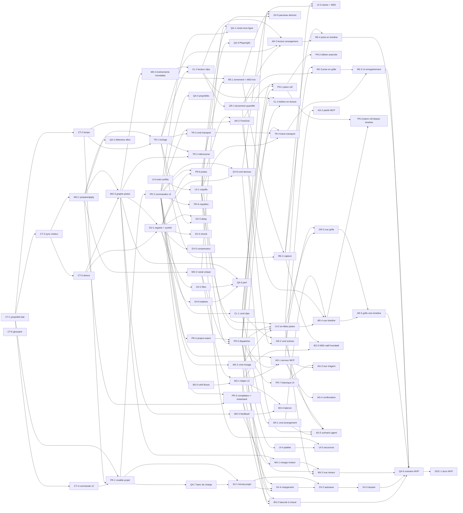

# Découpage du MVP

> **Proposition, en attente des décisions du fondateur** (document « Faulk — Plan MVP et swarm »). Ce document reprend l'étude du 2026-10-13 sur le découpage du MVP pour un essaim d'agents, avec les ajustements de la synthèse : le fichier de projet unique `.faulk` en JSON est remplacé par le format dossier de [Modèle de projet et format sur disque](../architecture/02-modele-projet.md), et une tâche « banc de charge » (QA-7) s'ajoute à la phase 1, ce qui porte le total à 81 tâches. L'étude s'appuie sur le code de la branche `feat/2-midi-oscillateur` (commit `766cfaa`) ; le code reste la source de vérité.

## 0. Objectif du MVP

Objectif du fondateur : **arriver à la création d'un projet multi-pistes avec différents instruments, dans les différents modes.**

À la fin du MVP, un utilisateur (ou un agent MCP) peut :

1. créer un projet, plusieurs pistes, chacune avec un instrument et une chaîne d'effets ;
2. jouer en direct sur la piste sélectionnée (MIDI, clavier de l'ordinateur), en mode Web comme en mode Boost ;
3. créer, éditer (piano roll) et enregistrer des clips MIDI ;
4. lancer des clips et des scènes dans une **grille de lancement**, avec quantification ;
5. placer des clips sur une **timeline d'arrangement** et la jouer en boucle ;
6. piloter le transport (lecture, arrêt, boucle, tempo, métronome) ;
7. mixer (volume, panoramique, mute, solo, vu-mètres) ;
8. enregistrer le projet, le rouvrir, et obtenir le même rendu ;
9. faire tout cela par commandes typées, exposées en outils MCP.

Hors MVP (proposé, à confirmer) : l'Atelier et la compilation Faust à la volée ([spec de l'Atelier](01-atelier-modules.md)), les sessions ACP (qui arrivent avec l'Atelier), les pistes audio et l'import d'échantillons, l'automation, les changements de tempo dans le temps, les envois et retours, les plugins tiers CLAP/VST3, WebMCP. Le format de projet réserve déjà leur place (blobs, couloirs d'automation, carte de tempo).

## 1. Constat sur le code de la branche `feat/2-midi-oscillateur`

| Constat | Conséquence pour le MVP |
| --- | --- |
| `Command::apply(&self, synth: &mut Synth)` : les commandes agissent directement sur **un** synthé du moteur. | Il manque un **modèle de projet** distinct du moteur : les commandes modifient le projet, qui produit les messages moteur. |
| Un seul `enum Command` avec trois `match` (`name`, `apply`, `undo_kind`) dans `crates/commands/src/lib.rs`. | Point chaud de conflits dès que dix agents ajoutent des commandes. |
| Le mappage commande → moteur est écrit en TypeScript côté Web (`web/src/lib/engine/wasm-ops.ts`) et en Rust côté Boost (`helper/src/audio.rs::engine_event`). | Risque de divergence Web/Boost : il faut **un seul chemin**, en Rust, partagé par les deux cibles. |
| `Session.run` dans `web/src/lib/session.svelte.ts` est un `switch` par type de commande. | À remplacer par un dispatcher générique. |
| Un export C `fk_*` par opération dans `engine-wasm`. | À remplacer par une boîte de réception binaire unique (`fk_push`) et une boîte d'envoi (`fk_feedback`). |
| `web/src/lib/i18n.ts` : un seul fichier de chaînes ; `App.svelte` : un seul écran. | Points chauds de conflits pour l'interface. |
| Pas de temps musical, de piste, de clip, d'identifiant stable. | Tout le socle est à construire avant les fonctions visibles. |
| Mode Boost écrit mais non vérifié. | À vérifier avant d'empiler le multi-pistes dessus. |

## 2. Décisions d'architecture proposées pour le socle

Ces décisions sont l'objet des tâches de la phase 0 (une ADR chacune dans `docs/adr/`). Le fondateur les valide.

### 2.1 Qui possède l'état du projet

- Nouvelle crate **`crates/project`** : le document (projet, pistes, devices, scènes, emplacements de clips, clips, notes, arrangement, réglages du transport), pur Rust, `serde`, sans I/O ; son format sur disque est celui du [modèle de projet](../architecture/02-modele-projet.md). Elle modifie la table « Stack and layout » de `CLAUDE.md`.
- `crates/commands` applique les commandes **au projet** : `apply(&mut Project, Command) -> Result<Outcome, CommandError>`, où `Outcome` contient la sortie typée, l'annulation, les `ProjectEvent` (pour l'interface) et les `ControlMsg` (pour le moteur).
- **La page possède le projet** : le cœur projet + commandes est compilé en WASM (`crates/project-wasm`, `wasm-bindgen` permis car il tourne sur le thread principal, pas dans le worklet). En mode Boost, la page envoie au helper les `ControlMsg`, pas les commandes ; le helper reste un pont sans logique produit, et son serveur MCP relaie les appels d'outils vers la page.
- Conséquence : basculer Web ↔ Boost = rejouer un **instantané** du projet vers l'autre moteur ; ouvrir un projet = même mécanisme.

### 2.2 Temps musical

- Positions et durées en **ticks entiers**, 960 par noire (`i64`).
- Tempo constant par projet (`f64` BPM, 20–999), signature rythmique ; pas de changement de tempo dans le temps au MVP.
- Le moteur convertit ticks ↔ échantillons avec une position `f64` ; les événements sont placés **à l'échantillon près** (découpage du bloc aux offsets).
- Quantification de lancement : aucune, 1/16, 1/8, 1/4, 1/2, 1 mesure, 2, 4 mesures. Boucle du transport : région `[début, fin)` en ticks.

### 2.3 Synchronisation projet → moteur sans verrou

Un seul code pour les deux cibles :

1. **`ControlMsg`** (encodage binaire compact) : ce que le projet envoie au moteur (créer une piste à l'emplacement *n*, insérer un device, régler un paramètre, téléverser les notes d'un clip, lancer un clip, jouer…).
2. `Engine::prepare(ControlMsg) -> RtMsg` : **hors chemin audio**, peut allouer (construire un device, un tampon de delay, une table de notes).
3. `Engine::apply(RtMsg)` : **sur le chemin audio**, sans allocation, en début de bloc ou à l'offset indiqué ; ce qui est remplacé part dans une file de « déchets » libérée hors chemin audio.
4. **`Feedback`** (moteur → page) : tête de lecture, état des clips, vu-mètres par piste, notes enregistrées, charge processeur, à environ 30 Hz.

Par cible :

- **Natif (helper)** : `prepare` sur un thread de contrôle, `RtMsg` vers le callback audio par `rtrb`, déchets en retour par un second `rtrb`.
- **WASM** : la mémoire du module n'est pas partagée au MVP (pas de `SharedArrayBuffer`, qui exige l'isolation cross-origin : décision ouverte, voir [stockage local](../architecture/03-stockage-local.md) § 3.4), donc `prepare` s'exécute dans le `onmessage` du worklet, **hors de `process`**. La page envoie des octets (`fk_push(ptr, len)`). Le module réserve sa mémoire au démarrage pour éviter un `memory.grow` en cours de session.
- **Capacités fixes** décidées dans l'ADR (proposition : 32 pistes, 8 devices par piste, 64 scènes, 65 536 notes au total, 256 événements par bloc). Le projet refuse la commande avant qu'elle n'atteigne le moteur : le moteur n'échoue jamais en temps réel. Ces capacités portent sur ce que le moteur joue, pas sur le format : le banc de charge (QA-7) dépasse volontairement ces chiffres, et ses mesures aident à les fixer.
- Le mappage commande → messages vit en Rust (`crates/commands`), jamais en TypeScript.

### 2.4 Contrat de commande v2

- Nom `domaine.verbe` (`track.create`, `clip.notes.add`, `transport.play`).
- Entrée **et sortie** typées (`schemars`) ; la sortie donne les identifiants créés.
- **Identifiants stables** (`TrackId`, `ClipId`, `SceneId`, `DeviceId`) générés par le projet, jamais des index ; le projet tient la correspondance identifiant → emplacement moteur. Le `NoteId` est à trancher : le [modèle de projet](../architecture/02-modele-projet.md) écrit les notes sans identifiant sur disque.
- Métadonnées de schéma : `x-undo` (`inverse`, `host`, `none`, et `snapshot` si l'annulation par instantané du modèle de projet est retenue), `x-destructive` (confirmation obligatoire), `x-kind` (`edit` entre dans l'historique, `live` éphémère comme une note jouée ou la lecture, `query` lecture seule).
- Historique : pile annuler/rétablir, **groupes** (un glisser de souris, un tour d'agent = une annulation), **auteur** sur chaque entrée (`user`, `agent:<nom>`).
- Disposition anti-conflits : un module par domaine (§ 5).
- Question ouverte : l'état de vue (sélection, zoom, défilement, vue affichée) est-il une commande ? Proposition : non pour le zoom et le défilement ; oui pour la sélection de piste (`view.select_track`, `x-kind: live`), qui décide où va le MIDI live et qu'un agent doit pouvoir lire.

### 2.5 Contrat de device (instrument ou effet)

- Trait `Device` dans `crates/engine` : `process(&mut self, ctx: &BlockCtx, events: &[NoteEvent], io: &mut AudioIo)`, `set_param(id, value)`, `reset()`. Sans allocation, sans panique.
- Descripteur statique par type : `kind` (`"faulk.osc_synth"`), rôle, paramètres (id stable, clé de nom, unité, min, max, défaut, échelle, valeurs énumérées). Exporté dans le schéma : l'interface **génère** les panneaux de réglage et les agents connaissent les paramètres.
- Un fichier par device (`crates/engine/src/devices/<kind>.rs`) et un registre d'une ligne par device.
- Les futurs modules de l'Atelier implémenteront ce même contrat.

### 2.6 Interface

- `Session` est découpée en : **dispatcher** (`run(command)` générique vers `project-wasm`), **store projet** (miroir réactif alimenté par les `ProjectEvent`), **store moteur** (statut, mode, latence, tête de lecture, vu-mètres, alimenté par le `Feedback`).
- Les vues lisent les stores et n'appellent que `run`.
- Composants partagés à figer tôt : `TimeGrid` (règle, zoom, aimantation, conversion ticks ↔ pixels), `ParamControl` (bouton généré depuis un descripteur), `TrackHeader` (nom, couleur, mute, solo, armement).

## 3. Épopées et tâches

Chaque tâche tient en une pull request pour un agent et donne : **But**, **Critères**, **Touche** (dossiers), **Dépend de**, **Phase**. Les critères s'ajoutent à la Definition of done de `CLAUDE.md` (fmt, clippy, tests, build WASM, parité, Playwright pour le web, schéma et undo testés pour les commandes).

Préfixes : `CT` contrats, `PR` projet et commandes, `MO` moteur, `TR` transport, `DV` devices, `CL` clips, `GR` grille de lancement, `AR` arrangement, `PN` piano roll, `RE` enregistrement, `MX` mixeur, `SV` sauvegarde, `AG` agents, `BO` mode Boost, `UI` interface, `QA` qualité, `DOC` documentation. La numérotation de l'étude est conservée : il n'y a pas de DV-7.

### Épopée 0 — Contrats et décisions (CT)

Une ADR par décision dans `docs/adr/` (créé à la demande, voir [domain docs](../agents/domain.md)), en français, frontmatter OKF, `status: draft`. Chaque ADR se termine par l'API Rust ou le schéma figé, en code.

**CT-1 — ADR : propriété de l'état et nouvelle crate `project`**
- But : figer § 2.1.
- Critères : ADR acceptée par le fondateur ; `CLAUDE.md` (table Stack) et l'[architecture](../architecture/01-architecture.md) mis à jour ; squelettes vides de `crates/project` et `crates/project-wasm` dans le workspace (compilent, aucun code métier).
- Touche : `docs/adr/`, `docs/architecture/`, `CLAUDE.md`, `Cargo.toml`, `crates/project*`.
- Dépend de : aucune. Phase 0.

**CT-2 — ADR : modèle de temps musical**
- But : figer § 2.2.
- Critères : types `Tick`, `Tempo`, `TimeSignature`, `Quantize`, `LoopRegion` avec conversions et tests (aller-retour ticks ↔ échantillons à 44,1/48/96 kHz, arrondis documentés).
- Touche : `docs/adr/`, module `time` (probablement dans `engine`, réexporté, puisque moteur et projet en ont besoin ; à décider dans l'ADR).
- Dépend de : CT-1. Phase 0.

**CT-3 — ADR : synchronisation projet → moteur (prepare/apply, capacités, feedback)**
- But : figer § 2.3.
- Critères : énumérations `ControlMsg`, `RtMsg`, `Feedback` déclarées (variantes du MVP listées, même vides), capacités chiffrées, format binaire décrit (en-tête, version, endianness), attaque écrite : file pleine, message inconnu, capacité dépassée, bascule de moteur en cours de message.
- Touche : `docs/adr/`, `crates/engine/src/msg.rs` (types seulement).
- Dépend de : CT-1. Phase 0.

**CT-4 — ADR : contrat de commande v2**
- But : figer § 2.4 et trancher l'état de vue et le `NoteId`.
- Critères : signature `apply` figée en code ; domaines du MVP figés (`project`, `track`, `device`, `clip`, `note`, `scene`, `launch`, `arrangement`, `transport`, `mixer`, `record`, `midi`, `live`, `history`, `view`) ; règle de test « chaque commande a description, schéma d'entrée et de sortie, undo testé ».
- Touche : `docs/adr/`, `crates/commands` (squelettes des modules).
- Dépend de : CT-1. Phase 0.

**CT-5 — ADR : contrat de device**
- But : figer § 2.5.
- Critères : trait et descripteurs écrits dans `crates/engine/src/device.rs` ; le schéma exporté contient les descripteurs (exemple avec le synthé actuel).
- Touche : `docs/adr/`, `crates/engine`.
- Dépend de : CT-3. Phase 0.

**CT-6 — Glossaire du domaine**
- But : créer `GLOSSARY.md` à la racine (projet, piste, device, instrument, effet, scène, emplacement de clip, clip, note, arrangement, lancement, quantification, armement, tête de lecture, prise, version, variante, blob).
- Critères : chaque terme a sa définition et son identifiant de code ; aucun nom d'autre logiciel.
- Touche : `GLOSSARY.md`.
- Dépend de : aucune. Phase 0.

**UI-0 — Anti-conflits côté web et fichiers générés**
- But : préparer le dépôt au travail parallèle (§ 5).
- Critères : i18n découpée par fonctionnalité (`web/src/lib/i18n/<feature>.ts`, assemblage typé, test de complétude EN/FR) ; registre de vues (`web/src/views/registry.ts`, une ligne par vue) ; fichiers générés (`web/src/lib/generated/*`) produits au `prebuild`/`pretest` et vérifiés en CI au lieu d'être fusionnés à la main (ou retirés de git : décision dans la PR) ; CI découpée en workflows par domaine.
- Touche : `web/src/lib/i18n*`, `web/src/views/`, `web/scripts/`, `.github/workflows/`, `.gitattributes`.
- Dépend de : aucune. Phase 0.

**BO-0 — Vérifier le mode Boost existant**
- But : vérifier sur la machine du fondateur le code Boost de l'issue #2 avant d'empiler dessus.
- Critères : appairage, son, MIDI natif, bascule aller-retour vérifiés ; latence **mesurée** (méthode notée) ; défauts ouverts en issues `Bug`.
- Touche : `crates/helper` (corrections seulement), [S1](../spikes/S1-moteur-hybride.md).
- Dépend de : merge de l'issue #2. Phase 0. Partiellement `ready-for-human` (matériel).

### Épopée 1 — Projet et couche de commandes (PR)

**PR-1 — Modèle de projet**
- But : implémenter `crates/project` selon le [modèle de projet](../architecture/02-modele-projet.md) : projet, pistes, devices, scènes, emplacements de clips, clips, notes, placements, réglages du transport, identifiants stables, clés d'ordre fractionnaires, capacités.
- Critères : invariants vérifiés par `validate()` (identifiants uniques, références valides, notes dans la longueur du clip, capacités) ; sérialisation aller-retour ; tests de propriétés sur la génération d'identifiants et de clés d'ordre.
- Touche : `crates/project`.
- Dépend de : CT-1, CT-2, CT-4. Phase 1.

**PR-2 — Couche de commandes v2 sur le projet**
- But : refondre `crates/commands` en modules par domaine, `apply(&mut Project)` → `Outcome { output, undo, events, control }`, historique (annuler, rétablir, groupes, auteur) ; migrer les commandes existantes (`note.on` devient `live.note_on { track }`, `synth.set_param` devient `device.set_param`, `midi.*` inchangées).
- Critères : un test parcourt **toutes** les commandes (énumération générée, pas une liste écrite à la main) et vérifie description, schémas, `x-undo`, `x-kind` ; aller-retour apply → undo → état identique pour chaque commande `edit` ; `history.undo`, `history.redo`, `history.begin_group`, `history.end_group`.
- Touche : `crates/commands`, `crates/protocol` (export du schéma).
- Dépend de : PR-1. Phase 1.

**PR-3 — Compilateur projet → moteur et instantané**
- But : chaque `Outcome` porte les `ControlMsg` du changement ; `snapshot(&Project) -> Vec<ControlMsg>` rejoue un projet entier sur un moteur vide (bascule de mode, ouverture).
- Critères : « appliquer N commandes en direct » et « instantané du projet final » produisent le **même rendu** hors ligne (harnais QA-1) ; table identifiant → emplacement moteur tenue par le projet, réutilisation des emplacements libérés testée.
- Touche : `crates/commands`, `crates/project`.
- Dépend de : PR-2, MO-1. Phase 1.

**PR-4 — `project-wasm` : le cœur projet dans la page**
- But : compiler `project` + `commands` en WASM pour le thread principal ; API `run(json) -> json` (sortie, événements, octets moteur), `snapshot()`, `load(files)`, `save() -> fichiers sales`.
- Critères : test Vitest qui crée un projet, des pistes et des notes par commandes ; types TypeScript générés depuis le schéma ; taille du `.wasm` mesurée et notée.
- Touche : `crates/project-wasm`, `web/scripts/`, `web/src/lib/project/`.
- Dépend de : PR-2. Phase 1.

**PR-5 — Dispatcher web générique et stores**
- But : remplacer le `switch` de `Session.run` par `run(command)` → `project-wasm` → octets moteur vers le moteur actif ; stores projet et moteur ; supprimer `wasm-ops.ts`.
- Critères : aucune référence à un type de commande dans le dispatcher ; l'écran actuel (synthé, clavier, MIDI) fonctionne via les nouvelles commandes ; test Playwright : note jouée, son mesuré non nul, aucune erreur console.
- Touche : `web/src/lib/session*`, `web/src/lib/stores/`, `web/src/lib/engine/`.
- Dépend de : PR-4, MO-2, UI-1. Phase 2.

**PR-6 — Commandes de requête pour les agents**
- But : `project.get`, `track.list`, `track.get`, `clip.get`, `clip.notes.list`, `scene.list`, `device.describe`, `transport.get` (`x-kind: query`).
- Critères : sorties typées et documentées ; aucune requête ne modifie le projet (égalité avant/après) ; pagination des listes de notes.
- Touche : `crates/commands`.
- Dépend de : PR-2. Phase 3.

**PR-7 — Annuler, rétablir et historique dans l'interface**
- But : boutons et raccourcis annuler/rétablir, panneau d'historique (libellé, auteur, heure).
- Critères : un glisser de note = une entrée ; l'historique affiche l'auteur ; test Playwright.
- Touche : `web/src/views/history/`, `web/src/lib/i18n/history.ts`.
- Dépend de : PR-5. Phase 3.

**PR-8 — Commandes de pistes**
- But : `track.create { instrument, name?, color? }`, `track.delete` (destructive), `track.rename`, `track.set_color`, `track.move`, `track.duplicate`, `view.select_track`.
- Critères : capacité maximale refusée par une erreur typée ; `track.delete` puis undo restaure piste, devices et clips à l'identique.
- Touche : `crates/commands/src/track.rs`, `crates/project`.
- Dépend de : PR-2, DV-1. Phase 2.

### Épopée 2 — Moteur : graphe et synchronisation (MO)

**MO-1 — Messages moteur et cycle prepare/apply**
- But : `ControlMsg` (encodage et décodage binaires), `Engine::prepare`, `Engine::apply`, file de déchets.
- Critères : décodage de n'importe quels octets sans panique (fuzz ou proptest) ; `apply` sous détecteur d'allocation ; même comportement en natif et en WASM.
- Touche : `crates/engine/src/msg.rs`, `crates/engine/src/engine.rs`.
- Dépend de : CT-3. Phase 1.

**MO-2 — Un seul canal vers le moteur, dans les deux cibles**
- But : `engine-wasm` expose `fk_push(ptr, len)` et `fk_feedback()` ; le worklet devient générique (octets in, octets out) ; le helper consomme le même flux (thread de contrôle + `rtrb`).
- Critères : `worklet.ts` ne connaît aucun type de commande ; test de parité natif/WASM sur un flux de messages enregistré ; anciens exports `fk_note_on`… supprimés.
- Touche : `crates/engine-wasm`, `web/src/lib/engine/`, `crates/helper/src/audio.rs`.
- Dépend de : MO-1. Phase 1.

**MO-3 — Graphe de pistes et chaînes de devices**
- But : N pistes préallouées, chacune instrument + effets en série, somme vers le master, tampons préalloués.
- Critères : rendu de 8 pistes avec le synthé ; ajouter ou supprimer une piste pendant la lecture sans clic (fondu court) ni allocation dans `process` ; une piste vide ne coûte pas de calcul notable (mesuré).
- Touche : `crates/engine/src/graph.rs`.
- Dépend de : MO-1, CT-5. Phase 1.

**MO-4 — Événements horodatés à l'échantillon près**
- But : les événements de note (live, clips) portent un offset dans le bloc ; le moteur découpe le bloc et route vers l'instrument de la piste cible.
- Critères : une note programmée à l'échantillon *k* démarre exactement à *k* (détection d'onset) pour des blocs de 64, 128, 512, 2048 ; file bornée, débordement compté et signalé dans le `Feedback`.
- Touche : `crates/engine/src/events.rs`, `crates/engine/src/graph.rs`.
- Dépend de : MO-3. Phase 2.

**MO-5 — Retour visuel multi-pistes**
- But : vu-mètres crête et RMS par piste et master, tête de lecture, charge processeur, compteurs de débordement, à environ 30 Hz.
- Critères : aucune allocation sur le chemin audio (côté worklet, remplacer le `postMessage` d'objet par un tampon réutilisé) ; décodage côté page testé.
- Touche : `crates/engine`, `crates/engine-wasm`, `web/src/lib/engine/`, `crates/helper`.
- Dépend de : MO-3. Phase 2.

### Épopée 3 — Transport et temps musical (TR)

**TR-1 — Horloge musicale du moteur**
- But : lecture, arrêt, déplacement de la tête, tempo, signature, boucle, conversion ticks ↔ échantillons.
- Critères : dérive nulle sur 10 minutes à 120 BPM ; boucle sans trou ni doublon d'événement à la jointure ; changement de tempo en lecture sans saut.
- Touche : `crates/engine/src/transport.rs`.
- Dépend de : MO-1, CT-2. Phase 1.

**TR-2 — Métronome**
- But : clic synthétisé (accent sur le premier temps), activation, volume, décompte optionnel avant enregistrement.
- Critères : clics à l'échantillon près (test d'onset) ; silence quand désactivé ; sortie sur le master hors vu-mètres des pistes.
- Touche : `crates/engine/src/metronome.rs`.
- Dépend de : TR-1, MO-3. Phase 2.

**TR-3 — Commandes de transport**
- But : `transport.play`, `transport.stop`, `transport.seek`, `transport.set_tempo`, `transport.set_time_signature`, `transport.set_loop`, `transport.toggle_loop`, `metronome.set`.
- Critères : tempo, signature, boucle et métronome sont des `edit` (annulables, enregistrés) ; lecture et arrêt sont `live` ; bornes de tempo refusées proprement.
- Touche : `crates/commands/src/transport.rs`.
- Dépend de : PR-2, TR-1. Phase 2.

**TR-4 — Barre de transport**
- But : lecture/arrêt, position en mesures:temps:ticks et minutes:secondes, tempo éditable, boucle, métronome, enregistrement (désactivé jusqu'à RE-5), état du moteur (mode, latence, charge) toujours visible.
- Critères : chaque contrôle passe par une commande ; glyphes d'état du DS-0.1 ; test Playwright lecture/arrêt et changement de tempo.
- Touche : `web/src/views/transport/`, `web/src/lib/i18n/transport.ts`.
- Dépend de : PR-5, TR-3, UI-1. Phase 2.

### Épopée 4 — Instruments et effets (DV)

**DV-1 — Registre de devices et synthé porté**
- But : registre des devices ; le synthé oscillateur actuel devient le device `faulk.osc_synth` avec son descripteur ; descripteurs exportés dans le schéma.
- Critères : rendu identique à l'ancien synthé (rendu de référence) ; aucun identifiant de paramètre écrit en dur côté web.
- Touche : `crates/engine/src/devices/`, `crates/protocol`.
- Dépend de : CT-5, MO-3. Phase 1.

**DV-2 — Filtre multimode**
- But : passe-bas, passe-haut, passe-bande, résonance, lissage des paramètres.
- Critères : atténuation mesurée à une octave de la coupure ; stable à résonance maximale ; ni NaN ni dénormaux.
- Touche : `crates/engine/src/devices/filter.rs`.
- Dépend de : DV-1. Phase 2.

**DV-3 — Delay synchronisable au tempo**
- But : temps libre ou en division, retour, mélange.
- Critères : écho mesuré au bon nombre d'échantillons ; tampon alloué dans `prepare` ; changement de tempo sans craquement.
- Touche : `crates/engine/src/devices/delay.rs`.
- Dépend de : DV-1, TR-1. Phase 4.

**DV-4 — Réverbération**
- But : réverbération algorithmique (taille, amortissement, mélange).
- Critères : queue qui décroît vers le silence ; coût processeur mesuré.
- Touche : `crates/engine/src/devices/reverb.rs`.
- Dépend de : DV-1. Phase 4.

**DV-5 — Compresseur**
- But : seuil, ratio, attaque, relâchement, gain de compensation.
- Critères : courbe statique mesurée conforme au ratio ; aucun dépassement non borné.
- Touche : `crates/engine/src/devices/compressor.rs`.
- Dépend de : DV-1. Phase 4.

**DV-6 — Batterie synthétisée**
- But : un deuxième instrument de nature différente : grosse caisse, caisse claire, charleston, clap, mappés sur des notes.
- Critères : chaque son déclenché par sa note, non silencieux et sans NaN ; paramètres par son dans le descripteur.
- Touche : `crates/engine/src/devices/drums.rs`.
- Dépend de : DV-1. Phase 2.

**DV-8 — Commandes de devices**
- But : `device.insert { track, kind, index }`, `device.remove` (destructive), `device.move`, `device.set_param`, `device.set_bypass`, `track.set_instrument`. L'index de la commande est traduit en clé d'ordre fractionnaire.
- Critères : `device.set_param` valide l'identifiant contre le descripteur ; l'undo de `device.remove` restaure les réglages.
- Touche : `crates/commands/src/device.rs`.
- Dépend de : PR-2, DV-1. Phase 2.

**DV-9 — Panneau de chaîne de devices**
- But : panneau du bas avec l'instrument et les effets de la piste sélectionnée, réglages générés (`ParamControl`), ajout depuis un navigateur d'instruments et d'effets, suppression, réordonnancement, contournement.
- Critères : aucun panneau écrit à la main par device ; un nouveau device apparaît sans changer l'interface ; test Playwright.
- Touche : `web/src/views/devices/`, `web/src/lib/components/ParamControl.svelte`, `web/src/lib/i18n/devices.ts`.
- Dépend de : PR-5, DV-8, UI-1. Phase 2.

### Épopée 5 — Clips (CL)

**CL-1 — Modèle et commandes de clips MIDI**
- But : `clip.create { slot | arrangement }`, `clip.delete`, `clip.duplicate`, `clip.rename`, `clip.set_length`, `clip.set_loop`, `clip.notes.add` (lot), `clip.notes.remove`, `clip.notes.update` (position, durée, hauteur, vélocité, en lot).
- Critères : un lot = une entrée d'historique ; notes hors longueur refusées ou tronquées selon l'ADR ; capacité de notes respectée.
- Touche : `crates/commands/src/clip.rs`, `crates/project`.
- Dépend de : PR-2. Phase 3.

**CL-2 — Lecteur de clips dans le moteur**
- But : tables de notes préallouées, téléversement par fragments (`prepare`), lecture d'un clip en boucle synchronisée au transport.
- Critères : aucune note coincée à l'arrêt, au bouclage, à la suppression d'un clip en lecture ; note qui chevauche la fin de boucle coupée proprement ; parité natif/WASM.
- Touche : `crates/engine/src/clip_player.rs`.
- Dépend de : MO-4, TR-1. Phase 3.

**CL-3 — Édition d'un clip pendant sa lecture**
- But : remplacer atomiquement la version d'un clip en lecture (nouvelle table préparée, échange dans `apply`, ancienne table aux déchets).
- Critères : 1 000 éditions pendant la lecture : aucune allocation sur le chemin audio, aucune note coincée, pas de trou audible.
- Touche : `crates/engine`, `crates/commands`.
- Dépend de : CL-1, CL-2, PR-3. Phase 3.

### Épopée 6 — Grille de lancement (GR)

**GR-1 — Lancement quantifié dans le moteur**
- But : lancer ou arrêter un clip ou une scène à la prochaine frontière de quantification ; un clip à la fois par piste ; états (armé, en attente, en lecture, arrêt en attente) dans le `Feedback`.
- Critères : départ à l'échantillon de la frontière pour chaque quantification ; lancer un autre clip sur la même piste remplace le premier à la frontière sans note coincée.
- Touche : `crates/engine/src/launcher.rs`.
- Dépend de : CL-2. Phase 3.

**GR-2 — Commandes de scènes et de lancement**
- But : `scene.create`, `scene.delete`, `scene.rename`, `scene.move`, `launch.clip`, `launch.scene`, `launch.stop_track`, `launch.stop_all`, `transport.set_launch_quantization`.
- Critères : `launch.*` sont `live` ; les scènes sont `edit` ; supprimer une scène qui contient des clips est destructive et confirmée.
- Touche : `crates/commands/src/scene.rs`, `crates/commands/src/launch.rs`.
- Dépend de : CL-1, GR-1. Phase 3.

**GR-3 — Vue grille de lancement**
- But : pistes en colonnes, scènes en lignes ; lancement par clic, état visible ; clip vide par double-clic ; ouverture du piano roll.
- Critères : fluide à 32 pistes × 64 scènes (mesuré) ; chaque état a un glyphe en plus de sa couleur ; test Playwright de lancement de scène.
- Touche : `web/src/views/grid/`, `web/src/lib/i18n/grid.ts`.
- Dépend de : GR-2, UI-2. Phase 3.

### Épopée 7 — Timeline d'arrangement (AR)

**AR-1 — Modèle et commandes d'arrangement**
- But : placements par piste (début, durée, décalage dans la source, boucle), écrits dans l'`arrangement.tsv` de chaque piste ; `arrangement.place`, `arrangement.move`, `arrangement.resize`, `arrangement.split`, `arrangement.delete`, `arrangement.duplicate`.
- Critères : chevauchements résolus selon une règle écrite dans l'ADR (le dernier posé gagne, l'autre est rogné) et testés.
- Touche : `crates/commands/src/arrangement.rs`, `crates/project`.
- Dépend de : CL-1. Phase 4.

**AR-2 — Lecture de l'arrangement et priorité grille / arrangement**
- But : le moteur joue la timeline ; par piste, un clip lancé depuis la grille prend la main jusqu'à `launch.back_to_arrangement`.
- Critères : seek au milieu d'une note longue sans démarrage en retard ni en double (règle écrite) ; boucle de région ; parité natif/WASM.
- Touche : `crates/engine/src/arrangement.rs`, `crates/commands/src/launch.rs`.
- Dépend de : CL-2, TR-1, GR-1. Phase 4.

**AR-3 — Composant `TimeGrid` partagé**
- But : règle (mesures, temps), zoom, défilement, aimantation, conversion ticks ↔ pixels, rendu canvas ; utilisé par la timeline et le piano roll.
- Critères : tests unitaires des conversions et de l'aimantation ; 60 images/s au défilement sur 200 mesures (mesuré dans Playwright).
- Touche : `web/src/lib/components/timegrid/`.
- Dépend de : UI-1, CT-2. Phase 3.

**AR-4 — Vue timeline d'arrangement**
- But : pistes, clips placés, glisser, redimensionner, couper, dupliquer, tête de lecture, région de boucle.
- Critères : chaque geste = une commande, un glisser = un groupe d'annulation ; test Playwright.
- Touche : `web/src/views/arrangement/`, `web/src/lib/i18n/arrangement.ts`.
- Dépend de : AR-1, AR-3, UI-2. Phase 4.

**AR-5 — De la grille vers l'arrangement**
- But : glisser un clip de la grille vers la timeline (copie) ; commande `arrangement.place_from_slot`.
- Critères : la copie est indépendante de l'original ; test. (Clip lié ou indépendant par défaut : question ouverte du [modèle de projet](../architecture/02-modele-projet.md).)
- Touche : `crates/commands`, `web/src/views/arrangement/`.
- Dépend de : GR-3, AR-4. Phase 4.

### Épopée 8 — Piano roll (PN)

**PN-1 — Éditeur piano roll**
- But : clavier vertical, grille `TimeGrid`, dessin, sélection (clic, rectangle), déplacement, redimensionnement, suppression, ligne de vélocité, écoute de la note éditée, longueur et boucle du clip.
- Critères : chaque geste = une commande, un glisser = un groupe ; fluide avec 2 000 notes (mesuré) ; test Playwright dessin + annulation.
- Touche : `web/src/views/piano-roll/`, `web/src/lib/i18n/piano-roll.ts`.
- Dépend de : CL-1, AR-3, PR-5. Phase 3.

**PN-2 — Édition avancée**
- But : quantification (avec force), transposition, duplication de sélection, copier/coller, raccourcis.
- Critères : `clip.notes.quantize` testée sur des cas limites (note à cheval sur la fin du clip).
- Touche : `crates/commands/src/clip.rs`, `web/src/views/piano-roll/`.
- Dépend de : PN-1. Phase 3.

**PN-3 — Piano roll ouvert depuis la timeline**
- But : ouvrir le clip d'un placement, avec la tête de lecture dans le contexte de la timeline.
- Critères : la tête de lecture du piano roll suit la position dans le clip pour les deux origines (grille, timeline).
- Touche : `web/src/views/piano-roll/`, `web/src/views/arrangement/`.
- Dépend de : PN-1, AR-4. Phase 4.

### Épopée 9 — Enregistrement MIDI (RE)

**RE-1 — Armement, monitoring et MIDI live vers les pistes**
- But : `track.arm`, `track.set_monitor` ; le MIDI live (Web MIDI, MIDI natif, clavier de l'ordinateur) va à la piste sélectionnée et aux pistes armées.
- Critères : changer de piste pendant une note tenue ne coince pas la note ; fonctionne en Web et en Boost.
- Touche : `crates/commands/src/record.rs`, `crates/engine`, `web/src/lib/midi/`, `crates/helper/src/midi.rs`.
- Dépend de : MO-4, PR-8. Phase 2.

**RE-2 — Capture dans le moteur**
- But : horodater les entrées au tick, tampon d'enregistrement préalloué, notes capturées renvoyées dans le `Feedback` ; compensation de la latence de sortie.
- Critères : une note jouée sur un temps (MIDI simulé à horodatage connu) est enregistrée sur ce temps à ± 1 ms en Web, méthode notée ; tampon plein signalé, jamais d'allocation.
- Touche : `crates/engine/src/recorder.rs`, `web/src/lib/midi/`.
- Dépend de : RE-1, TR-1. Phase 3.

**RE-3 — Enregistrer dans un emplacement de la grille**
- But : enregistrer une prise dans un emplacement vide ; longueur arrondie à la quantification ; la prise devient un clip par **une** commande annulable (`record.commit_take`).
- Critères : annuler retire toute la prise ; enregistrement en boucle (overdub) sur un clip existant.
- Touche : `crates/commands/src/record.rs`, `crates/engine`.
- Dépend de : RE-2, GR-1. Phase 3.

**RE-4 — Enregistrer dans l'arrangement**
- But : enregistrer sur la timeline à la tête de lecture, avec décompte, et en boucle de région (prises superposées fusionnées).
- Critères : la prise est placée là où elle a été jouée ; une entrée d'historique par prise.
- Touche : `crates/commands/src/record.rs`, `crates/engine`.
- Dépend de : RE-2, AR-2. Phase 4.

**RE-5 — Interface d'enregistrement**
- But : bouton d'enregistrement global, armement par piste, décompte, notes en cours d'enregistrement visibles.
- Critères : test Playwright avec Web MIDI simulé : enregistrer 4 notes, les voir dans le piano roll, annuler.
- Touche : `web/src/views/transport/`, `web/src/views/grid/`, `web/src/lib/components/TrackHeader.svelte`.
- Dépend de : RE-3, TR-4. Phase 3.

### Épopée 10 — Mixeur (MX)

**MX-1 — Mixage dans le moteur**
- But : volume et panoramique par piste et master (lissés), mute, solo (exclusif ou cumulatif selon l'ADR), loi de panoramique documentée.
- Critères : −6 dB demandé = −6 dB mesuré ; mute et solo sans clic ; vu-mètres après fader.
- Touche : `crates/engine/src/mixer.rs`.
- Dépend de : MO-3, MO-5. Phase 2.

**MX-2 — Commandes de mixage**
- But : `mixer.set_volume`, `mixer.set_pan`, `mixer.set_mute`, `mixer.set_solo`, `mixer.set_master_volume`.
- Critères : un geste de fader = un groupe d'annulation ; valeurs hors bornes refusées ou bornées selon l'ADR ; solo versionné ou non selon la décision du [modèle de projet](../architecture/02-modele-projet.md).
- Touche : `crates/commands/src/mixer.rs`.
- Dépend de : PR-2. Phase 2.

**MX-3 — Vue mixeur**
- But : tranches de pistes (fader, pan, mute, solo, armement, vu-mètre, nom, couleur), tranche master.
- Critères : vu-mètres à 30 Hz sans fuite mémoire (mesuré sur 10 minutes) ; test Playwright.
- Touche : `web/src/views/mixer/`, `web/src/lib/i18n/mixer.ts`.
- Dépend de : MX-1, MX-2, UI-2. Phase 4.

### Épopée 11 — Sauvegarde et chargement (SV)

**SV-1 — Format de projet sur disque**
- But : implémenter le format dossier du [modèle de projet](../architecture/02-modele-projet.md) : écrivain et lecteur canoniques (JSON à clés triées, TSV), `blobs/<sha256>`, version de format et migrations, validation à l'ouverture, refus explicite d'un projet invalide ou plus récent, suivi des fichiers sales, instantané de cache dans `.faulk/cache/`, `.gitattributes` et `.gitignore`, export et import `.faulkpack`.
- Critères : projets de référence relus et réécrits octet pour octet ; écrire → relire → réécrire identique sur des projets générés ; éditer une note ne réécrit qu'un fichier ; fichier corrompu → erreur typée, jamais de panique (fuzz) ; seuils issus de QA-7 appliqués.
- Touche : `crates/project/src/file/`.
- Dépend de : PR-1, QA-7. Phase 3.

**SV-4 — Chargement d'un projet dans le moteur**
- But : `project.open` remplace le projet : arrêt, réinitialisation du moteur, instantané rejoué.
- Critères : rendu d'un projet enregistré puis rouvert identique au rendu d'origine ; aucune note coincée de l'ancien projet.
- Touche : `crates/commands/src/project.rs`, `web/src/lib/session*`.
- Dépend de : PR-3, SV-1, PR-5. Phase 3.

**SV-2 — Enregistrement automatique dans le navigateur**
- But : `ProjectStore` sur OPFS ; enregistrement automatique des fichiers sales après un court délai, liste des projets récents, reprise après fermeture de l'onglet, `persist()` demandé (voir [stockage local](../architecture/03-stockage-local.md)).
- Critères : test Playwright : modifier, recharger la page, retrouver le projet ; quota plein signalé ; onglet fermé pendant une écriture → ancien fichier intact.
- Touche : `web/src/lib/storage/`, `web/src/views/projects/`.
- Dépend de : SV-1, SV-4. Phase 3.

**SV-3 — Ouvrir et enregistrer dans un dossier**
- But : `project.new`, `project.save`, `project.save_as`, ouverture d'un dossier de projet (File System Access dans Chromium, poignée rangée en IndexedDB) ; ailleurs, repli par export et import `.faulkpack`.
- Critères : `project.new` sur un projet modifié non enregistré demande confirmation (destructive) ; permission perdue gérée (bandeau, geste) ; test Playwright du repli.
- Touche : `crates/commands/src/project.rs`, `web/src/lib/storage/`.
- Dépend de : SV-2. Phase 5.

### Épopée 12 — Agents (AG)

**AG-1 — Serveur MCP dans le helper, outils générés**
- But : serveur MCP local (`rmcp`, HTTP sur `127.0.0.1` avec jeton, et stdio) ; un outil par commande, généré depuis le schéma ; le helper relaie l'appel à la page et renvoie la sortie.
- Critères : protocole v2 avec requêtes et réponses corrélées (`id`) ; jeton, `Origin` et `Host` vérifiés (tests d'attaque) ; page absente → erreur typée claire.
- Touche : `crates/helper/src/mcp.rs`, `crates/protocol`, `web/src/lib/agents/`.
- Dépend de : PR-2, PR-5, BO-1. Phase 3.

**AG-2 — Test de parité commandes ↔ outils MCP**
- But : test CI qui compare l'énumération des commandes aux outils exposés (nom, schéma, description).
- Critères : une commande sans outil fait échouer le test (vérifié par un test qui l'enlève).
- Touche : `crates/helper/tests/`.
- Dépend de : AG-1. Phase 3.

**AG-3 — Auteur et tour d'agent**
- But : chaque appel MCP porte l'auteur ; un tour d'agent = un groupe d'annulation ; l'historique l'affiche.
- Critères : annuler une fois défait tout un tour ; un geste de l'utilisateur pendant le tour n'est pas avalé dans le groupe (règle écrite et testée).
- Touche : `crates/commands`, `web/src/views/history/`.
- Dépend de : PR-7, AG-1. Phase 5.

**AG-4 — Confirmation des commandes destructrices**
- But : toute commande `x-destructive` demande une confirmation dans la page, quel que soit l'appelant ; refus → erreur typée renvoyée à l'agent.
- Critères : avec un client MCP de test, `track.delete` attend la confirmation ; refus → aucun changement.
- Touche : `web/src/lib/agents/`, `web/src/views/confirm/`.
- Dépend de : AG-1. Phase 5.

**AG-5 — Scénario agent de bout en bout**
- But : un client MCP scripté crée un projet : 3 pistes (synthé, batterie, synthé avec delay), 2 scènes, des clips, lance une scène, place des clips sur la timeline.
- Critères : le scénario passe en CI (helper sans interface + page Playwright) ; rendu non silencieux et sans NaN ; vérification manuelle avec Claude Code notée.
- Touche : `tests/e2e/agents/`.
- Dépend de : AG-1, GR-2, DV-8, AR-1. Phase 5.

### Épopée 13 — Parité du mode Boost (BO)

**BO-1 — Le helper parle le protocole v2**
- But : le helper reçoit les octets `ControlMsg`, renvoie le `Feedback` multi-pistes ; `Hello` annonce les capacités.
- Critères : même flux de messages → même rendu natif et WASM ; un message invalide ne coupe pas la session.
- Touche : `crates/helper`, `crates/protocol`.
- Dépend de : MO-2, BO-0. Phase 1.

**BO-2 — Bascule à chaud avec un projet**
- But : passer Web ↔ Boost en cours de session : arrêt des notes, instantané rejoué, position et état de lecture conservés.
- Critères : projet de 8 pistes, bascule pendant la lecture, rendus équivalents après la bascule ; perte du helper → retour Web sans perte du projet.
- Touche : `web/src/lib/session*`, `crates/helper`.
- Dépend de : BO-1, PR-3, PR-5. Phase 2.

**BO-3 — MIDI natif horodaté pour l'enregistrement**
- But : horodatage `midir` converti en position d'échantillon du callback.
- Critères : même test d'exactitude que RE-2, en Boost.
- Touche : `crates/helper/src/midi.rs`, `crates/helper/src/audio.rs`.
- Dépend de : RE-2, BO-1. Phase 4.

**BO-4 — Mesure de latence dans les deux modes**
- But : mesure aller-retour documentée (méthode, matériel, valeurs).
- Critères : valeurs mesurées notées dans `docs/` ; aucune latence annoncée sans mesure.
- Touche : `docs/spikes/` ou `docs/architecture/`.
- Dépend de : BO-1, MO-5. Phase 5. `ready-for-human` (matériel).

### Épopée 14 — Interface (UI)

**UI-1 — Coquille d'application**
- But : mise en page (barre du haut avec transport et état moteur, zone principale avec vues grille, timeline, mixeur, panneau du bas pour devices et piano roll, liste des pistes) ; navigation par le registre ; `Session` découpée en stores (§ 2.6).
- Critères : l'écran actuel reste accessible ; thème DS-0.1 ; sans débordement à 1 280 et 1 920 px ; test Playwright de navigation.
- Touche : `web/src/App.svelte`, `web/src/views/shell/`, `web/src/lib/stores/`.
- Dépend de : UI-0. Phase 1.

**UI-2 — En-têtes et liste de pistes**
- But : composant `TrackHeader` (nom, couleur, instrument, mute, solo, armement, sélection) partagé par la grille, la timeline et le mixeur ; créer une piste en choisissant son instrument.
- Critères : chaque action = une commande ; renommage au clavier ; test Playwright.
- Touche : `web/src/lib/components/TrackHeader.svelte`, `web/src/views/tracks/`.
- Dépend de : UI-1, PR-5, PR-8, MX-2. Phase 2.

**UI-3 — Clavier de l'ordinateur et MIDI vers la piste sélectionnée**
- But : adapter le clavier musical et le MIDI existants à la piste sélectionnée.
- Critères : aucun raccourci ne se déclenche pendant le jeu au clavier (règle écrite) ; test Playwright.
- Touche : `web/src/lib/keyboard.ts`, `web/src/lib/midi/`.
- Dépend de : UI-2, RE-1. Phase 2.

**UI-4 — Palette de commandes**
- But : palette générée depuis le schéma (nom, description, paramètres), recherche, exécution.
- Critères : toute commande `edit` ou `live` est trouvable (test par énumération du schéma).
- Touche : `web/src/views/palette/`.
- Dépend de : PR-5. Phase 5.

**UI-5 — Registre de raccourcis**
- But : raccourcis centralisés (lecture, enregistrement, annuler, dupliquer, vues), sans conflit avec le clavier musical, affichés dans la palette.
- Critères : un test détecte deux raccourcis identiques.
- Touche : `web/src/lib/shortcuts/`.
- Dépend de : UI-1, UI-4. Phase 5.

### Épopée 15 — Qualité et outillage de test (QA)

**QA-1 — Harnais de rendu hors ligne de projet**
- But : construire un projet par commandes, le rendre N secondes en natif et en WASM ; assertions (niveau, silence, spectre, onset, NaN, dénormaux) ; comparaison natif/WASM à tolérance fixée.
- Critères : utilisé par au moins un test de chaque crate moteur ; projets de référence dans `tests/fixtures/`.
- Touche : `crates/engine/tests/`, `crates/engine-wasm/tests/`, `crates/test-support` si besoin.
- Dépend de : MO-2, PR-2. Phase 1.

**QA-2 — Détecteur d'allocation généralisé**
- But : `assert_no_alloc` sur `apply` + `process` pour tout le moteur et chaque device, en debug.
- Critères : un test qui alloue volontairement sur le chemin audio échoue (test du garde-fou lui-même).
- Touche : `crates/engine`, `crates/test-support`.
- Dépend de : MO-1. Phase 1.

**QA-3 — Harnais Playwright**
- But : démarrage de l'audio, Web MIDI simulé, capture des erreurs console, lecture du niveau de sortie, chargement de projets de référence.
- Critères : un test d'exemple pour chaque point ; tourne en CI.
- Touche : `web/tests/e2e/`, `.github/workflows/`.
- Dépend de : UI-1. Phase 1.

**QA-4 — Tests de propriétés des commandes**
- But : séquences aléatoires de commandes : jamais de panique, `validate()` toujours vrai, tout annuler ramène au projet vide, capacités respectées.
- Critères : tourne en CI avec la graine affichée en cas d'échec.
- Touche : `crates/commands/tests/`.
- Dépend de : PR-2. Phase 1.

**QA-5 — Banc de performance audio**
- But : coût processeur par bloc avec 16 pistes × (instrument + 3 effets), en natif et en WASM ; budget fixé ; suivi en CI (non bloquant au début).
- Critères : résultats publiés dans la sortie CI ; budget noté dans `docs/constraints/`.
- Touche : `crates/engine/benches/`, `.github/workflows/`.
- Dépend de : MO-3, DV-2, DV-6. Phase 4.

**QA-6 — Scénario MVP de bout en bout**
- But : le parcours complet dans l'interface : créer un projet, 4 pistes de 2 instruments, effets, clips dans la grille, enregistrement MIDI, scène lancée, arrangement, mixage, enregistrement, réouverture, même rendu ; dans les deux modes quand le helper est disponible.
- Critères : test Playwright en CI (mode Web) ; parcours Boost vérifié et noté.
- Touche : `web/tests/e2e/mvp/`.
- Dépend de : toutes les tâches des phases 1 à 4, SV-3. Phase 5.

**QA-7 — Banc de charge du format de projet** (ajout de la synthèse)
- But : générer un projet synthétique très lourd (100 pistes, 200 000 notes, 6 millions de points d'automation, quelques Go d'audio) au format dossier, et mesurer l'ouverture, l'enregistrement (une note modifiée, le projet entier), la mémoire et les opérations git (status, commit, diff, fusion), dans le navigateur (OPFS et dossier réel) et en natif.
- Critères : générateur déterministe (graine notée) ; chiffres publiés avec la méthode et la machine ; seuils du format proposés à partir des mesures (densité d'automation qui bascule en blob, instantané de cache, éventuelle subdivision de `blobs/`) et reportés dans le [modèle de projet](../architecture/02-modele-projet.md) ; aucun chiffre annoncé sans mesure.
- Touche : `crates/project/benches/`, `web/tests/bench/`, `docs/architecture/02-modele-projet.md`.
- Dépend de : PR-1. Phase 1. L'écrivain du format utilisé ici est un prototype que SV-1 reprend ou remplace.

**DOC-1 — Documentation du MVP**
- But : mettre à jour `docs/architecture/`, `docs/product/` (statut des décisions) et `docs/specs/` pour les fonctions livrées.
- Critères : chaque document vérifié contre le code change de `status` ; liens valides ; `docs/log.md` à jour.
- Touche : `docs/`.
- Dépend de : QA-6. Phase 5.

## 4. Chemin critique et colonne vertébrale

### 4.1 La colonne vertébrale (en série, d'abord)

**CT-1, CT-3, CT-4, CT-5 → PR-1 → PR-2 → MO-1 → MO-3 → DV-1 → MO-2 → PR-3 → PR-4 → PR-5**, plus **TR-1** et **MO-4**.

Après PR-5 (« la page envoie n'importe quelle commande, le projet produit les messages, les deux moteurs jouent N pistes »), les domaines deviennent des feuilles parallèles.

### 4.2 Chemin critique jusqu'au MVP

```
CT-1 → CT-3 → MO-1 → MO-3 → MO-4 → CL-2 → GR-1 → RE-3 ─┐
CT-4 → PR-1 → PR-2 → PR-3 → PR-4 → PR-5 → UI-2 → GR-3 ──┼→ AR-2 → RE-4 → QA-6 → DOC-1
                                       └→ CL-1 → AR-1 → AR-4 ┘
```

Environ 13 pull requests en série (CT-1, CT-3, MO-1, MO-3, MO-4, CL-2, GR-1, AR-2, RE-4, SV-3, QA-6, DOC-1, plus la branche projet qui court en parallèle et rejoint à PR-5). QA-7 est hors du chemin critique tant qu'il précède SV-1 (phase 3). Tout le reste tourne en parallèle.

### 4.3 Graphe des dépendances



## 5. Contrats à figer tôt et points chauds de conflits

### 5.1 Contrats à figer avant d'ouvrir le parallélisme

| Contrat | Où | Figé par | Qui en dépend |
| --- | --- | --- | --- |
| Propriété de l'état (la page possède le projet) | ADR CT-1 | Phase 0 | Tout |
| Types de temps (`Tick`, `Tempo`, `Quantize`, `LoopRegion`) | `engine::time` | CT-2 | Transport, clips, grille, timeline, piano roll, enregistrement |
| `ControlMsg` / `RtMsg` / `Feedback`, capacités, encodage binaire | `engine::msg` | CT-3, MO-1 | Moteur, helper, worklet, compilateur projet |
| Signature `apply`, `Outcome`, `x-undo` / `x-destructive` / `x-kind`, domaines | `commands` | CT-4, PR-2 | Toutes les commandes, MCP, palette |
| Identifiants stables et clés d'ordre | `project` | PR-1 | Commandes, MCP, interface, format |
| Trait `Device` + descripteur de paramètres | `engine::device` | CT-5, DV-1 | Devices, panneau généré, agents, futurs modules de l'Atelier |
| `ProjectEvent` (miroir de l'interface) | `commands` | PR-2 | Stores web, vues |
| Format de projet v1 (arborescence par piste, règle texte / blobs, seuils) | `project::file` | QA-7, SV-1 | Enregistrement, tests de référence, pilote de fusion git |
| Protocole page ↔ helper v2 (octets moteur, requêtes MCP corrélées) | `protocol` | BO-1, AG-1 | Helper, page |
| Stores web (`project`, `engine`) et `run()` | `web/src/lib/stores/` | PR-5 | Toutes les vues |
| Composants `TimeGrid`, `ParamControl`, `TrackHeader` | `web/src/lib/components/` | AR-3, DV-9, UI-2 | Timeline, piano roll, grille, mixeur |

Règle pour l'essaim : **une tâche feuille ne modifie jamais un contrat figé.** Si elle en a besoin, elle s'arrête, et une tâche « amendement de contrat » est ouverte et livrée seule, par le lead.

### 5.2 Fichiers à risque de conflit et parades

| Fichier | Pourquoi | Parade |
| --- | --- | --- |
| `crates/commands/src/lib.rs` (`enum Command` + trois `match`) | Chaque commande y ajoute 3 à 4 lignes | Un module par domaine avec son enum et son `apply` ; l'enum racine ne compte qu'**une ligne par domaine**, figée en PR-2 ; `name()` et `undo_kind()` dérivés par macro ou par le schéma. |
| `web/src/lib/session.svelte.ts` (`switch` sur les commandes) | Chaque commande y passerait | Dispatcher générique (PR-5). |
| `web/src/lib/engine/wasm-ops.ts`, `crates/helper/src/audio.rs::engine_event` | Deux mappages commande → moteur | Supprimés par MO-2 : le mappage vit en Rust. |
| `web/src/lib/i18n.ts` | Toutes les chaînes dans un fichier | Un fichier par fonctionnalité (UI-0), test de complétude EN/FR. |
| `web/src/App.svelte` | Un seul écran | Coquille + registre de vues (UI-0, UI-1) : une vue = un dossier + une ligne au registre. |
| `web/src/lib/generated/protocol.ts`, `schema.json` | Régénérés par chaque PR qui touche une commande | Générés au build et vérifiés en CI ; en cas de conflit, régénérer, jamais fusionner à la main (ou les retirer de git : décision en UI-0). |
| `crates/protocol/src/lib.rs` (`ServerMessage`) | Chaque retour moteur y ajoutait une variante | Le `Feedback` passe en octets opaques ; `ServerMessage` ne bouge plus qu'au changement de version. |
| `crates/engine/src/lib.rs`, registre des devices | Réexports, une ligne par device | Une ligne par device, triée ; un fichier par device. |
| `crates/engine/src/msg.rs` (`ControlMsg`) | Chaque fonction moteur ajoute des messages | Toutes les variantes du MVP déclarées d'avance en CT-3 / MO-1, regroupées par domaine. |
| `Cargo.toml`, `Cargo.lock`, `web/pnpm-lock.yaml` | Ajouts de crates et de dépendances | Crates du MVP créées en phase 0 ou 1 ; une tâche feuille annonce toute dépendance dans son plan ; en cas de conflit, rebaser et régénérer le verrou. |
| `.github/workflows/ci.yml` | Chaque domaine ajoute des étapes | Un workflow par domaine (UI-0). |
| `docs/log.md`, `docs/*/index.md` | Ajouts en fin de fichier par chaque PR | Une ligne par PR, ajoutée en dernier au rebase ; conflits résolus en gardant les deux entrées. |
| `CLAUDE.md` | Stack et règles | Modifié seulement par les tâches de contrat (CT-1) et DOC-1. |

Le format de projet suit la même logique pour les musiciens : un fichier par device, un arrangement par piste, une note par ligne ([modèle de projet](../architecture/02-modele-projet.md) § 4).

### 5.3 Règles de travail de l'essaim

- Un agent = une tâche = une branche (`feat/<issue>-<slug>`) dans son propre worktree, rebasée sur `develop` avant la PR.
- Chaque tâche liste dans son plan les fichiers qu'elle possède ; deux tâches qui possèdent le même fichier ne tournent pas en même temps (lien de blocage GitHub).
- Les tâches moteur livrent toujours le test de parité natif/WASM et le détecteur d'allocation : la parité Boost est une condition de chaque PR, pas une phase.
- Les textes visibles par l'utilisateur (EN et FR) sont proposés dans la PR et validés par le fondateur (règle de `CLAUDE.md`).

## 6. Phases (jalons)

| Phase | But | Tâches | Nombre |
| --- | --- | --- | --- |
| **Phase 0 — Contrats** | Les décisions qui permettent le parallélisme sont prises et écrites en code ; le Boost existant est vérifié ; le dépôt est prêt pour le travail parallèle. | CT-1, CT-2, CT-3, CT-4, CT-5, CT-6, UI-0, BO-0 | 8 |
| **Phase 1 — Socle** | Un projet de N pistes construit par commandes rend le même signal en natif et en WASM ; la coquille d'interface et les harnais de test existent ; le format de projet est mesuré sous forte charge. | PR-1, PR-2, PR-3, PR-4, MO-1, MO-2, MO-3, DV-1, TR-1, BO-1, QA-1, QA-2, QA-3, QA-4, QA-7, UI-1 | 16 |
| **Phase 2 — Premier projet multi-pistes jouable** | Pistes avec des instruments différents, jeu en direct sur la piste sélectionnée, transport et métronome, effets, volume/mute/solo, dans les deux modes avec bascule à chaud. | PR-5, PR-8, MO-4, MO-5, TR-2, TR-3, TR-4, DV-2, DV-6, DV-8, DV-9, MX-1, MX-2, UI-2, UI-3, RE-1, BO-2 | 17 |
| **Phase 3 — Clips, grille de lancement, piano roll** | Créer, éditer et enregistrer des clips, les lancer par scènes avec quantification ; le projet survit à un rechargement ; un agent MCP pilote Faulk. | CL-1, CL-2, CL-3, GR-1, GR-2, GR-3, AR-3, PN-1, PN-2, RE-2, RE-3, RE-5, PR-6, PR-7, SV-1, SV-4, SV-2, AG-1, AG-2 | 19 |
| **Phase 4 — Arrangement, mixeur, effets** | Un morceau sur la timeline, enregistrement dedans, vue mixeur, delay, réverbération et compresseur ; budget de performance connu. | AR-1, AR-2, AR-4, AR-5, PN-3, RE-4, MX-3, DV-3, DV-4, DV-5, QA-5, BO-3 | 12 |
| **Phase 5 — Fichiers, agents, finition** | Ouvrir et enregistrer dans un dossier, garde-fous des agents, palette et raccourcis, latence mesurée, scénario MVP complet, documentation vérifiée. | SV-3, AG-3, AG-4, AG-5, BO-4, UI-4, UI-5, QA-6, DOC-1 | 9 |
| **Total** | | | **81** |

Parallélisme attendu (largeur maximale du front de tâches débloquées) : phase 0 ≈ 5 ; phase 1 ≈ 3 au début, puis ≈ 7 après PR-2 et MO-1 ; phase 2 ≈ 10 ; phase 3 ≈ 10 ; phase 4 ≈ 8 ; phase 5 ≈ 6. La phase 1 est la plus étroite : peu d'agents, les meilleurs.

Après le MVP : l'Atelier (modules Faust compilés à la volée, contrat `Device` réutilisé), les sessions ACP dans l'Atelier, les pistes audio et les échantillons (avec le streaming du [stockage local](../architecture/03-stockage-local.md)), l'automation, les envois et retours, les plugins CLAP puis VST3 en Boost avec gel des pistes, WebMCP, les versions et variantes dans l'application.

## 7. Décisions à demander au fondateur

1. Créer `crates/project` et `crates/project-wasm` (changement de la table Stack de `CLAUDE.md`).
2. La page propriétaire du projet, y compris en mode Boost (le helper reste un relais).
3. Périmètre MVP : MIDI seulement (pas de pistes audio), pas d'automation, tempo constant, pas d'envois et retours, ACP reporté avec l'Atelier.
4. L'état de vue (sélection, zoom) est-il une commande ? (§ 2.4)
5. Capacités fixes du moteur (32 pistes, 8 devices par piste, 64 scènes, 65 536 notes), à revoir avec les chiffres de QA-7.
6. Format de projet : le dossier regroupé par piste du [modèle de projet](../architecture/02-modele-projet.md) (texte canonique + blobs, `.faulkpack` pour l'export) ; stockage OPFS par défaut dans le navigateur, dossier réel en option dans Chromium.
7. Liste des devices du MVP : synthé oscillateur, batterie synthétisée, filtre, delay, réverbération, compresseur.
8. Quantification de lancement par défaut (proposition : 1 mesure).
9. Textes de l'interface EN et FR proposés par chaque PR et validés par le fondateur.
